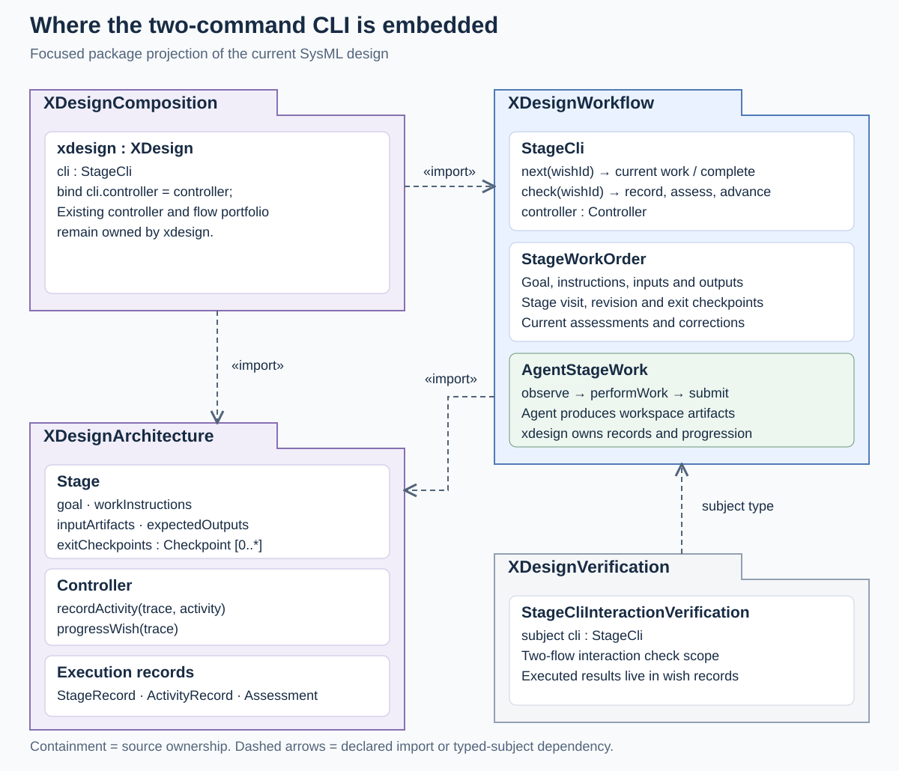
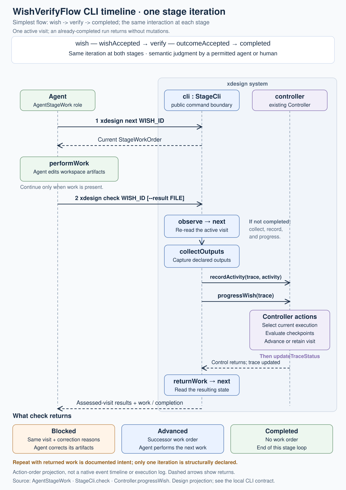
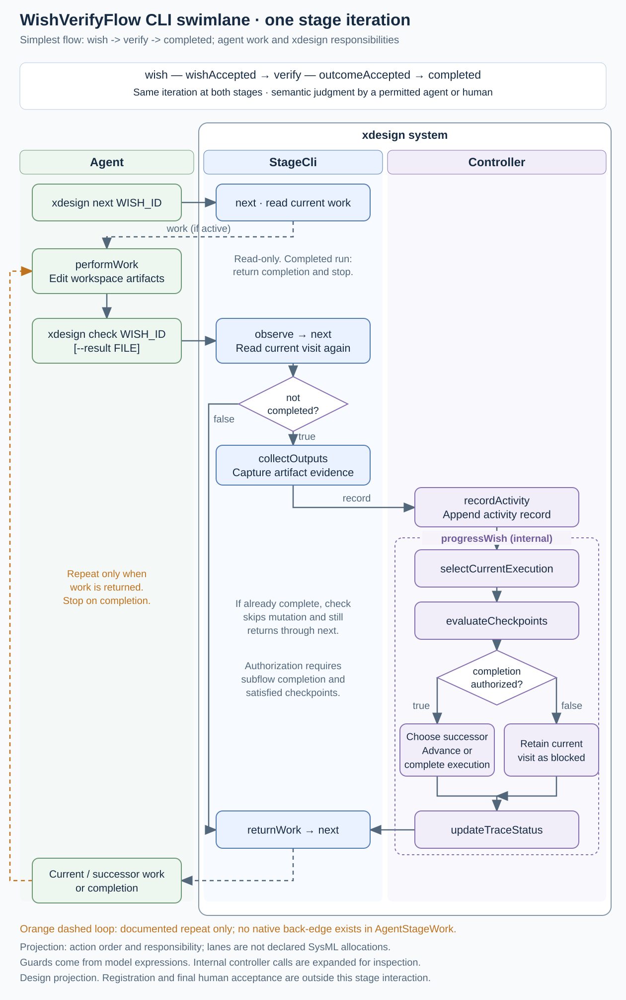

# xdesign

xdesign uses SysML v2 to organize engineering work from a wish to a result supported by
evidence. This page brings the project composition, usage, and three overview diagrams
together. The [documentation map](index.md) leads to the detailed specifications.

<a id="overview-composition"></a>

## 1. Project composition

The project model describes the system being developed. Each wish's trace explains how its
requirements, design, implementation, and verification followed. New runs keep operational
traces in the store; legacy/bootstrap traces remain in SysML. Flows organize the work;
xdesign records evidence and checks whether a stage may advance.

| Part | Responsibility | Location |
| --- | --- | --- |
| Project model | Defines requirements, parts, relationships, and behavior | `mbse/model/` |
| Operational store | Retains new wish/run revisions, materials, evidence and receipts | `.xdesign/`; [storage design](design/storage.md#d86) |
| Legacy/bootstrap wish traces | Retain existing SysML flow, stage, artifact and assessment history | `mbse/wishes/` |
| Execution engine | Records artifact revisions, evaluates gates, and controls advancement | `src/core/` |
| Flow implementations | Supply the four-stage SimpleFlow and two-stage WishVerifyFlow | `src/simple_flow/`, `src/wish_verify/` |
| CLI | Initializes a local run and provides the repeated `next` / `check` interaction | `src/main.rs`, `src/stage_cli/`; [CLI contract](design/stage-cli.md#d85) |
| Documentation and tools | Explain the model and provide checking, rendering, and build tools | `docs/`, `tools/` |
| Portable document contract | Supplies versioned SysML document rules, templates, a shared CLI/MCP authoring tool, and an agent skill | `document-kit/`; [design](design/document-kit.md#d113) |
| Working output | Holds ignored environments, build output, regenerable runtime copies and temporary evidence | `cache/` |

The package diagram shows where the two-command CLI fits. `StageCli` retrieves work and
delegates recording and assessment to the controller. The agent performs the work in the
project workspace.



*Package diagram — [source and detailed explanation](architecture/system-composition.md#b01).
The diagram describes the interaction implemented by the [local CLI](design/stage-cli.md#d85).*

<a id="overview-usage"></a>

## 2. How to use xdesign

Build from the repository root with Rust/Cargo installed:

```bash
mkdir -p cache/tmp
export TMPDIR="$PWD/cache/tmp"
export CARGO_HOME="$PWD/cache/cargo-home"
export CARGO_TARGET_DIR="$PWD/cache/target"
cargo build
```

In the prepared macOS workspace, if Cargo is not on `PATH`, prepend
`$PWD/cache/toolchain/stable-aarch64-apple-darwin/bin`. Cached dependencies support
`cargo build --offline` and `cargo run --offline -- ...`.

Choose a SysML wish source and initialize its local run once. The default source is
`mbse/wishes/WISH_ID.sysml`; `--wish FILE` imports another existing source. New runs retain
revisions in `.xdesign/` and use `cache/wishes/WISH_ID.sysml` as their working copy:

```bash
cargo run -- init WISH_ID --flow simple-flow [--wish FILE]
cargo run -- next WISH_ID
# Perform the work described by the returned stage.
cargo run -- check WISH_ID
```

The repeated interaction is always `next` and `check`. `next` returns the current stage's
goal, instructions, inputs, expected outputs, and exit criteria without changing the stored
run. `check` collects outputs, records their revisions, runs the stage's checks, commits the
revision and returns correction work, the next stage's work, or completion. The response is
JSON, so an agent can continue directly from its returned work order. Later processes restore
the stored head and regenerate missing cache copies; `init` refuses to overwrite a run.

SimpleFlow has four stages: requirements → design → implement → verify. Its first three
stages run fixed checks. Verification requires retained evidence and an explicit agent
or human judgment as well as the fixed record check. Supply these through a result file:

```bash
cargo run -- next WISH_ID
# Review the gate criteria and current artifact snapshot; write the result JSON.
cargo run -- check WISH_ID --result cache/stage-result.json --operation-id OP_ID
```

The [result-file contract and example](design/stage-cli.md#d85) specify identity, state
token, artifact digests, judge, outcome and rationale. Missing judgment blocks the stage
as unevaluated. A stale result is refused before changing the record. Reuse the operation
ID for exact retry and query `store outcome OP_ID` after uncertainty. `store list`, `get`,
`history`, `checkout`, and `doctor` inspect the durable revisions. Stage exit 0 means work
or completion, 1 means a checked stage remains blocked, and 2 means a command error.

Use `--flow wish-verify` at initialization for the simplest two-stage flow shown below;
both stages need semantic judgment. `cargo run -- --help` lists the commands. The earlier
`simple-flow demo` and `wish-verify demo` entry points remain available.

This local CLI supports the two built-in flat plans in this repository. It does not
execute arbitrary or nested flows or record final human acceptance. See
[current status](records/status.md) and [the implementation evidence](records/plans/stage-cli.md#p34).

To build and browse the documentation with Python 3:

```bash
python3 -B tools/docs.py build
python3 -B tools/docs.py serve
```

Open [the local documentation](http://127.0.0.1:8766). Its **Start here → Project overview**
entry displays this page.

<a id="overview-wishverify"></a>

## 3. Simplest WishVerifyFlow: timeline and swimlane

Both diagrams below describe the **simplest two-stage WishVerifyFlow**:

```text
wish -- wishAccepted --> verify -- outcomeAccepted --> completed
```

The example uses the gated `DesignedWishVerifyFlow` specialization. Both gates need a
permitted agent or human's semantic judgment; this flow has no fixed syntactic checker.
A failed, missing, or stale judgment blocks advancement. The base `WishVerifyFlow`
definition leaves `wish` ungated; see the [gate definitions](design/flows/wish-verify/definition.md#d61).

The **timeline** shows the order of one stage iteration: get work, perform it, submit
for checking, and receive the result. The same interaction applies at `wish` and `verify`.



*Timeline — [source and detailed explanation](design/flows/wish-verify/views.md#d84).
An action-order projection of the CLI design, not an executed run or native sequence messages.*

The **swimlane** shows who performs each step: the agent owns workspace work, the CLI
collects the outputs, and the controller records evidence, assesses gates, and advances
or retains the current visit.



*Swimlane — [source and detailed explanation](design/flows/wish-verify/views.md#d84).
Lanes express documented responsibilities. The model declares one iteration; repetition
is documented intent. These diagrams do not establish engineering acceptance.*
