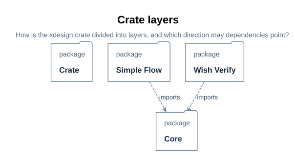

# Crate structure

> Project: xdesign | Status: implemented slice in two layers | Audience:
> application integrators, module owners, and reviewers.

## U68 Crate structure

The `xdesign` crate is divided into two layers, and dependencies point one way:
`simple_flow` may depend on `core`, never the reverse. `core` owns the
flow-agnostic infrastructure — status vocabulary, plan data and structural
validation, records, the check-command and judge trait boundaries, gate
evaluation, the run engine, and generic construction. `simple_flow` owns the
designed four-stage flow built on it: the blueprint as data, blueprint
conformance, the designed-run factory, and the fixed-checker adapter. A second
designed flow becomes another sibling of `simple_flow`, building on `core` the
same way.

> **Figure U68-1 — Crate layers.**
> **Question:** How is the xdesign crate divided into layers, and which direction may dependencies point?
> **Model view:** `XDesignRustUml::rustCrateLayers` (GeneralView projection).
> **Companions:** the module-level layout and class views in [D45–D46](../details/simple_flow/06_rust_uml_design.md#d45).
> **Status:** renderable-now.
> **Reading:** The crate contains `core` and `simpleFlow`; `simpleFlow` depends on `core`; `core` depends on nothing outside itself.
> **Limits:** The figure shows layer and module dependencies, not individual types; class-level relations stay in the module design.

| Layer | API directory | Source module | Group overview |
| --- | --- | --- | --- |
| `core` | [core/](core/00_overview.md#u71) | `src/core/` | [core/00_overview.md](core/00_overview.md#u71) |
| `simple_flow` | [simple_flow/](simple_flow/00_overview.md#u72) | `src/simple_flow/` | [simple_flow/00_overview.md](simple_flow/00_overview.md#u72) |

The source modules land with step 3 of the
[restructure plan](../prj_manage/08_api_layering_restructure_plan.md#p22); the
model's `XDesignRustUml::crate` packages and this directory layout are the
contract they move to.
