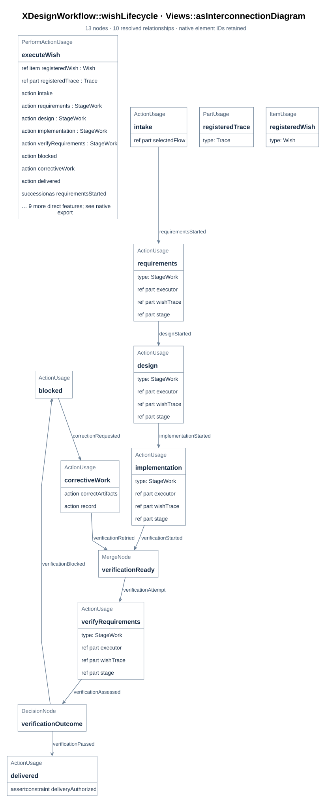

# xdesign — architecture overview

This document explains the architecture after the [documentation entry](../00_index.md).
Each section names the model elements it documents; the model carries the reverse reference
(`XDesignCommon::DocSection`, see [B04](01_system_composition.md#b04)). Every figure is
rendered from the model by `tools/render_docs.py`; none is drawn by hand.

<a id="a01"></a>

## A01 What the project does

xdesign manages engineering development with SysML v2. A requester states a wish; the
model records the wish, the work it causes, and the evidence that answers it. The tool
must answer two questions:

1. What makes up the system being developed, and how do its parts relate and work together?
2. Why did each wish lead to these requirements, designs, implementations and verification results?

The first question is answered by the project MBSE model under `mbse/model/`. The second
by an independent SysML traceability model per wish under `mbse/wishes/`. The composition
that holds both is `XDesignArchitecture::XDesign`.

<a id="a02"></a>

## A02 The three kinds of model

| Model | Lives in | Holds | Changes when |
| --- | --- | --- | --- |
| Project MBSE model | `mbse/model/` | Requirements baseline, architecture, record definitions, workflow definitions and traceability links | The project's own design changes |
| Wish traceability models | `mbse/wishes/wish-<id>.sysml` | One wish, its trace, its stage records, activities and assessments | That wish advances |
| Workflow definitions | inside the project model | `Flow`, `Stage`, `Checkpoint`, `Checker`, `Controller` | The way work is organised changes |

The dependency runs one way. A wish references model elements; no model element names a
wish (`XDesignRequirements::modelStandsWithoutWishes`). A wish's products — the
requirements it produces and the model changes it causes — are retained in `mbse/model/`;
a wish record may describe them but never holds the only copy
(`XDesignRequirements::wishProductsAreRetained`).

<a id="a03"></a>

## A03 How a wish advances



> **Figure A03-1 — Wish lifecycle.**  
> **Question:** How does a wish move from registration to delivery or rework?  
> **Model view:** `XDesignWorkflow::wishLifecycle`, an action-flow projection of `Workflow::executeWish`.  
> **Companions:** [F04](../details/01_flows_and_checkpoints.md#f04) for controller actions and [E03](../details/02_records_and_evidence.md#e03) for revisions.  
> **Status:** renderable-now.  
> **Reading:** Follow the entry, assessment, and advance path to see where the controller records work. A failed gate retains the visit so corrective work can be assessed at a new revision.  
> **Limits:** The figure is a defined workflow, not evidence that a particular wish passed a checkpoint.

Receiving a wish registers the wish and an independent trace, assigns a flow, creates one
stage record per stage of that flow, and enters the flow's initial stage
(`Controller::receiveWish`). Within a stage, work appends activity records
(`Controller::recordActivity`). A stage is left only when its subflow (if any) has
completed and every exit checkpoint passes at the current artifact revision
(`StageRecord::completionAuthorized`). The final stage's checkpoint completes the flow and
delivers the wish. A stage that does not pass stays current, marked blocked, and is
resumable; corrective work raises the artifact revision so the next assessment judges
current artifacts (`Workflow::executeWish`, `Controller::progressWish`).

`WishStatus` names the wish's `received`, `active`, `blocked`, and `delivered` states.
Those literals describe the trace's outcome, distinct from a stage visit's status
([E02](../details/02_records_and_evidence.md#e02)) or a flow execution's status
([E01](../details/02_records_and_evidence.md#e01)).

<a id="a04"></a>

## A04 Repository layout

```text
mbse/
  model/    common.sysml        shared statuses, kinds, metadata (DocSection)
            requirements.sysml  the requirements baseline
            architecture.sysml  flows, checkpoints, records, controller, XDesign
            detailedDesign.sysml  the simple flow's design: run class, factory, functions, checkpoint class, gates
            verification.sysml  planned design-review coverage, separate from results
            workflow.sysml      ports, interfaces and the executed lifecycle scenario
            traceability.sysml  which model element satisfies which requirement
            uml.sysml           SimpleFlow Rust crate and API design projections
  wishes/   wish-0001.sysml …   one independent traceability model per wish
docs/       00_index.md         entry, reading paths and model/flow map
            arch/ requirements/ details/ review/ uml/ prj_manage/  this documentation, by concern
            details/05_documentation_contract.md  model/documentation specification
            details/simple_flow/  one flow's detailed design, decomposed
            uml/simpflow/       SimpleFlow public API contract, one page per API
            arch/assets/ requirements/assets/ details/assets/   figures beside their document topics
            details/simple_flow/assets/   SimpleFlow figures beside their design topics
tools/      sysml_web/          the pinned compiler and the local workbench
            render_docs.py      renders figures into each owning directory's assets/
            check_documentation.py  validates document/model location links
cache/      compiler reports, evidence, render logs, research prototypes (not versioned)
```

The [documentation entry](../00_index.md) gives reading paths, a document map, and a row
for each documented flow. The main modules and developed flow directory below correspond
to different stages of the workflow's V-model (`VModel`, see
[F03](../details/01_flows_and_checkpoints.md#f03)):

| Module | Holds | Corresponds to |
| --- | --- | --- |
| `arch/` | What the project is and how it is composed | `systemArchitecture` |
| `requirements/` | The requirements baseline and its enforcement | `systemRequirements` |
| `details/` | The mechanisms: flows, records, toolchain | `detailedDesign`, `implementation` |
| `details/simple_flow/` | The SimpleFlow design: its run, gates, rules, and coordinated SysML views | `detailedDesign` |
| `uml/` | Software design notation and the SimpleFlow public API contract | `detailedDesign` |
| `prj_manage/` | Review synthesis and implementation plan | Project planning across stages |
| `review/` | How verification is done and where each wish stands | `systemVerification`, `acceptanceValidation` |

The shared architecture and mechanism documents do not assume every wish uses
`SimpleFlow`. A flow with its own developed design can add a sibling under `details/`,
starting with `00_overview.md`, without renumbering or changing the SimpleFlow documents. The entry
adds that flow's purpose, stages, design links, and status. Numbering is per directory and
figures mirror their documents' paths (`docs/AGENTS.md`); the detailed rule is
in [D30](../details/05_documentation_contract.md#d30).

<a id="a05"></a>

## A05 The model at a glance



> **Figure A05-1 — Project model definitions.**  
> **Question:** Which core definitions and specializations make up the project model?  
> **Model view:** Definitions-and-specializations projection of `mbse/model/`.  
> **Companions:** [B01](01_system_composition.md#b01) for owned parts and [F01](../details/01_flows_and_checkpoints.md#f01) for flow vocabulary.  
> **Status:** renderable-now.  
> **Reading:** The graph connects the main flow, record, controller, and system definitions. Specialization edges show where a specific flow or record refines a common type.  
> **Limits:** This broad inventory omits the detailed behavior and interface contracts of each definition.

Rendered from `mbse/model` as a definitions-and-specializations diagram: `Flow` and its
specializations, the record definitions, `Controller`, and `XDesign`.

<a id="a06"></a>

## A06 Documentation map

Where each model module and sub-module is documented. Section identifiers are stable;
`document + section` is the reference form the model itself carries.

| Model element | Documented in |
| --- | --- |
| `XDesignCommon` | [F02](../details/01_flows_and_checkpoints.md#f02) |
| `XDesignCommon::WishStatus` | [A03](#a03) |
| `XDesignCommon::StageStatus` | [E02](../details/02_records_and_evidence.md#e02) |
| `XDesignCommon::FlowStatus` | [E01](../details/02_records_and_evidence.md#e01) |
| `XDesignCommon::CheckpointOutcome` | [E04](../details/02_records_and_evidence.md#e04) |
| `XDesignCommon::CheckKind`, `JudgeAuthority`, `ConformanceKind` | [F02](../details/01_flows_and_checkpoints.md#f02) |
| `XDesignCommon::DocSection` | [D27](../details/05_documentation_contract.md#d27) |
| `XDesignCommon::DocFigure` | [D28](../details/05_documentation_contract.md#d28) |
| SysML view/viewpoint to document figure contract | [D29](../details/05_documentation_contract.md#d29) |
| `DocumentationViewpoint` and the nine SimpleFlow concern usages | [D29](../details/05_documentation_contract.md#d29), [D12](../details/simple_flow/04_sysml_diagrams.md#d12) |
| Documentation set and per-flow growth | [D30](../details/05_documentation_contract.md#d30) |
| Documentation audit and SimpleFlow checker rules | [D31](../details/05_documentation_contract.md#d31), [D06](../details/simple_flow/02_gates_and_rules.md#d06) |
| `XDesignRequirements`, `XDesignRequirement`, every requirement | [R01](../requirements/01_baseline.md#r01) |
| `XDesignTraceability` | [R02](../requirements/01_baseline.md#r02) |
| `SimpleFlowRustUml` and its crate and API elements | [D44](../details/simple_flow/06_rust_uml_design.md#d44), [U13](../uml/simpflow/00_overview.md#u13) |
| `RustUmlDesignReview` | [D52](../details/simple_flow/06_rust_uml_design.md#d52) |
| `simpleFlowFilePlan`, `simpleFlowFilePlanView` | [D53](../details/simple_flow/07_file_plan_and_verification.md#d53) |
| `SimpleFlowGateBehaviorVerification`, `SimpleFlowRecoveryVerification`, `SimpleFlowFilePlanVerification` | [D54](../details/simple_flow/07_file_plan_and_verification.md#d54) |
| `XDesignArchitecture` | [A05](#a05), [B05](02_design.md#b05) |
| `Flow`, `Stage` | [F01](../details/01_flows_and_checkpoints.md#f01) |
| `Checkpoint`, `Checker` | [F02](../details/01_flows_and_checkpoints.md#f02) |
| `CheckerRule` | [D06](../details/simple_flow/02_gates_and_rules.md#d06) |
| `VModel`, `SimpleFlow`, `WishVerifyFlow`, `DesignFlow`, `simpleFlow`, `wishVerifyFlow`, `designFlow` | [F03](../details/01_flows_and_checkpoints.md#f03) |
| `sysmlDeliverableAccepted`, `sysmlCompilerCheck` | [F03](../details/01_flows_and_checkpoints.md#f03) |
| `nestedFlowExample` | [F05](../details/01_flows_and_checkpoints.md#f05) |
| `Wish`, `Trace` | [E01](../details/02_records_and_evidence.md#e01) |
| `FlowExecution`, `ActivityRecord` | [E02](../details/02_records_and_evidence.md#e02) |
| `StageRecord` | [E03](../details/02_records_and_evidence.md#e03) |
| `CheckpointAssessment` | [E04](../details/02_records_and_evidence.md#e04) |
| `Controller` | [F04](../details/01_flows_and_checkpoints.md#f04) |
| `XDesignDetailedDesign`, `designedSimpleFlow` | [D01](../details/simple_flow/01_run_design.md#d01), [D32](../details/simple_flow/05_module_design.md#d32) |
| `SimpleFlowRun` | [D02](../details/simple_flow/01_run_design.md#d02) |
| `SimpleFlowRunFactory` | [D03](../details/simple_flow/01_run_design.md#d03) |
| `EvaluateSimpleFlowGate`, `AdvanceSimpleFlowRun` | [D04](../details/simple_flow/01_run_design.md#d04) |
| `SimpleFlowCheckpoint`, `SimpleFlowSyntacticCheckpoint`, `SimpleFlowSemanticCheckpoint` | [D11](../details/simple_flow/02_gates_and_rules.md#d11) |
| `EvaluateSimpleFlowCheckpoint`, `RunSyntacticCheck`, `TakeSemanticJudgment` | [D11](../details/simple_flow/02_gates_and_rules.md#d11) |
| The designed flow's gates, their class and documented rules | [D05](../details/simple_flow/02_gates_and_rules.md#d05), [D06](../details/simple_flow/02_gates_and_rules.md#d06), [D11](../details/simple_flow/02_gates_and_rules.md#d11) |
| The designed flow's implemented local checks and declared rule contract | [D06](../details/simple_flow/02_gates_and_rules.md#d06), [D07](../details/simple_flow/02_gates_and_rules.md#d07) |
| `SimpleFlowRunTimeline` | [D08](../details/simple_flow/03_structure_graphs.md#d08) |
| The nine coordinated SysML views | [D12](../details/simple_flow/04_sysml_diagrams.md#d12) |
| `DiagramDocumentationRenderer` | [D22](../details/04_diagram_presentation.md#d22) |
| `DiagramPresentation` | [D23](../details/04_diagram_presentation.md#d23) |
| `DiagramPresentationReview` | [D25](../details/04_diagram_presentation.md#d25) |
| `DocumentationContractReview` | [V07](../review/01_wish_status.md#v07) |
| `blockDefinitionDiagram`, `internalBlockDiagram` | [D13](../details/simple_flow/05_module_design.md#d13), [D14](../details/simple_flow/05_module_design.md#d14) |
| `requirementsDiagram`, `XDesignVerification`, `SimpleFlowViewReview` | [D15](../requirements/01_baseline.md#d15) |
| `parametricDiagram`, `GateAuthorization`, `SimpleFlowAuthorization` | [D16](../details/simple_flow/05_module_design.md#d16) |
| `useCaseDiagram`, `ProgressWish`, `ReviewEvidence`, `progressWish`, `reviewEvidence` | [D17](../requirements/01_baseline.md#d17) |
| `activityDiagram`, `sequenceDiagram` | [D18](../details/simple_flow/05_module_design.md#d18), [D19](../details/simple_flow/05_module_design.md#d19) |
| `stateMachineDiagram`, `SimpleFlowRunLifecycle` | [D20](../details/simple_flow/05_module_design.md#d20) |
| `packageDiagram` | [D21](02_design.md#d21) |
| `projectPackageIntegration` | [D21](02_design.md#d21) |
| `CheckCommandExchange`, `JudgmentExchange`, their interfaces, `CheckerCommand`, `Judge`, `SimpleFlowAutomation` | [D10](../details/simple_flow/03_structure_graphs.md#d10) |
| `XDesign`, `xdesign` | [B01](01_system_composition.md#b01) |
| `recordStructure` (view) | [T03](../details/03_toolchain.md#t03) |
| `XDesignWorkflow` | [B02](01_system_composition.md#b02), [I01](../icd/01_interfaces.md#i01) |
| `WishExchange`, `FlowExchange`, `WishInterface`, `FlowInterface`, `WishRequester`, `WorkflowFlow`, `WorkflowController`, `Workflow` | [B02](01_system_composition.md#b02) |
| `StageWork` | [F04](../details/01_flows_and_checkpoints.md#f04) |
| `workflow` (usage) | [E06](../details/02_records_and_evidence.md#e06) |
| `wishLifecycle`, `workflowInterfaces` (views) | [T03](../details/03_toolchain.md#t03) |
| `mbse/wishes/wish-0001.sysml` … `wish-0003.sysml` | [V02](../review/01_wish_status.md#v02) |
| `mbse/wishes/wish-0004.sysml` | [V04](../review/01_wish_status.md#v04) |
| `mbse/wishes/wish-0005.sysml` | [V03](../review/01_wish_status.md#v03) |
| `mbse/wishes/wish-0006.sysml` | [V05](../review/01_wish_status.md#v05) |
| `mbse/wishes/wish-0007.sysml` | [V06](../review/01_wish_status.md#v06) |
| `mbse/wishes/wish-0008.sysml` | [V07](../review/01_wish_status.md#v07) |
| `mbse/wishes/wish-0009.sysml` | [V16](../review/01_wish_status.md#v16) |
| `designedFlowTree` (view) | [D01](../details/simple_flow/01_run_design.md#d01) |
| `designTree` (view) | [D02](../details/simple_flow/01_run_design.md#d02) |
| `factoryFlow` (view) | [D03](../details/simple_flow/01_run_design.md#d03) |
| `gateEvaluationFlow` (view) | [D04](../details/simple_flow/01_run_design.md#d04) |
| `checkpointEvaluationFlow` (view) | [D11](../details/simple_flow/02_gates_and_rules.md#d11) |
| `interfaceStructure` (view) | [D10](../details/simple_flow/03_structure_graphs.md#d10) |
| `tools/sysml_web/`, `tools/render_docs.py` | [T01](../details/03_toolchain.md#t01) |
