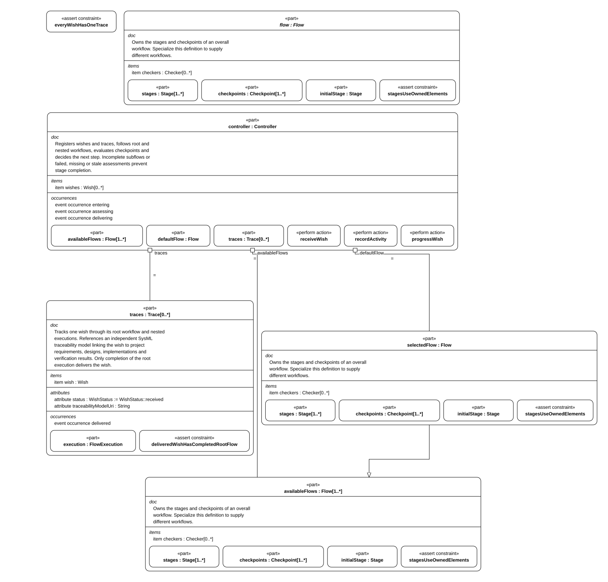
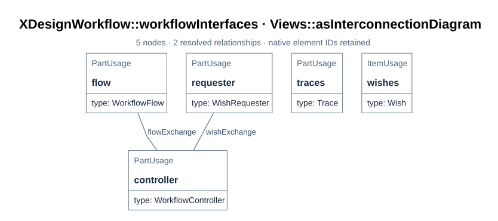

# System composition

How the tool itself is composed: its parts, the interfaces between them, what is owned,
and how the model points at this documentation.

<a id="b01"></a>

## B01 The composition



> **Figure B01-1 — System composition.**  
> **Question:** Which parts does `XDesign` own and bind?  
> **Model view:** Internal-structure projection of `XDesignArchitecture::XDesign`.  
> **Companions:** [B02](#b02) for typed interfaces and [E01](../details/02_records_and_evidence.md#e01) for record definitions.  
> **Status:** renderable-now.  
> **Reading:** The flow, controller, wishes, and traces are parts of one composition. Their bindings give the controller its default flow and the records it manages.  
> **Limits:** Ownership and bindings do not show a run's stage order or prove its delivery invariants.

`XDesignArchitecture::XDesign` composes four parts and binds them:

| Part | Type | Role |
| --- | --- | --- |
| `'flow'` | `VModel` (redefined in `xdesign`) | The stages and checkpoints every wish is run through by default |
| `controller` | `Controller` | Registers wishes and traces, records activities, evaluates checkpoints, advances or blocks. `Workflow` redefines this part as `WorkflowController` |
| `wishes` | `Wish [0..*]` | The requested outcomes |
| `traces` | `Trace [0..*]` | One execution record per wish |

Bindings: `controller.defaultFlow = 'flow'`, `controller.wishes = wishes`,
`controller.traces = traces`. One assertion holds the composition together:
`XDesign::everyWishHasOneTrace` — every wish has exactly one trace, and every trace
belongs to a wish.

<a id="b02"></a>

## B02 Interfaces



> **Figure B02-1 — Workflow interfaces.**  
> **Question:** What crosses the requester, controller, and flow boundaries?  
> **Model view:** `XDesignWorkflow::workflowInterfaces`, an interconnection view of `Workflow`.  
> **Companions:** [B01](#b01) for composition and [F04](../details/01_flows_and_checkpoints.md#f04) for controller actions.  
> **Status:** renderable-now.  
> **Reading:** The wish interface carries a submission in and registered wish and trace references out. The flow interface supplies the selected flow definition to the controller.  
> **Limits:** The figure defines connections and item flows, not message timing or a particular wish's result.

`XDesignWorkflow::Workflow` adds the requester and the typed interfaces:

| Interface | Connected ports | Flows |
| --- | --- | --- |
| `WishInterface` | `requester.wishPort` ↔ `controller.wishPort` | `submission` (the description), `wishRegistration` (the registered `Wish`), `traceRegistration` (the registered `Trace`) |
| `FlowInterface` | `'flow'.flowPort` → `controller.flowPort` | `flowDefinition` (the selected `Flow`) |

The port directions say who owns what: `WishExchange` takes a description in and returns
the wish and its trace out; `FlowExchange` publishes a flow definition. Wishes and traces
stay owned by the workflow; the requester receives references through its port.

<a id="b03"></a>

## B03 Ownership and delivery invariants

Four rules hold regardless of which flow a wish runs:

- A wish's execution records every stage of its assigned flow, and no others
  (`FlowExecution::recordsEveryFlowStage`, `recordsUseAssignedFlow`).
- A completed stage is authorized: its subflow, if any, completed, and every exit
  checkpoint passed at the current artifact revision (`StageRecord::completedStageIsAuthorized`).
- A completed flow has an authorized terminal stage
  (`FlowExecution::completedFlowHasAuthorizedTerminalStage`).
- Only completion of the root flow delivers the wish
  (`Trace::deliveredWishHasCompletedRootFlow`).

Two requirements state which side of the boundary model content sits on:
`wishProductsAreRetained` (products live in the model, [R01](../requirements/01_baseline.md#r01))
and `modelStandsWithoutWishes` (the model never names a wish).

<a id="b04"></a>

## B04 Documentation locations in the model

`XDesignCommon::DocSection` is the metadata every module and sub-module carries. An
annotation sits inside the element it belongs to — metadata application annotates the
enclosing element, not the next one:

```sysml
// mbse/model/common.sysml
metadata def DocSection {
    attribute document : String;
    attribute section : String;
}

// mbse/model/architecture.sysml
part def XDesign {
    @XDesignCommon::DocSection { document = "docs/arch/01_system_composition.md"; section = "B01"; }
    …
}
```

`document` is the repository-relative file, `section` the stable identifier of the
specific section — never a whole document. The map in [A06](00_overview.md#a06) reads the
relationship in reverse. [D27](../details/05_documentation_contract.md#d27) specifies
how those exact targets resolve.

`XDesignCommon::DocFigure` is its companion for figures: it names the carrying document
and the rendered asset in the carrying document's `assets/` directory. It is applied to the detailed design's nine
SysML views ([D12](../details/simple_flow/04_sysml_diagrams.md#d12)), earlier structure
graphs ([D09](../details/simple_flow/03_structure_graphs.md#d09)), and checkpoint
evaluation figure ([D11](../details/simple_flow/02_gates_and_rules.md#d11)). The view's
selection and question, the renderer's projection, and the explanatory block in the
carrying section have distinct roles ([D28–D29](../details/05_documentation_contract.md#d28)).

`python3 tools/check_documentation.py --json` checks resolvable paths and anchors,
embedded assets, and the adjacent figure blocks. It does not decide whether a selected
view or its explanation is an engineering-correct reading of the model; that remains a
review judgment. Compiler parse/check establishes SysML syntax and supported name
resolution separately ([T04](../details/03_toolchain.md#t04)). The earlier
`simple_flow_design.py` prototype remains research under `cache/research/checks/`.
