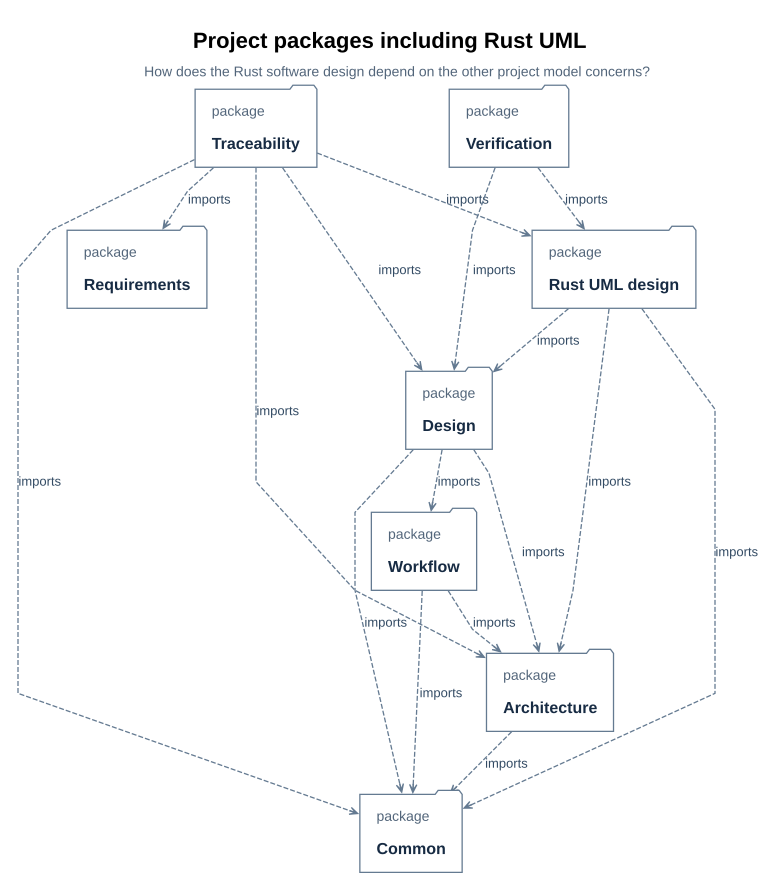
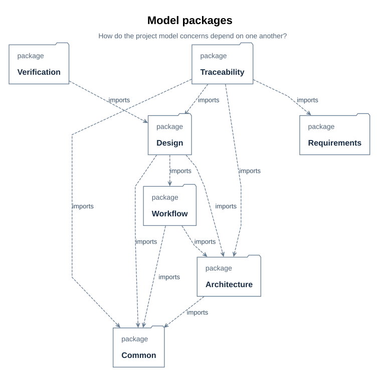

# System architecture design

> Project: xdesign | Version: working draft, 19 October 2026 | Status: working design;
> no allocated baseline or PDR review | Audience: wish owners, architects, module owners,
> integrators, and reviewers.
>
> Basis: [requirements inventory](../requirements/01_baseline.md#r01),
> [system composition](01_system_composition.md#b01), and
> `mbse/model/architecture.sysml`. This document follows the architecture-stage topics
> in `cache/templates/docs/architecture/00_design.md`. A template topic is included even
> when the project has not yet made or verified the associated decision.

| Version | Date | Change | Review |
| --- | --- | --- | --- |
| Working draft | 19 October 2026 | Collected the current architecture decisions, interfaces, open allocations, and PDR gaps | No PDR recorded |

## B05 Introduction and constraints

This is the architecture of the xdesign tool, not of a system that an xdesign user might
develop. Its modeled boundary comprises the workflow definition, controller, wishes, and
their independent traces. Its current repository also contains the SysML model, documents,
renderer, compiler integration, and a stand-alone documentation audit. A complete workflow
application has not been implemented ([R03](../requirements/01_baseline.md#r03)).

### B06 Goals and scope

The architecture must make both system composition and the reason for each wish's outcome
inspectable. The project model states reusable requirements, structure, workflows, and
constraints; one trace per wish records selected flow, visits, assessments, evidence, and
the path to delivery. The requirements inventory and satisfaction links are in
[R01–R02](../requirements/01_baseline.md#r01). This design specifies those logical
responsibilities and their model-level interfaces. Deployment, durable storage, external
service APIs, and production operations remain to be designed.

### B07 Terminology

| Term | Meaning in this architecture |
| --- | --- |
| Project model | Wish-independent SysML definitions and requirements in `mbse/model/`. |
| Wish trace | One wish's independent SysML execution and rationale record in `mbse/wishes/`. |
| Flow definition | Reusable plan of stages and checkpoints; it is distinct from a `FlowExecution`. |
| Stage visit | One `StageRecord` for an attempt at a stage; rework appends another visit. |
| Current assessment | The latest assessment per checkpoint for a visit, selected independently of revision; it authorizes progress only when its evaluated revision equals the visit's artifact revision and its outcome passed ([E02–E03](../details/02_records_and_evidence.md#e02)). |
| Syntactic checkpoint | Gate judged by a fixed checker and its reported evidence. |
| Semantic checkpoint | Gate judged by a permitted agent or human with rationale and evidence. |
| PDR | Preliminary design review of an allocated architecture baseline; no such review is recorded. |

The record definitions and revision semantics are specified in
[E01–E04](../details/02_records_and_evidence.md#e01).

### B08 Architecture constraints

| Constraint | Architectural effect | Source |
| --- | --- | --- |
| The project model must resolve without wish files | Reusable definitions may be referenced by wishes, but may not depend on their identities | [A02](00_overview.md#a02), `modelStandsWithoutWishes` |
| Wish products must remain in the project model | A wish trace records provenance but cannot be the only copy of a requirement or design change | [A02](00_overview.md#a02), `wishProductsAreRetained` |
| Completion requires current evidence | Every exit checkpoint must pass at the visit's artifact revision; a subflow must finish before its parent stage | [B03](01_system_composition.md#b03), [E03](../details/02_records_and_evidence.md#e03) |
| Syntactic and semantic judgments have different authorities | The former uses declared checkers and script evidence; the latter names permitted judges | [F02](../details/01_flows_and_checkpoints.md#f02) |
| SysML checking uses the pinned local compiler | Model edits receive `parse` and `check` reports; unevaluated constraint bodies remain engineering obligations | [T01](../details/03_toolchain.md#t01), [T04](../details/03_toolchain.md#t04) |

No architecture-level cost, schedule, latency, availability, or hosting constraint has
been baselined. The repository's documentation and `cache/` conventions constrain this
design's artifacts; they do not select a runtime platform.

### B09 Stakeholder concerns

| Stakeholder | Concern | Addressed in |
| --- | --- | --- |
| Wish requester | A submitted wish keeps an inspectable outcome and trace | [B11](#b11), [A03](00_overview.md#a03) |
| Model author | Reusable model content remains separate from each wish's record | [B13](#b13), [A02](00_overview.md#a02) |
| Reviewer or judge | Current evidence, criteria, and authority are visible before advancement | [B14](#b14), [E04](../details/02_records_and_evidence.md#e04) |
| Implementer | Parts, interfaces, and unresolved choices are distinguishable | [B13](#b13), [B26](#b26) |
| Verifier | Requirement links and planned verification can be inspected without treating a declared test as a pass | [R02](../requirements/01_baseline.md#r02), [B28](#b28) |

### B10 Architecture drivers

The leading drivers are traceability of each wish, independence of reusable model
content, authorization at the current artifact revision, and a repeatable split between
fixed checks and engineering judgment. They produced the `XDesign` composition, the
`Trace`/`FlowExecution`/`StageRecord` record hierarchy, and the `Checkpoint`/`Checker`
split. Documentation readability and model/document locators later shaped the view and
metadata contract ([D27–D31](../details/05_documentation_contract.md#d27)). The project
has not assigned numerical priorities or weights to these drivers.

## B11 System context and boundary

The human requester is an external actor. The model represents that role with a
`WishRequester` part inside the `Workflow` composition and connects its port to the
controller through `XDesignWorkflow::WishInterface`. That interface carries a submission
toward the controller and returns references to the registered wish and trace. The
composition's selected `Flow` is supplied through `FlowInterface`; the controller uses
it to create the execution plan. The typed context and directions are visible in the
[workflow interface figure](01_system_composition.md#b02). The
[wish lifecycle figure](00_overview.md#a03) shows what happens after registration.

| Participant or dependency | Boundary exchange | Current specification |
| --- | --- | --- |
| Human requester, represented by the `WishRequester` part | Description in; registered `Wish` and `Trace` references out | Native `WishExchange` ports and `WishInterface` |
| Selected flow definition | `Flow` reference into the controller | Native `FlowExchange` and `FlowInterface`; flow is part of the modeled composition |
| Checker process or semantic judge | Artifacts and criteria out; report or rationale and evidence in | Generic checkpoint contract; designed SimpleFlow ports in [D10](../details/simple_flow/03_structure_graphs.md#d10) |
| Local compiler and repository files | Model sources in; parse/check reports and documentation assets out | Development toolchain in [T01](../details/03_toolchain.md#t01), not an application deployment interface |

The current context model identifies information crossing typed ports. It does not
establish a network boundary, user identity protocol, external service, transport, or
operational trust boundary.

## B12 Architecture design

The architecture defines a logical composition and a revision-aware progression rule.
The detailed SimpleFlow design refines that composition for one selected flow; it does
not turn every flow into the same implementation. The subsections below separate modeled
structure and behavior from open physical, data, and security choices.

### B13 Logical structure, interfaces, and model organization

`XDesign` owns a flow, controller, wishes, and traces and binds the controller to the
flow and collections. Its one-trace-per-wish assertion states the central ownership
invariant. The [composition figure and part table](01_system_composition.md#b01) show
this structure; the [interface figure](01_system_composition.md#b02) shows the two
typed exchanges and their item directions. `Stage`, `Checkpoint`, and `Checker` belong
to reusable flow definitions; `FlowExecution`, `StageRecord`, `ActivityRecord`, and
`CheckpointAssessment` record one wish's use of them ([F01](../details/01_flows_and_checkpoints.md#f01),
[E01](../details/02_records_and_evidence.md#e01)).

| Interface | From → to | Content and direction | Medium or protocol | Draft ICD |
| --- | --- | --- | --- | --- |
| `WishInterface` (IF-001) | Requester ↔ controller | Submission in; registered wish and trace references out | SysML typed port; runtime transport undecided | [I02](../icd/01_interfaces.md#i02) |
| `FlowInterface` (IF-002) | Selected flow → controller | Flow definition into controller | SysML typed port; runtime transport undecided | [I03](../icd/01_interfaces.md#i03) |
| `CheckCommandInterface` (IF-003) | Designed run ↔ checker command | Command request and result for a syntactic gate | Detailed-design interface; runtime protocol undecided | [I04](../icd/01_interfaces.md#i04) |
| `JudgmentInterface` (IF-004) | Designed run ↔ judge | Criteria/evidence and semantic outcome | Detailed-design interface; runtime protocol undecided | [I05](../icd/01_interfaces.md#i05) |

All four IF identifiers already designate draft, modeled interfaces; they are document
inventory IDs, not production interface versions. Their directions and item types are
specified in the model and [ICD](../icd/01_interfaces.md#i01). Runtime payload schemas,
failure and timing behavior, contract owners, review authorities, criticality ratings,
and a frozen ICD baseline remain open. Package organization is modeled by
`SimpleFlowRustUml::projectPackageIntegration`; its documentation
belongs here because dependency direction is an architecture concern.

#### D21 Packages: model organization and dependency direction

> **Figure D21-1 — Project packages.**  
> **Question:** How is the selected project model organized, and which packages depend on others?  
> **Model view:** `SimpleFlowRustUml::projectPackageIntegration`, a package-dependency projection.  
> **Companions:** [D13](../details/simple_flow/05_module_design.md#d13) for types and [D15](../requirements/01_baseline.md#d15) for requirement relationships.  
> **Status:** renderable-now; design reviewed.  
> **Reading:** Eight project packages, including the Rust UML design, appear within the selected model boundary. Dependency arrows describe model organization and the direction in which changes may have effects.  
> **Limits:** Package dependencies are neither runtime messages nor an executed verification result.

`projectPackageIntegration` selects the project packages used by the simple-flow design. Common
definitions provide the shared vocabulary; requirements declare obligations; architecture
defines the system and generic flow; workflow assembles the workflow; detailed design
refines the simple flow; traceability links satisfiers; verification declares planned
verification cases; and Rust UML maps the software design back to the detailed design.
The selected package boundary contains these eight project packages.
The separate wish package consumes the project model to record derivation and delivery;
it is outside this view's selected project-model boundary.

> **Figure D21-2 — SimpleFlow package selection.**  
> **Question:** Which project packages does the nine-view SimpleFlow design select for its architecture concern?  
> **Model view:** `XDesignDetailedDesign::packageDiagram`, the original SimpleFlow package view.  
> **Companions:** [Figure D21-1](#d21) adds the Rust UML package to show its whole-project integration; [D12](../details/simple_flow/04_sysml_diagrams.md#d12) records the nine-view coverage.  
> **Status:** renderable-now; retained as the SimpleFlow package concern.  
> **Reading:** The seven packages used by the original detailed-design view remain visible, while D21-1 includes the software design package that realizes them.  
> **Limits:** A package arrow indicates a model dependency, not a runtime call or an approval.

Package symbols and short captions distinguish the eight selected packages. Their full
qualified names remain in the source details. Package arrows represent the model's imports
and dependencies. They organize model
elements and identify what changes may affect another package. They do not represent run
messages, application deployment, or product decomposition. In particular, the project
model stands independently of wish identifiers; the wish trace depends on the project
model ([A02](00_overview.md#a02)).

Review this organization together with the types in [D13](../details/simple_flow/05_module_design.md#d13) and the satisfaction and
verification relations in [D15](../requirements/01_baseline.md#d15). Adding a package arrow alone does not establish an
engineering requirement or verification result.

### B14 Runtime behavior

`Controller::receiveWish` registers the wish and trace, selects a flow, makes planned
stage records, and enters the initial stage. `recordActivity` appends work at the active
visit and raises its revision when artifacts change. `progressWish` assesses current
exit checkpoints, advances only if each passes for that revision and any subflow is
complete, or retains the stage as blocked for corrective work. The
[lifecycle figure](00_overview.md#a03), [controller figure](../details/01_flows_and_checkpoints.md#f04),
and [rework account](../details/01_flows_and_checkpoints.md#f05) give the complete
modeled path.

The selectable flows have different stage and gate sets ([F03](../details/01_flows_and_checkpoints.md#f03)).
For `designedSimpleFlow`, the [activity](../details/simple_flow/05_module_design.md#d18),
[sequence](../details/simple_flow/05_module_design.md#d19), and
[state](../details/simple_flow/05_module_design.md#d20) views refine evaluation,
creation, blocked status, and rework. Concurrency, scheduling, timeout behavior,
retry limits, and failure recovery outside the modeled blocked/rework path have no
architecture decision or verified runtime result.

### B15 Physical and deployment view

No physical node, process boundary, network, deployment artifact, or logical-to-physical
allocation has been selected. Development commands run locally from the repository
([T01](../details/03_toolchain.md#t01)); that fact is not a deployed product
architecture. A deployment view would need execution nodes, the location of model and
evidence storage, component allocation, protocols, operational capacity assumptions,
and failure boundaries. There is no deployment figure or capacity claim to review yet.

### B16 Data view

The logical information model consists of `Wish` identity and description; `Trace`
status, model URI, and root execution; `FlowExecution` and its stage visits; and
revisioned activities and checkpoint assessments ([E01–E04](../details/02_records_and_evidence.md#e01)).
The reference from a trace to its wish and the requirement that every wish has exactly
one trace define logical cardinality. Evidence URIs refer to artifacts retained in the
current repository workflow; [E04](../details/02_records_and_evidence.md#e04)
explains the record semantics.

No production database, schema or keys beyond modeled identities, retention period,
backup policy, migration method, or data-quality service has been chosen. The model is a
logical data contract, not an ER design or proof of durable storage. Any physical data
design must preserve visit history, assessment revision, and evidence references.

### B17 Security view

`agentMayJudge` and `humanMayJudge` constrain who *may provide an assessment* in the
model ([F02](../details/01_flows_and_checkpoints.md#f02)); they do not authenticate an
actor or authorize access to files. The project has not specified identity providers,
roles and permissions, trust boundaries, encryption, secret handling, audit retention,
or threat scenarios. The existing trace records an assessor and evidence URI, but does
not establish a tamper-resistant audit log. Security design and verification remain
open before any shared or networked deployment.

## B18 Function–concept–form and concept selection

The current model gives a traceable partial mapping from purpose to form. It does not
contain a completed architecture trade study, so the existing design is described here
without a numerical selection score.

### B19 Function decomposition

| Solution-neutral function | Input → output | Modeled refinement |
| --- | --- | --- |
| Register a requested outcome | Description and selected flow → wish, trace, initial execution | `Controller::receiveWish` |
| Preserve work and evidence | Current visit and artifact changes → activity, revision, assessment history | `Controller::recordActivity`, `StageRecord` |
| Decide whether work may advance | Stage, current artifacts, checkpoint criteria → authorized next step or blocked visit | `Controller::progressWish`, `Checkpoint` |
| Explain system and wish rationale | Reusable model and per-wish history → linked documentation and trace | `DocSection`, `DocFigure`, independent wish model |

The [flow and controller descriptions](../details/01_flows_and_checkpoints.md#f01)
give the native decomposition. The system does not yet model service performance or
parallel scheduling requirements for these functions.

### B20 Concepts and working principles

The recorded working principle is a reusable project model plus an independent trace for
each wish, advanced through a selected flow by checkpoint assessments at an artifact
revision. Syntactic criteria use fixed commands; semantic criteria use accountable
judgment. This principle explains the `Flow`/`FlowExecution` and
`Checkpoint`/`CheckpointAssessment` separations. `VModel`, `SimpleFlow`, `WishVerifyFlow`,
and `DesignFlow` are selectable workflow forms for different outcomes
([F03](../details/01_flows_and_checkpoints.md#f03)); they are not scored candidate
architectures. No alternative storage, orchestration, or deployment concepts have
been compared in a recorded selection study.

### B21 Form and allocation

| Function | Working principle | Form that carries it | Derived obligation |
| --- | --- | --- | --- |
| Register and assign | One wish, one trace, selected flow | `XDesign`, `Controller`, `Trace` | `modelStandsWithoutWishes`, `wishProductsAreRetained` ([R01](../requirements/01_baseline.md#r01)) |
| Record and revisit | Append visits and assess the current revision | `FlowExecution`, `StageRecord`, `CheckpointAssessment` | `runRecordIsScriptChecked` is exercised for the new SimpleFlow JSON run; VModel and historical SysML records remain outside this checker ([R03](../requirements/01_baseline.md#r03)) |
| Gate progress | Fixed syntactic check or permitted semantic judgment | `Checkpoint`, `Checker`, `CheckerRule`; SimpleFlow checkpoint design | `checkpointKindIsDeclared`, `syntacticCheckIsFixed`, `checkerRulesAreDeclared` ([R01](../requirements/01_baseline.md#r01)) |
| Present and locate design | Native views plus model/document metadata | `DocSection`, `DocFigure`, renderer, documentation audit | `figuresStayWithDesignExplanation`, `modelDocumentationLinksResolve` ([D31](../details/05_documentation_contract.md#d31)) |

This is a design allocation table, not evidence that the application functions have
executed. The satisfaction and planned verification links are in
[R02](../requirements/01_baseline.md#r02).

### B22 Design variables and derived requirements

The model fixes some variable domains: `selectedFlow` chooses a defined flow usage;
`Checkpoint::kind` is syntactic or semantic; stages own successors and exit checkpoints;
`artifactRevision` identifies the assessed artifact state. The requirements in
[R01](../requirements/01_baseline.md#r01) derive obligations from these decisions,
including a current-revision assessment, retained wish products, and declared checker
rules. No numeric ranges for capacity, throughput, latency, storage size, or reliability
have been set. Those values cannot be inferred from the SysML type declarations.

### B23 Candidate generation and selection

The repository records no morphological matrix, screening criteria, weighted trade
study, Pareto comparison, or rejected-concept rationale for the architecture as a whole.
The existing flow variants are defined because different wishes need different stage
sets, but their presence does not prove an architecture-wide trade study. A PDR-ready
selection record would compare candidate working principles against agreed criteria,
record infeasible combinations, and identify the chosen configuration and residual
risks. That record is an open item, not a retrospective score assigned here.

## B24 Key technical decisions and ADR index

| Current decision | Evidence of chosen form | Alternatives and ADR status |
| --- | --- | --- |
| Keep reusable model content independent of wish records | [A02](00_overview.md#a02), `modelStandsWithoutWishes` | No ADR or recorded candidate comparison |
| Gate each stage exit using current-revision assessments | [B03](01_system_composition.md#b03), [E03](../details/02_records_and_evidence.md#e03) | No ADR or quantified trade-off |
| Route syntactic checks and semantic judgments separately | [F02](../details/01_flows_and_checkpoints.md#f02) | No ADR; four SimpleFlow commands execute, while VModel checker implementations remain open |
| Present model-derived figures with source and document locators | [D27–D31](../details/05_documentation_contract.md#d27) | Design and audit exist; no architecture ADR |

The table indexes choices visible in the model. It is not an ADR collection and does not
claim that alternatives were formally rejected.

## B25 Quality attribute design

| Attribute | Current target or invariant | Design means | Verification and margin |
| --- | --- | --- | --- |
| Trace integrity | Exactly one trace per wish; completed visits and delivery require authorization | `XDesign`, `StageRecord`, `FlowExecution`, `Trace` constraints | SysML declarations and historical assessments exist; compiler does not evaluate constraint bodies. No measured margin ([B03](01_system_composition.md#b03)) |
| Model/document consistency | Every modeled locator resolves and every declared figure has a local explanation | `DocSection`, `DocFigure`, documentation audit | Stand-alone audit rerun for wish-0008 revision 4 after asset placement; semantic agreement remains a review judgment ([V07](../review/01_wish_status.md#v07)) |
| Primary diagram readability | Nine SimpleFlow figures: at least 11 CSS-pixel text at 900-pixel article width, with no clipped labels or ambiguous overlaps | Model-owned presentation metadata and diagram-specific renderer | Final-figure review for wish-0007 revision 1; this is limited to nine primary figures ([V06](../review/01_wish_status.md#v06)) |
| Reproducible model checking | Pinned compiler reports parsing and supported name/rule checks | Bundled `sysml` executable and retained reports | Parse/check evidence exists; unevaluated rules are not successes ([T04](../details/03_toolchain.md#t04)) |
| Performance, availability, security | No quantified targets | No allocated architecture means yet | No analysis, test, or margin recorded |

Quality claims must be tied to the revision and scope of their evidence. A documented
constraint is not a measured runtime property.

## B26 Interfaces and cross-disciplinary design

The four named model interfaces and their content are summarized in [B13](#b13).
`WishInterface` and `FlowInterface` are architecture-level; the checker-command and
judgment interfaces refine one designed flow. The
[draft ICD](../icd/01_interfaces.md#i01) records all four interface IDs, modeled
fields and directions, and unassigned contract owners and review authorities. The
remaining protocol, failure, compatibility, and criticality decisions prevent a frozen
ICD baseline. There is no N²/DSM coupling analysis. Integration
verification is a stage of `VModel` and points back to system architecture
([F03](../details/01_flows_and_checkpoints.md#f03)); it has no executed interface
verification result for this design.

The work spans model, documents, renderer, and future application code. Their current
cross-artifact link is the model's `DocSection`/`DocFigure` metadata and the generated
asset path; the audit checks mechanical links ([D31](../details/05_documentation_contract.md#d31)).
No hardware/software allocation or other physical discipline interface has been
selected.

## B27 Risks and trade-offs

| Risk or failure | Source | Effect | Design response | Status |
| --- | --- | --- | --- | --- |
| A declared constraint is treated as an executed proof | Compiler capability review ([T04](../details/03_toolchain.md#t04)) | Unauthorized progress could be inferred from a clean parse/check report | Preserve unevaluated-rule diagnostics; require separate check or judgment evidence | Open |
| A planned checker URI is mistaken for a runnable gate | [R03](../requirements/01_baseline.md#r03) | A `VModel` syntactic gate cannot pass by its absent command | Implement and verify each VModel command and rule-list agreement; the four SimpleFlow commands are already executable | Open for VModel |
| A wish trace becomes the only copy of a requirement or design | Model boundary requirement ([A02](00_overview.md#a02)) | Rewriting or moving a wish record could lose project design | Keep reusable products in `mbse/model/`; inspect this boundary during review | Open as an unenforced obligation |
| Documentation links resolve but the explanation is wrong | Audit scope ([D31](../details/05_documentation_contract.md#d31)) | Reviewers may trust a technically valid but misleading figure | Keep semantic review separate from the locator audit | Open for every new revision |
| Deployment and security assumptions are left implicit | Open physical and security views ([B15](#b15), [B17](#b17)) | A later implementation may choose incompatible persistence or trust boundaries | Define environment, threat model, data policy, and allocation before deployment baseline | Open |

No FMEA, FTA, causal model, quantified risk score, or formal acceptance of these residual
risks is recorded.

## B28 PDR evidence package

| Template evidence item | Current evidence | Status for PDR |
| --- | --- | --- |
| Concept comparison and selection rationale | Working principle is modeled; no candidate comparison or ADR | Missing |
| Quantitative feasibility against requirements | Model constraints and selected documentation metrics exist; no system-level performance or capacity analysis | Missing |
| Verification method and phase for every requirement | Some planned verification links and wish-specific reviews exist ([R02](../requirements/01_baseline.md#r02)); complete per-requirement methods are absent | Partial |
| Interface baseline with IDs and ICDs | Draft IDs and modeled fields in [I01–I05](../icd/01_interfaces.md#i01); no frozen contract, runtime protocol, or criticality | Partial |
| Risks retired or accepted | Open risks in [B27](#b27); no formal disposition | Missing |
| Derived requirements captured | Requirements inventory and satisfaction links in [R01–R02](../requirements/01_baseline.md#r01) | Partial: several enforcement obligations are unmet |
| Architecture baseline under configuration control | Versioned model and documentation sources; no frozen allocated baseline or PDR decision | Missing |

The repository has compiler, documentation-audit, diagram, and wish-review evidence for
their stated scopes ([V06–V07](../review/01_wish_status.md#v06)). Those checks do not
constitute PDR approval of this architecture. `VModel::architectureAccepted` is a
semantic checkpoint whose criterion is that parts, relationships, and interfaces
address the requirements; this document records no passing assessment of it.

## B29 Review record and open issues

| Item | Result or next decision | Link |
| --- | --- | --- |
| Architecture review | No PDR or allocated-baseline acceptance recorded | [B28](#b28) |
| Runtime platform and component allocation | Select only after operating environment and constraints are agreed | [B15](#b15) |
| Storage lifecycle and security controls | Specify retention, backup, access, audit, and threat assumptions | [B16–B17](#b16) |
| Interface baseline and integration checks | Complete the [draft ICD](../icd/01_interfaces.md#i01) with transport and verification criteria | [B26](#b26) |
| Concept selection rationale | Record candidates, screening, trade criteria, and decision | [B23](#b23) |
| Runnable workflow gates | The four SimpleFlow checks now execute; implement the default V-model commands and keep all rule lists aligned with the model | [R03](../requirements/01_baseline.md#r03) |

