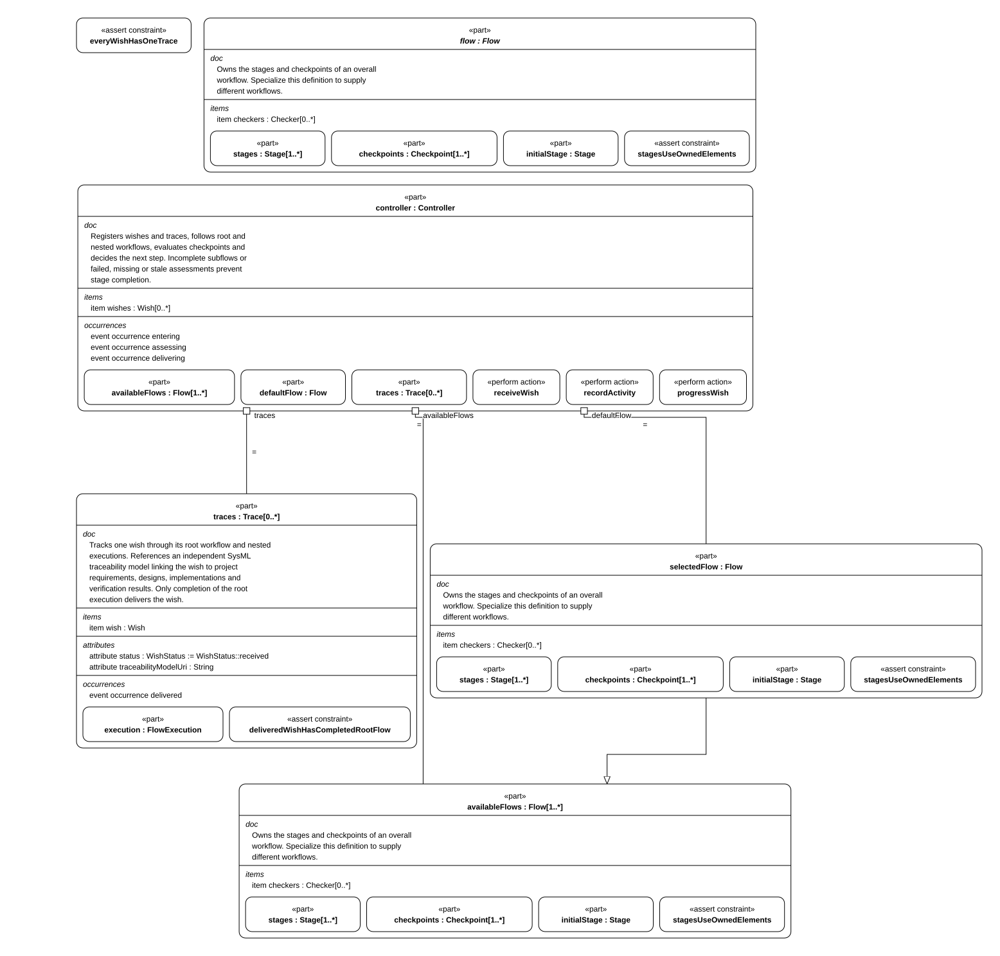
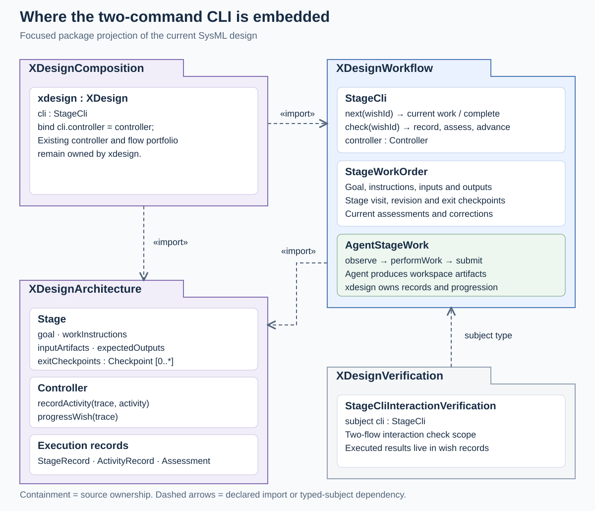
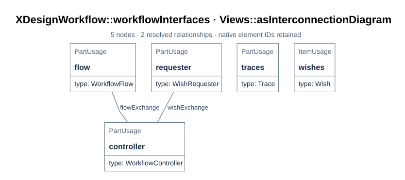
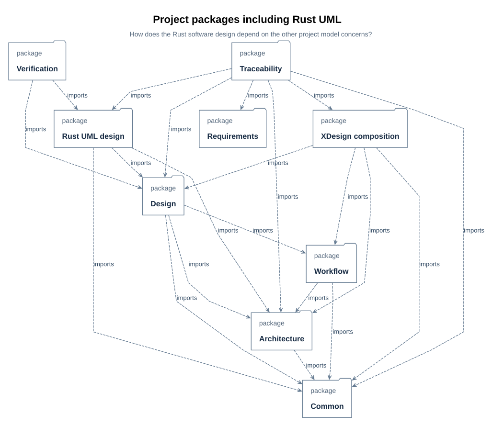
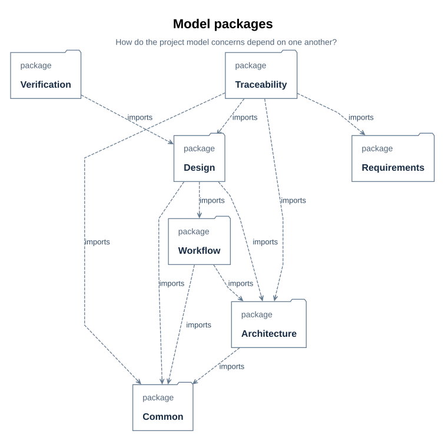

# System composition

How the tool itself is composed: its parts, the interfaces between them, what is owned,
and how the model points at this documentation.

<a id="b01"></a>

## 1. The composition



> **Figure B01-1 — System composition.**  
> **Question:** Which parts does `XDesign` own and bind?  
> **Model view:** Internal-structure projection of `XDesignArchitecture::XDesign`.  
> **Companions:** [B02](#b02) for typed interfaces and [E01](../interfaces/record-format.md#e01) for record definitions.  
> **Status:** renderable-now.  
> **Reading:** The abstract flow origin, owned flow portfolio, selected default, controller, wishes, and traces form one composition. Bindings give the controller its available plans and default selection.  
> **Limits:** Ownership and bindings do not show a run's stage order or prove its delivery invariants. This base-type projection does not include the concrete `xdesign.cli` addition.

`XDesignArchitecture::XDesign` defines the system composition.
`XDesignComposition::xdesign` supplies its concrete flow portfolio:

| Part | Type | Role |
| --- | --- | --- |
| `'flow'` | abstract `Flow` | Common origin specialized by each selectable flow usage; it is not itself run |
| `availableFlows` | `Flow [1..*]` | Owned portfolio of the concrete plan usages under `xdesign` |
| `selectedFlow` | reference to `Flow` | Default portfolio member; `xdesign` binds it to `vModel` |
| `controller` | `Controller` | Registers wishes and traces, records activities, evaluates checkpoints, advances or blocks. It may select only a portfolio member |
| `wishes` | `Wish [0..*]` | The requested outcomes |
| `traces` | `Trace [0..*]` | One execution record per wish |

Bindings: `controller.availableFlows = availableFlows`,
`controller.defaultFlow = selectedFlow`, `controller.wishes = wishes`, and
`controller.traces = traces`. The portfolio usages are
`xdesign.vModel`, `xdesign.workflowFlow`, `xdesign.wishVerifyFlow`,
`xdesign.designFlow`, `xdesign.designedSimpleFlow`, and
`xdesign.nestedFlowExample`; each specializes `xdesign.'flow'`
([F03](../design/flow.md#f03)). One assertion holds the
composition together:
`XDesign::everyWishHasOneTrace` — every wish has exactly one trace, and every trace
belongs to a wish.

The concrete `XDesignComposition::xdesign` also owns `cli : StageCli` and binds
`cli.controller = controller`. This boundary exposes the two repeated
stage operations, `next` and `check`, described in the [run lifecycle](../design/lifecycle.md#f04).
It delegates recording, checkpoint evaluation, and progress to the existing
controller; the agent performs the returned work in the project workspace.
The [local CLI implementation](../design/stage-cli.md#d85) realizes this interaction
for the two built-in flat flows.



> **Figure B01-2 — Stage CLI package integration.**
> **Question:** Where do the two stage commands fit in the project model and concrete system?
> **Model view:** `XDesignComposition::stageCliPackageView`, a focused package and relationship projection.
> **Companions:** [Run lifecycle](../design/lifecycle.md#f04) defines the command contract; the [simplest WishVerifyFlow interaction](../design/flows/wish-verify/views.md#d84) expands its timeline and responsibilities.
> **Status:** renderable-now; common CLI design with a bounded local implementation.
> **Reading:** The workflow package owns `StageCli`, `StageWorkOrder`, and `AgentStageWork`; the architecture package supplies the controller, stages, and records. The concrete `xdesign.cli` binds to the existing controller, while the verification package declares interaction checks. Typed references, action references, and bindings explain how the added boundary uses the existing model.
> **Limits:** These package relationships do not implement the commands or establish a passed verification case. The projection selects the CLI integration rather than every project package member.

The CLI belongs at the composition boundary because every stage uses the same
work-and-check interaction. Keeping flow content in `Stage` and progression in
`Controller` lets `StageCli` expose two operations without adding a separate public
command for each internal recording or assessment step.

<a id="b02"></a>

## 2. Interfaces



> **Figure B02-1 — Workflow interfaces.**  
> **Question:** What crosses the requester, controller, and flow boundaries?  
> **Model view:** `XDesignWorkflow::workflowInterfaces`, an interconnection view of `Workflow`.  
> **Companions:** [B01](#b01) for composition and [F04](../design/lifecycle.md#f04) for controller actions.  
> **Status:** renderable-now.  
> **Reading:** The wish interface carries a submission in and registered wish and trace references out. The flow interface supplies the selected flow definition to the controller.  
> **Limits:** The figure defines connections and item flows, not message timing or a particular wish's result.

`XDesignWorkflow::Workflow` is the four-stage interface and lifecycle configuration.
Its `WorkflowFlow` definition is instantiated as `xdesign.workflowFlow` in the
portfolio. The configuration adds the requester and typed interfaces:

| Interface | Connected ports | Flows |
| --- | --- | --- |
| `WishInterface` | `requester.wishPort` ↔ `controller.wishPort` | `submission` (the description), `wishRegistration` (the registered `Wish`), `traceRegistration` (the registered `Trace`) |
| `FlowInterface` | `'flow'.flowPort` → `controller.flowPort` | `flowDefinition` (the selected `Flow`) |

The port directions say who owns what: `WishExchange` takes a description in and returns
the wish and its trace out; `FlowExchange` publishes a flow definition. Wishes and traces
stay owned by the workflow composition; the requester receives references through
its port. The figure specifies the interface type and does not assert that the
current generic `xdesign.controller` has implemented those ports.

<a id="b03"></a>

## 3. Ownership and delivery invariants

The controller's `selectedFlowIsAvailable` assertion requires every selected plan to
belong to the composition's portfolio. Four record rules hold regardless of which
member a wish runs:

- A wish's execution records every stage of its assigned flow, and no others
  (`FlowExecution::recordsEveryFlowStage`, `recordsUseAssignedFlow`).
- A completed stage is authorized: its subflow, if any, completed, and every exit
  checkpoint passed at the current artifact revision (`StageRecord::completedStageIsAuthorized`).
- A completed flow has an authorized terminal stage
  (`FlowExecution::completedFlowHasAuthorizedTerminalStage`).
- Only completion of the root flow delivers the wish
  (`Trace::deliveredWishHasCompletedRootFlow`).

Two requirements state which side of the boundary model content sits on:
`wishProductsAreRetained` (products live in the model, [R01](../requirements/requirements.md#r01))
and `modelStandsWithoutWishes` (the model never names a wish).

<a id="b04"></a>

## 4. Documentation locations in the model

`XDesignCommon::DocSection` is the metadata every module and sub-module carries. An
annotation sits inside the element it belongs to — metadata application annotates the
enclosing element, not the next one:

```sysml
// mbse/model/common.sysml
metadata def DocSection {
    attribute document : String;
    attribute section : String;
}

// mbse/model/architecture.sysml
part def XDesign {
    @XDesignCommon::DocSection { document = "docs/architecture/system-composition.md"; section = "B01"; }
    …
}
```

`document` is the repository-relative file, `section` the stable identifier of the
specific section — never a whole document. The map in [A06](index.md#a06) reads the
relationship in reverse. [D27](../interfaces/documentation-contract.md#d27) specifies
how those exact targets resolve.

`XDesignCommon::DocFigure` is its companion for figures: it names the carrying document
and the rendered asset in the carrying document's `assets/` directory. It is applied to the detailed design's nine
SysML views ([D12](../design/flows/simple-flow/views.md#d12)), earlier structure
graphs ([D09](../design/flows/simple-flow/views.md#d09)), and checkpoint
evaluation figure ([D11](../design/flows/simple-flow/definition.md#d11)). The view's
selection and question, the renderer's projection, and the explanatory block in the
carrying section have distinct roles ([D28–D29](../interfaces/documentation-contract.md#d28)).

`python3 tools/check_documentation.py --json` checks resolvable paths and anchors,
embedded assets, and the adjacent figure blocks. It does not decide whether a selected
view or its explanation is an engineering-correct reading of the model; that remains a
review judgment. Compiler parse/check establishes SysML syntax and supported name
resolution separately ([T04](constraints.md#t04)). The earlier
`simple_flow_design.py` prototype remains research under `cache/research/checks/`.

<a id="d21"></a>

#### 4.0.1 Packages: model organization and dependency direction



> **Figure D21-1 — Project packages.**  
> **Question:** How is the selected project model organized, and which packages depend on others?  
> **Model view:** `XDesignRustUml::projectPackageIntegration`, a package-dependency projection.  
> **Companions:** [D13](../design/flows/simple-flow/views.md#d13) for types and [D15](../verification/requirements.md#d15) for requirement relationships.  
> **Status:** renderable-now; design reviewed.  
> **Reading:** Nine project packages, including xdesign composition and the Rust UML design, appear within the selected model boundary. Dependency arrows describe model organization and the direction in which changes may have effects.  
> **Limits:** Package dependencies are neither runtime messages nor an executed verification result.

`projectPackageIntegration` selects the project packages used by the simple-flow design. Common
definitions provide the shared vocabulary; requirements declare obligations; architecture
defines the system and generic flow; workflow defines interfaces and lifecycle actions;
composition owns the selectable flows and their default; detailed design refines the
simple flow; traceability links satisfiers; verification declares planned
verification cases; and Rust UML maps the `xdesign` crate's software design
(`core` + `simple_flow`) back to the detailed design. A model package is a namespace and dependency unit here; the
runtime module belongs to the xdesign crate.
The selected package boundary contains these nine project packages.
The separate wish package consumes the project model to record derivation and delivery;
it is outside this view's selected project-model boundary.



> **Figure D21-2 — SimpleFlow package selection.**  
> **Question:** Which project packages does the nine-view SimpleFlow design select for its architecture concern?  
> **Model view:** `XDesignDetailedDesign::packageDiagram`, the original SimpleFlow package view.  
> **Companions:** [Figure D21-1](#d21) adds composition and Rust UML to show whole-project integration; [D12](../design/flows/simple-flow/views.md#d12) records the nine-view coverage.  
> **Status:** renderable-now; retained as the SimpleFlow package concern.  
> **Reading:** The seven packages used by the original detailed-design view remain visible, while D21-1 adds composition and the software design package.  
> **Limits:** A package arrow indicates a model dependency, not a runtime call or an approval.

Package symbols and short captions distinguish the nine selected packages. Their full
qualified names remain in the source details. Package arrows represent the model's imports
and dependencies. They organize model
elements and identify what changes may affect another package. They do not represent run
messages, application deployment, or product decomposition. In particular, the project
model stands independently of wish identifiers; the wish trace depends on the project
model ([A02](index.md#a02)).

Review this organization together with the types in [D13](../design/flows/simple-flow/views.md#d13) and the satisfaction and
verification relations in [D15](../verification/requirements.md#d15). Adding a package arrow alone does not establish an
engineering requirement or verification result.
