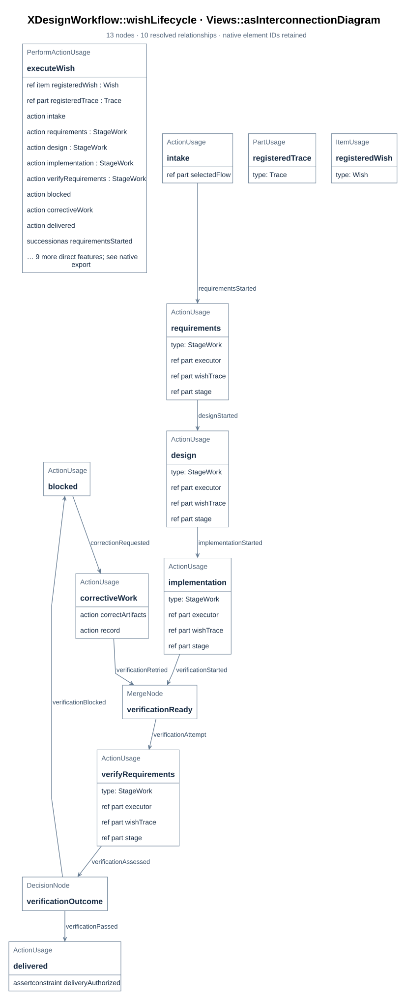
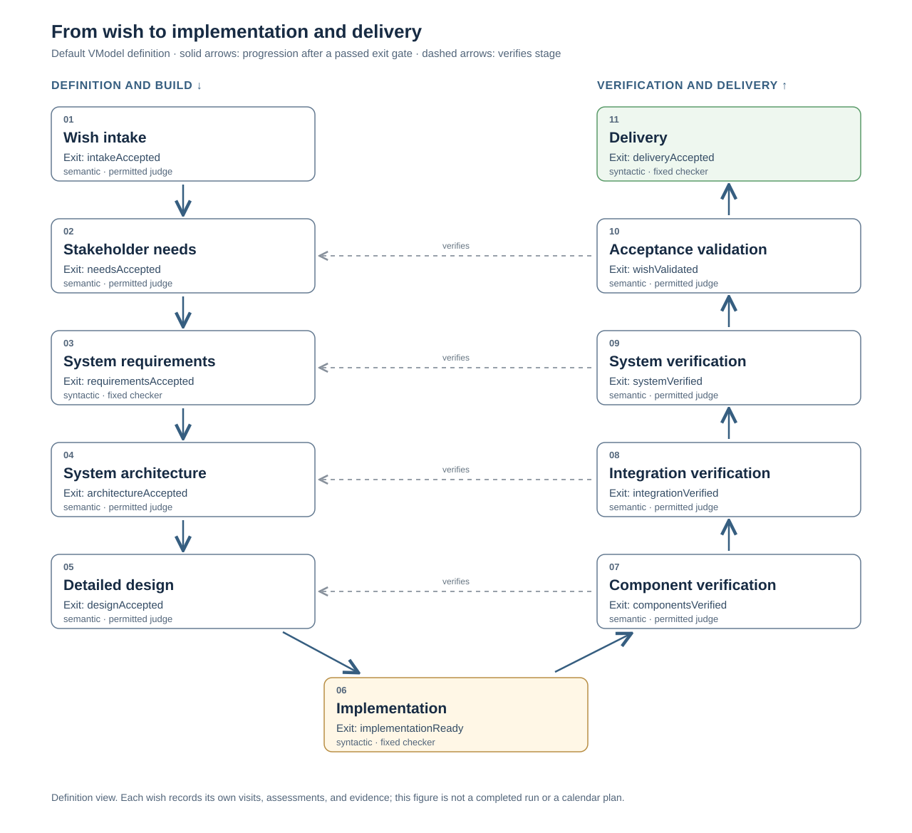

# Wish lifecycle and delivery route

## 1. How a wish advances

> **Figure A03-1 — Wish lifecycle.**  
> **Question:** How does a wish move from registration to delivery or rework?  
> **Model view:** `XDesignWorkflow::wishLifecycle`, an action-flow projection of `Workflow::executeWish`.  
> **Companions:** [F04](../design/lifecycle.md#f04) for controller actions and [E03](../design/evidence-and-revisions.md#e03) for revisions.  
> **Status:** renderable-now.  
> **Reading:** Follow the entry, assessment, and advance path to see where the controller records work. A failed gate retains the visit so corrective work can be assessed at a new revision.  
> **Limits:** The figure is a defined workflow, not evidence that a particular wish passed a checkpoint.

Receiving a wish registers the wish and an independent trace, assigns a flow, creates one
stage record per stage of that flow, and enters the flow's initial stage
(`Controller::receiveWish`). Within a stage, work appends activity records
(`Controller::recordActivity`). A stage is left only when its subflow (if any) has
completed and every exit checkpoint passes at the current artifact revision
(`StageRecord::completionAuthorized`). The final stage's checkpoint completes the flow and
delivers the wish. A stage that does not pass stays current, marked blocked, and is
resumable; corrective work raises the artifact revision so the next assessment judges
current artifacts (`Workflow::executeWish`, `Controller::progressWish`).

`WishStatus` names the wish's `received`, `active`, `blocked`, and `delivered` states.
Those literals describe the trace's outcome, distinct from a stage visit's status
([E02](../design/evidence-and-revisions.md#e02)) or a flow execution's status
([E01](../interfaces/record-format.md#e01)).

For the whole wish → implementation → verification → delivery route, including
stage exit gates and V-model verification pairings, see [B30](#b30).

> Status: default VModel design view, 20 October 2026. The route and its gates are
> modeled; the full route is not an executable application or an accepted project
> delivery. No calendar dates or durations have been assigned.

This page is the overview for a requester or developer asking how one wish can become
an implementation and a delivered outcome. It joins the stage sequence, exit gates,
verification correspondences, and wish evidence in one place. The
[lifecycle action](#a03) explains what the controller does within a
stage; the [package view](system-composition.md#d21) explains model organization; the
[SimpleFlow run timeline](../design/flows/simple-flow/views.md#d08) explains
one four-stage run. The route below shows the default eleven-stage path they do not
show together.

The [xdesign composition](system-composition.md#b01) owns the selectable
flows under its abstract `'flow'` origin and selects `xdesign.vModel` by default.
The graph projects that usage's `VModel` definition; another selected flow has
its own stage and gate set ([F03](../design/flow.md#f03)).

## 2. The route from wish to delivery

> **Figure B30-1 — Wish-to-delivery route.**  
> **Question:** Which stages and exit gates take a wish through definition, implementation, verification, validation, and delivery?  
> **Model view:** Native stage/checkpoint projection of `XDesignArchitecture::VModel`, rendered from the pinned compiler export by `tools/sysml_web/vmodel_overview.py`.  
> **Companions:** [F03](../design/flow.md#f03) for flow selection, [B31](#b31) for gate criteria and work products, and [E03](../design/evidence-and-revisions.md#e03) for current-revision authorization.  
> **Status:** renderable-now; modeled default route, not an executed end-to-end run.  
> **Reading:** Follow solid arrows down the left side to implementation, then up the right side to delivery. Every box names the stage's exit checkpoint and its kind. Dashed arrows point from a verification or validation stage to the development stage it checks; they do not mean work can skip the intervening stages.  
> **Limits:** This definition view has no elapsed time, assigned people, particular wish status, or executed result. It shows one linear default path and cannot establish that a gate passed.

The figure reads native `initialStage`, `nextStages`, `exitCheckpoints`,
`Checkpoint::sourceStage`, `Checkpoint::kind`, and `verifiesStage` references from
`VModel`. It fails to render if the export no longer has one connected route or a
verification pairing that this layout can show faithfully. The gate criteria remain
in the model and are summarized below. A wish selects a flow when received; its
independent trace records the actual route, visits, revisions, assessments, and
evidence ([A02](index.md#a02), [E01](../interfaces/record-format.md#e01)).

## 3. What each gate establishes

The stage names and gate order below come from `VModel` in
`mbse/model/architecture.sysml`. The "work or evidence" column paraphrases each
checkpoint's modeled criterion so a reader can identify the expected result. A gate
authorizes leaving its stage only after a passing current-revision assessment
([B03](system-composition.md#b03)).

| Stage | Work or evidence expected at its exit | Exit gate and authority |
| --- | --- | --- |
| Wish intake | Recorded wish, scope, and intended outcome | `intakeAccepted` — semantic; permitted agent or human |
| Stakeholder needs | Agreed needs and acceptance criteria | `needsAccepted` — semantic; human |
| System requirements | Requirements and verification criteria traced to the wish | `requirementsAccepted` — syntactic; fixed checker |
| System architecture | Parts, relationships, and interfaces addressing requirements | `architectureAccepted` — semantic; permitted agent or human |
| Detailed design | Design supporting implementation and component verification | `designAccepted` — semantic; permitted agent or human |
| Implementation | Implementation artifacts and build evidence | `implementationReady` — syntactic; fixed checker |
| Component verification | Evidence against detailed design | `componentsVerified` — semantic; permitted agent or human |
| Integration verification | Evidence for architectural interfaces | `integrationVerified` — semantic; permitted agent or human |
| System verification | Evidence against system requirements | `systemVerified` — semantic; permitted agent or human |
| Acceptance validation | Evidence of the intended stakeholder outcome, judged against needs | `wishValidated` — semantic; human |
| Delivery | Delivery artifacts, traceability, and acceptance evidence recorded | `deliveryAccepted` — syntactic; fixed checker |

The four dashed correspondences are `componentVerification → detailedDesign`,
`integrationVerification → systemArchitecture`, `systemVerification →
systemRequirements`, and `acceptanceValidation → stakeholderNeeds`. Verification
checks the built system against prior definitions; acceptance validation judges
whether the intended outcome was achieved. The implementation stage sits between
definition and verification. The final delivery gate checks that the resulting
record exists; it does not replace the earlier engineering judgments.
