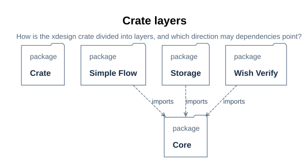

# xdesign API design

> Project: xdesign | Status: the `xdesign::core` + `xdesign::simple_flow` +
> `xdesign::wish_verify` slices are implemented; `xdesign::storage` is designed
> through wish-0011; the generic project controller remains at the SysML design level |
> Audience: application integrators, module owners, and reviewers.
> This directory is the authored class-and-function design of the `xdesign` crate: one
> inventory and crate map on this page, then one design page per API under its layer
> directory. It is not a generated reference.

## What this directory owns

The class-and-function level of the `xdesign` crate's software design: [`core/`](core/index.md#u71),
the flow-agnostic infrastructure; [`simple_flow/`](simple-flow/index.md#u72), the designed
four-stage flow; [`wish_verify/`](wish-verify/index.md#u73), the designed two-stage judged
flow; and [`storage/`](storage/index.md), the local item, revision, material, receipt, query,
checkout, and recovery boundary. The flow layers depend on `core`; storage depends on core
only for shared digest/path primitives, and `core` never depends on SQLite or storage. The
crate's layer map is [U68](#u68).

| Document | Question it answers |
| --- | --- |
| this overview | What does the crate offer, what is the project boundary, and what are the design documentation conventions? |
| [crate structure](#u68) | How is the crate divided into layers, and which direction may dependencies point? |
| [core design](core/index.md#u71) | What does the core layer own, and in which order should its groups be read? |
| [simple-flow design](simple-flow/index.md#u72) | What does the four-stage flow layer own, and which core APIs does it build on? |
| [wish-verify design](wish-verify/index.md#u73) | What does the two-stage judged flow layer own, and which core APIs does it build on? |
| [storage design](storage/index.md) | How do items, revisions, materials and receipts provide durable recoverable operations? |

This directory does not own system structure, module behavior contracts, or test
evidence: those belong to the architecture design and the detailed design, which
embed their own views. A module's UML design lives with that module — today those
are the [SimpleFlow Rust UML design](../flows/simple-flow/implementation.md#d44),
[wish-verify Rust UML design](../flows/wish-verify/implementation.md#d75), and
[storage module design](../storage.md#d86).

## API boundary and reading order

`xdesign` is the Rust package for this project. Its library entry point currently exposes
`core`, `simple_flow`, and `wish_verify`; the storage module is designed to be added during
wish-0011 implementation. The [crate inventory](#u14) and one-API-per-page reference distinguish the
implemented flow slices from the storage design being delivered by wish-0011.
`src/main.rs` exposes the [local stage CLI](../stage-cli.md#d85) for both built-in
flat plans and retains the earlier demo commands. It is not the generic controller
for every selectable flow.

Read the [crate structure](#u68), the
[xdesign architecture](../../architecture/system-behavior.md#b13), the
[SimpleFlow Rust design](../flows/simple-flow/implementation.md#d44), and
then the [implemented API inventory](#u14). The
[implementation plan](../../records/plans/simple-flow.md#p03)
sets the first executable slice's acceptance boundary, and the
[wish-verify plan](../../records/plans/wish-verify.md#p25)
sets the second slice's.

## Project responsibilities and software status

The SysML `XDesign` composition owns the selected `flow`, controller, wishes, traces,
and `ProjectStore`. These are project-level responsibilities. The Rust crate beneath this
directory implements selected flow behavior on a generic run engine and the store behind
a separate library boundary; it does not replace that composition.

| Modeled responsibility | Rust location or intended boundary | Status |
| --- | --- | --- |
| `XDesign` composition and flow selection | xdesign application boundary | Modeled; no generic Rust API yet |
| `Controller::receiveWish`, `recordActivity`, `progressWish` | xdesign controller API | Modeled; no generic Rust signatures or implementation yet |
| `ProjectStore` and operational revisions/materials/receipts | `xdesign::storage`; stage adapter in `src/stage_cli/persistent.rs` | Implemented and exercised within the [storage acceptance boundary](../../records/plans/storage.md#p38); final human acceptance is separate |
| `Trace` and `FlowExecution` for a wish | xdesign trace and run API | Modeled; `xdesign::core`'s run engine realizes `FlowExecution` with a local, specialized run record |
| `designedSimpleFlow` construction, gate evaluation, and advancement | `xdesign::core` + `xdesign::simple_flow` | Implemented four-stage slice; [API inventory](#u14) |
| Fixed checker commands | `tools/checks/simple_*.py` used by `xdesign::simple_flow` | Implemented for that slice |
| `designedWishVerifyFlow` construction, judgment evaluation, and advancement | `xdesign::core` + `xdesign::wish_verify` | Implemented two-stage judged slice — both gates semantic, no checker commands; [API inventory](#u14) |

The intended integration is for the project controller to select a flow and create
its execution, then delegate a `designedSimpleFlow` execution to
`xdesign::simple_flow`. The controller remains responsible for wish registration,
trace ownership, generic flow selection, and the full V-model. This allocation
follows the [modeled controller actions](../lifecycle.md#f04)
and [record ownership](../../interfaces/record-format.md#e01); no Rust
controller API is claimed until its contracts and code exist.

## Integration rule

The API pages under this directory document only exported and crate-visible
operations of the `xdesign` crate. A module's API pages live under
`docs/design/api/<layer>/` — one layer directory per crate layer, with the inventory
above routing to them. A new project-level Rust API must be added to this
inventory when it is designed, with a dedicated contract page and a link to the
SysML element it realizes. The generic controller must consume a selected flow
through the modeled `FlowInterface` and retain the independent wish trace; the
current local CLI does neither for the full workflow. The
[interface contract](../../interfaces/contracts.md#i01) and
[architecture runtime behavior](../../architecture/system-behavior.md#b14) remain the source for
those future integration decisions.

## What this reference covers

The public and crate-visible APIs of the `xdesign` crate — structs, enums, traits,
functions and methods — grouped by layer and role, core first. The code implements
the gated four-stage slice and the gated two-stage judged slice described here. The
modeled UML and the executable tests have different evidence roles: consult the
[implementation plan](../../records/plans/simple-flow.md#p06)
and the [wish-verify plan](../../records/plans/wish-verify.md#p28)
for executed results and remaining delivery limits. Each layer's overview gives
its module-to-file map: [core](core/index.md#u71),
[simple_flow](simple-flow/index.md#u72),
[wish_verify](wish-verify/index.md#u73), and [storage](storage/index.md). The storage
[implementation plan](../../records/plans/storage.md#p35) owns its delivery evidence.

Reading order for a newcomer: the inventory below top to bottom, then the pages of
`create_run`, `RsFlowRun`, `evaluate_gates`, `advance`, and the flow layers'
`designed_simple_flow_plan` → `validate_designed_plan` → `create_designed_run` or
`wish_verify_flow_plan` → `validate_wish_verify_plan` → `create_wish_verify_run`
path.

## API inventory

### Core — status and error enums

| API | Kind | One-liner | Page |
| --- | --- | --- | --- |
| `RsFlowStatus` | enum | Run lifecycle vocabulary | [core/01](core/rs-flow-status.md#u39) |
| `RsStageStatus` | enum | Visit lifecycle vocabulary | [core/02](core/rs-stage-status.md#u40) |
| `RsCheckKind` | enum | How a gate's criteria are established | [core/03](core/rs-check-kind.md#u41) |
| `RsCheckpointOutcome` | enum | A verdict's vocabulary | [core/04](core/rs-checkpoint-outcome.md#u42) |
| `RsJudgeAuthority` | enum | Who may judge | [core/05](core/rs-judge-authority.md#u43) |
| `RsAdvanceOutcome` | enum | What `advance()` decided | [core/06](core/rs-advance-outcome.md#u44) |
| `RsConformanceKind` | enum | What class of conformance a checker establishes | [core/07](core/rs-conformance-kind.md#u50) |
| `RsPlanError` | enum | How plan validation fails | [core/08](core/rs-plan-error.md#u45) |
| `RsGateError` | enum | How gate evaluation fails to conclude | [core/09](core/rs-gate-error.md#u46) |

### Core — plan types

| API | Kind | One-liner | Page |
| --- | --- | --- | --- |
| `RsFlowPlan` | struct | The flow as data: stages and checkpoints | [core/10](core/rs-flow-plan.md#u25) |
| `RsFlowPlan::validate` | `fn validate(&self) -> Result<(), RsPlanError>` | Reject a structurally inconsistent plan before any run exists | [core/11](core/rs-flow-plan-validate.md#u26) |
| `RsFlowPlan::freeze` | `fn freeze(&mut self, uri: impl Into<String>) -> Result<(), RsPlanError>` | Write a frozen plan and bind its exact byte hash | [core/12](core/rs-flow-plan-freeze.md#u53) |
| `RsStageSpec` | struct | One stage: successors, exit gates, terminal flag | [core/13](core/rs-stage-spec.md#u33) |
| `RsCheckpointSpec` | struct | One gate: kind, criteria, optional checker, judge flags | [core/14](core/rs-checkpoint-spec.md#u34) |
| `RsCheckerSpec` | struct | The command a syntactic gate runs and its rules | [core/15](core/rs-checker-spec.md#u35) |
| `RsCheckerRuleSpec` | struct | One fixed rule's identity and condition | [core/16](core/rs-checker-rule-spec.md#u36) |

### Core — record types

| API | Kind | One-liner | Page |
| --- | --- | --- | --- |
| `RsStageVisit` | struct | One visit of one stage; owns activities and assessments | [core/17](core/rs-stage-visit.md#u27) |
| `RsStageVisit::record_activity` | `pub(crate) fn record_activity(&mut self, activity: RsActivityEntry) -> bool` | Append work done; bump revision when artifacts changed | [core/18](core/rs-stage-visit-record-activity.md#u28) |
| `RsStageVisit::append_assessment` | `pub(crate) fn append_assessment(&mut self, assessment: RsAssessmentEntry)` | Append a gate verdict; earlier assessments stay | [core/19](core/rs-stage-visit-append-assessment.md#u29) |
| `RsStageVisit::completion_authorized` | `fn completion_authorized(&self, plan: &RsFlowPlan) -> bool` | Latest verdict of every exit gate passed at the current revision and snapshot digest | [core/20](core/rs-stage-visit-completion-authorized.md#u30) |
| `RsActivityEntry` | struct | One recorded piece of work | [core/21](core/rs-activity-entry.md#u31) |
| `RsAssessmentEntry` | struct | One recorded gate verdict with evidence | [core/22](core/rs-assessment-entry.md#u32) |
| `RsArtifactDigest` | struct | URI and SHA-256 of exact artifact bytes | [core/23](core/rs-artifact-digest.md#u51) |
| `RsStageVisit::verify_artifacts` | `fn verify_artifacts(&self) -> bool` | Rehash each current artifact and its canonical set | [core/24](core/rs-stage-visit-verify-artifacts.md#u55) |
| `hash_artifact` | `fn hash_artifact(uri: &str) -> Result<RsArtifactDigest, String>` | Read a file and obtain its exact byte digest | [core/25](core/hash-artifact.md#u56) |
| `snapshot_digest` | `fn snapshot_digest(artifacts: &[RsArtifactDigest]) -> String` | Hash the canonical artifact digest list | [core/26](core/snapshot-digest.md#u57) |
| `RsStageVisit::evidence_uris` | `fn evidence_uris(&self) -> Vec<String>` | Collect current artifacts and same-revision assessment evidence | [core/27](core/rs-stage-visit-evidence-uris.md#u63) |
| `RsStageVisit::verify_passed_evidence` | `pub(crate) fn verify_passed_evidence(&self) -> bool` | Confirm every passed assessment retains at least one existing evidence file | [core/28](core/rs-stage-visit-verify-passed-evidence.md#u64) |

### Core — trait boundaries and reports

| API | Kind | One-liner | Page |
| --- | --- | --- | --- |
| `RsCheckCommand` | trait | Boundary every fixed check is invoked through | [core/29](core/rs-check-command.md#u21) |
| `RsCheckCommand::run_check` | `fn run_check(&self, checker, plan identity/digest, wish/run URIs, stage, revision, snapshot digest) -> Result<RsGateReport, RsGateError>` | Invoke the selected command; return a byte-bound rule report | [core/30](core/rs-check-command-run-check.md#u22) |
| `RsJudge` | trait | Boundary a semantic gate is judged through | [core/31](core/rs-judge.md#u23) |
| `RsJudge::review` | `fn review(&self, criteria: &[String], evidence_uris: &[String]) -> (RsCheckpointOutcome, String)` | Present criteria and evidence; return verdict and rationale | [core/32](core/rs-judge-review.md#u24) |
| `RsGateReport` | struct | The check command's answer: verdict plus per-rule reports | [core/33](core/rs-gate-report.md#u37) |
| `RsRuleReport` | struct | One rule's verdict and diagnostic | [core/34](core/rs-rule-report.md#u38) |
| `RsSuppliedJudge` | struct, implements `RsJudge` | Carry a caller's explicit semantic verdict; performs no independent review | [core/35](core/rs-supplied-judge.md#u59) |

### Core — validation utilities

| API | Signature | One-liner | Page |
| --- | --- | --- | --- |
| `sha256_bytes` | `fn sha256_bytes(bytes: &[u8]) -> String` | Hash exact bytes | [core/36](core/sha256-bytes.md#u60) |
| `valid_digest` | `fn valid_digest(s: &str) -> bool` | Check lowercase SHA-256 syntax | [core/37](core/valid-digest.md#u61) |
| `valid_relative_path` | `fn valid_relative_path(s: &str) -> bool` | Check repository-relative path shape | [core/38](core/valid-relative-path.md#u62) |

### Core — gate evaluation

| API | Signature | One-liner | Page |
| --- | --- | --- | --- |
| `evaluate_checkpoint` | `fn evaluate_checkpoint(spec, visit, plan identity/digest, wish/run URIs, check, judge) -> Result<RsAssessmentEntry, RsGateError>` | One gate: scripted check or permitted judgment, by `kind` | [core/39](core/evaluate-checkpoint.md#u20) |

### Core — run engine

| API | Signature | One-liner | Page |
| --- | --- | --- | --- |
| `RsFlowRun` | struct | The generic run engine: plan, visits, current visit, two trait objects | [core/40](core/rs-flow-run.md#u17) |
| `RsFlowRun::evaluate_gates` | `fn evaluate_gates(&mut self) -> Vec<RsAssessmentEntry>` | Evaluate every exit gate of the current visit, append assessments | [core/41](core/rs-flow-run-evaluate-gates.md#u18) |
| `RsFlowRun::advance` | `fn advance(&mut self) -> RsAdvanceOutcome` | Enter the next stage or complete only after authorization; otherwise remain blocked | [core/42](core/rs-flow-run-advance.md#u19) |
| `RsFlowRun::record_activity` | `fn record_activity(&mut self, activity: RsActivityEntry) -> Result<(), String>` | Validate and record correction on the same blocked visit | [core/43](core/rs-flow-run-record-activity.md#u48) |
| `RsFlowRun::reopen_stage` | `fn reopen_stage(&mut self, stage_id: &str) -> bool` | Reopen a completed flow-completing stage as a new visit | [core/44](core/rs-flow-run-reopen-stage.md#u49) |
| `RsFlowRun::write_record` | `fn write_record(&self) -> Result<(), String>` | Write the re-readable JSON run snapshot | [core/45](core/rs-flow-run-write-record.md#u54) |

### Core — construction

| API | Signature | One-liner | Page |
| --- | --- | --- | --- |
| `create_run` | `fn create_run(plan, wish_model_uri, run_record_uri, check, judgment) -> Result<RsFlowRun, RsPlanError>` | Structurally validate the frozen plan, then build a run and its planned visits | [core/46](core/create-run.md#u16) |
| `restore_run` | `fn restore_run(plan, wish_model_uri, run_record_uri, check, judgment) -> Result<RsFlowRun, String>` | Restore a validated persisted run without writes | [restore API](core/restore-run.md#u78) |

### Simple flow — the designed flow

| API | Signature | One-liner | Page |
| --- | --- | --- | --- |
| `designed_simple_flow_plan` | `fn designed_simple_flow_plan() -> RsFlowPlan` | Construct the modeled four-stage plan before freezing its bytes | [simple_flow/01](simple-flow/designed-simple-flow-plan.md#u52) |
| `validate_designed_plan` | `fn validate_designed_plan(plan: &RsFlowPlan) -> Result<(), RsPlanError>` | Reject any plan that differs from the `designedSimpleFlow` blueprint | [simple_flow/02](simple-flow/validate-designed-plan.md#u69) |
| `create_designed_run` | `fn create_designed_run(plan, wish_model_uri, run_record_uri, check, judgment) -> Result<RsFlowRun, RsPlanError>` | Check blueprint conformance, then construct through `create_run` | [simple_flow/03](simple-flow/create-designed-run.md#u70) |
| `RsProcessCheck` | struct, implements `RsCheckCommand` | Invoke and validate a fixed Python checker command | [simple_flow/04](simple-flow/rs-process-check.md#u58) |

### Wish-verify flow — the designed judged flow

| API | Signature | One-liner | Page |
| --- | --- | --- | --- |
| `wish_verify_flow_plan` | `fn wish_verify_flow_plan() -> RsFlowPlan` | Construct the modeled two-stage judged plan before freezing its bytes | [wish_verify_flow/01](wish-verify/wish-verify-flow-plan.md#u74) |
| `validate_wish_verify_plan` | `fn validate_wish_verify_plan(plan: &RsFlowPlan) -> Result<(), RsPlanError>` | Reject any plan that differs from the `designedWishVerifyFlow` blueprint, including one with a syntactic gate | [wish_verify_flow/02](wish-verify/validate-wish-verify-plan.md#u75) |
| `create_wish_verify_run` | `fn create_wish_verify_run(plan, wish_model_uri, run_record_uri, judgment) -> Result<RsFlowRun, RsPlanError>` | Check blueprint conformance, then construct through `create_run` with the unused-check stub | [wish_verify_flow/03](wish-verify/create-wish-verify-run.md#u76) |
| `RsUnusedCheck` | struct, implements `RsCheckCommand` | Never-invoked check stub: every call returns a command-failed error | [wish_verify_flow/04](wish-verify/rs-unused-check.md#u77) |

### Storage — records and errors (designed through wish-0011)

| API | Kind | One-liner | Page |
| --- | --- | --- | --- |
| `RsSaveRequest` | struct | Exact operation, expected head, metadata, complete manifest and result | [storage/RsSaveRequest](storage/rs-save-request.md#u80) |
| `RsSaveMaterial` | struct | URI, role, digest and optional project-relative source | [storage/RsSaveMaterial](storage/rs-save-material.md#u85) |
| `RsMaterial` | struct | Committed URI, role, digest and exact byte length | [storage/RsMaterial](storage/rs-material.md#u86) |
| `RsItemRevision` | struct | Immutable complete revision and derived projection | [storage/RsItemRevision](storage/rs-item-revision.md#u87) |
| `RsItemSummary` | struct | Current-head list projection | [storage/RsItemSummary](storage/rs-item-summary.md#u88) |
| `RsOperationOutcome` | enum | Pending, committed or conflict | [storage/RsOperationOutcome](storage/rs-operation-outcome.md#u89) |
| `RsOperationReceipt` | struct | Exact request digest, outcome, optional revision and result | [storage/RsOperationReceipt](storage/rs-operation-receipt.md#u90) |
| `RsWishStatus` | enum | Derived received/active/blocked/delivered output | [storage/RsWishStatus](storage/rs-wish-status.md#u91) |
| `RsWishProjection` | struct | Flow, registry/run, status and current-stage projection | [storage/RsWishProjection](storage/rs-wish-projection.md#u92) |
| `RsStoreError` | enum | Typed invalid/format/not-found/mismatch/integrity/path/I/O/database/uncertainty failures | [storage/RsStoreError](storage/rs-store-error.md#u93) |
| `RsCheckoutReport` | struct | Exact checkout item, revision, destination and count | [storage/RsCheckoutReport](storage/rs-checkout-report.md#u94) |
| `RsDoctorFindingKind` | enum | Orphan, pending, missing, altered, staging, record, format, identity or permission finding | [storage/RsDoctorFindingKind](storage/rs-doctor-finding-kind.md#u95) |
| `RsDoctorFinding` | struct | One integrity finding and subject | [storage/RsDoctorFinding](storage/rs-doctor-finding.md#u96) |
| `RsDoctorReport` | struct | Completed read-only inspection and all findings | [storage/RsDoctorReport](storage/rs-doctor-report.md#u97) |

### Storage — lifecycle and operations (designed through wish-0011)

| API | Signature | One-liner | Page |
| --- | --- | --- | --- |
| `RsStore` | struct | Own safe root, SQLite handle and root/database identities | [storage/RsStore](storage/rs-store.md#u81) |
| `RsStore::init` | `fn init(root: &Path) -> Result<Self, RsStoreError>` | Initialize or reopen only a compatible store without adopting foreign content | [storage/RsStore::init](storage/rs-store-init.md#u98) |
| `RsStore::open` | `fn open(root: &Path) -> Result<Self, RsStoreError>` | Open and validate an existing version-1 store without creation or repair | [storage/RsStore::open](storage/rs-store-open.md#u99) |
| `RsStore::save` | `fn save(&self, project_root: &Path, request: &RsSaveRequest) -> Result<RsOperationReceipt, RsStoreError>` | Deterministically encode and atomically save one typed request | [storage/RsStore::save](storage/rs-store-save.md#u82) |
| `RsStore::save_bytes` | `fn save_bytes(&self, project_root: &Path, raw: &[u8]) -> Result<RsOperationReceipt, RsStoreError>` | Save or resume an exact raw request | [storage/RsStore::save_bytes](storage/rs-store-save-bytes.md#u100) |
| `RsStore::outcome` | `fn outcome(&self, operation_id: &str) -> Result<RsOperationReceipt, RsStoreError>` | Return the actual pending or terminal receipt | [storage/RsStore::outcome](storage/rs-store-outcome.md#u83) |
| `RsStore::list` | `fn list(&self, kind: Option<&str>, status: Option<&str>) -> Result<Vec<RsItemSummary>, RsStoreError>` | List current heads by kind and derived wish status | [storage/RsStore::list](storage/rs-store-list.md#u101) |
| `RsStore::get` | `fn get(&self, item_id: &str, revision: Option<u64>) -> Result<RsItemRevision, RsStoreError>` | Return one complete selected revision | [storage/RsStore::get](storage/rs-store-get.md#u102) |
| `RsStore::history` | `fn history(&self, item_id: &str) -> Result<Vec<RsItemRevision>, RsStoreError>` | Return every revision in ascending order | [storage/RsStore::history](storage/rs-store-history.md#u103) |
| `RsStore::read_material` | `fn read_material(&self, item_id: &str, revision: Option<u64>, uri: &str) -> Result<Vec<u8>, RsStoreError>` | Return manifest bytes only after full length/digest verification | [storage/RsStore::read_material](storage/rs-store-read-material.md#u104) |
| `RsStore::checkout` | `fn checkout(&self, item_id: &str, revision: Option<u64>, destination: &Path) -> Result<RsCheckoutReport, RsStoreError>` | Verify and materialize a complete revision without replacement | [storage/RsStore::checkout](storage/rs-store-checkout.md#u84) |
| `RsStore::doctor` | `fn doctor(&self, verify_bytes: bool) -> Result<RsDoctorReport, RsStoreError>` | Report record, identity, pending, orphan and byte-integrity findings without repair | [storage/RsStore::doctor](storage/rs-store-doctor.md#u105) |

## Conventions

- **Completeness rule.** Every documented type and nontrivial operation, including
  crate-visible operations, appears in [U14](#u14) exactly once and has exactly
  one page. A page documents one API and nothing else.
- **Trivial getters.** `RsFlowRun::status()`, `RsFlowRun::current()` and
  field getters on data structs have no logic; they are declared on the owning type's
  page (marked `trivial`) and have no page of their own. They appear in the type's
  method list rather than as separate inventory rows.
- **Naming.** Types `UpperCamelCase` with the crate's `Rs` prefix, functions and
  variables `snake_case`, enum variants `UpperCamelCase`, error enums end in `Error`.
  A name in a signature is the same name in the model, the figures and this reference.
- **Signature fidelity.** Pages give full Rust signatures including `Result` error
  channels and trait bounds; `GateError` is reserved for "no conclusion possible" —
  a rule that does not hold is data (`RsRuleReport`), never an error.
- **Status.** The crate's implemented flow slices have executable behavior tests;
  storage behavior requires wish-0011's STORE cases. This does not establish the default
  V-model, whole-store backup/migration, or acceptance of any developed system.

## API design documentation structure

A module's UML design has two granularities, and both are required for a software
module. The module level — component structure, type groups, key interactions,
states, applicability — lives in the module's own document (for example
[D44–D52](../flows/simple-flow/implementation.md#d44)). The class-and-function
level lives in this **API design set**, with one page per API:

- **One inventory page.** Every public or crate-visible nontrivial API of the crate
  — structs, enums, traits, functions, methods, constants — appears exactly once in
  [U14](#u14), grouped by layer and role, with its designed signature and a one-line
  summary. The inventory is the design map, not a generated signature list.
- **One page per API.** Each page states the designed signature and the design-level
  contract: parameter and return semantics, error variants, state and persistence
  effects, caller constraints, and a small example. A struct page carries its field
  design with visibility and invariants; an enum page its variant design; a trait page
  its implementor contract. These are design documents, not generated reference pages.
- **Conventions.** Trivial getters and constructors are declared on the owning type's
  page — no page of their own, but still listed. One object has one name across
  signatures, inventory, figures, and model. Every page names the model element it
  realizes, or states why it is a language-side addition. A page marked designed-only
  does not claim implemented behavior.

The design pages sit under `docs/design/api/<layer>/`. This overview is the inventory
and coverage map. The project boundary and implemented layers are [U65](#u65)–[U66](#u66).

## Reading order

1. The crate structure section [U68](#u68): the layer map — dependencies point one
   way, `simple_flow` → `core` and `wish_verify` → `core`.
2. The module's own UML design document, used with its architecture design and
   interface contract; today those are
   [06_rust_uml_design.md](../flows/simple-flow/implementation.md#d44) and the
   [wish-verify Rust UML design](../flows/wish-verify/implementation.md#d75).
3. The layer overviews — [core](core/index.md#u71), then [simple-flow](simple-flow/index.md#u72)
   and [wish-verify](wish-verify/index.md#u73) — then the [inventory](#u14) and the
   page of each API being used.

## Relation to the decomposition levels

| Level | Owns | Where |
| --- | --- | --- |
| architecture | system boundary, structure, interfaces, concept selection | [architecture design](../../architecture/system-context.md#b05) |
| details | module behavior, data, interfaces, tests | [SimpleFlow module design](../flows/simple-flow/implementation.md#d32) |
| API | class-and-function reference of the crate, layer structure | this directory |

The levels are complementary, not competing documents: architecture selects the
structure, detailed design fixes module behavior, and this reference fixes the
crate's API. The module UML design lives in
[06_rust_uml_design.md](../flows/simple-flow/implementation.md#d44); the
whole-project package view includes the Rust UML package
([D21](../../architecture/system-composition.md#d21)); model elements link to their own API pages
through `DocSection` annotations.

## Current state and limits

- The implemented slices are `xdesign::core` + `xdesign::simple_flow` — the gated
  four-stage SimpleFlow with executable behavior and checker tests — and
  `xdesign::wish_verify` — the gated two-stage judged flow with both gates
  semantic. Neither is the complete V-model workflow — the generic controller,
  multi-user persistence, and project-level acceptance remain modeled-only ([U66](#u66)).
- The layered split documented here is realized in the SysML model
  (`XDesignRustUml`), in this reference, and in the source: the crate has been
  `src/core/` + `src/simple_flow/` since step 3 of the
  [restructure plan](../../records/plans/api-layering.md#p22), with
  `src/wish_verify/` added as the second flow layer by the
  [wish-verify plan](../../records/plans/wish-verify.md#p27).
- The crate-layer figure in [01_struct.md](#u68) is a model projection
  rendered by the pinned toolchain; its render step follows this documentation
  step. The inventory above is the load-bearing text.

## Review

This level is reviewable when: the inventory lists every public or crate-visible
API exactly once and each has exactly one page; every page carries its full
signature, contracts, and stepwise logic; section identifiers stayed stable across
the layer split; and links resolve to existing sections. The documentation review
checklist is [V12](../../verification/review-criteria.md#v12).

> Project: xdesign | Status: three implemented flow/core layers plus storage design |
> Audience: application integrators, module owners, and reviewers.

## Crate structure

Dependencies point toward `core`: `simple_flow`, `wish_verify`, and `storage` may use its
shared data and digest/path primitives, never the reverse. The flow layers do not depend on
each other. `core` owns flow-agnostic plans, records, gates, and run behavior. The two flow
layers own their blueprints, conformance, and factories. `storage` owns SQLite, blobs,
revisions, receipts, queries, checkout, and recovery; `src/stage_cli/` adapts it to runs
without moving persistence into the engine. A further designed flow remains a sibling layer.

> **Figure U68-1 — Crate layers.**
> **Question:** How is the xdesign crate divided into layers, and which direction may dependencies point?
> **Model view:** `XDesignRustUml::rustCrateLayers` (GeneralView projection).
> **Companions:** the module-level layout and class views in [D45–D46](../flows/simple-flow/implementation.md#d45), [D76–D77](../flows/wish-verify/implementation.md#d76), and [storage design](../storage.md#d86).
> **Status:** renderable-now; module projection, not runtime proof.
> **Reading:** The crate contains `core`, `simpleFlow`, `wishVerify`, and `storage`; dependencies point toward core, which has no SQLite or storage dependency.
> **Limits:** The figure shows layer and module dependencies, not individual types or verified storage behavior.

| Layer | API directory | Source module | Group overview |
| --- | --- | --- | --- |
| `core` | [core/](core/index.md#u71) | `src/core/` | [core design](core/index.md#u71) |
| `simple_flow` | [simple_flow/](simple-flow/index.md#u72) | `src/simple_flow/` | [simple-flow design](simple-flow/index.md#u72) |
| `wish_verify` | [wish_verify/](wish-verify/index.md#u73) | `src/wish_verify/` | [wish-verify design](wish-verify/index.md#u73) |
| `storage` | [storage/](storage/index.md) | `src/storage/` | [storage design](storage/index.md) |

The `core` and `simple_flow` source modules landed with step 3 of the
[restructure plan](../../records/plans/api-layering.md#p22); `src/wish_verify/` followed its
flow plan. `src/storage/` is planned by the [storage plan](../../records/plans/storage.md#p35).
The model's `XDesignRustUml::crate` packages and this directory layout are the contract.

The optional [checker bundle](core/rs-checker-bundle.md#u110) and [resource adapter](../checker-execution.md#d111) define release-safe script execution.
