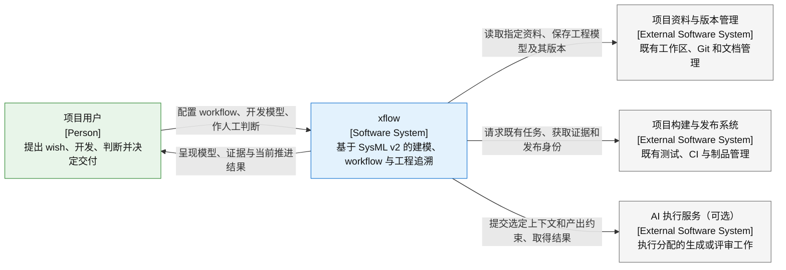
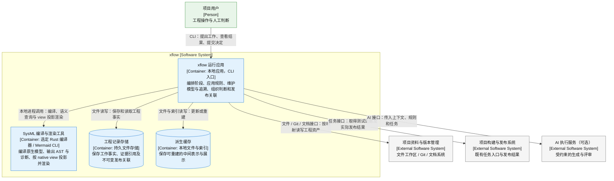

# xflow 架构设计

状态：设计草案。日期：2026-10-13。本文确定产品目标、用户使用方式和 C4 架构边界，作为 `details/` 详细设计的共同依据。现有代码只用于识别可用依赖，不作为目标架构的约束。

## 1. 本项目做什么

**xflow 是用 SysML v2 管理工程开发过程的工具。** 用户在自己的项目中表达 wish、建立系统模型、定义产出约束，并通过 V-model 中的检查和智能判断，将 wish 推进到有证据支持的交付结果。

它同时回答两个问题：项目正在开发的系统由什么组成；每条 wish 为什么形成这些需求、设计、实现和验证结果。前者由项目 MBSE 模型表达，后者由每条 wish 独立的 SysML 追溯模型表达。workflow 负责组织这些模型和成果怎样产生、怎样检查、由谁判断，以及何时可以继续。

用户得到的主要能力是：

| 能力 | 用户得到什么 |
| --- | --- |
| 项目建模 | 表达系统部件、接口、行为及其关系的原生 SysML v2 模型和 view |
| wish 管理与追溯 | 每条 wish 独立保存的意图、需求、设计、实现引用、验证和判断链，以及原生 view |
| 可管控的 workflow | 固定 V-model 阶段与关卡；按 workflow 指定人或 AI 承担工作和智能判断 |
| 自定义产出约束 | 按阶段定义结构合规和语义评审要求，允许引用外部规范 |
| 工程证据与发布关联 | 保存实际检查、判断和用户调整记录，为项目既有发布关联确定且不可变的工程依据 |

xflow 接入用户已有工程。项目目录、代码组织、编辑器、构建工具和发布流程由项目自身维护；xflow 按配置的位置读写模型、约束和相关资料，并连接这些既有工具。用户不需要为使用 xflow 重新组织整个仓库。

## 2. 用户怎样用它开发自己的项目

以一个已有软件项目为例，仓库已经有自己的源码、文档、测试和 CI 发布流程。

1. **接入项目。** 用户选择已安装的 xflow 工具版本，告知现有模型、文档、代码及证据的存放位置，并配置既有构建和发布入口。不存在必须采用的目录树。
2. **定义工作方式。** 用户维护约束 SysML，为这个 workflow 配置阶段产出规范、语义评审问题和 AGENT 分配。人工参与方式由各 workflow 自定义，不设全局默认策略。
3. **提出 wish 并建模。** 例如“断网后仍能保存用户修改，恢复网络后同步”。xflow 为该 wish 建立独立追溯模型及 view，并把涉及的客户端、存储和同步部件关联到项目组成模型。已有部件继续使用同一身份。
4. **沿 V-model 开发。** 人或 AI 在当前阶段生成、修改需求、设计、代码和验证材料。xflow 检查这些产出是否符合选定的阶段约束，并要求相应 SRR、PDR、CDR 等关卡的 AGENT 作出有依据的判断。返工时继续保留已有尝试和证据。
5. **由用户掌控判断。** 用户可以查看材料、判断理由和追溯关系，也可以改变关卡结果。改变结果形成新的有效决定，历史判断和已经发布的内容继续保留。
6. **使用项目原有方式发布。** 用户仍通过既有 CI、Git 或制品系统发布。xflow 为实际发布关联当次确定的模型、约束、验证证据和决定，使之后能解释该版本满足了哪些 wish、依据是什么。
7. **继续开发。** 后续 wish、规则调整和模型修改进入新的开发工作。已有发布及其工程依据保持不变。

用户可以逐步接入已有项目，先建立当前需要的系统范围和 wish 追溯。接入本身不代表历史成果已经满足新规则；范围覆盖和不足必须在模型与评审中可见。

## 3. 生命周期与内容归属

开发和发布是内容的逻辑状态，不要求设置同名目录。工具发布与用户项目发布也是两件事：前者提供稳定机制，后者交付用户自己的系统。

| 内容 | 开发时如何变化 | 发布与长期使用时的要求 |
| --- | --- | --- |
| 工具机制：V-model、公共元模型、语言编译、渲染、追溯处理 | 工具研发可以演进；接入项目时选定的机制在该项目周期中保持固定 | 保留明确的工具及依赖身份；安装更新不会自动改变已有项目 |
| 用户约束：约束 SysML、文档规范、外部规则引用 | 用户可以按项目需要修改；工作明确采用哪个规则版本 | 既有检查和发布保持当次规则依据 |
| 工程资产：项目模型、各 wish 模型及 view、文档、代码 | 持续修改、增加和共享，规模随项目增长 | 选入发布的内容及必要依赖必须能够按确定版本读取 |
| 工作事实：执行、检查、AGENT 判断、用户调整和证据 | 持续新增；新的决定可以取代当前决定，既有事实保留 | 必须能说明实际检查了什么、谁依据什么作了判断 |
| 派生缓存：编译中间表示、索引、临时渲染 | 随源资料更新，可丢弃并重建 | 不作为模型、view、文档或证据的唯一保存位置 |

固定的是追溯机制；每条 wish 的追溯内容会增长。固定的是渲染机制；原生 view 及其所表达的项目内容会变化。生成的 SysML 和设计文档都是工程资产。

发布不可变意味着该发布选择的内容和工程依据不会被后续编辑替换。资料可以留在项目已有 Git、制品库或其他能保留确定版本的存储中；xflow 负责识别和核对引用。无法保证旧版本可读取时，必须先保存必要内容，才能形成有效的发布关联。

## 4. C4 Level 1：系统上下文

本图描述 xflow 与人及外部软件系统的关系。用户项目、wish、模型和约束是工程内容；管理这些内容的工作区、版本管理和发布系统属于外部系统。C4 的这一层用于说明软件系统在环境中的位置。[C4 系统上下文定义](https://c4model.com/diagrams/system-context)

图例：绿色为人，蓝色为本系统，灰色为外部系统。箭头表示发起方对接收方的一项交互职责，交互可以返回结果。AGENT 是智能决策职责，由项目用户或所分配的 AI 承担；它不是“AI 服务”的别名。

外部系统的具体产品按项目接入配置替换；使用本地文件和 Git 的项目同样适用。AI 服务可选，workflow 可以全部由人完成。构建系统返回的测试事实、AGENT 的评审决定和实际发布结果分别保留各自来源。

## 5. C4 Level 2：容器

初始架构采用本地应用接入现有工程，避免为了管控 workflow 另建一套项目管理基础设施。容器是实际应用或数据存储；阶段编排、追溯维护和规则检查是应用内职责。[C4 容器定义](https://c4model.com/diagrams/container)

图例沿用 Level 1；边框标出本系统范围，圆柱表示数据存储。CLI 指命令行入口。W005 将工具边界的目标调整为选定 Rust 编译器输出实际编译结构与可用语义导出，再由 Mermaid CLI 生成展示；dev_v01 的 Java Pilot 编译和渲染记录仍按原工具身份保留。此图表达应用和存储边界，不意味着需要部署微服务，也不声明新链已经完成验收。运行应用的宿主语言尚未选定，CLI 命令格式、本地进程通信格式及各外部接口在详细设计中确定。

| 容器 | 权威职责与边界 |
| --- | --- |
| xflow 运行应用 | 所有推进由它核对当前材料、规则和有效决定；人或 AI 返回的内容先成为可检查的候选，不直接覆盖工程事实 |
| SysML 编译与渲染工具 | 从选定 Rust 编译器取得真实 AST／语义导出与诊断，按原生 view 投影为 Mermaid 并渲染到 HTML；未求值规则独立可见，编译或绘图成功不能据此宣布 wish 已满足 |
| 工程记录存储 | 保存实际发生的事实和版本关联；项目原生模型仍保存在配置的工程资料位置，记录存储不另造一份模型权威副本 |
| 派生缓存 | 服务性能和展示；删除后能从确定的工程资产和记录重建 |

记录和缓存的物理位置可配置，原生模型位置也可配置；图中的存储名称不是用户项目的强制目录名。模型、文档和代码继续使用项目既有版本管理。记录引用这些资料的确定版本，二者分工明确。

## 6. 核心职责如何协作

### 固定流程与可配置参与

V-model 给出阶段、验证对应关系和 SRR、PDR、CDR 等关卡位置。workflow 在此基础上选择本次工作范围、每阶段产出约束、执行主体和关卡 AGENT。用户可配置不同的人工参与安排；应用根据配置判断工作是否可推进，不自行补出一个默认人工策略。

阶段推进、返工和重新判断都属于同一工程过程。用户改变决定时，应用记录新的决定及影响范围；受影响工作需要按当前材料重新核对。用户的决策权不改变编译诊断、测试事实或历史发布内容。

### 项目模型与 wish 模型

公共元模型提供稳定的元素和关系语义。项目模型表达被开发系统；各 wish 模型独立表达从意图到交付的追溯链，并引用项目的共享部件。关系通过原生 SysML 元素及引用表达，可用语言工具解析检查。

每份项目工程 SysML 都有自己的原生 view；每条 wish 也有表达其追溯链的原生 view。界面或渲染图片是这些 view 的展示结果。外部文档、代码和证据通过模型中的引用参与追溯，需要定位到相关章节或代码范围时保留对应位置。

### 两类约束与判断

| 用户约束类别 | 由谁负责 | 作用 |
| --- | --- | --- |
| 语法与结构合规、阶段规则 | 语言工具和可执行规则检查 | 检查 SysML 语法、类型与引用、必要追溯及 view、文档命名和位置、阶段允许的产出 |
| 工程语义约束 | 本关卡配置的 AGENT | 依据材料判断是否满足 wish 和需求，以及设计、实现和验证是否一致 |

编译器所称的“语义检查”包含类型或引用一致性，在本设计中仍归入可执行结构检查。工程语义判断不能由“文件存在”或“编译通过”替代。外部链接可以提供约束内容；无法读取或无法自动解释的规范必须明确交给相应检查或评审处理，不能默认为通过。

### 发布关联

xflow 将确定的工程范围和依赖组织为可评审的候选。检查与 AGENT 决定针对该候选，项目既有发布系统负责产生实际产品发布。只有核对实际发布内容与被检查的选择一致后，才能确认其工程关联。

关联保留既有发布身份、选定的工程内容、采用的工具和约束，以及检查与决定依据。它不建立另一套项目发布编号，也不要求复制产品制品。后续决定和资料修改不会替换已确认的关联；修正通过新的记录或新的发布关联表达。实际产品内容改变仍走项目既有发布流程，补充工程依据本身不要求重新发布产品。

## 7. 自举与设计范围

xflow 自身也是一个被开发的项目。它的组成模型、每条研发 wish 的独立追溯及 view、阶段约束、关卡判断和工具发布，同样使用上述机制。自举采用已有可运行的工具版本开展下一轮开发；当前开发代码不能同时作为自身已经通过检查的证明。

本文固定产品职责和架构边界。详细设计进一步定义模型契约、推进条件、记录与存储行为以及发布关联流程；文件布局、API、数据库表和代码级实现不在架构层展开。

| 详细设计文档 | 负责回答的问题 |
| --- | --- |
| [details/overview.md](details/overview.md) | 各详细设计怎样协作，一次工程工作怎样完整执行 |
| [details/v_model_sysml.md](details/v_model_sysml.md) | 固定 V-model 怎样表达，workflow 如何配置参与和产出约束 |
| [details/wish_sysm.md](details/wish_sysm.md) | 项目模型、独立 wish 模型与原生 view 的模型契约 |
| [details/rendering.md](details/rendering.md) | W005 的 Rust AST、native view 选择、Mermaid 投影、离线 HTML 与诊断边界 |
| [details/trace.md](details/trace.md) | 追溯关系、工程证据和用户调整怎样关联并保持历史 |
| [details/gate.md](details/gate.md) | 关卡如何取得检查事实、形成有效决定并响应用户调整 |
| [details/release.md](details/release.md) | 如何接入既有发布，形成不可变的工程依据 |
| [details/storage.md](details/storage.md) | 可配置路径、版本引用、持久资料与缓存如何存放 |

设计依据是当前用户讨论及 [v_model_agents.sysml](../v_model_agents.sysml)、[wish_to_product.sysml](../wish_to_product.sysml) 中的意图。两份模型是待实现和调整的行为规格；本文与后续详细设计不声明当前运行时已实现这些能力。C4 图采用带类型、职责、关系和图例的 Mermaid 表示。[C4 图示约定](https://c4model.com/diagrams/notation)
