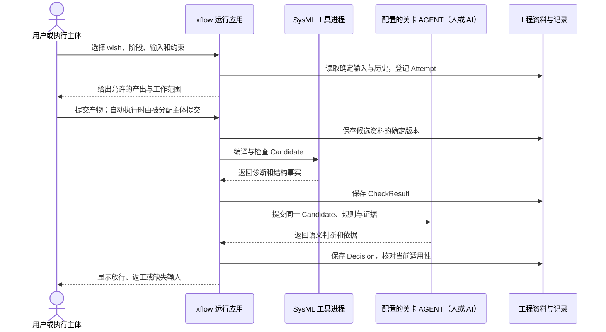

# 详细设计总览

状态：设计草案。日期：2026-10-13。上位依据：[架构设计](../arch_design.md)。本文定义各详细设计共享的对象、职责和执行顺序；具体模型、关卡、追溯、发布和存储规则分别由专题文档负责。

## 1. 设计目标与边界

xflow 让用户在已有工程中，以原生 SysML v2 模型组织系统开发，并用明确的产出约束和人或 AI 的判断控制推进。目标是使一次工作能够回答：正在满足哪个 wish、改变哪个项目部件、应产生什么、检查过什么、谁作出判断、交付结果在哪里。

第一阶段以本地应用为主，提供命令行操作入口，调用统一的 SysML 工具进程。本文所列操作是行为契约，不是已经实现的命令或 API。工作台界面、分布式执行和具体宿主语言不影响以下契约，另行实现时必须遵守同一边界。

项目原有目录和发布体系继续使用。接入配置选择资料位置和外部任务入口；逻辑对象可以保存在同一物理位置，不要求为每种对象新建目录、数据库或服务。

## 2. 共同术语与权威来源

| 对象 | 含义 | 权威来源 |
| --- | --- | --- |
| ProjectModel | 被开发系统的组成、接口、行为和关系 | 项目位置中的原生 SysML |
| WishModel | 单条 wish 的意图及从需求到交付的独立追溯链 | 该 wish 单独保存的原生 SysML |
| NativeView | 某份工程 SysML 或 wish 链的原生 view 声明 | 所属原生模型；渲染结果是派生内容 |
| WorkflowProfile | 工作范围、阶段产出约束、执行主体和 AGENT 分配 | 项目配置及其 SysML 规则模型 |
| ConstraintSet | 一次工作明确采用的用户约束集合与外部规范依据 | 确定版本的约束 SysML 和引用资料 |
| Candidate | 提交检查和判断的确定内容及必要依赖集合 | 确定版本的模型、资料和依赖选择 |
| Attempt | 一个阶段的一次工作尝试，关联输入、规则和实际产出 | 实际执行记录及所引用的工程资产 |
| CheckResult | 对确定材料执行结构、阶段规则或工具检查的事实 | 实际工具输出及检查记录 |
| Decision | 人或 AI 对候选的判断，或用户对已有决定的调整 | 记录主体、范围、时间及理由的决定记录；用户未提供理由时如实标记 |
| ReleaseAssociation | 既有实际项目发布与确定工程依据的不可变关联 | 发布系统事实和关联记录 |

这些是统一语义，不强制采用同名类型、字段或文件。概念细化由各专题文档定义。原生模型中的工程关系、实际发生的事实、外部产品发布事实有各自权威来源；索引只引用这些来源。

同一个项目部件可以被多个 wish 引用，仍保留一个身份与维护来源。每条 wish 的模型独立存放，不能只有数据库中的 wish 行或一个全项目关系列表。每份项目维护的工程 SysML，包括 workflow 与约束模型，都要有自己的 view；接入时不要求改写第三方语言标准库。

## 3. 从接入到交付的执行顺序

| 步骤 | 输入与动作 | 完成后必须留下什么 |
| --- | --- | --- |
| 接入 | 选定已安装工具、项目范围、路径映射和外部任务入口；核对可读写能力 | 项目配置及其版本、明确的覆盖范围；不会自动迁移源码目录 |
| 配置 workflow | 采用固定 V-model；配置当前范围的产出规则及人或 AI 的执行/评审分配 | 可解析的 WorkflowProfile 和 ConstraintSet；缺失分配明确报告 |
| 建立 wish | 保存意图，确定涉及的系统范围，建立独立模型和原生 view | WishModel、项目部件引用；未知需求保留待澄清状态 |
| 执行阶段 | 对选定输入和规则开始 Attempt，由人或 AI 产生候选产物 | 产物、执行记录、阶段内建立的原生追溯关系 |
| 检查材料 | 固定 Candidate，调用语言工具和规则检查；记录外部验证事实 | 绑定该 Candidate 的 CheckResult 与诊断 |
| 关卡判断 | 配置的 AGENT 读取候选、约束和证据，作语义判断；用户可调整结果 | Decision，以及当前决定是否仍适用的结论 |
| 推进或返工 | 核对关卡条件；放行后继续，缺少配置/判断或动作不可执行时等待，需要返工时回到最早受影响阶段 | 当前工程进度、等待或返工原因和历史尝试 |
| 关联发布 | 固定交付范围，经既有流水线发布并核对实际内容 | ReleaseAssociation；准备通过本身不等于产品已发布 |
| 继续开发 | 新 wish、规则和模型修改形成新的工作 | 新资产和记录；既有发布选择保持不变 |

阶段活动允许人工编辑、AI 生成和外部工具执行。候选模型和资料一经保存就是持久工程资产，包括检查失败的候选；应用核对它们能否作为当前推进依据。检查、判断及接纳过程更新相关模型与记录，不把未接纳资料当作可丢弃缓存；具体保存和并发规则见 [storage.md](storage.md)。

## 4. 一次阶段尝试内部怎样协作

此图是行为协作图，AGENT 可以就是当前用户。实际语义评审不能读取一个随后随意变化的工作区并把决定登记为对旧候选有效。输入、规则、产物或必要依赖变化时，应用核对受影响范围；相关旧检查和决定仍保留，但不能直接用于新材料放行。

## 5. 贯穿全部实现的规则

1. **原生模型可解释。** 项目组成和 wish 链使用公共元模型的元素与关系；view 是原生声明。HTML、图片、数据库边表和外部 ID 不能替代这些原生内容。
2. **固定机制和用户规则分开。** 项目选择的语言依赖、V-model 和公共追溯语义固定；用户在扩展边界内修改项目规则和主体分配。变更规则不改写既有判断的依据。
3. **检查事实和判断分开。** 编译、测试、文档规则检查保留实际结果；AGENT 判断是否充分满足工程意图。用户可以改变有效决定，不能把失败的编译记录改为成功。
4. **没有隐含人工策略。** 每个 workflow 明确选择人或 AI；执行主体与评审主体分别表达。主体配置缺失时说明缺失，不能自动把所有关卡交给 AI。
5. **每项结论针对确定范围。** 决定记录引用 Candidate、规则和证据；当前适用性由这些内容是否一致及决定关系确定。最新时间戳本身不足以放行。
6. **发布保持原内容。** 用户项目的既有发布身份和内容由其发布系统负责；工程关联一经确认保持不变。补充或纠正依据以新记录表达，不能伪造历史评审时间。
7. **持久资产和缓存分开。** 生成模型、view、设计文档和证据是工程资产；编译表示、索引和临时展示可以重建。

外部规范只给了链接但无法读取时，处理结果必须是待补充、明确失败或由指定主体作有依据的例外决定；工具不能把“有链接”理解成“已满足规范”。原生语言不合法或必要引用无法解析时，应修正材料，不能通过修改关卡决定制造一个合规模型。

## 6. 各文档的职责边界

| 文档 | 负责定义 | 依赖与交接 |
| --- | --- | --- |
| [v_model_sysml.md](v_model_sysml.md) | 固定阶段、验证对应、workflow 配置和阶段产出规则 | 提供关卡位置和当前阶段契约给 gate |
| [wish_sysm.md](wish_sysm.md) | 项目与独立 wish 的模型契约、共享身份及原生 view | 向 trace 提供原生元素和关系端点 |
| [trace.md](trace.md) | 关系、证据、历史和变更影响 | 为 gate 和 release 提供可解释的工程依据 |
| [gate.md](gate.md) | 关卡判断、有效决定、用户调整和重新评审 | 采用结构事实；不代替外部发布系统 |
| [release.md](release.md) | 确定候选、接入既有发布并确认不可变关联 | 采用 gate 决定和 storage 的确定版本保证 |
| [storage.md](storage.md) | 路径映射、确定版本、事实保存、并发和缓存 | 支撑所有模型、记录和发布关联的保存读取 |

## 7. 一个贯穿场景与验收结果

项目新增“离线保存，联网同步”的 wish。项目模型描述已有客户端、持久存储和同步服务；该 wish 独立链接相关需求、设计、实现引用和验证材料。workflow 为 SRR 和 CDR 分配的 AGENT 可以不同，分配方式由用户决定。

当同步实现改变时，旧验证证据不能自动证明新实现，受影响检查和关卡重新评估；其他未受影响 wish 不因文件恰好相邻而全部失效。用户推翻一次 AI 评审后，新决定和原评审同时可追溯。既有 CI 发布成功且内容核对一致后，将其实际发布身份与本次依据关联。

最小验收应覆盖：在原目录接入；原生模型/view 能编译读取；同一部件被多 wish 共享；workflow 分别采用人和 AI；不合法产出被定位；用户调整保留历史；资料变化触发相关重评；发布关联可按确定版本读取；清理缓存不丢失工程内容。

## 8. 自举与实施顺序

xflow 自身按同一规则建立项目组成模型和研发 wish：先实现接入及模型读取，再实现结构检查和阶段/关卡推进，随后接入 AI 和既有发布。每一项实现都对应自己的 wish 链及验证证据，具体开发任务另行形成。

首次自举可以由人配合已安装语言工具执行检查和评审，记录真实步骤；已有可运行版本提供下一版本的开发机制。尚未实现的自动检查不能登记为已经执行，未来工具能力也不能作为当前版本合格的证据。
