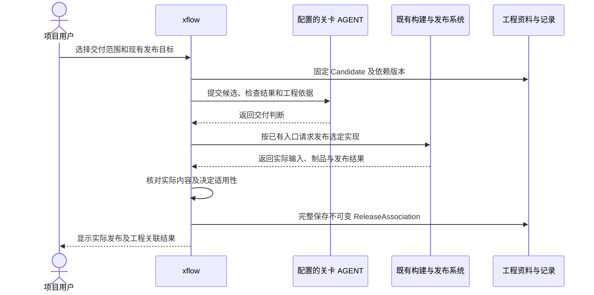

# 发布与工程依据关联设计

状态：设计草案。日期：2026-10-13。依据：[架构设计](../arch_design.md)、[详细设计总览](overview.md)。本文设计 xflow 怎样为用户项目既有发布关联确定的 MBSE 依据，不定义用户项目的新目录或另一套产品发布流程。

## 1. 发布的职责与不变边界

产品发布由项目已有 Git、CI、制品库或人工发布入口完成。xflow 负责确定对应的 wish 和系统范围、收集工程依据、检查及评审，并核对这些依据与实际交付内容一致。

需要区分三个事实：候选经过工程评审；发布系统成功产生产品；xflow 确认该产品与选定工程依据相符。只有前两者不能自动推出第三者。

| 对象 | 负责方 | 何时确定内容 |
| --- | --- | --- |
| Candidate | xflow 按用户范围选择 | 开始检查和判断前，固定内容及必要依赖 |
| 实际产品发布 | 项目既有发布系统 | 由该系统的提交、构建、制品和发布事实确定 |
| ReleaseAssociation | xflow | 实际发布内容核对一致、工程依据可读取以后 |

不变的是确定内容及其原始依据。关联记录有自己的记录身份以便引用，但不成为用户产品的新版本号。资料不必集中复制到某个发布目录；必要内容可保留在原 Git 或制品库中，只要确定版本长期可读取并能核对内容。

## 2. 候选怎样确定

用户选择本次交付的 wish、系统范围和项目已有发布目标。应用据此生成 Candidate，并固定下列逻辑内容：

| 内容 | 选择要求 |
| --- | --- |
| 产品实现 | 本次交付对应的源码版本、构建输入及可识别制品；不能只使用可移动分支名 |
| 原生工程模型 | 涉及的项目模型、各 wish 的独立模型及原生 view |
| 工程资料 | 满足当前阶段规则的设计、验证计划、实际证据和交付资料 |
| 规则 | 选定的 workflow、用户约束和使用的外部规范内容 |
| 工具依据 | 项目采用的固定 V-model、元模型、编译、渲染及追溯依赖身份 |
| 必要依赖 | 上述内容引用并影响解释或判定的共享模型、资料和资源 |

依赖收集按照原生关系和资料引用进行，不把整个仓库都默认纳入。重复引用共享部件时只保留一个确定版本。未选 wish 若共享了本次改变的部件，需要评估影响，不能仅因不在交付清单就忽略其已知需求约束。

外部文件有版本和内容核对信息时直接引用；只有会变化的 URL、浮动文档或本地未保存内容时，先保存必要版本。章节定位属于引用范围，不能替代文档版本。具体版本契约见 [storage.md](storage.md)。

检查和决定引用 Candidate。它们不被放入 Candidate 自身的内容标识计算中，避免“检查生成新标识、原检查又失效”的循环。ReleaseAssociation 后续选择该 Candidate 及其检查、决定和实际发布事实。

## 3. 接入原发布流程

适配的是项目已经存在的发布入口，既可以由 xflow 请求运行，也可以由用户自行运行后提交可核对结果。接入时约定以下能力，具体产品接口另行实现：

- 如何把选定的源码与构建输入交给发布入口。
- 怎样取得实际构建输入、测试证据、制品身份与发布结果。
- 怎样读取确定的产品内容并核对它与 Candidate 的一致性。
- 怎样识别任务失败、取消、重试以及“请求后尚未拿到结果”。

如果发布系统不能返回足够信息，用户可以补充可核验的证据；仍不能证明实际内容一致时，保持未确认关联。普通链接和“任务显示成功”不能替代内容对应证据。

## 4. 完整流程

1. **选择范围。** 用户指定交付目标、wish 和系统范围，应用核对配置与覆盖边界。
2. **固定候选。** 收集确定版本和必要依赖，确认可读取，建立 Candidate。未完成此步不能进入最终评审。
3. **检查与判断。** 对同一 Candidate 执行结构和阶段检查；按 workflow 完成语义及交付判断。决定的适用性和用户调整规则见 [gate.md](gate.md)。
4. **执行既有发布。** 通过已有入口发布该实现，或取得用户已经执行的发布结果。保存真实任务与产品发布事实。
5. **核对内容。** 确认实际实现、必要构建输入与被评审内容相符；核对所有必要检查和决定仍适用，所选资料可按确定版本读取。
6. **确认关联。** 一次完整保存 ReleaseAssociation 及依据选择。之后的当前工程状态不改变这一关联。

阶段 3 完成以后开发区可以继续编辑，发布和确认仍只读取选定版本。若需把后续修改纳入交付，创建新的 Candidate 并重做受影响检查与判断，不能悄悄替换旧候选里的文件。

图中由 xflow 请求发布是可选接入方式。用户自行发布时，流程从接收同等发布事实继续，不要求把项目发布操作迁入 xflow。

## 5. 关联记录的逻辑契约

这些信息可以按选定存储实现组织，文件名和序列化格式不是本设计的强制要求。

| 信息 | 必须说明什么 |
| --- | --- |
| 关联身份、记录时间 | 标识本条不可变记录，保存实际创建时间 |
| 实际发布身份 | 原系统中的仓库/发布目标、发布标识及不可变提交或制品身份；不能只有 tag 名称 |
| Candidate 引用 | 确定的工程范围、内容和必要依赖选择 |
| 检查与决定引用 | 针对该候选的实际检查、有效 AGENT 决定及用户调整；例外保留理由和范围 |
| 内容对应依据 | 怎样核对实现和构建输入一致，相关外部任务结果与证据 |
| 保留位置 | 从哪里读取选定版本，无法依赖外部保留时保存的必要内容在哪里 |
| 前序关系（如有） | 补充、修正或替代哪条关联，原因是什么 |

被采用的历史关卡检查和决定及其必要依赖一并关联，各自保留原 Candidate、规则、输入和实现版本。最终交付决定直接绑定最终候选；早期证据不改绑成对最终版本执行过的检查，其适用范围及差异由最终评审说明。

关联完成后，候选选择、检查结果和原始决定都不能被原位替换。撤回、补充和当前采用关系由后续记录表达；界面可以标明原关联已被修正，但原记录仍按原内容读取。

确认关联后，独立 wish 链在新的模型版本中加入该实际发布及关联的原生引用，形成真实交付端点。新增引用需要结构核对；该结果引用实际检查版本，不再强制回填到同一版本形成自我引用。原 Candidate 和关联仍保留确认时的选择，不能为了让它们包含自己的发布事实而反复封存。

## 6. 失败、重试与修正

| 情况 | 处理行为 |
| --- | --- |
| 必要判断缺失，或检查缺口尚未由当前有效决定明确处置 | 不请求最终发布或不确认关联，返回对应阶段补充；实际情况完整记录 |
| 发布任务失败或取消 | 保留 Candidate 和已完成检查，记录外部失败；内容不变且决定仍适用时可按项目原流程重试 |
| 请求超时，实际发布结果未知 | 先查询原任务和发布身份，禁止假设失败后盲目再发；取得结果后继续核对 |
| 发布成功，但 xflow 保存关联失败 | 产品发布事实仍真实存在；按同一实际发布与候选恢复保存，不重新发产品 |
| 实际发布的实现与候选不同 | 不确认该关联；为实际内容建立候选并重新检查评审，真实记录是补充评审而非当时已通过 |
| 资料有 URL 但旧版本不能读取 | 在确认前补齐确定版本；之后发现丢失则追加异常记录并恢复同一内容，不能拿新内容替代 |
| 相同候选与同一实际发布重复确认 | 返回既有完整关联；不追加含义完全相同的重复记录 |
| 用户改变当前关卡决定 | 影响当前开发推进或新的关联准备；已确认关联保留当次决定 |

一次保存中不能出现外部可见的“完整关联”却缺少必需引用；中断后的准备记录可以保留待恢复状态。发布入口的重试能力和关联保存的重试能力分别处理，不能把二者合成一个“再发布”动作。

普通检查失败经用户或所配置 AGENT 明确采用缺口后，可以按有效决定继续；关联保留失败、采用范围和后续动作，不能显示为全部合规。必要模型或资料不可解释、实际产品内容无法核对等技术缺失仍需补齐，否则关联无法成立。这区分用户的决定权与事实能否被读取和证明。

同一实际产品发布可以有后续补充或纠正的工程关联。例如原记录漏选一个原生 view，在核对其真实适用版本后创建补充关联，保留前序记录和修正原因，无需重建产品。若原实现本身需要改变，则必须走项目既有的新发布流程。

规则后来改变时，可以对旧产品做新的评估并关联真实评估时间；该记录不能声称旧发布当时已满足新规则。发现语义问题也不能撤写原 AI 或人工判断，只能增加新的判断、通知状态和后续工作。

## 7. 阅读与后续开发

读取发布时，从实际产品身份进入对应 ReleaseAssociation，再读取选定模型、原生 view、约束、证据和决定。所有资料读取确定版本；渲染和索引可以重建，但不能默认用当前工作区内容替代。

继续开发时，可以引用选定发布的模型与资料作为输入，再创建新的 Attempt、Candidate 和决定。开发中的“当前使用”关系允许更新，原关联和产品内容保持不变。历史发布的阅读使用原工具依据；现工具不兼容时明确报告兼容性问题，不静默改写旧模型。

## 8. 验收场景

| 场景 | 期望结果 |
| --- | --- |
| 已有仓库和 CI 发布接入 | 保留原发布标识、目录和产品制品；能从原发布查到工程依据 |
| 候选评审后开发文件继续变化 | 发布关联仍读取旧候选；修改不能自动带入已通过的判断 |
| tag 被移动或同名产品内容变化 | 通过提交/制品身份发现差异，不能把同名视为同一发布内容 |
| 既有发布成功、关联确认中断后恢复 | 不重复发布产品，最终只得到一条同义完整关联 |
| 多 wish 共享项目部件 | 依赖指向同一确定部件版本，相关影响评估可见 |
| 已发布后用户推翻旧决定 | 原关联仍可解释当时依据，新的决定和修正关系另行可查 |
| 同一产品发布补充工程依据 | 新记录保留前序关系和真实补充时间，原关联内容不变 |
