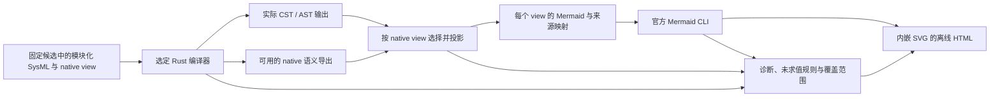

# Rust AST、Mermaid 与 HTML 编译渲染设计

状态：W005 目标详细设计，实施与验收分别记录。日期：2026-10-13。依据：[架构设计](../arch_design.md)、[原生模型与 view 契约](wish_sysm.md)，以及 [W005 原始请求和后续选择](../../../.xflow/wishes/sources/W005_request.json)。本文规定新工具链的职责和验收边界，不把设计文字当作已经执行成功的证明。

## 1. 目标与选定方案

W005 将当前编译渲染入口调整为：选定的 Rust 编译器处理原生 SysML，输出真实编译结构及可用的语义导出；xflow 按原生 view 选择内容并投影为 Mermaid；官方 Mermaid CLI 预渲染 SVG，最终内嵌到可离线打开的 HTML。

原生 `.sysml` 是模型、关系与 view 选择的唯一维护来源。AST、语义导出、Mermaid、SVG 和 HTML 都是有来源的派生表示；修改其中一份展示文件不会改变模型。编译器替换也不改变 wish、CheckResult、Decision 与 ReleaseAssociation 的事实含义。

| 用户输入或选型 | 本轮采用的解释与边界 |
| --- | --- |
| 请求 xdesign 的 Rust 编译器，再经 AST、Mermaid 到 HTML | 请求迁移实际编译和展示链，不能用文本扫描构造的图代替真实编译产物 |
| 后续提供 `cache/designV3` | 在 xdesign 工作区定位其既有设计与展示工作；路径本身不证明其中存在 Rust 编译器 |
| 明确选择“采用已找到的 Rust v0.1.4（推荐）” | 采用已找到的 `haradama/sysml-v2-rs` 0.1.4 候选实施；观察到的工作副本位于 xdesign 的 `cache/concept_experiments/candidates/alternative/rust` |
| Mermaid 渲染器 | 锁定官方 `@mermaid-js/mermaid-cli` 12.0.0 与 `mermaid` 12.1.0；源依赖锁位于 `.xflow/xflow/tools/mermaid/package-lock.json` |

编译器精确源码修订、依赖锁、局部修改、构建命令和可执行文件哈希由持久工具锁与实际执行记录确定，不能只凭 `0.1.4` 版本字符串推断。研究候选的能力范围需要对本项目模型实测；用户选定它用于实施不等于已经验收其全部语言语义。

## 2. 工具边界与数据流

上图说明处理职责，不替代工程 `.sysml` 中的 native view。xflow 运行应用选择候选、调用工具并保存事实；编译器负责实际语言处理；投影器解释已取得的编译结果；渲染器负责 Mermaid 布局和 SVG。HTML 组织这些结果及其范围说明，不承担关卡批准职责。

新的交付入口是 `.xflow/xflow/tools/render_delivery.py`，新展示输出进入 `cache/dev_v02/`。`.xflow/xflow/tools/validate_delivery.py` 保留为 dev_v01 历史工具；新入口不得在 Rust 或 Mermaid 失败时静默调用该旧链并继续报告新链成功。

## 3. 区分编译结构、语义导出与投影模型

“AST”在用户目标中表示 Rust 编译后的中间模型。实现记录必须进一步指出实际拿到了什么：具体语法树 CST、抽象语法树 AST、已解析语义图，或这些产物的组合。原始编译输出按原样保留，不能把投影器补出的字段重新命名为编译器原生输出。

| 表示 | 可以说明什么 | 不能单独说明什么 |
| --- | --- | --- |
| 编译器 CST / AST | 语法节点、嵌套结构及编译器实际提供的源位置 | 仅有语法节点不能证明跨文件引用、类型约束、继承或 view 选择已经解析 |
| 编译器 native 语义导出 | 工具实际导出的元素身份、类型、所属关系、引用和 view 选择；具体字段以选定版本输出为准 | 有语义图不意味着所有 SysML 表达式、约束或工程判断已经执行 |
| xflow 规范化投影输入 | 统一图节点、边、来源映射和覆盖状态，便于生成 Mermaid | 它是适配器的派生契约，不能冒充 Rust 内部 AST schema 或另一个权威模型 |
| Mermaid 与 SVG | 某次 view 选择对应的可视内容和关系 | 布局成功不证明模型完备、规则通过或 wish 已满足 |

Rust 输出中没有的信息必须标明缺失、未解析或不支持。不得通过正则重扫 SysML 文本来伪装编译得到的关系；源文本读取只用于核对哈希、显示源码片段及编译器给出的源位置。若需编译后的补充解析，应保留其算法身份、输入和诊断，并清楚地区分其结果与编译器原生事实。

投影层至少需要能够表达源候选身份、模块位置、原生元素身份、元素类型、限定名、源位置、关系类型及端点、view 身份及其选择来源、诊断和覆盖状态。这是 xflow 对适配器输出的需求，本文不预设 Rust 0.1.4 内部字段名或假定它已提供全部信息。

## 4. 原生 view 选择与身份

每个工程模块继续在自己的 SysML 文件内维护 view usage。应用从真实编译结果发现 view，核对所属模块、被选择元素及必要关系；文件名、元素名或 HTML 标题不能替代原生归属。`expose`、嵌套选择与通配选择的实际解析结果必须保留，选择不受支持时明确给出该 view 的缺口。

同一共享部件被多个 wish 引用时，各 view 的节点映射必须指向同一个原生元素身份。类型相同、显示名称相同或限定名相似都不足以合并两个部件。Mermaid 节点标识仅为图内安全标识，需经映射表回到原生身份，不能因转义、缩写或哈希截断碰撞而错误合并。

一次固定源候选重建时，应检查身份和投影的一致性。跨版本重命名或移动需要核对编译器和身份策略是否真正保持绑定；如果工具只保证当前候选内身份，不得声称已完成跨版本身份迁移。未解析端点应保留诊断，不能按名称猜一个邻近节点。

每个 view 的来源映射至少说明：来自哪个原生 view、选择了哪些原生元素、每个图节点/边对应的源身份及位置、关系方向、被隐藏或不支持的内容，以及采用的投影策略。展示简化可以明确标注，但不能静默丢掉必需关系后报告覆盖完整。

## 5. Mermaid 投影规则

首版采用显式 `flowchart` 投影，以有类型的节点和有标签的边展示 SysML 选择结果。使用这种布局不宣称 Mermaid 等价实现了 SysML 的全部标准图形或执行语义。

| 原生内容 | 投影要求 |
| --- | --- |
| definition 与 usage | 显示实际类型并保持不同身份；不能把类型定义当作某个实际部件 |
| 所属、组合、嵌套元素 | 保留实际所属端点；折叠结构时可查询完整来源映射和覆盖范围 |
| 引用与共享端点 | 按解析得到的身份连接，不根据标签合并；明确引用角色 |
| connection、flow、端口 | 使用真实端点与方向；不把任意布局箭头解释为执行顺序 |
| satisfy requirement | 明确标成满足关系或设计主张，保留需求与设计端点；不展示成验证通过 |
| verify 与 verification | 明确标成验证目标或计划；实际测试结果仍须来自独立事实记录 |
| dependency 与自定义角色 | 保留关系类型、方向和角色说明；同名标签不能升级为标准 satisfy/verify 语义 |
| action、decision、约束及表达式 | 展示编译器实际取得的结构；未经执行的表达式必须保留未求值状态 |

节点排序、边排序、图内标识生成、字符转义和布局参数应确定，使同一输入及工具锁可复现。标签中包含引号、括号、换行或类似 Mermaid 指令的文本时，应作为纯文字编码。渲染适配器拒绝外来 `click` 指令、原始 HTML 和每图配置注入；来源跳转由受控 HTML 映射提供。

默认布局采用固定的 Dagre 配置，保留安全文本和边数限制。超过限制时输出具体失败或覆盖缺口，不截断后标成完整成功。交付评审检查模型语义映射、图形可读性和限制说明，而不只检查 SVG 文件是否存在。

## 6. Mermaid CLI 与离线 HTML

`.xflow/xflow/tools/mermaid/` 保存固定依赖声明、依赖锁和渲染适配代码。实际运行记录同时保留 Node、Mermaid CLI、Mermaid、浏览器可执行程序及配置身份；精确包锁不等于浏览器和字体环境也天然相同，复现声明应限定已记录的环境。

CLI 在构建阶段把每个 `.mmd` 渲染为 `.svg`。最终 HTML 内嵌 SVG、页面样式和所需的轻量交互，不依赖 CDN，也不要求阅读时从网络取得 Mermaid 或浏览器字体。离线页面可以继续提供模块筛选、原始尺寸切换、源码与诊断展开，以及本地证据链接。

每个 view 同时交付 Mermaid 文本、SVG 和来源映射，HTML 按模块组织它们并展示所对应的原生 view。源码、原生元素 ID、类型与关系、编译/投影/渲染诊断以及 `unevaluated` 规则分别可见，不能只给一张图掩盖其依据。

页面中“编译成功”“渲染成功”“模型覆盖完整”“规则求值通过”“工程验收通过”是不同结论。页面应分别列出实际状态和记录链接，不以一个绿色总标识代替这些区别。某个 view 失败时可展示其他成功结果，但失败 view 仍在清单中并说明原因；旧 SVG 不能被误认作当前失败尝试产生的结果。

## 7. 诊断与未求值规则

编译、语义解析、view 选择、投影、渲染和工程评审分别产生事实。至少区分以下状态，不把未知转换为成功。

| 状态 | 含义与后续处理 |
| --- | --- |
| `passed` | 指定检查确已执行，且其明确准则得到满足；必须带范围和证据 |
| `failed` | 实际检查发现错误或执行失败；保留位置、信息、退出状态和受影响范围 |
| `unevaluated` | 规则、表达式或行为存在，但当前工具链没有执行它；需要后续求值或相应评审 |
| 不支持／缺失／未解析 | 当前阶段无法取得必要信息；报告具体缺口，不补出虚假的关系或证明 |

解析器接受表达式，并不表示表达式值或约束真假已经计算。语言类型检查、固定关卡规则求值和工程充分性判断也不能相互替代。旧 Pilot 执行过的 16 项测试可以作为旧候选历史证据展示，但不能计入新 Rust 候选的已执行检查；尚未由新链执行的规则必须另列。

错误输出与正常 AST 分开保留。失败不得覆盖已有成功记录，不得生成伪成功 HTML，也不得转调用旧 Java Pilot/PlantUML 后隐瞒工具变更。必要输入不存在、实际 AST 契约无法使用或 renderer 失败时，记录阻塞项并保持 W005 尚未完成的范围可见。

## 8. 版本与持久化

运行前固定工程源码、文档、投影代码、编译器与渲染器身份，形成候选。记录需要能核对实际执行读到的内容与所选候选一致，执行期间源改变时不能继续沿用原候选结论。

| 内容 | 本项目保存位置或职责 |
| --- | --- |
| 原生 workflow、工程模型与 wish | 继续分别位于 `.xflow/xflow/`、`.xflow/mbse/`、`.xflow/wishes/`，按模块维护 |
| W005 来源及选择 | `.xflow/wishes/sources/W005_request.json`，模型和索引引用实际摘要 |
| 固定机制与依赖声明 | `.xflow/xflow/tools/` 中的新入口、编译器适配与 Mermaid 工具配置 |
| 本次真实执行与验收事实 | `.xflow/mbse/records/dev_v02/` 下的确定执行记录，保存候选、实际工具身份、必要原始输出和结论 |
| HTML、逐 view 的 Mermaid / SVG / 来源映射 | `cache/dev_v02/` 中的可重建展示；不能成为成功事实或编译原始输出的唯一保存处 |
| 旧 dev_v01 | 原候选快照、原编译/渲染证据及验收记录保持不变；展示仍标明旧工具链与原时间 |

候选后的实际检查和主 agent 验收应新增记录，再通过新版本的模型或索引关联。不能把结果倒插进已被检查的候选并维持原摘要，也不能把 W005 的新链结果改署为 W001 的旧验收。

## 9. 实施验收

W005 的验收对象是实际选定的 Rust→中间模型→Mermaid→HTML 链路及其明确覆盖范围，不是 xflow 所有规划产品能力。主 agent 在子任务交付后核对来源、执行证据与展示，记录仍未实现的规则或语义。

| 检查场景 | 应观察到的结果 |
| --- | --- |
| 编译完整模块候选 | 实际使用选定 Rust 工具；保存原始输出、诊断、工具身份及源摘要，模块和 view 可逐一核对 |
| 两条 wish 引用共享部件 | 两个来源映射解析到同一个实际部件身份；同名的不同部件仍保持独立 |
| 逐 view 的投影与展示 | 选择来自 native view，每份 Mermaid、SVG、映射和 HTML 之间可核对；关键 satisfy/verify 关系与未完成状态可见 |
| 约束能解析但没有求值能力 | 显式列为 `unevaluated`，不继承旧工具执行的通过结果 |
| 注入语法错误或断开引用 | 对应阶段报告真实位置和错误；缺少必要语义时阻止对应成功声明 |
| Mermaid 语法错误、恶意标签或渲染进程失败 | 记录失败，不执行图中文字、不覆盖原成功记录、不暗中调用旧渲染链 |
| 相同固定输入重复渲染 | 记录图形与映射的一致性；环境敏感差异应解释并限定复现范围 |
| 离线打开 HTML | 各图、源码摘要、ID、关系和诊断可读，无 CDN 依赖；本地证据链接指向所选执行 |
| 对照 dev_v01 | 原快照和验收证据未改变，历史通过项与本次实际执行项分开显示 |

具体完成状态以该次持久执行记录与主 agent 验收为准。本文列出的契约与场景不预先宣布测试已经通过。
