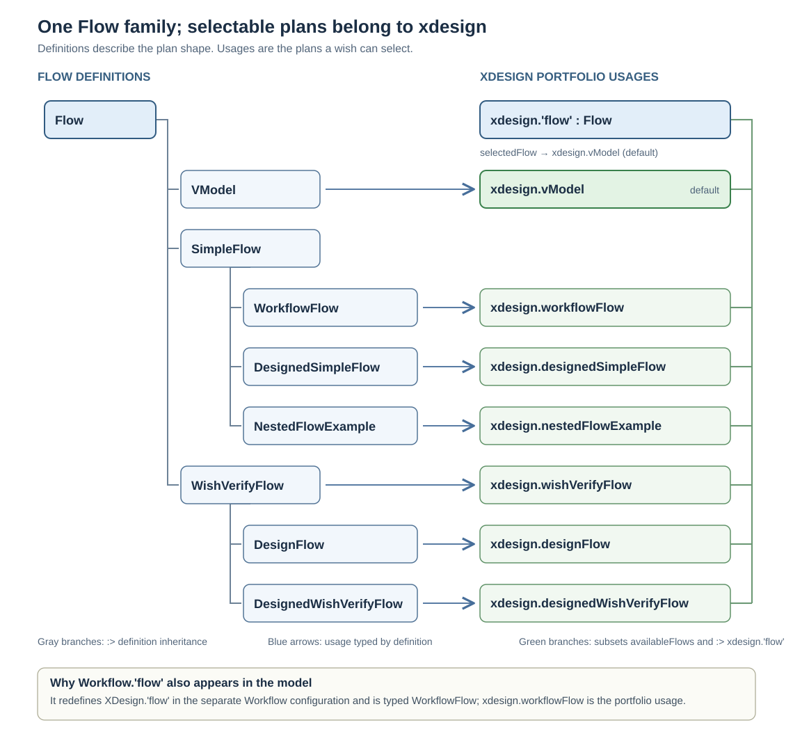
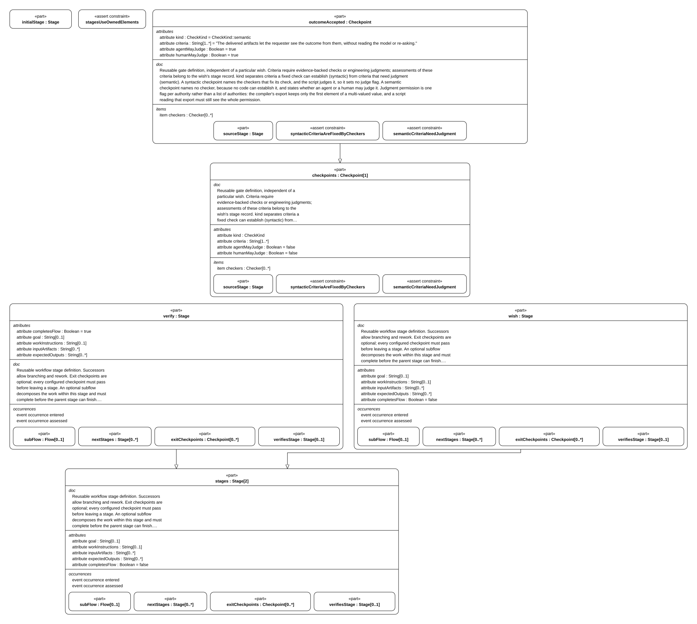

# Flow model and catalog

This page is the shared starting point for the design of every flow: the flow/stage/checkpoint vocabulary, the declared flow catalog, and the links to the common lifecycle, evidence, adapter, and flow-specific design. A specific flow states only its differences and declared values here.

| Page | Scope | Owns |
| --- | --- | --- |
| flow.md (this page) | common | flow/stage/checkpoint vocabulary and flow catalog |
| [lifecycle.md](lifecycle.md) | common | generic run lifecycle, advancement, reopening, blocked correction, rework |
| [evidence-and-revisions.md](evidence-and-revisions.md) | common | revisions, assessments, artifact identity, retained evidence, invariants |
| [adapters.md](adapters.md) | common | checker-command and judge boundaries, reports, authority |
| [flows/simple-flow/](flows/simple-flow/index.md) | flow-specific | definition, implementation, views for the four-stage flow |
| [flows/wish-verify/](flows/wish-verify/index.md) | flow-specific | definition, implementation, views for the two-stage judged flow |
| [api/](api/index.md) | class/function | one design document per API |

## 1. Flow, stage, checkpoint, checker

| Definition | Fields | Meaning |
| --- | --- | --- |
| `Flow` | `stages [1..*]`, `checkpoints [1..*]`, `checkers [0..*]`, `initialStage` | Owns the stages and gates of one workflow. `stagesUseOwnedElements` requires every stage to reference only stages, checkpoints and checkers of its own flow |
| `Stage` | `subFlow [0..1]`, `nextStages [0..*]`, `exitCheckpoints [0..*]`, `verifiesStage [0..1]`, `completesFlow`; events `entered`, `assessed` | One step: work happens here, successors allow branching and rework, exit checkpoints gate leaving. A verification stage names the stage it checks |
| `Checkpoint` | `sourceStage`, `kind`, `criteria [1..*]`, `checkers [0..*]`, `agentMayJudge`, `humanMayJudge` | A gate. Criteria are what must hold before the stage is left |
| `Checker` | `checkerId`, `commandUri`, `establishes [1..*]`, `rules [0..*]` | A deterministic check fixed as code or a script, so the flow runs it unchanged instead of judging afresh. A designed flow's checkers declare the rules that decide them ([D06](flows/simple-flow/definition.md#d06)) |
| `CheckerRule` | `ruleId`, `condition`, `reads [1..*]` | One logical rule a checker applies; the checker's outcome is the conjunction of its rules' verdicts, and its report names each rule with its verdict |

A flow is independent of any wish: it says what work exists and what must hold, never who
wants it or when it ran. The state of one wish inside a flow is recorded separately
([E01](../interfaces/record-format.md#e01)).

## 2. The flows in this model

`XDesignArchitecture::Flow` is the reusable workflow type. Its definitions form
three branches: `VModel`; `SimpleFlow` with `WorkflowFlow`, `DesignedSimpleFlow`, and
`NestedFlowExample`; and `WishVerifyFlow` with `DesignFlow` and
`DesignedWishVerifyFlow`. In particular,
`WorkflowFlow` and `DesignedSimpleFlow` are siblings. One does not inherit the other.

`XDesignComposition::xdesign` owns the concrete selectable usages. The abstract
`xdesign.'flow' : Flow` is their shared feature origin; each usage is typed by one
definition, specializes that origin, and belongs to `availableFlows`. In the model,
`part def DesignedSimpleFlow :> SimpleFlow` means **definition inheritance**;
`part designedSimpleFlow : DesignedSimpleFlow :> 'flow'` means **an xdesign-owned
usage with a definition type and a shared feature origin**. These are different
relationships, drawn separately below.

> **Figure F03-1 — Flow definitions and selectable usages.**  
> **Question:** How do the named flows relate to `Flow` and `xdesign.'flow'`?  
> **Model view:** Compiler-export projection of `Flow` subclassifications, `XDesignComposition::xdesign` feature typing and portfolio subsettings, and the separate `Workflow.'flow'` redefinition.  
> **Companions:** [F01](#f01) for the reusable flow contract and [B01](../architecture/system-composition.md#b01) for xdesign ownership and controller bindings.  
> **Status:** renderable-now.  
> **Reading:** Follow gray branches for definition inheritance, blue arrows for each usage's type, and green branches for the usages that share `xdesign.'flow'` and `availableFlows`. `selectedFlow` identifies `xdesign.vModel` as the default.  
> **Limits:** This shows type and ownership relationships, not stage order, gate outcomes, or evidence from a wish run.

`XDesignWorkflow::Workflow` is another *definition* that specializes `XDesign`.
Its `Workflow.'flow' : WorkflowFlow` redefines the inherited `'flow'` feature for
the `Workflow::executeWish` scenario. The concrete portfolio in this project is
`XDesignComposition::xdesign : XDesign`; its corresponding selectable member is
`xdesign.workflowFlow`. This explains why both names appear in model views.

`xdesign.selectedFlow` points to `xdesign.vModel` by default. The composition
binds the controller's `availableFlows` and `defaultFlow` to its portfolio and
selection. `receiveWish` may choose another owned member and records that choice
in the trace. Its `selectedFlowIsAvailable` assertion requires portfolio
membership; the generic controller is a model specification, not an implemented
application.

| Flow usage | Stages | Exit checkpoints | Selected when |
| --- | --- | --- | --- |
| `xdesign.vModel : VModel` | 11 stages: `wishIntake` → `stakeholderNeeds` → `systemRequirements` → `systemArchitecture` → `detailedDesign` → `implementation` → `componentVerification` → `integrationVerification` → `systemVerification` → `acceptanceValidation` → `delivery` | 11, one per stage: 3 syntactic (`requirementsAccepted`, `implementationReady`, `deliveryAccepted`), 8 semantic | The default full V-model |
| `xdesign.workflowFlow : WorkflowFlow` | `requirements` → `design` → `implement` → `'verify'` | `verificationAccepted` (semantic) | Historical four-stage runs for wishes 0001–0004 and 0007; also the plan illustrated by `Workflow::executeWish` |
| `xdesign.wishVerifyFlow : WishVerifyFlow` | `wish` → `'verify'` | `outcomeAccepted` (semantic) | A judged artifact, such as documentation or analysis |
| `xdesign.designFlow : DesignFlow` | `wish` → `'verify'` | `sysmlDeliverableAccepted` (syntactic, judged by the pinned compiler), `outcomeAccepted` (semantic) | A SysML design deliverable and its documentation, before implementation ([V05](../records/wishes/wish-history.md#v05)) |
| `xdesign.designedSimpleFlow : DesignedSimpleFlow` | The four `SimpleFlow` stages, in order | 5: four fixed syntactic gates and inherited semantic `verificationAccepted` | An executable gated run ([D01](flows/simple-flow/definition.md#d01), [D07](flows/simple-flow/definition.md#d07), [P08](../records/executions/simple-flow.md#p08)) |
| `xdesign.designedWishVerifyFlow : DesignedWishVerifyFlow` | The two `WishVerifyFlow` stages, `wish` → `'verify'`, in order | 2, both semantic: `wishAccepted` (added at the wish stage) and inherited terminal `outcomeAccepted`, each judged by a permitted agent or human | An executable gated judged run ([D57](flows/wish-verify/definition.md#d57), [D61](flows/wish-verify/definition.md#d61), [P25](../records/plans/wish-verify.md#p25)) |
| `xdesign.nestedFlowExample : NestedFlowExample` | Four `SimpleFlow` stages; `design` has a nested four-stage subflow | `verificationAccepted` (semantic) at the outer terminal stage | Demonstrates the subflow completion rule ([F05](lifecycle.md#f05)) |

> **Figure F03-2 — Wish-to-verification flow.**  
> **Question:** How is a judged artifact delivered without implementation stages?  
> **Model view:** Internal-structure projection of `XDesignArchitecture::WishVerifyFlow`.  
> **Companions:** [F02](adapters.md#f02) for checkpoint kinds and [V03](../records/wishes/wish-history.md#v03) for a recorded run.  
> **Status:** renderable-now.  
> **Reading:** The wish stage produces the artifact, then verification judges the outcome at its semantic checkpoint. The figure makes the two-stage boundary explicit.  
> **Limits:** It does not describe `DesignFlow`'s additional compiler check or a particular assessment's evidence.

`WishVerifyFlow` is the flow for semantic-only work: no requirement, design or
implementation stage, so nothing is produced that pretends to be checkable. The wish
stage records the request and does the work; verification judges the outcome
([V03](../records/wishes/wish-history.md#v03)).

`DesignFlow` is the design-stage flow: the wish stage produces the SysML deliverable and
its documentation; verification is a syntactic check by the pinned compiler
(`sysmlDeliverableAccepted`) and the inherited semantic judgment of what the design means
(`outcomeAccepted`). It has no implementation stage: implementation starts only after a
language is selected ([V05](../records/wishes/wish-history.md#v05),
[D07](flows/simple-flow/definition.md#d07)).

`DesignedSimpleFlow` specializes `SimpleFlow` without changing the historical
`xdesign.workflowFlow` stages or gates. Its concrete usage adds an exit gate to every
stage, the first three syntactic and verification by a syntactic record gate plus the
inherited semantic judgment. The rules
and commands for each syntactic gate are implemented in the four-stage local slice
([D05](flows/simple-flow/definition.md#d05),
[D06](flows/simple-flow/definition.md#d06),
[D07](flows/simple-flow/definition.md#d07),
[P08](../records/executions/simple-flow.md#p08)).

`DesignedWishVerifyFlow` specializes `WishVerifyFlow` the same way, without changing
the historical `xdesign.wishVerifyFlow` usage or its wish-0005 and wish-0009 records.
It adds a semantic exit gate, `wishAccepted`, to the wish stage the architecture left
ungated — a designed flow gates every stage — and retypes the inherited terminal
`outcomeAccepted` so the run evaluates both gates through one checkpoint class. Both
gates are judged by a permitted agent or human; the flow declares no syntactic
checkpoint and no checker, because the architecture states that nothing in this flow's
outcome is established by a fixed check. Its design, judgment contract, and views are
documented under [details/wish_verify_flow/](flows/wish-verify/index.md#d56),
and its Rust slice is `xdesign::wish_verify`
([P25](../records/plans/wish-verify.md#p25)).

The shared flow definitions and controller rules stay in this document. A flow's
specialized design belongs in its own addressable location: the current developed
SimpleFlow design is under [details/simple_flow/](flows/simple-flow/definition.md#d01).
A new selectable plan must be added to the `xdesign` portfolio and documented in the
[entry](../index.md); its design can have a sibling directory when needed. Adding
one does not recast SimpleFlow sections or make its gates apply to another flow
([D30](../interfaces/documentation-contract.md#d30)).
