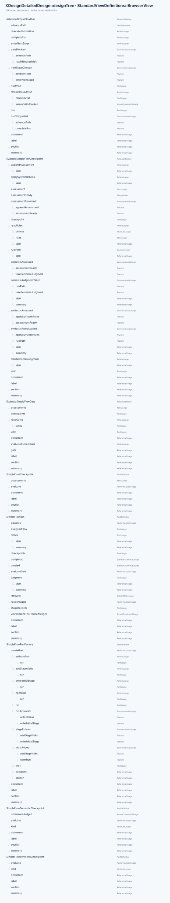
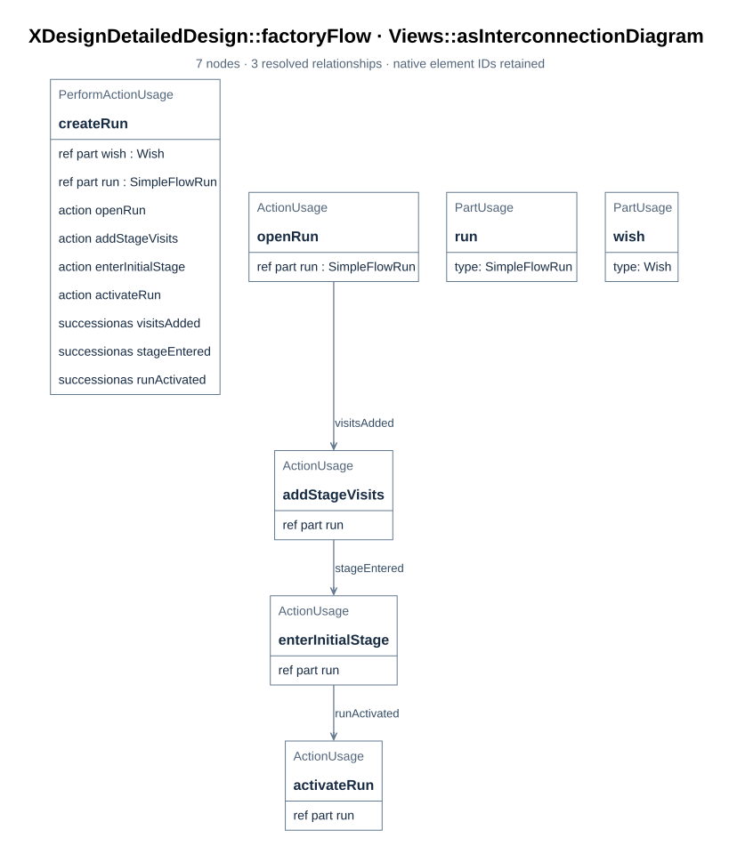
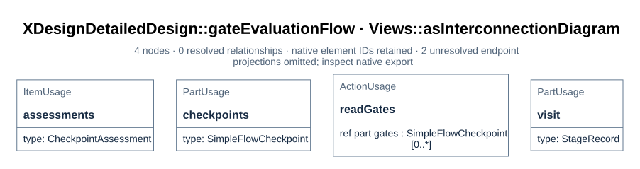
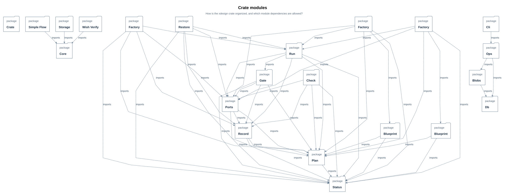
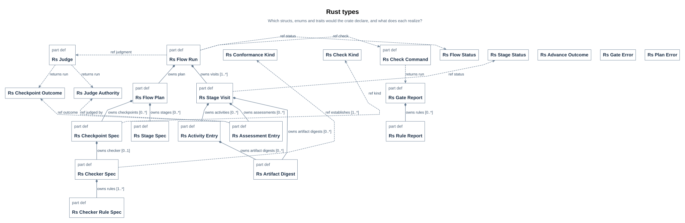
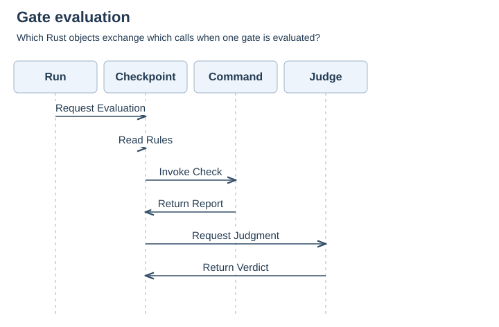
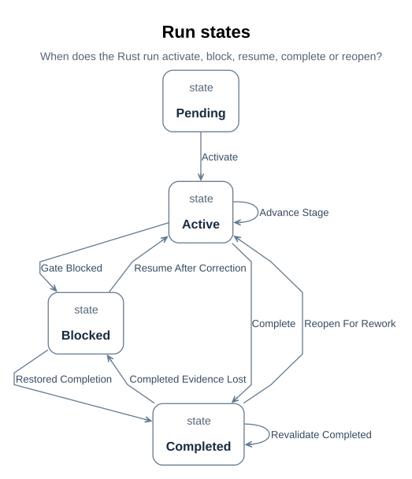

# SimpleFlow implementation

How SimpleFlow is realized: its run class, factory, functions, module types and behavior, checks and error handling, test points and limits, and the Rust UML design. The class-and-function contract of each API is in design/api; the shared lifecycle and evidence semantics are in design/lifecycle.md and design/evidence-and-revisions.md.

## 1. The run class

> **Figure D02-1 — Run design definitions.**  
> **Question:** Which classes and functions realize one run of the designed flow?  
> **Model view:** `XDesignDetailedDesign::designTree`, a browser view of the run design.  
> **Companions:** [D03](#d03) for creation and [D11](definition.md#d11) for checkpoint evaluation.  
> **Status:** renderable-now; design view with a tested first executable slice.  
> **Reading:** The run class specializes `FlowExecution` and names its visits, ports, events, and operations. The factory and action definitions provide the creation, assessment, and advancement roles.  
> **Limits:** Declared members do not establish an implemented class or an executed run.

`SimpleFlowRun` specializes the architecture's generic `FlowExecution`
([E01](../../../interfaces/record-format.md#e01)): one run of the designed flow, with the flow's plan
and operations fixed. A wish's execution is typed by it — the realization is the typing,
not a declaration beside it ([R01](../../../requirements/requirements.md#r01),
`runRealizesItsDesign`), and a check establishes it for a run on the designed usage.

| Member | What it is |
| --- | --- |
| `assignedFlow : DesignedSimpleFlow` (redefined) | The class of plan this run executes; a concrete run binds the `xdesign.designedSimpleFlow` usage |
| `stageRecords : StageRecord [4..*]` (redefined) | A visit to each of the four stages; a reworked stage appends a further visit, so the count grows |
| `check : ~CheckCommandExchange`, `judgment : ~JudgmentExchange` | The run's ports — the interfaces it invokes checks and presents judgments through ([D10](views.md#d10)) |
| `created`, `completed` | The run's events — the ends of its timeline ([D08](views.md#d08)) |
| `checkpoints : SimpleFlowCheckpoint [0..*]` | The designed flow's gates as checkpoint-class instances; the run evaluates them ([D11](definition.md#d11)) |
| `evaluateGate : EvaluateSimpleFlowGate` | The operation that hands each gate of the current visit to its class's `evaluate` operation ([D04](#d04)) |
| `advance : AdvanceSimpleFlowRun` | The operation that moves the run on when the gates authorize it ([D04](#d04)) |
| `reopenStage : ReopenSimpleFlowStage` | Explicitly reopen a completed terminal visit as a new visit while retaining the completed record ([D04](#d04)) |
| `visitsRealizeThePlannedStages` | Assertion: every visit is a visit to one of the plan's stages, and every stage of the plan has a visit |

The assertion, like every `assert constraint` in this model, is not evaluated by the
compiler ([T04](../../../architecture/constraints.md#t04)); it is read, and the factory ([D03](#d03)) and the
controller's rules are what keep it true.

## 2. The factory

> **Figure D03-1 — Run creation.**  
> **Question:** How does the factory initialize a designed run?  
> **Model view:** `XDesignDetailedDesign::factoryFlow`, an action-flow view of `SimpleFlowRunFactory::createRun`.  
> **Companions:** [D02](#d02) for the run's members and [F04](../../lifecycle.md#f04) for registration.  
> **Status:** renderable-now; design view with a tested first executable slice.  
> **Reading:** Creation opens the run, adds planned stage visits, enters the first stage, and activates the run. Those steps shape the execution record the controller will own.  
> **Limits:** The figure is an operation specification and does not show a completed registration test.

`SimpleFlowRunFactory::createRun` models a `Wish` input and the designed flow's plan and
produces the run. The local Rust `create_run` receives `wish_model_uri`, a path identifying
the independent wish SysML source; it does not load a `Wish` item. The factory realizes
the run-creation part of `Controller::receiveWish`
that assigns the flow, opens the run and enters its initial stage
([F04](../../lifecycle.md#f04)) — so an implementation of the simple flow builds
one factory instead of re-deriving the generic controller's behaviour.

| Step | What it does |
| --- | --- |
| `openRun` | Creates the run, bound to the plan, with no visits yet |
| `addStageVisits` | Adds one pending visit per stage — `requirements`, `design`, `implement`, `verify` — each bound to its stage, at visit index 0 and artifact revision 0 |
| `enterInitialStage` | The `requirements` visit becomes current and active at revision 0; the rest stay pending |
| `activateRun` | The run becomes active, so the controller records activities against it |

The boundary stays where the architecture put it: the wish remains an item of the
`Workflow` composition and the trace that holds the run is the controller's, produced by
`receiveWish` ([B01](../../../architecture/system-composition.md#b01)); the factory only shapes the
run itself.

## 3. The functions

> **Figure D04-1 — Gate evaluation function.**  
> **Question:** How does a run obtain checkpoint assessments before advancing?  
> **Model view:** `XDesignDetailedDesign::gateEvaluationFlow`, an action-flow view of `EvaluateSimpleFlowGate`.  
> **Companions:** [D11](definition.md#d11) for the checkpoint class and [E04](../../evidence-and-revisions.md#e04) for assessment records.  
> **Status:** renderable-now; design view with a tested first executable slice.  
> **Reading:** The function takes the current visit's exit gates and delegates each assessment to its checkpoint class. It records the outcome before the separate advance function tests authorization.  
> **Limits:** The figure does not make an absent checker command runnable or establish a pass.

**`EvaluateSimpleFlowGate`** selects only the current visit's stage exit gates from the
plan, then iterates over them in plan order. Each gate's class `evaluate` operation
appends one `CheckpointAssessment` to the visit. The verify stage has both a fixed
record gate and a semantic gate; both iterations are required. The class operation
is `EvaluateSimpleFlowCheckpoint`; its two adaptations implement it as `RunSyntacticCheck`
(a syntactic checkpoint) and `TakeSemanticJudgment` (a semantic checkpoint)
([D11](definition.md#d11)).

- **The script path (syntactic).** The gate's checker command runs through the run's check
  port, applies the rules the checker declares — rule by rule, reporting each verdict —
  and its report for the visited revision is the evidence; the assessment is recorded with
  `judgedBy = script` and holds only when every rule holds. Nothing is judged afresh,
  which is what makes one check reproducible and comparable across revisions
  ([F02](../../adapters.md#f02)).
- **The judge path (semantic).** The gate's criteria and the visit's artifacts and evidence
  go through the judgment port to a judge the gate permits; the rationale and evidence are
  recorded. No code settles it, and none pretends to.
- Either way: a gate with no assessment authorizes nothing, and `unevaluated` criteria
  provide no authorization to advance ([E04](../../evidence-and-revisions.md#e04)).

**`AdvanceSimpleFlowRun`** is the successor rule of the designed flow: when the current
visit is authorized *at the visited revision*, the stage that follows hands the run its
pending visit; the `verify` stage has no successor, so its completion completes the run,
which is what lets the controller deliver the trace ([E05](../../evidence-and-revisions.md#e05)).
A visit that is not authorized stays current and blocked. Corrective work records a
content-change activity in that same visit and increments its artifact revision, even
when the artifact URI stays the same; earlier assessments remain attached to the
revision they judged ([E03](../../evidence-and-revisions.md#e03)).
`ReopenSimpleFlowStage` is a separate explicit action for a completed terminal run:
it preserves the completed verification visit and appends a new active verification
visit with the next visit index and revision 0. Reopening an earlier completed stage
needs downstream invalidation rules and is outside this action.

These action bodies are specifications, not executed results: the compiler resolves
their names but does not evaluate their `assert constraint` bodies
([T04](../../../architecture/constraints.md#t04)). The executable cases in
[D54](../../../verification/design.md#d54) must establish their behavior.

## 4. Module overview and allocation

`SimpleFlowRun` records a wish's planned and visited stages. The factory constructs that
run; `SimpleFlowCheckpoint` evaluates a gate and retains its assessment; the advance
operation consults the current visit before entering another stage. The module boundary
is the designed SimpleFlow automation, with a checker-command exchange and a separate
judge exchange. [D01–D04](definition.md#d01) state the run and operation contract;
[D05–D07](definition.md#d05) state gate criteria and the fixed rules.

| Concern | Current source | Status |
| --- | --- | --- |
| Requirements and design allocation | [R01–R02](../../../requirements/requirements.md#r01), [D15](../../../verification/requirements.md#d15) | Structural satisfaction and planned project-level verification; the four SimpleFlow checker commands execute |
| Module boundary and roles | [D17](../../../requirements/requirements.md#d17), [D14](views.md#d14) | Modeled design and local Rust slice; generic application integration pending |
| Package ownership | [D21](../../../architecture/system-composition.md#d21) | Model organization, not deployment |
| Stage and gate realization | [D01](definition.md#d01), [D05](definition.md#d05) | Four-stage run and five gates execute locally; historical wish assessments remain separate |

The module does not own the user's engineering judgment or turn a passed compiler check
into verification of engineering meaning. Those outcomes belong to the wish trace and
its assessed artifact revision.

## 5. Classes and data structures

The run, factory, checkpoint, stage visit, and assessment types are the module's core
structures. [D02](#d02) gives the run's key features and multiplicities;
[E01–E04](../../../interfaces/record-format.md#e01) define the retained visit and evidence
records. The type figure below explains ownership and specialization. A Rust realization
exists, while durable storage layout remains open.

| Core type | Modeled shape and responsibility | Range or invariant | Implementation status |
| --- | --- | --- | --- |
| `SimpleFlowRun` | `FlowExecution` specialization with planned stages and visits | At least one visit per planned stage; current visit determines advancement | Realized by the generic `RsFlowRun` bound to the designed blueprint for the four-stage local slice; durable persistence open |
| `SimpleFlowRunFactory` | Creation operation for a typed run and its initial plan | One creation path per requested run in [D03](#d03) | Realized by the local Rust `create_designed_run` function |
| `SimpleFlowCheckpoint` | Common gate evaluation operation with syntactic and semantic specializations | Assessment kind follows its declared checkpoint kind | Realized by the local Rust gate/checker and judge ports; generic controller integration open |
| `StageRecord` | Stage, visit index, artifact revision, activities, assessments, and completion state | New rework visit preserves previous visit history | Realized by `RsStageVisit` in the JSON run; durable storage open |
| `CheckpointAssessment` | Checkpoint, evaluated revision, outcome, judge, rationale, and evidence references | Current pass must match the visit's artifact revision | Realized by `RsAssessmentEntry` in the JSON run; historical SysML records remain separate |

These are logical records, not a database schema. No units, byte sizes, persistence keys,
or serialized layouts are assigned where the model has not selected them.

## 6. Key flow design

The normal scenario starts with a controller-created run, enters a stage, obtains its
current-revision assessment, and advances only when the visit is authorized. Correction
of a blocked visit stays in that visit; explicit reopening of a completed terminal
visit creates another one without overwriting history. The three views below
divide interaction order, lifecycle state, and gate-evaluation control flow.

## 7. Algorithms and authorization logic

The principal decision is whether the current visit may complete. It counts distinct
required exit gates with passed assessments at the visit's artifact revision and checks
subflow completion. [D04](#d04) specifies how that result controls
advancement; the bound values and exact expression are below. The compiler parses the
relation but does not execute its constraint body.

## 8. Interface implementation contract

The module design declares two draft interfaces: a fixed checker-command exchange for
syntactic gates and a permitted agent or human judgment exchange for semantic gates. The
model separates their ports; [D10](views.md#d10) shows topology, while the
[interface control document](../../../interfaces/contracts.md#i01) inventories modeled fields,
directions, and unresolved operational fields. These are existing draft definitions;
neither endpoint has a running implementation or a frozen ICD baseline.

| Draft interface | Module role | Modeled fields and direction | Operational fields still open | ICD source |
| --- | --- | --- | --- | --- |
| IF-003 `CheckCommandInterface` | Run invokes; command responds | `wishModel`, `recordUri`, `checkerId`, `planId`, `planSha256`, `stage`, `artifactRevision`, `snapshotDigest` run → command; `report`, `reportedRevision`, `reportedSnapshotDigest`, `reportedRuleIds`, `holds` command → run | Report serialization, timeout, retry, idempotency, failure codes, versioning | [I04](../../../interfaces/contracts.md#i04) |
| IF-004 `JudgmentInterface` | Run presents; permitted judge responds | `criteria` and `artifactsUris` run → judge; `outcome` and `rationale` judge → run | Identity enforcement, URI resolution, response schema, timeout, retry, versioning | [I05](../../../interfaces/contracts.md#i05) |

The endpoint implementation must validate fields, retain the assessed revision, and
distinguish command failure from a failed engineering criterion. Transport, failure codes,
contract owners, and review authorities are still unassigned; [I09](../../../interfaces/contracts.md#i09)
tracks those decisions. The modeled item flows establish design intent, not interface
conformance evidence.

## 9. Errors, rework, and logging

A missing, failed, or stale assessment prevents completion of the current visit. The
design retains the assessment's outcome, rationale, and evidence URIs. Correction
increments the same visit's artifact revision on a content-change event; explicit
terminal reopening creates a new visit only after completion
([E03–E05](../../evidence-and-revisions.md#e03), [D20](views.md#d20)).
[D06](definition.md#d06) specifies diagnostics for the implemented checker
rules. Application error codes, retry policy, operational log levels, and correlation IDs
are not yet designed; they cannot be treated as implementation commitments.

## 10. Performance and resource design

The model defines no latency, throughput, CPU, memory, or concurrency budget for the run
and its gates. The sequence view states order, not duration; the authorization relation
is a logical condition, not a timing analysis. Performance targets and margins require
requirements and analysis before a CDR or release claim. The renderer's 900-pixel figure
readability target is a documentation quality requirement, not a workflow performance
budget ([D24](../../../interfaces/documentation-contract.md#d24)).

## 11. Test points and verification planning

| Test focus | Requirement or rule | Method and expected evidence | Status |
| --- | --- | --- | --- |
| One assessment per required gate at the current revision | `designedFlowGatesEveryStage`, `GateAuthorization` | Model review, Rust behavior tests, and a retained four-stage run | Tested for SimpleFlow; [P08](../../../records/executions/simple-flow.md#p08) |
| Failed or stale gate blocks advancement | `gateSyntaxIsRunnable`, [D16](views.md#d16) | Boundary tests against the run and retained visit evidence | Tested for the crate; [P08](../../../records/executions/simple-flow.md#p08) |
| Correction preserves the blocked visit; explicit terminal reopen preserves the completed visit | `runRecordIsScriptChecked`, [D20](views.md#d20) | Record-check command and recovery tests | Tested for the crate; [P08](../../../records/executions/simple-flow.md#p08) |
| Correct checker and judge routing | `syntacticAssessmentIsScripted`, `semanticCheckNamesItsJudges` | Rule report for script checks and rationale/evidence for agent or human checks | Tested for the local command boundary; [P08](../../../records/executions/simple-flow.md#p08) |

The requirements view in [D15](../../../verification/requirements.md#d15) shows a focused
model review case. Its declaration does not record a pass. The separate SimpleFlow
execution record [P08](../../../records/executions/simple-flow.md#p08)
identifies the tests that actually ran; historical wish design-stage assessments
remain in the independent wish records.

## 12. CDR evidence and design baseline status

| CDR evidence item | Current state |
| --- | --- |
| Allocated types, gates, and interface definitions | Model and sections above describe them; the ICD is proposed, not frozen |
| Every requirement's verification case, method, and phase | The selected model review is declared; full matrix and executable cases remain incomplete |
| Build, assembly, integration, and test maturity | The four-stage Rust crate, four commands, unit/integration tests, and local CLI example run; generic workflow application remains open |
| Residual risks and waivers | Unevaluated constraint bodies, incomplete performance/interface behavior, historical evidence, and default V-model automation remain open |

No CDR has frozen this module design. The stage checklist is used to expose the remaining
evidence, not to imply a passed gate ([V08](../../../verification/review-criteria.md#v08)).

## 13. Open module decisions

| Decision needed | Why it matters | Current state |
| --- | --- | --- |
| Checker and assessment provenance policy | Source revision and evidence-byte retention need a durable project policy | Commands and report schema execute; provenance limits remain in [P12](../../../records/reviews/simple-flow-fixes.md#p12) |
| Persistence, retries, and observability for run records | Needed to execute and diagnose rework safely across restarts and users | Local JSON serialization exists; durable storage, retries, and observability remain unspecified |
| Performance and capacity targets | Needed for measurable resource design | No target in current requirements |
| Interface versioning and runtime transport | Needed before binding consumers to an implementation | Proposed contract in [I01](../../../interfaces/contracts.md#i01) |

> Module: the `xdesign` crate — `xdesign::core` + `xdesign::simple_flow` | Version: v0.1 | Status:
> implemented four-stage slice, exercised by `tests/simple_flow.rs`
> and the fixed-command tests; model views remain design projections.
> Audience: module implementers, integrators, verifiers, and reviewers.
> Relation: [module design](#d32) | requirements
> [R01](../../../requirements/requirements.md#r01) (`rustUmlDesignMapsEveryDesignElement`,
> `umlViewsAreSelectedWithReasons`, `softwareDesignClaimsNoImplementation`) | interface
> contract [I01](../../../interfaces/contracts.md#i01) | view applicability and figure rules
> [U09](../../../interfaces/documentation-contract.md#u09). Model source: `mbse/model/uml.sysml`
> (package `XDesignRustUml`).

## 14. Revision history

| Version | Date | Author | Change summary | Reviewed by |
| --- | --- | --- | --- | --- |
| v0.1 | 2026-10-19 | kimi-agent | First draft: crate layout, types, gate interaction, run states | wish-0009 `outcomeAccepted` assessment ([V16](../../../records/wishes/wish-history.md#v16)) |
| v0.1 implementation alignment | 2026-10-20 | Codex | Reconciled the crate, API, local record writes, and executable test points with the model design | [SimpleFlow implementation plan](../../../records/plans/simple-flow.md#p06) |
| v0.1 project integration | 2026-10-20 | Codex | Placed the SimpleFlow module and API reference beneath the xdesign crate boundary | Project boundary review pending |
| v0.1 two-layer restructure | 2026-10-20 | kimi-agent | Split the crate design into `core` + `simpleFlow` layers, renamed `RsSimpleFlowRun` to `RsFlowRun` realizing `FlowExecution`, and repointed API links to the API design set under `docs/design/api/` | [restructure plan](../../../records/plans/api-layering.md#p22), documentation step |

## 15. Purpose, scope and reading order

This document is the UML software design of the designed simple flow
([D01](definition.md#d01)) realized by the `xdesign` crate — the generic
`xdesign::core` run engine plus the designed flow in `xdesign::simple_flow`.
The SysML detailed design fixes what a run is made of; this design decides what a Rust
program declares to realize it — modules, structs, enums, traits and functions —
and records which SysML design element each Rust element realizes. The design model is
`XDesignRustUml` in `mbse/model/uml.sysml`; its views are SysML projections
rendered by the pinned toolchain, under the figure rules of the documentation contract
([U10](../../../interfaces/documentation-contract.md#u10)).

The source files and executable tests now exist within the `xdesign` package. This
document explains their design relationship, while the
[project implementation plan](../../../records/plans/simple-flow.md#p06)
records executed results. Async runtimes, durable multi-user persistence, generic
controller integration, and the default V-model remain outside this module's scope.
The local JSON record under `cache/` supports the fixed checkers but is not a
durable product evidence store.

Reading order: [module layout](#d45) -> [types](#d46) -> [interactions](#d47) ->
[states](#d48) -> [interfaces](#d49) -> [errors and performance](#d50) ->
[tests and traceability](#d51) -> [view applicability](views.md#d52). The class-and-function
level of this design — every public API with its full Rust signature, contracts and
stepwise logic — lives in the [xdesign API design set](../../api/index.md#u14), one design page per API.

## 16. xdesign crate layer and module structure

The `xdesign` crate splits into two layers, and dependencies point one way:
`simple_flow` may use `core`, never the reverse. `core` owns the flow-agnostic
infrastructure in seven source modules: `status` defines vocabulary, `plan` and
`record` hold data and hash identities, `ports` declares the check-command and judge
trait boundaries with their reports, `gate` evaluates one checkpoint, `run` owns the
run engine's state changes, and `factory` builds a run from any structurally valid
plan. `simple_flow` owns the designed four-stage flow in three source modules:
`blueprint` holds the designed plan as data with its blueprint conformance, `factory`
constructs the designed run through the generic constructor, and `check` adapts the
four fixed checker commands. Within `core`, dependencies point toward the data
definitions, so the run behavior never reaches back into its callers. The model
declares this layout under `XDesignRustUml::crate`; the figure projects it.

The source layout landed with step 3 of the
[restructure plan](../../../records/plans/api-layering.md#p22):
`src/core/{status,plan,record,ports,gate,run,factory}.rs` and
`src/simple_flow/{blueprint,factory,check}.rs` now hold the implemented code,
and the model layout and this section are its contract. The crate-level layer
map is [U68](../../api/index.md#u68).

> **Figure D45-1 — xdesign crate module layout.**  
> **Question:** How is the xdesign crate organized, and which module dependencies are allowed?  
> **Model view:** Package projection of `XDesignRustUml::rustModuleLayout`.  
> **Companions:** [crate layers U68](../../api/index.md#u68), [class structure](#d46), [module design D32](#d32).  
> **Status:** renderable-now; the SimpleFlow source modules are implemented.  
> **Reading:** The crate contains two layer packages, `core` and `simpleFlow`; the leaf boxes are their Rust source modules and the arrows are allowed `use` dependencies. Dependencies point from `simpleFlow` into `core` and, within `core`, toward the data definitions, so `status` sits at the bottom with no dependencies.  
> **Limits:** Shows the designed module layout, not the future generic controller, external crates, or deployment.

| Module | Responsibility | Depends on |
| --- | --- | --- |
| `core::status` | Flow, stage, check-kind, outcome and judge-authority enums | — |
| `core::plan` | Stage, checkpoint, checker and rule specifications; structural validation | `core::status` |
| `core::record` | Visit, activity and assessment entries; artifact hashing | `core::status`, `core::plan` |
| `core::ports` | `RsCheckCommand` and `RsJudge` traits; gate and rule reports | `core::status`, `core::plan`, `core::record` |
| `core::gate` | Single-checkpoint evaluation | `core::status`, `core::plan`, `core::record`, `core::ports` |
| `core::run` | The generic run engine `RsFlowRun`, its state handling and advancement | `core::status`, `core::plan`, `core::record`, `core::ports`, `core::gate` |
| `core::factory` | Generic run construction `create_run` | `core::status`, `core::plan`, `core::record`, `core::ports`, `core::run` |
| `simple_flow::blueprint` | The designed four-stage plan as data; blueprint conformance | `core::plan`, `core::status` |
| `simple_flow::factory` | Designed-run construction `create_designed_run` | `simple_flow::blueprint`, `core::run`, `core::plan`, `core::ports`, `core::status` |
| `simple_flow::check` | `RsProcessCheck`, the fixed four-checker command adapter | `core::ports`, `core::plan`, `core::record`, `core::status` |

The modeled `XDesignCrate` owns the modules under `crate` and exposes the two
automation boundaries as ports typed
by the design's existing exchanges ([D49](#d49)), so the crate honors the modeled
interfaces instead of inventing new ones.
The project package view [D21](../../../architecture/system-composition.md#d21) includes
`XDesignRustUml` beside architecture, detailed design, verification, and
traceability. Each Rust model element's `DocSection` points to its specific
[API page](../../api/index.md#u14); the views and package retain
their module-level sections here. This keeps the software design in the same
model-to-document chain as the rest of the system.

## 17. Types: structs, enums and traits

The crate's types fall in three groups. **Status enums** mirror the model's lifecycle
vocabulary one-to-one (`RsFlowStatus`, `RsStageStatus`, `RsCheckKind`,
`RsCheckpointOutcome`, `RsJudgeAuthority`, `RsConformanceKind`), plus
`RsAdvanceOutcome`, which names the successor outcomes. **Record and plan structs**
carry data: a visit owns activities, assessments and artifact digests; completed
visits remain in history while blocked visits receive corrective work. The plan makes a
flow — stages, checkpoints, checkers, rules — data the run consults.
`RsFlowPlan::validate` keeps only structural checks; conformance to the exact
four-stage, five-checkpoint blueprint is the flow layer's `validate_designed_plan`.
**Traits** are the two automation boundaries, `RsCheckCommand` and
`RsJudge`; the run holds trait objects and knows no concrete checker or reviewer.

> **Figure D46-1 — Rust type structure.**  
> **Question:** Which structs, enums and traits does the crate declare, and what does each realize?  
> **Model view:** Block-definition projection of `XDesignRustUml::rustClassStructure`.  
> **Companions:** [gate interaction](#d47), [run states](#d48), [block definition D13](views.md#d13).  
> **Status:** renderable-now; core types implemented.  
> **Reading:** Each card is one Rust type with its fields; the `Rs` prefix marks the crate's Rust vocabulary. Composition (`Vec`-owned entries) runs from visit to activity and assessment entries and from plan to its specifications. `RsFlowRun` realizes the generic `FlowExecution`; a run whose plan is the frozen designed blueprint plays the `SimpleFlowRun` role.  
> **Limits:** Field types are design-level (strings, integers, enums); concrete Rust generics, lifetimes and serialization derives are implementation decisions.

Core data structures:

| Name | Shape / type | Range / units | Invariant |
| --- | --- | --- | --- |
| `RsStageVisit` | struct; `visit_index`, `artifact_revision`, current artifact digest | revision starts at 0 | Latest assessments cite both current revision and exact artifact snapshot digest ([D16](views.md#d16)) |
| `RsAssessmentEntry` | struct; `outcome`, `judged_by`, evaluated snapshot digest | SHA-256 | `checkpoint_id` resolves against the plan; a syntactic gate's entry is `judged_by = script` |
| `RsArtifactDigest` | struct; artifact URI and SHA-256 | lowercase 64-digit hash | Changes at the same URI invalidate the former byte identity ([U51](../../api/core/rs-artifact-digest.md#u51)) |
| `RsCheckpointSpec` | struct; `kind` enum, `checker` option | — | `checker` is present exactly when `kind = syntactic`; a semantic spec names judge flags and no checker |
| `RsFlowPlan` | struct; 4 stage specs and frozen plan URI/SHA-256 | exact plan file bytes | Stage order and exit gates equal `designedSimpleFlow` ([D01](definition.md#d01)) |
| `RsFlowRun` | struct; `visits: Vec<RsStageVisit>` | ≥ 4 visits | One initial visit per stage at creation; the initial stage is active and the others pending |

Every type realizes a named SysML design element, recorded as a `dependency` in
`XDesignRustUml` (for example `rsFlowRunRealizes` from `RsFlowRun` to
`XDesignArchitecture::FlowExecution`); `rustUmlDesignMapsEveryDesignElement` makes that mapping the coverage
obligation the design review reads ([D52](views.md#d52)). Each type's fields, methods,
invariants and per-function contracts are specified entry by entry in the
[xdesign API design set](../../api/index.md#u14); the two error enums
`RsPlanError` and `RsGateError` are Rust-side additions with their own pages
([U45](../../api/core/rs-plan-error.md#u45), [U46](../../api/core/rs-gate-error.md#u46)).

## 18. Interaction design

The key scenario is one gate evaluation. The run asks the current visit's checkpoint
spec to evaluate; the spec reads its own rules and branches on `kind`: a syntactic spec
invokes its checker through the `RsCheckCommand` trait and holds only when every rule
holds; a semantic spec presents its criteria and the visit's artifact and evidence URIs
through the `RsJudge` trait and records the returned verdict. Either way the run appends
the assessment to the current visit. The caller later invokes `advance()` for the
transition decision. The branch is exclusive for one spec; the figure draws both
paths because it specifies the operation, not one execution.

> **Figure D47-1 — Gate evaluation interaction.**  
> **Question:** Which Rust objects exchange which calls when one gate is evaluated?  
> **Model view:** Sequence projection of `XDesignRustUml::RsGateEvaluationInteraction`.  
> **Companions:** [type structure](#d46), [interface implementation](#d49), [activity view D18](views.md#d18).  
> **Status:** renderable-now; gate evaluation implemented.  
> **Reading:** Lifelines are the run, the checkpoint spec, the check command and the judge. The middle four messages are the kind branch: check invocation and report for a syntactic spec, judgment request and verdict for a semantic one.  
> **Limits:** One gate only; `evaluateGates` repeats it per exit checkpoint. No timeouts, retries or concurrency are designed — see [D50](#d50).

The run and gate functions map onto the model's operations (full signatures,
contracts and stepwise logic: the linked API pages):

| Rust function | Realizes | Decides | API entry |
| --- | --- | --- | --- |
| `create_run(plan, ...) -> Result<RsFlowRun, RsPlanError>` | `FlowExecution` construction ([E02](../../evidence-and-revisions.md#e02)) | Structurally validates the frozen plan and both record URIs; initial stage active | [U16](../../api/core/create-run.md#u16) |
| `create_designed_run(plan, ...) -> Result<RsFlowRun, RsPlanError>` | `SimpleFlowRunFactory::createRun` ([D03](#d03)) | Blueprint conformance, then generic construction | [U70](../../api/simple-flow/create-designed-run.md#u70) |
| `run.evaluate_gates()` | `EvaluateSimpleFlowGate` ([D04](#d04)) | One assessment per exit gate of the current visit | [U18](../../api/core/rs-flow-run-evaluate-gates.md#u18) |
| `evaluate_checkpoint(...) -> Result<RsAssessmentEntry, RsGateError>` | `EvaluateSimpleFlowCheckpoint` ([D11](definition.md#d11)) | Scripted report or permitted judgment, by `kind` | [U20](../../api/core/evaluate-checkpoint.md#u20) |
| `run.advance() -> RsAdvanceOutcome` | `AdvanceSimpleFlowRun` ([D04](#d04)) | Enter next stage, complete, or retain a blocked visit | [U19](../../api/core/rs-flow-run-advance.md#u19) |
| `run.record_activity(activity) -> Result<(), String>` | `Controller::recordActivity` ([F04](../../lifecycle.md#f04)) | Validate artifact bytes and correct the same blocked visit | [U48](../../api/core/rs-flow-run-record-activity.md#u48) |
| `run.reopen_stage(stage_id) -> bool` | `ReopenSimpleFlowStage` ([D04](#d04)) | Reopen a completed flow-completing stage as a new visit | [U49](../../api/core/rs-flow-run-reopen-stage.md#u49) |

## 19. State design

The run's state handling mirrors `SimpleFlowRunLifecycle`
([D20](views.md#d20)) with `RsFlowStatus` as the state variable the methods
maintain: `create_run` moves pending to active; a gate that is not authorized blocks the
run and its current visit; corrective work resumes that same visit and increments
its revision when artifact bytes change; an authorized nonterminal
visit advances within active; an authorized terminal visit completes it; and a completed
run can reopen its terminal stage as a new revision-zero visit without erasing history.
Calling `advance()` on an already completed run rechecks retained artifacts and passed
assessment evidence. Missing bytes block the run; after restoration a further
`advance()` can complete it again without appending a visit.

> **Figure D48-1 — Run state machine.**  
> **Question:** When does the Rust run activate, block, resume, complete or reopen?  
> **Model view:** State-machine projection of `XDesignRustUml::RsRunLifecycle`.  
> **Companions:** [gate interaction](#d47), [lifecycle D20](views.md#d20).  
> **Status:** renderable-now; run states implemented.  
> **Reading:** Four states with transitions keyed on `run.status`, which `create_run`, `evaluate_gates`, `advance`, `record_activity` and `reopen_stage` set. Blocked correction keeps the current visit; terminal reopening appends one. A completed run may revalidate in place, become blocked if retained evidence is lost, and complete again after restoration.
> **Limits:** This view's guards are status projections weakened for compiler support; they do not encode the artifact and evidence checks in [D16](views.md#d16) and the API methods.

| Transition | From → to | Model guard | Rust event |
| --- | --- | --- | --- |
| `revalidateCompleted` | completed → completed | `run.status == RsFlowStatus::completed` | `advance()` finds current and completed visit artifacts and passed evidence intact. |
| `completedEvidenceLost` | completed → blocked | `run.status == RsFlowStatus::blocked` | `advance()` finds missing or changed retained artifacts or missing passed evidence. |
| `restoredCompletion` | blocked → completed | `run.status == RsFlowStatus::completed` | After restoration, `advance()` revalidates the terminal visit and persists completion. |

## 20. Interface implementation

The crate honors the design's two modeled exchanges through its traits: `core::ports`
declares `RsCheckCommand` and `RsJudge`, and `simple_flow::check` adapts the four fixed
checker commands; the ports on `XDesignCrate` are typed by those exchanges, so
no new interface is invented here.
Field-level contracts stay in the interface control document
([I01](../../../interfaces/contracts.md#i01)).

| Interface | Role | Signature or message | Timeout / retry / idempotency | Interface contract |
| --- | --- | --- | --- | --- |
| `RsCheckCommand` trait ↔ `CheckCommandExchange` | consumer (run invokes a checker) | `run_check(checker, plan identity/digest, wish model URI, run record URI, stage, revision, snapshot digest) -> Result<RsGateReport, RsGateError>` | One synchronous subprocess per gate; no timeout or automatic retry in this slice | [U22](../../api/core/rs-check-command-run-check.md#u22), [U58](../../api/simple-flow/rs-process-check.md#u58), [I04](../../../interfaces/contracts.md#i04) |
| `RsJudge` trait ↔ `JudgmentExchange` | consumer (run presents to a judge) | `review(criteria, evidence_uris) -> (outcome, rationale)` after authority check | Synchronous caller-supplied verdict; no timeout or automatic retry | [U24](../../api/core/rs-judge-review.md#u24), [U59](../../api/core/rs-supplied-judge.md#u59), [I05](../../../interfaces/contracts.md#i05) |

Ordering in the implementation: the run writes its JSON record before each checker,
appends that gate's assessment, and writes again before the next gate. The verify
judge therefore receives the preceding record-check report as evidence. The
checker verifies the frozen plan file, current run snapshot, and artifact SHA-256
values; `advance()` rechecks the current bytes and latest assessments. A failed
record write blocks advancement. Subprocess failure becomes an `Unevaluated`
assessment; the project CLI configures the process adapter to retain stdout
and stderr logs under `cache/`.

## 21. Errors, logging and performance

- Error taxonomy, designed at the type level: a failed rule is data (`RsRuleReport`
  with `holds = false` and a diagnostic), not an exception; a missing checker for a
  syntactic spec is a plan error the factory must reject; a judge's refusal is an
  `unevaluated` outcome, never a fabricated pass.
- Retry, degradation and recovery: none designed. A blocked run resumes through
  corrective work and a new assessment at the new revision ([D48](#d48)); the design
  adds no automatic retry of commands or judgments.
- Logging: the local JSON run record retains activities and assessments; each
  fixed-command report has stdout and stderr logs. No separate telemetry or
  durable product evidence store is implemented.
- Performance: no budget is set. Gate evaluation is linear in the stage's exit
  checkpoints and their rules; authorization counting is linear in a visit's
  assessments. No measurement exists, and none is claimed.

## 22. Test points and traceability

The crate has executable Rust cases in `tests/simple_flow.rs`,
`tests/plan_model_sync.rs`, and `tests/process_check_contract.rs`, command-line
wish cases in `src/main_wish_tests.rs`, and fixed-command cases in
`tests/test_simple_flow_checkers.py` and `tests/test_simple_flow_design_layout.py`,
mapped to the [SF verification matrix](../../../verification/design.md#d54). The `TC-UML` identifiers below remain
design review points, not separately executed case records. Source tests cover
the behavioral rows named in the last column; model-view review remains separate.

| Requirement | UML element(s) | Design review point | Executable source coverage |
| --- | --- | --- | --- |
| `rustUmlDesignMapsEveryDesignElement` | `RsFlowRun`, `RsCheckpointSpec`, `RsFlowPlan` | TC-UML-01: every designed checkpoint resolves to a spec | `malformed_plans_are_rejected_before_run` checks plan shape; mapping review remains planned |
| `rustUmlDesignMapsEveryDesignElement` | `create_run` | TC-UML-02: initial stage and planned visits | `initial_visits_stage_scope_and_mixed_verify_gates` |
| `umlViewsAreSelectedWithReasons` | [D52](views.md#d52) table | TC-UML-03: each view has applicability and reason | Design review remains planned |
| `softwareDesignClaimsNoImplementation` | whole document | TC-UML-04: claims match repository artifacts | Documentation review remains planned |
| Gate authorization ([D16](views.md#d16)) | `evaluate_checkpoint`, `RsAdvanceOutcome` | TC-UML-05: latest verdict and snapshot control authorization | `latest_verdict_and_revision_control_authorization`; `later_unevaluated_supersedes_pass_at_same_revision` |
| Lifecycle ([D48](#d48)) | `RsFlowRun::reopen_stage` | TC-UML-06: blocked correction and terminal reopen preserve history | `failed_correction_reuses_visit_and_completed_run_needs_reopen` |
| Frozen plan and evidence ([D47](#d47)) | `RsFlowPlan`, `RsArtifactDigest`, `RsGateReport` | TC-UML-07: exact plan and artifact hashes reject drift | `malformed_plans_are_rejected_before_run`; `latest_verdict_and_revision_control_authorization` |
| Gate authority and report validity ([D49](#d49)) | `RsJudge`, `RsCheckCommand`, `evaluate_checkpoint` | TC-UML-08: invalid report or judge cannot pass | `malformed_reports_never_pass_but_rule_failure_is_failed`; `unauthorized_or_unreasoned_semantic_judge_cannot_complete` |
