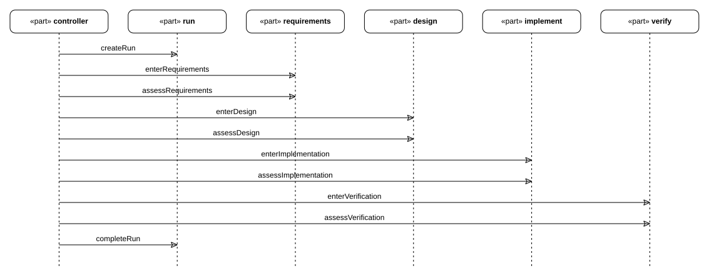
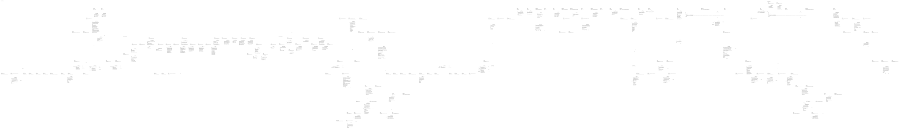
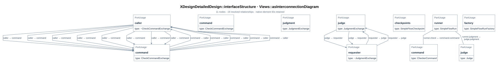
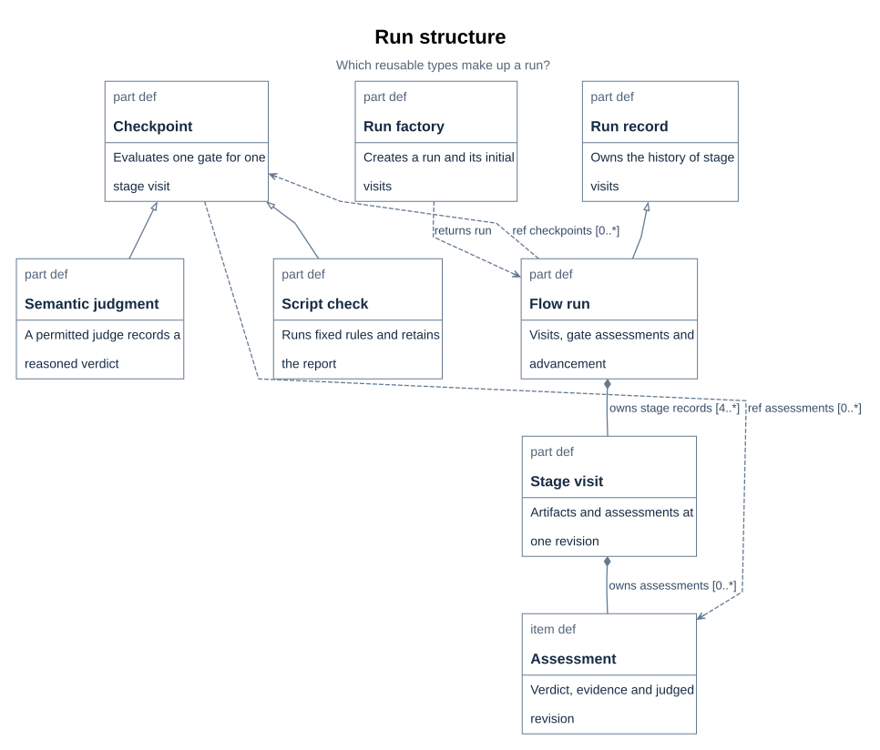
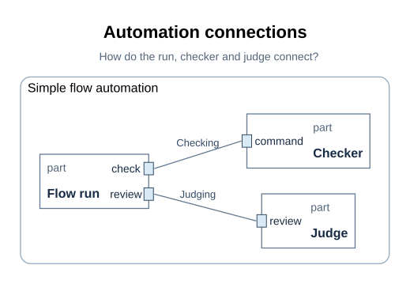
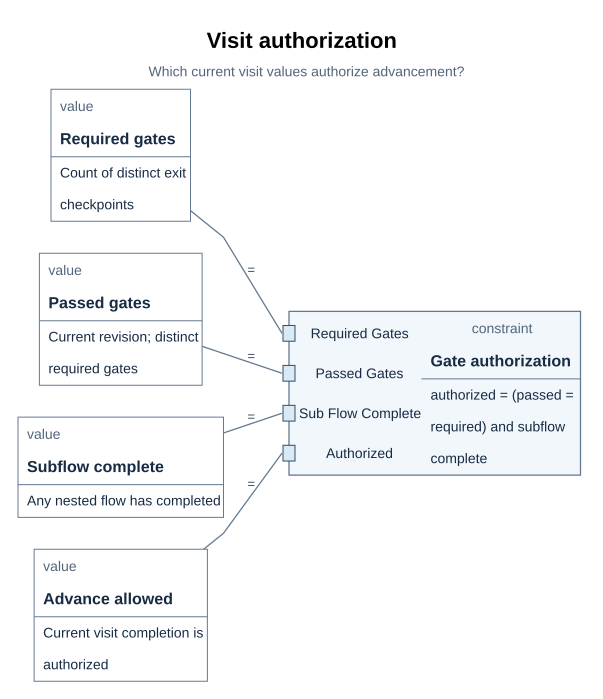
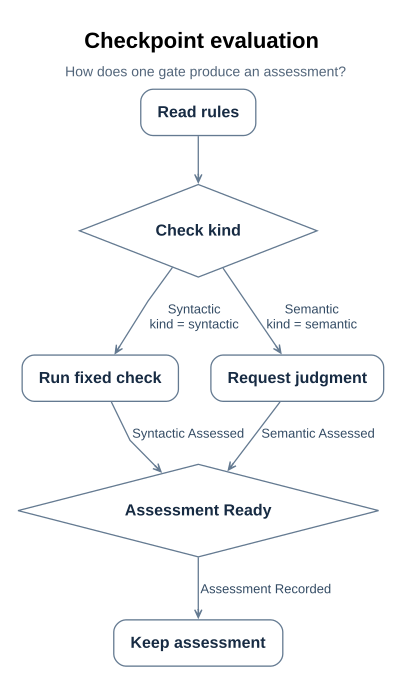
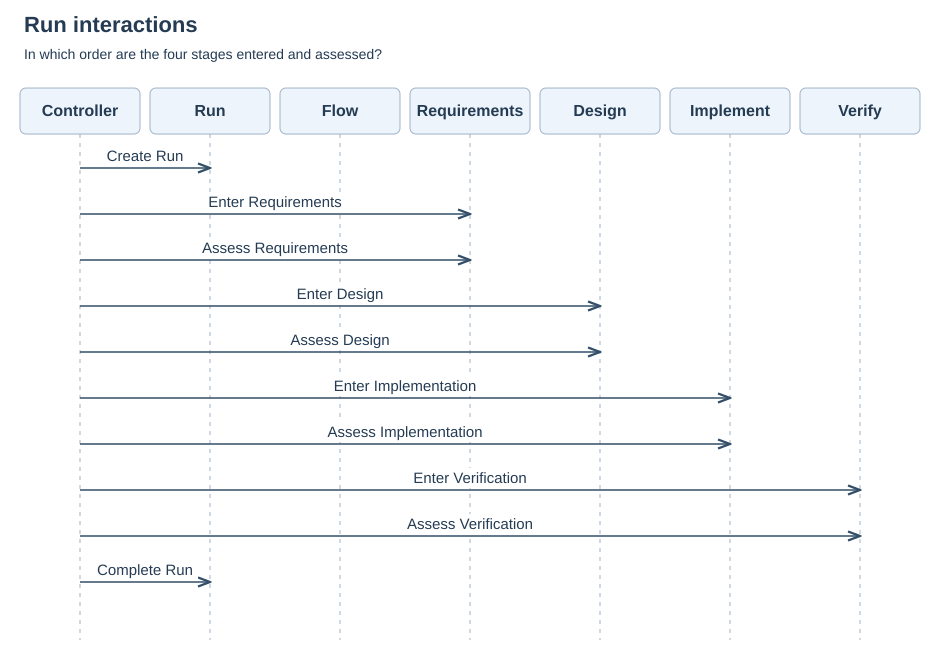
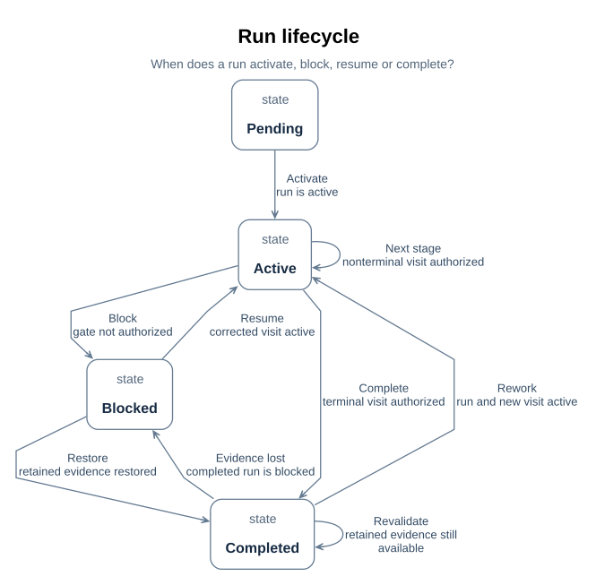

# SimpleFlow views

The views that explain the SimpleFlow design: timeline, logical structure, interfaces, the nine-question applicability and coverage, the block/sequence/state/activity/parametric/internal views, and the limits of each projection. The shared figure and presentation contract is in interfaces/documentation-contract.md.

Figure ownership:

| Figure group | Sections | Embedded in |
| --- | --- | --- |
| Timeline, logical, interface, coverage, block/sequence/state/activity/parametric/internal views | D08-D20 | views.md |
| Designed flow, run/factory/checkpoint realization figures | D01-D04 | definition.md and implementation.md beside their sections |
| Rust UML and API mapping figures | D44-D51 | implementation.md beside the Rust design sections |

## 1. The timeline

> **Figure D08-1 — Designed run timeline.**  
> **Question:** In what order does the normal run enter stages and assess gates?  
> **Model view:** Sequence projection of `XDesignDetailedDesign::SimpleFlowRunTimeline`.  
> **Companions:** [D19](#d19) for the focused sequence and [D20](#d20) for blocked and rework paths.  
> **Status:** renderable-now; design view with a tested first executable slice.  
> **Reading:** The controller creates a run, stages are entered in order, and each gate is assessed before the next entry. The terminal stage ends the run after authorization.  
> **Limits:** This normal path omits the alternative visits and evidence of any actual wish.

`SimpleFlowRunTimeline` is the flow's own sequence view: the run is created, each stage is
entered and its gate assessed in order, and the terminal stage's completion finishes the
run. Its lifelines are the controller (`workflow.controller`), the designed flow's four
stages, and the run class — whose `created` and `completed` events bound the run's life
([D02](implementation.md#d02)). A particular wish's journey is this shape with that wish's
records and its rework on the same lifelines ([E06](../../../records/executions/wish-journeys.md#e06)).
The corresponding nine-view sequence is [D19](#d19); blocked and rework
behavior is explicit in the lifecycle view ([D20](#d20)).

## 2. The logical structure

> **Figure D09-1 — Detailed design definitions.**  
> **Question:** Which definitions and specializations form the simple-flow design?  
> **Model view:** Definitions-and-specializations projection of `mbse/model/detailedDesign.sysml`.  
> **Companions:** [D13](#d13) for focused type ownership and [D21](../../../architecture/system-composition.md#d21) for packages.  
> **Status:** renderable-now.  
> **Reading:** This broad graph shows the run, factory, functions, checkpoint adaptations, and interface definitions together. It gives a map of the design file before the focused views explain each relationship.  
> **Limits:** The broad graph is an inventory and is not the primary article-size view for every detail.

The logical graph is the design file's definitions and specializations, drawn by the
compiler from `mbse/model/detailedDesign.sysml` with the rest of the model loaded as
library only: the run class and what it specializes (`FlowExecution`), its visits, ports,
events, operations and assertion; the factory and its creation steps; the two functions and
their paths; the ports, interfaces and the automation that wires them. The model carries
the figure's location itself — a `DocFigure` annotation on the package — so the design says
where its picture lives rather than leaving the correspondence to this prose.
The file now also contains the separate, designed-only
[document contract engine](../../document-kit.md#d113); its definitions appear
in this broad inventory but are not part of SimpleFlow's run.
The focused block definition view ([D13](#d13)) separates types and
ownership from package organization ([D21](../../../architecture/system-composition.md#d21)).

## 3. The interfaces

> **Figure D10-1 — Check and judgment interfaces.**  
> **Question:** Which ports connect the run to a checker command and a judge?  
> **Model view:** `XDesignDetailedDesign::interfaceStructure`, an interconnection view of `SimpleFlowAutomation`.  
> **Companions:** [D14](#d14) for the focused internal-block view and [D11](definition.md#d11) for evaluation.  
> **Status:** renderable-now; design view with a tested first executable slice.  
> **Reading:** One exchange sends a fixed check request and returns a per-rule report. The other sends criteria and artifacts to a permitted judge and returns a reasoned outcome.  
> **Limits:** Port and interface declarations do not prove an implementation honors the exchange contracts.

A run is automated through two interfaces, both declared in the design and drawn above:

| Draft interface | Ends | What crosses it |
| --- | --- | --- |
| IF-003 `CheckCommandInterface` (`CheckCommandExchange`) | the run's `check` port → a `CheckerCommand`'s `command` port | `wishModel` and `stage` from run to command; per-rule `report` and `holds` verdict back |
| IF-004 `JudgmentInterface` (`JudgmentExchange`) | the run's `judgment` port → a `Judge`'s `judgment` port | `criteria` and `artifactsUris` from run to judge; `outcome` and `rationale` back |

`SimpleFlowAutomation` wires them: it owns the run, the factory, a checker command and a
judge, and connects the run's ports to the command and the judge. The interface is where
the checker scripts' argument contract lives — the same contract
[02_gates_and_rules.md](definition.md) states for the commands — and where the
semantic gate's boundary is explicit: what crosses the judgment interface is what a script
cannot settle.
The focused internal block view is [D14](#d14); it selects the same
automation parts and interface usages. The [draft ICD](../../../interfaces/contracts.md#i01)
records the modeled fields under IF-003 and IF-004 and lists the operational contract
fields still open; neither interface has a frozen baseline or verified endpoint.

The nine selected SysML questions form a coverage index for the SimpleFlow design.
Their figures and explanations are embedded in the current requirements, architecture,
and module-design sections that answer each question. D12 records applicability and the
engineering stage handoffs; the linked D13–D21 sections carry the actual figures.

## 4. Scope, sources, and stage handoffs

`02_modeling_and_design.pdf`, page 14, names the nine SysML diagram types; pages 15–23
explain them individually. Page 24 explains the corresponding SysML v2 approach: select
elements from one semantic model through views and viewpoints. This design keeps the nine
familiar question views and expresses their content with SysML v2 definitions, usages,
relationships, constraints, and behavior. Each view has a `DocumentationViewpoint` usage
whose `concernText` and stakeholder role explain why the view selects its elements. The
viewpoint's `subject` binds it to the native view; the view's `DocFigure` locates the
rendered asset and its `DocSection` locates the explanation
([D29](../../../interfaces/documentation-contract.md#d29)). These are views of xdesign's SimpleFlow;
the lesson's CanSat example supplies the explanations of the diagram types.

| Question | Viewpoint → native view in `XDesignDetailedDesign` | Applicability and reason for SimpleFlow | Owning stage | Figure and explanation | Lesson page |
| --- | --- | --- | --- | --- | --- |
| What types make up the flow and its run? | `blockDefinitionConcern` → `blockDefinitionDiagram` | Required to show run and gate type ownership | Detailed design | [D13](#d13) | 15 |
| How do a run's internal parts and ports connect? | `internalBlockConcern` → `internalBlockDiagram` | Required to distinguish the checker and judge interfaces | Detailed design | [D14](#d14) | 16 |
| Which requirements are satisfied and how will they be verified? | `requirementsConcern` → `requirementsDiagram` | Required to show selected requirement allocation and planned review | Requirements | [D15](../../../verification/requirements.md#d15) | 17 |
| Which bound values authorize completion? | `parametricConcern` → `parametricDiagram` | Required to expose current-revision gate authorization | Detailed design | [D16](#d16) | 18 |
| Who uses the flow and for which goals? | `useCaseConcern` → `useCaseDiagram` | Required to show requester and reviewer goals at the system boundary | Requirements | [D17](../../../requirements/requirements.md#d17) | 19 |
| In which order are checkpoint rules applied? | `activityConcern` → `activityDiagram` | Required to distinguish syntactic and semantic branch conditions | Detailed design | [D18](#d18) | 20 |
| Which participants interact in which order? | `sequenceConcern` → `sequenceDiagram` | Required to show normal run message order | Detailed design | [D19](#d19) | 21 |
| In which state is a run, and what changes it? | `stateMachineConcern` → `stateMachineDiagram` | Required to show blocking, recovery, and completion conditions | Detailed design | [D20](#d20) | 22 |
| How is the model organized and which packages depend on others? | `packageConcern` → `packageDiagram` | Required to show project-model dependency direction used by this flow | Architecture | [D21](../../../architecture/system-composition.md#d21) | 23 |

“Required” is a scope decision for this SimpleFlow design: wish-0006 requested nine-view
coverage, and each row states the design question that makes that view applicable. The
package view selects project-model packages because this flow depends on their boundaries;
it does not depict a flow-specific deployment. Each concern has a declared native view
and a figure in the linked owning-stage section. A future flow records each concern as required,
recommended, or inapplicable with a reason in its own design, as specified in
[D29](../../../interfaces/documentation-contract.md#d29).

The stages refine one model rather than producing unrelated drawings:

| Stage | Questions and model work | Target handoff, not an accepted baseline |
| --- | --- | --- |
| Requirements | Use cases establish participants, goals, and the system boundary. Requirements state outcomes, rationales, and verification methods; the requirements view retains their traceability. | An SRR requirements baseline that is measurable, verifiable, and traceable. |
| Architecture and concept selection | System composition sets boundaries and responsibilities; package dependencies organize the model; interface and runtime contracts identify decisions that need refinement. | A PDR concept choice with reasons, quantitative analysis, and risk evidence. |
| Detailed design | Refine types, internal ports, activities, interactions, states, and bound authorization values until the run and its checkpoint operations can be implemented. Link the design to planned verification and documentation. | A CDR design baseline sufficient for implementation, integration, and testing. |
| Verification and feedback | Execute the applicable checks and review the evidence against the requirements. A failing or stale assessment prevents advancement and can open rework. | Evidence and a recorded judgment; changes return to the affected requirements and design. |

These are the lesson's engineering stage handoffs. The project's four-stage `SimpleFlow`
uses its own declared checkpoints ([D05](definition.md#d05)); this document does
not add SRR, PDR, or CDR as executable gates to that flow. wish-0006 remains a design
delivery; wish-0007 changes the diagram presentation tooling and its documentation. The
four SimpleFlow checker commands and local Rust run now execute
([D07](definition.md#d07), [P08](../../../records/executions/simple-flow.md#p08));
the complete workflow application and VModel gate commands remain open.

External teaching slides informed the view selection but are not repository
evidence and are not retained here. The design decisions and limits below stand on the model
and the verification records.

> Module: `XDesignDetailedDesign` SimpleFlow run and checkpoint automation | Revision: 4
> Status: design specification; no frozen CDR baseline.
> Audience: module implementers, integrators, verifiers, and reviewers. Basis:
> [architecture design](../../../architecture/system-behavior.md#b13),
> [requirements inventory](../../../requirements/requirements.md#r01), and the
> [draft ICD](../../../interfaces/contracts.md#i01).

The project model is the structural source; this document records the module decisions
and their limits.

The related [flow plan](definition.md#d01), [gate contracts](definition.md#d05),
and [structure overviews](#d08) remain detailed sources. The
[view-coverage index](#d12) records why the selected views apply;
the figures themselves sit in the design topics they explain below.

| Revision | Date | Change | Review status |
| --- | --- | --- | --- |
| 2 | 2026-10-19 | Stage-organized module design and figure locations for wish-0008 correction | Documentation scope assessed; CDR pending |
| 3 | 2026-10-19 | Clarified the existing draft interface contracts and current stage-document paths | Documentation scope reviewed; CDR pending |
| 4 | 2026-10-20 | Aligned implementation status and recovery behavior with the executed SimpleFlow slice | Local tests recorded in [P08](../../../records/executions/simple-flow.md#p08) and [P12](../../../records/reviews/simple-flow-fixes.md#p12); CDR pending |

### 4.1 Block definition: types, ownership, and specialization

> **Figure D13-1 — Block definition.**  
> **Question:** What types make up the run, and how do they own and specialize one another?  
> **Model view:** `XDesignDetailedDesign::blockDefinitionDiagram`, a focused type projection.  
> **Companions:** [D14](#d14) for connected instances and [D15](../../../verification/requirements.md#d15) for requirements.  
> **Status:** renderable-now; design reviewed.  
> **Reading:** Type boxes show the run, factory, checkpoint classes, and records. Ownership and specialization edges preserve the selected multiplicities and inherited contracts.  
> **Limits:** The figure does not show communicating parts, run order, or an executed class implementation.

`blockDefinitionDiagram` selects `SimpleFlowRun`, its parent `FlowExecution`,
`SimpleFlowRunFactory`, `SimpleFlowCheckpoint`, its syntactic and semantic
specializations, `StageRecord`, and `CheckpointAssessment`. SysML v2 definitions provide
the reusable types that a SysML v1 block definition diagram would show. Their owned
features and multiplicities state what instances carry; specialization states which
common contract each adaptation inherits.

`SimpleFlowRun` specializes `FlowExecution` and owns stage visits, with at least one visit
per planned stage. `SimpleFlowCheckpoint` owns the common evaluation operation and
assessment history. `SimpleFlowSyntacticCheckpoint` and `SimpleFlowSemanticCheckpoint`
specialize that common class rather than introducing unrelated gate contracts. The factory
creates the run; the run performs the gate and advance functions.

The figure keeps short type labels and the relevant ownership and specialization
relationships. Ownership multiplicities remain beside their edges; they are not activity
guards. Full names and source identities remain in SVG details. This view supports
architecture decomposition and detailed type review. The actual parts and their
connections are selected in [D14](#d14).

### 4.2 Internal blocks: parts, ports, and interfaces

> **Figure D14-1 — Internal block.**  
> **Question:** How do the run, checker command, and judge connect inside the automation?  
> **Model view:** `XDesignDetailedDesign::internalBlockDiagram`, an interconnection projection of `SimpleFlowAutomation`.  
> **Companions:** [D13](#d13) for types and [D19](#d19) for interaction order.  
> **Status:** renderable-now; design reviewed.  
> **Reading:** The enclosure is the automation boundary and the ports attach to their owning parts. Separate check and judgment connectors retain the two exchange contracts.  
> **Limits:** The connection topology does not prove that a checker or judge endpoint exists at runtime.

`internalBlockDiagram` selects `SimpleFlowAutomation`. The figure focuses on its three
communicating parts: the runner, checker command, and judge. The factory remains in the
model and the block-definition view; it is not a communicating endpoint in this figure. Its `checkpoints` reference selects the runner's plan gates,
so the automation does not create another set of gates. The `checking`
and `judging` interface usages connect the run's ports to their counterparts. The model
declares each exchange's type, direction, and fields ([D10](#d10)).

The check exchange sends the wish model and stage and returns a per-rule report and
verdict. The judgment exchange sends criteria and artifact URIs and returns an outcome and
rationale. A permitted judge and a command have different responsibilities, so both
interfaces are retained. A connector records the designed contract; implementation must
still supply the checker command and establish that the communicating ends honor it.

The automation enclosure makes the selected boundary visible, with the ports attached
to their owning parts and the check and judgment interfaces connecting those ports. The
figure retains the two different exchange contracts rather than reducing their endpoints
to long qualified connection labels.

This view supports interface review and integration planning. It complements the type
definitions in [D13](#d13) and the message ordering in [D19](#d19).

### 4.3 Parametric: completion authorization from bound values

> **Figure D16-1 — Gate authorization parameters.**  
> **Question:** Which bound values determine whether a visit may complete?  
> **Model view:** `XDesignDetailedDesign::parametricDiagram`, a projection of `GateAuthorization` and `SimpleFlowAuthorization`.  
> **Companions:** [E03](../../evidence-and-revisions.md#e03) for revision freshness and [D20](#d20) for run transitions.  
> **Status:** renderable-now; design reviewed.  
> **Reading:** Four bound values feed the central authorization relation. The table below gives the exact source of each count and Boolean.  
> **Limits:** Parsing the relation does not evaluate its bound values or prove runtime authorization.

`parametricDiagram` selects `GateAuthorization` and `SimpleFlowAuthorization`. The
constraint expresses the software engineering condition for advancement: all required exit
gates must have passed at the current artifact revision, and any required subflow must be
complete. Its parameters are bound to the authorization part's values rather than copied
into an unrelated calculation.

The constraint is `authorized == (passedGates == requiredGates and subFlowComplete)`.
`SimpleFlowAuthorization` binds its context values to the constraint's corresponding
parameters:

| Parameter | Bound source |
| --- | --- |
| `requiredGates` | Count of `visit.stage.exitCheckpoints`. |
| `passedGates` | Count of distinct exit checkpoints with a current passed assessment whose `evaluatedRevision` equals `visit.artifactRevision`. |
| `subFlowComplete` | `visit.subFlowSatisfied`. |
| `authorized` | `visit.completionAuthorized`. |

The central constraint exposes four parameter terminals connected to their bound values.
The main relation is visible in the figure; long counting and selection expressions remain
in the source model and the binding table above.

A missing gate, a failed assessment, a stale assessment, or an unfinished subflow therefore
leaves completion unauthorized. Counting the required checkpoint identities, rather than
assessment rows, prevents duplicate passes for one gate from replacing another missing
gate ([E03](../../evidence-and-revisions.md#e03)).

This is an authorization constraint for a software workflow. No response time, throughput,
or physical budget is invented for this design. Parameter bindings make the decision
inputs and relation explicit; the compiler's ability to parse or resolve them does not
prove every bound evaluation or runtime result.

### 4.4 Activity: checkpoint evaluation and guarded paths

> **Figure D18-1 — Checkpoint activity.**  
> **Question:** Which guarded path obtains an assessment for each checkpoint kind?  
> **Model view:** `XDesignDetailedDesign::activityDiagram`, an action-flow projection of `EvaluateSimpleFlowCheckpoint`.  
> **Companions:** [D11](definition.md#d11) for the class operation and [D20](#d20) for later run state changes.  
> **Status:** renderable-now; design reviewed.  
> **Reading:** Reading the rules precedes a kind-dependent syntactic or semantic path, and both paths append an assessment. The guard table below preserves the exact expressions omitted from compiler interchange.  
> **Limits:** The figure specifies control flow, not concurrent execution or a passing assessment.

`activityDiagram` selects `EvaluateSimpleFlowCheckpoint` and its actions and successions.
Evaluation reads the checkpoint's rules and takes the path guarded by its declared kind:
the syntactic path runs the declared fixed checker; the semantic path
asks a permitted judge to assess the criteria. An explicit merge joins the mutually
exclusive paths before appending one assessment to the visit
and the checkpoint's history ([D11](definition.md#d11)).

| Named succession | Guard | Next action |
| --- | --- | --- |
| `syntacticRulesApplied` | `checkpoint.kind == CheckKind::syntactic` | `applySyntacticRules` |
| `semanticJudgmentTaken` | `checkpoint.kind == CheckKind::semantic` | `takeSemanticJudgment` |

The source declares both guards explicitly. The compiler's diagram interchange preserves
the branch names but omits their guard text. Concise model-owned captions identify the
syntactic and semantic branches, while the table retains the exact conditions from the
SysML source. The branch choice says how the assessment is obtained, not whether it passes.
Failed and insufficient outcomes are still recorded. `AdvanceSimpleFlowRun` subsequently
checks authorization; an absent, failed, or stale assessment blocks the same current visit
([D04](implementation.md#d04), [D20](#d20)). Existing evidence remains attached to its
original visit and revision.

This view answers control-flow questions. The selected operation is sequential apart from
its alternative guarded paths; the figure does not claim concurrent rule evaluation.

### 4.5 Sequence: run creation, stage entry, and assessment

> **Figure D19-1 — Run sequence.**  
> **Question:** Which participants exchange the normal run's events, and in what order?  
> **Model view:** `XDesignDetailedDesign::sequenceDiagram`, a projection of `SimpleFlowRunTimeline`.  
> **Companions:** [D14](#d14) for exchange boundaries and [D20](#d20) for blocked and rework behavior.  
> **Status:** renderable-now; design reviewed.  
> **Reading:** Six lifelines carry ten ordered messages from creation through the terminal completion event. Each later stage entry assumes the previous visit was authorized.  
> **Limits:** This normal sequence does not show rework loops, performance, or actual wish evidence.

`sequenceDiagram` selects `SimpleFlowRunTimeline`. Its lifelines are the controller, the
run, and the four designed stages. Messages start with run creation, proceed through stage
entry and gate assessment, and finish with the run's completion event. A stage-entry
message after initial entry is authorized only by the current visit's exit gates; the ordering does not grant
permission by itself.

The compact timeline retains all six lifelines and ten messages, using short model-owned
labels to keep the interaction readable in the article. It expresses the normal
interaction order. It declares no
alternative or loop fragments. A blocked gate holds the current visit; explicit terminal
reopening adds another visit and repeats the applicable stage interactions. Those guards and the return path are
selected in the activity and lifecycle views
([D18](#d18), [D20](#d20)), and remain part of interpreting this sequence. The interfaces in
[D14](#d14) specify what crosses the checker and judge boundaries during assessment.

The view supports protocol and scenario review. Message ordering supplies no latency or
throughput evidence. A particular wish's actual journey and assessment results belong to
its independent trace ([E06](../../../records/executions/wish-journeys.md#e06)).

### 4.6 State machine: run status, blocking, and rework

> **Figure D20-1 — Run lifecycle.**  
> **Question:** Which states and guarded transitions control blocking, recovery, and completion?  
> **Model view:** `XDesignDetailedDesign::stateMachineDiagram`, a state-transition projection of `SimpleFlowRunLifecycle`.  
> **Companions:** [D16](#d16) for completion authorization and [D18](#d18) for assessment actions.  
> **Status:** renderable-now; design reviewed.  
> **Reading:** Pending, active, blocked, and completed states are connected by recovery and advance transitions. The table below gives the exact guards behind the short visible captions.  
> **Limits:** The state machine is a design specification; it does not show a recorded run or evaluate constraint bodies.

`stateMachineDiagram` selects `SimpleFlowRunLifecycle`, exhibited by `SimpleFlowRun`, with
its `run` reference bound to that run. Its four states are `pending`, `active`, `blocked`,
and `completed`. It distinguishes the status of the run from the stage whose visit is
current. Its transitions have explicit conditions:

| Transition | From → to | Guard |
| --- | --- | --- |
| `activate` | pending → active | `run.status == FlowStatus::active` |
| `gateBlocked` | active → blocked | `run.status == FlowStatus::blocked and not run.currentRecord.completionAuthorized` |
| `resumeAfterCorrection` | blocked → active | `run.currentRecord.status == StageStatus::active` |
| `advanceStage` | active → active | `run.currentRecord.completionAuthorized and not run.currentRecord.stage.completesFlow` |
| `complete` | active → completed | `run.currentRecord.completionAuthorized and run.currentRecord.stage.completesFlow` |
| `revalidateCompleted` | completed → completed | `run.status == FlowStatus::completed and run.currentRecord.completionAuthorized` |
| `completedEvidenceLost` | completed → blocked | `run.status == FlowStatus::blocked and run.currentRecord.status == StageStatus::blocked` |
| `restoredCompletion` | blocked → completed | `run.status == FlowStatus::completed and run.currentRecord.status == StageStatus::completed and run.currentRecord.stage.completesFlow` |
| `reopenForRework` | completed → active | `run.status == FlowStatus::active and run.currentRecord.status == StageStatus::active` |

The figure uses short transition captions so the recovery and completion paths remain
readable; the table above retains the exact guards. A caption describes its source
condition and does not replace that condition.

Assessment and authorization decide whether work can advance. A missing, failed, or stale
gate cannot authorize the current visit. The blocked transition also requires the run's
recorded status to be blocked, so an active visit is not blocked merely because its gates
have yet to be assessed. Corrective work resumes the same current visit at a new content
revision. Repeating `advance` on a completed local Rust run rechecks artifact digests
and the existence of passed-assessment evidence URIs. If an artifact is missing or
changed, or an evidence URI no longer resolves, the run and terminal visit become
blocked. Restoring them can return the run to completed without appending a visit.
The state projection's guards express the resulting statuses; the Rust implementation
also checks actual files. `ReopenSimpleFlowStage`, separate from advancement, can
reopen only a completed terminal run; it appends a new visit and preserves the record
([D04](implementation.md#d04)).

Completion requires authorization at the terminal stage; passing an intermediate stage
does not complete the run. The state-machine guards are read together with
`StageRecord.completionAuthorized` and the bound authorization constraint in [D16](#d16).
They prevent the stage timeline from being mistaken for unconditional progress.

This view supports lifecycle and recovery review. Its states describe where the run can
remain and which events or conditions move it; the activity view describes what its
operations do. Neither constitutes an executed application test.

## 5. View applicability and design limits

Applicability follows the documentation contract's selection rule
([U09](../../../interfaces/documentation-contract.md#u09)): each view of this software design is
required, recommended, or not applicable with a reason, stated over the SysML
projection vocabulary this repository renders.

| SysML view projection | Applicability | Figure / status |
| --- | --- | --- |
| package | required — the crate's layer and module layout with allowed dependency directions | [Figure D45-1](implementation.md#d45), renderable-now; crate-level layer map in [U68](../../api/index.md#u68) |
| block definition | required — the crate's types and their realization mapping are the design's core | [Figure D46-1](implementation.md#d46), renderable-now |
| internal block | recommended — port wiring already shown by [D14](#d14) | companion, not redrawn |
| activity | recommended — checkpoint evaluation flow already in [D18](#d18) | companion, not redrawn |
| sequence | required — gate evaluation interaction | [Figure D47-1](implementation.md#d47), renderable-now |
| state machine | required — run state handling | [Figure D48-1](implementation.md#d48), renderable-now |
| use case | not applicable — actor goals are the automation's, already in [D17](../../../requirements/requirements.md#d17) | companion |
| requirements | not applicable — this design's requirement coverage is traced in [D51](implementation.md#d51), not drawn | — |
| parametric | not applicable — gate authorization arithmetic stays in the module design's [D16](#d16) view | companion |

Design limits, stated once for the whole document: `xdesign::core` +
`xdesign::simple_flow` implement the gated
four-stage slice and write local JSON evidence, while
`XDesignVerification::RustUmlDesignReview` remains a declared design review case,
not an executed formal review. The xdesign crate has no async workflow, default V-model
controller integration, or durable multi-user persistence. A CDR for this module
would still need the evidence package the
checklist lists ([V08](../../../verification/review-criteria.md#v08)).
