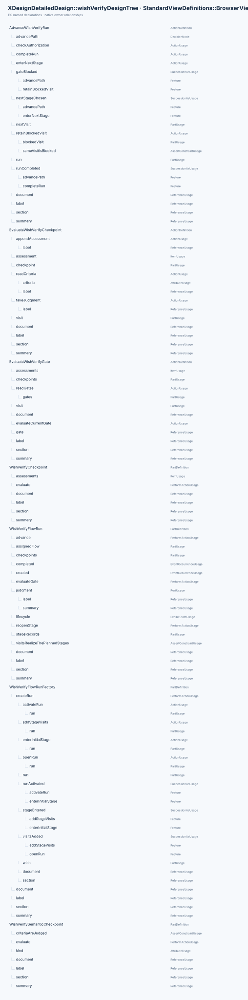
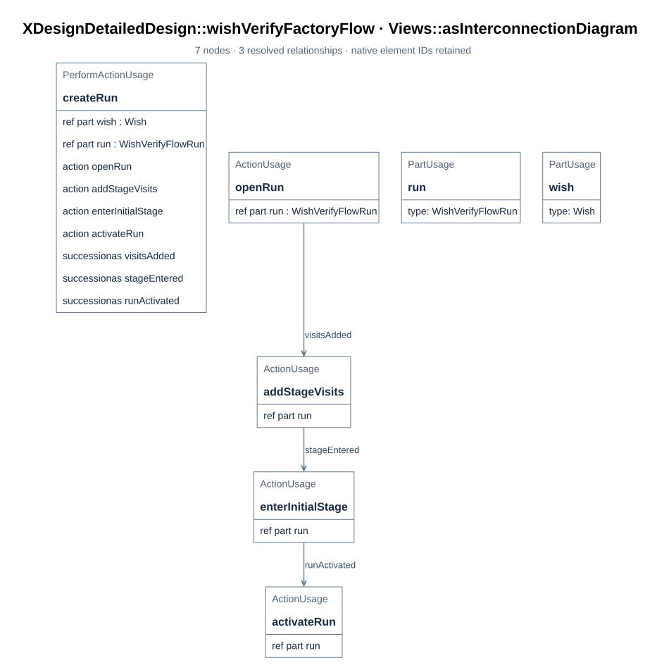
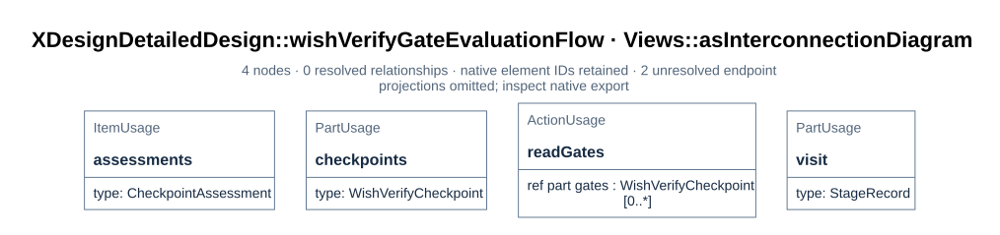
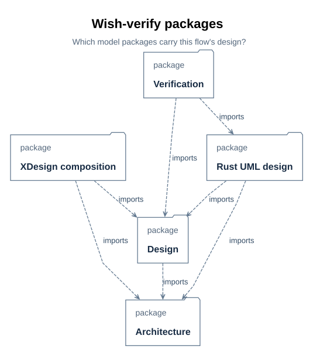
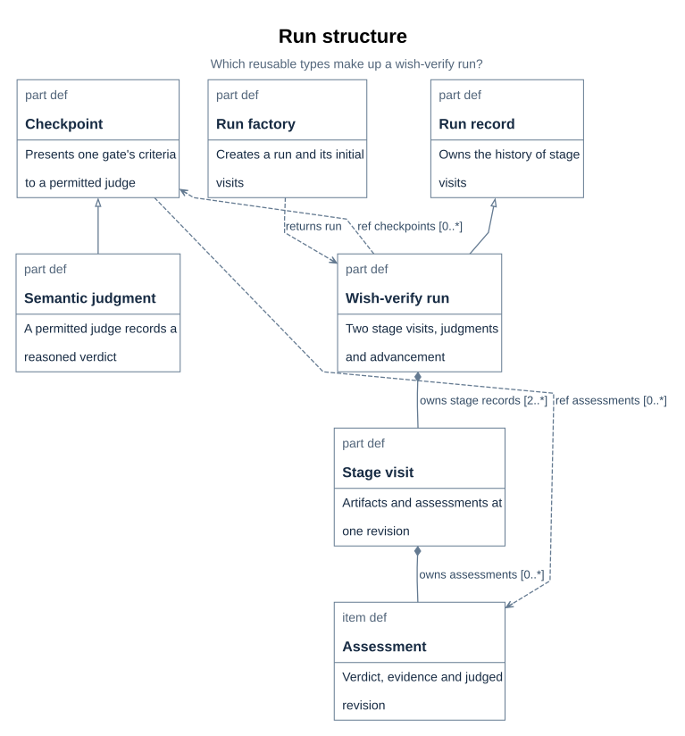
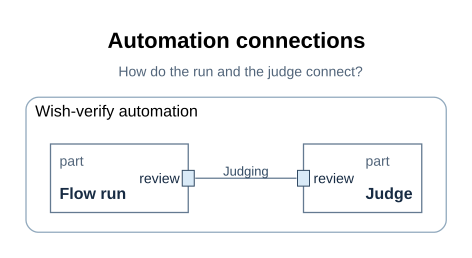
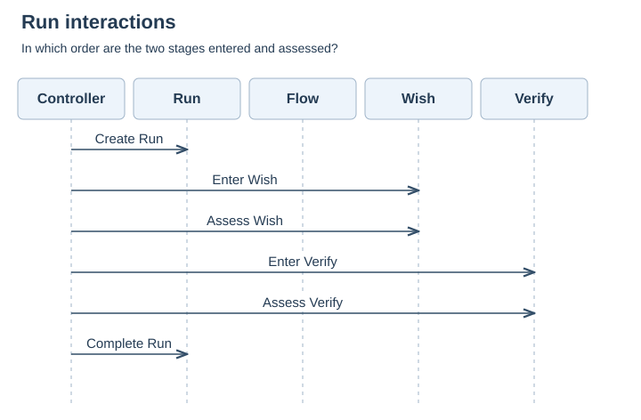
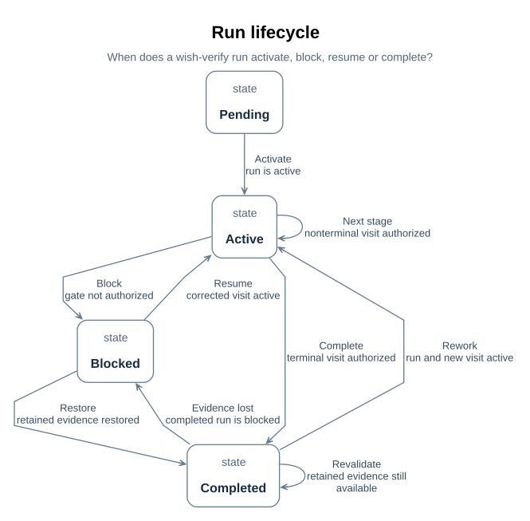
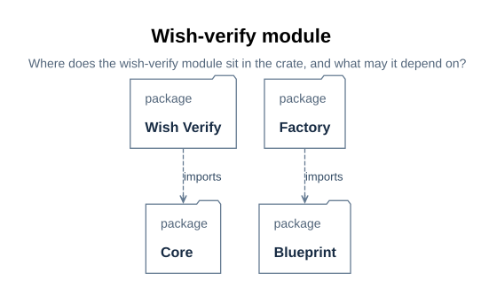
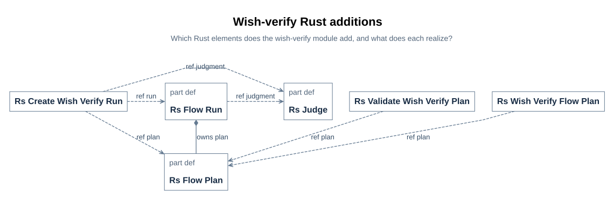

# WishVerifyFlow implementation

How WishVerifyFlow is realized: its run class, factory, functions, module types and behavior, errors and limits, and the reuse-oriented Rust UML design. The class-and-function contract of each API is in design/api; the shared lifecycle and evidence semantics are in design/lifecycle.md and design/evidence-and-revisions.md.

## 1. The run class

> **Figure D58-1 — Run design definitions.**
> **Question:** Which classes and functions realize one run of the designed flow?
> **Model view:** `XDesignDetailedDesign::wishVerifyDesignTree`, a browser view of the run design.
> **Companions:** [D59](#d59) for creation and [D63](definition.md#d63) for checkpoint evaluation.
> **Status:** renderable-now; design view of the implemented Rust slice; executed verification is recorded in [P28](../../../records/plans/wish-verify.md#p28).
> **Reading:** The run class specializes `FlowExecution` and names its visits, judgment port, events, and operations. The factory and action definitions provide the creation, assessment, and advancement roles.
> **Limits:** Declared members do not establish an implemented class or an executed run.

`WishVerifyFlowRun` specializes the architecture's generic `FlowExecution`
([E01](../../../interfaces/record-format.md#e01)): one run of the designed flow, with the
flow's plan and operations fixed. A wish's execution is typed by it — the realization is
the typing, not a declaration beside it ([R01](../../../requirements/requirements.md#r01),
`runRealizesItsDesign`).

| Member | What it is |
| --- | --- |
| `assignedFlow : DesignedWishVerifyFlow` (redefined) | The class of plan this run executes; a concrete run binds the `xdesign.designedWishVerifyFlow` usage |
| `stageRecords : StageRecord [2..*]` (redefined) | A visit to each of the two stages; a reworked terminal stage appends a further visit, so the count grows |
| `judgment : ~JudgmentExchange` | The run's only port — the interface it presents judgments through; no check port exists because no syntactic gate exists ([D67](#d67)) |
| `created`, `completed` | The run's events — the ends of its timeline ([D68](#d68)) |
| `checkpoints : WishVerifyCheckpoint [0..*]` | The designed flow's two gates as checkpoint-class instances, bound to the assigned flow's plan; the run evaluates them ([D63](definition.md#d63)) |
| `lifecycle : WishVerifyRunLifecycle` | The run's exhibited state, bound to itself ([D68](#d68)) |
| `evaluateGate : EvaluateWishVerifyGate` | The operation that hands each gate of the current visit to its class's `evaluate` operation ([D60](#d60)) |
| `advance : AdvanceWishVerifyRun` | The operation that moves the run on when the gates authorize it ([D60](#d60)) |
| `reopenStage : ReopenWishVerifyStage` | Explicitly reopen a completed terminal visit as a new visit while retaining the completed record ([D60](#d60)) |
| `visitsRealizeThePlannedStages` | Assertion: every visit is a visit to one of the plan's stages, and every stage of the plan has a visit |

The assertion, like every `assert constraint` in this model, is not evaluated by the
compiler ([T04](../../../architecture/constraints.md#t04)); it is read, and the factory ([D59](#d59)) and
the run's rules are what keep it true.

## 2. The factory

> **Figure D59-1 — Run creation.**
> **Question:** How does the factory initialize a designed run?
> **Model view:** `XDesignDetailedDesign::wishVerifyFactoryFlow`, an action-flow view of `WishVerifyFlowRunFactory::createRun`.
> **Companions:** [D58](#d58) for the run's members and [F04](../../lifecycle.md#f04) for registration.
> **Status:** renderable-now; design view of the implemented Rust slice; executed verification is recorded in [P28](../../../records/plans/wish-verify.md#p28).
> **Reading:** Creation opens the run, adds planned stage visits, enters the wish stage, and activates the run. Those steps shape the execution record the controller will own.
> **Limits:** The figure is an operation specification and does not show a completed registration test.

`WishVerifyFlowRunFactory::createRun` models a `Wish` input and the designed flow's
plan and produces the run. The local Rust `create_wish_verify_run` receives
`wish_model_uri`, a path identifying the independent wish SysML source; it does not
load a `Wish` item. The factory realizes the run-creation part of
`Controller::receiveWish` that assigns the flow, opens the run and enters its initial
stage ([F04](../../lifecycle.md#f04)) — so an implementation of this flow
builds one factory instead of re-deriving the generic controller's behaviour.

| Step | What it does |
| --- | --- |
| `openRun` | Creates the run, bound to the plan, with no visits yet |
| `addStageVisits` | Adds one pending visit per stage — `wish` and `verify` — each bound to its stage, at visit index 0 and artifact revision 0 |
| `enterInitialStage` | The `wish` visit becomes current and active at revision 0; the verify visit stays pending |
| `activateRun` | The run becomes active, so the controller records activities against it |

The boundary stays where the architecture put it: the wish remains an item of the
`Workflow` composition and the trace that holds the run is the controller's, produced by
`receiveWish` ([B01](../../../architecture/system-composition.md#b01)); the factory only shapes
the run itself.

## 3. The functions

> **Figure D60-1 — Gate evaluation function.**
> **Question:** How does a run obtain checkpoint assessments before advancing?
> **Model view:** `XDesignDetailedDesign::wishVerifyGateEvaluationFlow`, an action-flow view of `EvaluateWishVerifyGate`.
> **Companions:** [D63](definition.md#d63) for the checkpoint class and [E04](../../evidence-and-revisions.md#e04) for assessment records.
> **Status:** renderable-now; design view of the implemented Rust slice; executed verification is recorded in [P28](../../../records/plans/wish-verify.md#p28).
> **Reading:** The function takes the current visit's exit gates and delegates each assessment to its checkpoint class's judged path. It records the outcome before the separate advance function tests authorization.
> **Limits:** The figure does not supply a judge or establish a pass.

**`EvaluateWishVerifyGate`** selects only the current visit's stage exit gates from the
plan, then iterates over them in plan order. Each gate's class `evaluate` operation
appends one `CheckpointAssessment` to the visit. Each of the two stages has exactly one
exit gate, so one iteration runs per stage evaluation. The class operation is
`EvaluateWishVerifyCheckpoint`; its single adaptation implements it as
`TakeWishVerifyJudgment` ([D63](definition.md#d63)).

- **The judged path (the only path).** The gate's criteria and the visit's artifacts
  and evidence go through the judgment port to a judge the gate permits; the outcome,
  rationale, and evidence are recorded. No code settles it, and none pretends to —
  there is no syntactic branch because this flow declares no syntactic gate
  ([D62](definition.md#d62)).
- Either way: a gate with no assessment authorizes nothing, and `unevaluated` criteria
  provide no authorization to advance ([E04](../../evidence-and-revisions.md#e04)).

**`AdvanceWishVerifyRun`** is the successor rule of the designed flow: when the current
visit is authorized *at the visited revision*, the stage that follows hands the run its
pending visit — an authorized `wish` visit makes the pending `verify` visit current.
The `verify` stage has no successor, so its completion completes the run, which is what
lets the controller deliver the trace ([E05](../../evidence-and-revisions.md#e05)). A
visit that is not authorized stays current and blocked. Corrective work records a
content-change activity in that same visit and increments its artifact revision, even
when the artifact URI stays the same; earlier assessments remain attached to the
revision they judged ([E03](../../evidence-and-revisions.md#e03)).
`ReopenWishVerifyStage` is a separate explicit action for a completed terminal run: it
preserves the completed verify visit and appends a new active verify visit with the next
visit index and revision 0. Reopening the wish stage of a completed run needs
downstream invalidation rules and is outside this action.

These action bodies are specifications, not executed results: the compiler resolves
their names but does not evaluate their `assert constraint` bodies
([T04](../../../architecture/constraints.md#t04)). The executable cases WV-01–WV-10 in
[P28](../../../records/plans/wish-verify.md#p28) must establish
their behavior.

The designed wish-verify flow's gates live in `mbse/model/detailedDesign.sysml`; the
inherited terminal gate's criteria live in `mbse/model/architecture.sysml` on
`WishVerifyFlow`. A gate is a `Checkpoint`
([F01](../../flow.md#f01)); both gates of this flow are semantic, so
this document has no rule tables and no command contracts — it states the judgment
contract instead.

## 4. Module overview and package ownership

`WishVerifyFlowRun` records a wish's planned and visited stages. The factory constructs
that run; `WishVerifyCheckpoint` evaluates a gate and retains its assessment; the
advance operation consults the current visit before entering another stage. The module
boundary is the designed wish-verify automation, with a single judgment exchange and no
checker exchange. [D57–D60](definition.md#d57) state the run and operation contract;
[D61–D63](definition.md#d61) state gate criteria and the judgment contract.

> **Figure D65-1 — Wish-verify packages.**
> **Question:** Which model packages carry this flow's design?
> **Model view:** `XDesignDetailedDesign::wishVerifyPackageDiagram`, a package projection.
> **Companions:** [D21](../../../architecture/system-composition.md#d21) for the whole-project package view and [D76](#d76) for the crate layout.
> **Status:** renderable-now; design view of the implemented Rust slice; executed verification is recorded in [P28](../../../records/plans/wish-verify.md#p28).
> **Reading:** The architecture owns the base flow, the detailed design owns the gated specialization, the composition owns the selectable usage, the Rust UML package maps the software realization, and the verification package holds the planned cases.
> **Limits:** The figure shows model organization, not deployment or executable code.

The module does not own the judge's engineering judgment or turn a recorded pass into
project-level acceptance. Those outcomes belong to the wish trace and its assessed
artifact revision.

## 5. Classes and data structures

The run, factory, checkpoint, stage visit, and assessment types are the module's core
structures. [D58](#d58) gives the run's key features and
multiplicities; [E01–E04](../../../interfaces/record-format.md#e01) define the retained visit
and evidence records. A Rust realization exists on the generic `xdesign::core` engine;
durable storage layout remains open.

> **Figure D66-1 — Block definition.**
> **Question:** Which reusable types make up a wish-verify run?
> **Model view:** `XDesignDetailedDesign::wishVerifyBlockDefinitionDiagram`, a focused type projection.
> **Companions:** [D67](#d67) for connected instances and [D69](views.md#d69) for requirements.
> **Status:** renderable-now; design view of the implemented Rust slice; executed verification is recorded in [P28](../../../records/plans/wish-verify.md#p28).
> **Reading:** Type boxes show the run, its parent `FlowExecution`, the factory, the checkpoint class and its semantic adaptation, and the visit and assessment records. Ownership and specialization edges preserve the selected multiplicities and inherited contracts.
> **Limits:** The figure does not show communicating parts, run order, or an executed class implementation.

`wishVerifyBlockDefinitionDiagram` selects `WishVerifyFlowRun`, its parent
`FlowExecution`, `WishVerifyFlowRunFactory`, `WishVerifyCheckpoint`, its semantic
specialization, `StageRecord`, and `CheckpointAssessment`. `WishVerifyFlowRun`
specializes `FlowExecution` and owns stage visits, with at least one visit per planned
stage; `WishVerifyCheckpoint` owns the common evaluation operation and assessment
history; `WishVerifySemanticCheckpoint` specializes that common class rather than
introducing an unrelated gate contract. The factory creates the run; the run performs
the gate and advance functions.

| Core type | Modeled shape and responsibility | Range or invariant | Implementation status |
| --- | --- | --- | --- |
| `WishVerifyFlowRun` | `FlowExecution` specialization with planned stages and visits | At least one visit per planned stage; current visit determines advancement | Realized by the generic `RsFlowRun` bound to the designed blueprint; durable persistence open |
| `WishVerifyFlowRunFactory` | Creation operation for a typed run and its initial plan | One creation path per requested run in [D59](#d59) | Realized by `create_wish_verify_run` ([U76](../../api/wish-verify/create-wish-verify-run.md#u76)) |
| `WishVerifyCheckpoint` | Common gate evaluation operation with its semantic specialization | Assessment kind is always semantic in this flow | Realized by `RsCheckpointSpec` and the judge port; generic controller integration open |
| `StageRecord` | Stage, visit index, artifact revision, activities, assessments, and completion state | New rework visit preserves previous visit history | Realized by `RsStageVisit` in the JSON run; durable storage open |
| `CheckpointAssessment` | Checkpoint, evaluated revision, outcome, judge, rationale, and evidence references | Current pass must match the visit's artifact revision | Realized by `RsAssessmentEntry` in the JSON run; historical SysML records remain separate |

These are logical records, not a database schema. No units, byte sizes, persistence
keys, or serialized layouts are assigned where the model has not selected them.

## 6. Interface contract: judgment only

The module design wires exactly one interface: the judgment exchange by which the run
presents criteria and receives a reasoned verdict. The judgment port types —
`JudgmentExchange`, `JudgmentInterface`, and `Judge` — are reused unchanged from the
SimpleFlow design ([D10](../simple-flow/views.md#d10)); no checker
command interface is wired, because this flow declares no syntactic gate
([D62](definition.md#d62)). The
[interface control document](../../../interfaces/contracts.md#i01) inventories the modeled
fields, directions, and unresolved operational fields; it is a draft, not a frozen
baseline.

> **Figure D67-1 — Internal block.**
> **Question:** How do the run and the judge connect?
> **Model view:** `XDesignDetailedDesign::wishVerifyInternalBlockDiagram`, an interconnection projection of `WishVerifyAutomation`.
> **Companions:** [D66](#d66) for types and [D68](#d68) for interaction order.
> **Status:** renderable-now; design view of the implemented Rust slice; executed verification is recorded in [P28](../../../records/plans/wish-verify.md#p28).
> **Reading:** The enclosure is the automation boundary. The factory creates the run, and the run's judgment port connects to the judge's port through the judgment interface; no check connector exists.
> **Limits:** The connection topology does not prove that a judge endpoint answered at runtime.

| Draft interface | Module role | Modeled fields and direction | Operational fields still open | ICD source |
| --- | --- | --- | --- | --- |
| IF-004 `JudgmentInterface` | Run presents; permitted judge responds | `criteria` and `artifactsUris` run → judge; `outcome` and `rationale` judge → run | Identity enforcement, URI resolution, response schema, timeout, retry, versioning | [I05](../../../interfaces/contracts.md#i05) |

`WishVerifyAutomation`'s `checkpoints` reference selects the runner's plan gates, so
the automation does not create another set of gates. The endpoint implementation must
validate fields, retain the assessed revision, and distinguish a refused judgment from
a failed engineering criterion. Transport, failure codes, contract owners, and review
authorities are still unassigned; [I09](../../../interfaces/contracts.md#i09) tracks those
decisions. The modeled item flows establish design intent, not interface conformance
evidence.

## 7. Key flow design: timeline and lifecycle

The normal scenario starts with a factory-created run, enters the wish stage, obtains
its current-revision judgment, advances to verify when authorized, and completes when
the terminal visit is authorized. Correction of a blocked visit stays in that visit;
explicit reopening of a completed terminal visit creates another one without
overwriting history. The two views below divide interaction order from lifecycle state.

> **Figure D68-1 — Run sequence.**
> **Question:** In which order are the two stages entered and assessed?
> **Model view:** `XDesignDetailedDesign::wishVerifySequenceDiagram`, a projection of `WishVerifyRunTimeline`.
> **Companions:** [D67](#d67) for the exchange boundary and the lifecycle below for blocked and rework behavior.
> **Status:** renderable-now; design view of the implemented Rust slice; executed verification is recorded in [P28](../../../records/plans/wish-verify.md#p28).
> **Reading:** Five lifelines — controller, run, flow, and the two stages — carry six ordered messages from creation through the terminal completion event. Entry into verify assumes the wish visit was authorized.
> **Limits:** This normal sequence does not show rework loops, performance, or actual wish evidence.

`wishVerifySequenceDiagram` selects `WishVerifyRunTimeline`. Its messages start with
run creation, proceed through wish-stage entry and assessment, then verify-stage entry
and assessment, and finish with the run's completion event. A stage-entry message after
initial entry is authorized only by the current visit's exit gate; the ordering does
not grant permission by itself. The view declares no alternative or loop fragments: a
blocked gate holds the current visit, and explicit terminal reopening adds another
visit and repeats the applicable stage interactions. A particular wish's actual journey
and assessment results belong to its independent trace
([E06](../../../records/executions/wish-journeys.md#e06)).

> **Figure D68-2 — Run lifecycle.**
> **Question:** When does a wish-verify run activate, block, resume or complete?
> **Model view:** `XDesignDetailedDesign::wishVerifyStateMachineDiagram`, a state-transition projection of `WishVerifyRunLifecycle`.
> **Companions:** [D70](views.md#d70) for completion authorization and [D60](#d60) for the advance and reopen actions.
> **Status:** renderable-now; design view of the implemented Rust slice; executed verification is recorded in [P28](../../../records/plans/wish-verify.md#p28).
> **Reading:** Pending, active, blocked, and completed states are connected by activation, blocking, resume, advance, completion, revalidation, and rework transitions. The table below gives the exact guards behind the short visible captions.
> **Limits:** The state machine is a design specification; it does not show a recorded run or evaluate constraint bodies.

`wishVerifyStateMachineDiagram` selects `WishVerifyRunLifecycle`, exhibited by
`WishVerifyFlowRun` with its `run` reference bound to that run. Its four states are
`pending`, `active`, `blocked`, and `completed`. It distinguishes the status of the run
from the stage whose visit is current. Its transitions have explicit conditions:

| Transition | From → to | Guard |
| --- | --- | --- |
| `activate` | pending → active | `run.status == FlowStatus::active` |
| `gateBlocked` | active → blocked | `run.status == FlowStatus::blocked and not run.currentRecord.completionAuthorized` |
| `resumeAfterCorrection` | blocked → active | `run.currentRecord.status == StageStatus::active` |
| `advanceStage` | active → active | `run.currentRecord.completionAuthorized and not run.currentRecord.stage.completesFlow` |
| `complete` | active → completed | `run.currentRecord.completionAuthorized and run.currentRecord.stage.completesFlow` |
| `revalidateCompleted` | completed → completed | `run.status == FlowStatus::completed and run.currentRecord.completionAuthorized` |
| `completedEvidenceLost` | completed → blocked | `run.status == FlowStatus::blocked and run.currentRecord.status == StageStatus::blocked` |
| `restoredCompletion` | blocked → completed | `run.status == FlowStatus::completed and run.currentRecord.status == StageStatus::completed and run.currentRecord.stage.completesFlow` |
| `reopenForRework` | completed → active | `run.status == FlowStatus::active and run.currentRecord.status == StageStatus::active` |

Assessment and authorization decide whether work can advance. A missing, failed, or
stale judgment cannot authorize the current visit. The blocked transition also requires
the run's recorded status to be blocked, so an active visit is not blocked merely
because its gate has yet to be assessed. Corrective work resumes the same current visit
at a new content revision. Repeating `advance` on a completed run rechecks retained
artifact digests and the existence of passed-assessment evidence URIs; loss blocks the
run, and restoration can complete it again without appending a visit.
`ReopenWishVerifyStage`, separate from advancement, can reopen only a completed
terminal run; it appends a new visit and preserves the record
([D60](#d60)).

Completion requires authorization at the terminal verify stage; passing the wish stage
does not complete the run. The state-machine guards are read together with
`StageRecord.completionAuthorized` and the bound authorization constraint in
[D70](views.md#d70). They prevent the stage timeline from being mistaken for unconditional
progress.

## 8. Errors, blocked correction and rework

A missing, failed, or stale judgment prevents completion of the current visit. The
design retains the assessment's outcome, rationale, and evidence URIs. Correction
increments the same visit's artifact revision on a content-change event; explicit
terminal reopening creates a new visit only after completion
([E03–E05](../../evidence-and-revisions.md#e03), [D68](#d68)). A judge's refusal is an
`unevaluated` outcome, never a fabricated pass, and missing evidence files fail
evaluation rather than being replaced by an inferred pass
([D62](definition.md#d62)). Because this flow wires no checker, there are
no command failure codes of its own; the unused-check stub on the Rust side fails any
call, so an accidental invocation surfaces as an error instead of a silent pass
([U77](../../api/wish-verify/rs-unused-check.md#u77)). Application error codes,
retry policy, operational log levels, and correlation IDs are not yet designed; they
cannot be treated as implementation commitments.

## 9. Test points and verification planning

The executable cases are WV-01–WV-10 of the
[implementation plan](../../../records/plans/wish-verify.md#p28);
their modeled counterparts are `WishVerifyFlowBehaviorVerification` and
`WishVerifyFlowFilePlanVerification` ([D69](views.md#d69)). A declared case is a plan until a
test has run and its result is recorded in P28.

| Test focus | Requirement or rule | Planned case | Method and expected evidence | Status |
| --- | --- | --- | --- | --- |
| Blueprint conformance rejects a wrong stage, an absent, duplicate or foreign gate | `designedFlowGatesEveryStage` | WV-01 | Rust construction tests; no run exists | Planned |
| Happy path: both semantic gates judged, run advances and completes with a re-readable record | `runRealizesItsDesign` | WV-02 | Rust behavior test plus the `wish-verify demo` command; retained JSON record under `cache/` | Planned |
| Unpermitted judge, script authority, empty identity or rationale never pass | `semanticCheckNamesItsJudges` | WV-03 | Rust counterexample tests; refused or unevaluated assessments | Planned |
| Missing artifacts or evidence files fail evaluation | judgment contract [D62](definition.md#d62) | WV-04 | Rust counterexample tests; visit stays blocked | Planned |
| Content change stales an earlier pass; latest assessment governs | [D70](views.md#d70) authorization | WV-05 | Rust revision tests; advance remains blocked | Planned |
| Terminal reopen appends a visit; invalid reopens rejected | [D68](#d68) lifecycle | WV-06 | Rust reopen tests; history retained | Planned |
| Frozen plan drift is rejected | plan identity, [D57](definition.md#d57) | WV-07 | Rust hash-drift tests | Planned |
| End-to-end demo command | [P25](../../../records/plans/wish-verify.md#p25) | WV-08 | `xdesign wish-verify demo`; retained plan, record, and rationale | Planned |
| File-plan conformance, model ↔ repository | `wishVerifyFlowFilePlan` | WV-09 | `tests/plan_model_sync.rs` case | Planned |
| Documentation and model gates | [D31](../../../interfaces/documentation-contract.md#d31) | WV-10 | Compiler parse/check, documentation audit, figure regeneration, strict site build, full test suite | Planned |

## 10. Evidence status and open decisions

| Template evidence item | Current state |
| --- | --- |
| Allocated types, gates, and interface definitions | Model and sections above describe them; the judgment interface is a reused draft, not frozen |
| Every requirement's verification case, method, and phase | The behavior and file-plan cases are declared with planned case rows; executed results are recorded in [P28](../../../records/plans/wish-verify.md#p28) |
| Build, assembly, integration, and test maturity | The `xdesign::wish_verify` module slice exists on the unchanged `xdesign::core` engine; generic controller integration remains open |
| Residual risks and waivers | Unevaluated constraint bodies, draft interface operational fields, durable persistence, and project-level acceptance remain open |

| Decision needed | Why it matters | Current state |
| --- | --- | --- |
| Judgment provenance and identity policy | Who judged, on which revision, must stay re-examinable | Assessment records carry judge identity, rationale, and evidence URIs; durable policy open |
| Persistence, retries, and observability for run records | Needed to execute and diagnose rework safely across restarts and users | Local JSON serialization exists on the core engine; durable storage remains unspecified |
| Interface versioning and runtime transport | Needed before binding consumers to an implementation | Proposed contract in [I01](../../../interfaces/contracts.md#i01) |
| Executed verification of the slice | Declared cases do not establish behavior | WV-01–WV-10 executed; results and retained logs recorded in [P28](../../../records/plans/wish-verify.md#p28) |

No CDR has frozen this module design. The checklist's evidence items are used to expose
the remaining evidence, not to imply a passed gate
([V08](../../../verification/review-criteria.md#v08)).

> Module: the `xdesign::wish_verify` layer of the `xdesign` crate | Version: v0.1 |
> Status: implemented two-stage slice on the unchanged `xdesign::core` engine;
> executable behavior cases are executed and recorded in the implementation plan
> ([P28](../../../records/plans/wish-verify.md#p28)); model views
> remain design projections.
> Audience: module implementers, integrators, verifiers, and reviewers.
> Relation: [module design](#d65) | requirements
> [R01](../../../requirements/requirements.md#r01) (`rustUmlDesignMapsEveryDesignElement`,
> `umlViewsAreSelectedWithReasons`, `softwareDesignClaimsNoImplementation`) | view
> applicability and figure rules [U09](../../../interfaces/documentation-contract.md#u09). Model
> source: `mbse/model/uml.sysml` (package `XDesignRustUml`).

## 11. Revision history

| Version | Date | Author | Change summary | Reviewed by |
| --- | --- | --- | --- | --- |
| v0.1 | 2026-10-20 | kimi-agent | First draft: wishVerify layer layout, types, realization mapping, view applicability | Executed verification recorded in [P28](../../../records/plans/wish-verify.md#p28); plan review remains with the requester ([P25](../../../records/plans/wish-verify.md#p25)) |

## 12. Purpose, scope and reading order

This document is the UML software design of the designed wish-verify flow
([D57](definition.md#d57)) realized by the `xdesign` crate — a new
`xdesign::wish_verify` layer built on the unchanged generic `xdesign::core` run engine.
The SysML detailed design fixes what a run is made of; this design decides what a Rust
program declares to realize it and records which SysML design element each Rust element
realizes. The design model is `XDesignRustUml` in `mbse/model/uml.sysml`: the
`crate::wishVerify` package, the three flow-level functions `RsWishVerifyFlowPlan`,
`RsValidateWishVerifyPlan`, and `RsCreateWishVerifyRun`, and the realization
dependencies from shared core elements to the wish-verify design elements. Its views
are SysML projections rendered by the pinned toolchain, under the figure rules of the
documentation contract ([U10](../../../interfaces/documentation-contract.md#u10)).

Plan decision 4
([P26](../../../records/plans/wish-verify.md#p26)) fixes the
scope: new Rust code is limited to the flow module — the blueprint plan as data, its
blueprint conformance, the run factory, and an unused-check stub — while the generic
run, record, gate, and judge elements of `core` realize the corresponding
WishVerifyFlow design elements through added realization dependencies instead of
parallel Rust types. Async runtimes, durable multi-user persistence, generic controller
integration, and the default V-model remain outside this module's scope.

Reading order: [crate layers](#d76) -> [types and realization](#d77) ->
[interactions and states](#d78) -> [errors and performance](#d79) ->
[view applicability](views.md#d80). The class-and-function level — every public API with its
full Rust signature, contracts and stepwise logic — lives in the
[wish-verify API pages](../../api/wish-verify/index.md#u73) of the
[xdesign API design set](../../api/index.md#u14).

## 13. Crate layers and the wishVerify module

The `xdesign` crate splits into layers, and dependencies point one way:
`simple_flow` and `wish_verify` may use `core`, never the reverse, and the flow layers
do not use each other. `wish_verify` owns the designed two-stage flow in two source
modules: `blueprint` holds the designed plan as data with its blueprint conformance,
and `factory` constructs the designed run through the generic constructor with the
unused-check stub and the caller's judge. The module declares no checker adapter: both
gates are semantic, so there is no process adapter like `simple_flow::check`; the
never-invoked check stub lives in the factory. The model declares this layout under
`XDesignRustUml::crate::wishVerify`; the figure projects it.

> **Figure D76-1 — wishVerify module layout.**
> **Question:** Where does the wish-verify module sit in the crate, and what may it depend on?
> **Model view:** `XDesignRustUml::wishVerifyRustModules` (GeneralView projection of `crate::wishVerify` and `crate::core`).
> **Companions:** [crate layers U68](../../api/index.md#u68), [module design D65](#d65).
> **Status:** renderable-now; the wishVerify source modules are implemented.
> **Reading:** The wishVerify package sits beside simpleFlow over the shared core; the leaf boxes are its Rust source modules and the arrows are the allowed `use` dependencies. Dependencies point from wishVerify into core, and core depends on no flow layer.
> **Limits:** Shows the designed module layout, not the future generic controller, external crates, or deployment.

| Module | Responsibility | Depends on |
| --- | --- | --- |
| `wish_verify::blueprint` | The designed two-stage plan as data; blueprint conformance | `core::plan`, `core::status` |
| `wish_verify::factory` | Designed-run construction `create_wish_verify_run`, with the `RsUnusedCheck` stub | `wish_verify::blueprint`, `core::run`, `core::plan`, `core::ports`, `core::status` |

The model records these directions as dependencies: `wishVerifyUsesCore` from
`crate::wishVerify` to `crate::core`, `wishVerifyBlueprintUsesCorePlan` and
`wishVerifyBlueprintUsesCoreStatus` from the blueprint package, and
`wishVerifyFactoryUsesBlueprint`, `wishVerifyFactoryUsesCoreRun`,
`wishVerifyFactoryUsesCorePlan`, `wishVerifyFactoryUsesCorePorts`, and
`wishVerifyFactoryUsesCoreStatus` from the factory package. The crate-level layer map
is [U68](../../api/index.md#u68). Each Rust model element's `DocSection` points to
its specific [API page](../../api/wish-verify/index.md#u73); the views and
package retain their module-level sections here.

## 14. Types and the realization mapping

The flow layer adds exactly three functions and one stub; everything else the run needs
is reused from `core`. The realization dependencies in `mbse/model/uml.sysml` record
both directions of the mapping: the flow module's own functions realize the flow's
blueprint, conformance, and factory, while the shared core elements realize the run,
checkpoint, evaluation, advance, reopen, authorization, and lifecycle elements — one
Rust element realizes both designed flows' elements where the design is shared.

> **Figure D77-1 — wishVerify Rust additions.**
> **Question:** Which Rust elements does the wish-verify module add, and what does each realize?
> **Model view:** `XDesignRustUml::wishVerifyRustTypes` (GeneralView projection of the three functions and the core types they build on).
> **Companions:** [module layout](#d76), [block definition D66](#d66), [SimpleFlow Rust types D46](../simple-flow/implementation.md#d46).
> **Status:** renderable-now; the three functions and the stub are implemented.
> **Reading:** The three cards at the flow level are the module's functions; the core cards are the shared types they build on. Realization dependencies run from the Rust elements back to the wish-verify design elements.
> **Limits:** The figure shows the mapping, not per-function contracts; those live in the API pages.

| Design element | Realizing Rust element | Realization dependency in the model |
| --- | --- | --- |
| `DesignedWishVerifyFlow` (as plan data) | `wish_verify_flow_plan` ([U74](../../api/wish-verify/wish-verify-flow-plan.md#u74)) | `rsWishVerifyFlowPlanProjects` from `RsWishVerifyFlowPlan` |
| `DesignedWishVerifyFlow` (blueprint conformance) | `validate_wish_verify_plan` ([U75](../../api/wish-verify/validate-wish-verify-plan.md#u75)) | `rsValidateWishVerifyPlanConformance` from `RsValidateWishVerifyPlan` |
| `WishVerifyFlowRunFactory` | `create_wish_verify_run` ([U76](../../api/wish-verify/create-wish-verify-run.md#u76)) | `rsCreateWishVerifyRunRealizes` from `RsCreateWishVerifyRun` |
| `WishVerifyFlowRun` | `RsFlowRun` ([U17](../../api/core/rs-flow-run.md#u17)) — a run whose plan is the frozen `designedWishVerifyFlow` blueprint plays the `WishVerifyFlowRun` role | `rsFlowRunRealizesWishVerifyRun` |
| `WishVerifyCheckpoint`, `WishVerifySemanticCheckpoint` | `RsCheckpointSpec` ([U34](../../api/core/rs-checkpoint-spec.md#u34)) — a semantic spec names judge flags and no checker | `rsCheckpointSpecRealizesWishVerify`, `rsCheckpointSpecRealizesWishVerifySemantic` |
| `EvaluateWishVerifyCheckpoint`, `TakeWishVerifyJudgment` | `evaluate_checkpoint` ([U20](../../api/core/evaluate-checkpoint.md#u20)) — the semantic path | `rsEvaluateCheckpointRealizesWishVerify`, `rsEvaluateCheckpointTakesWishVerifyJudgment` |
| `EvaluateWishVerifyGate` | `RsFlowRun::evaluate_gates` ([U18](../../api/core/rs-flow-run-evaluate-gates.md#u18)) | `rsEvaluateGatesRealizesWishVerify` |
| `AdvanceWishVerifyRun` | `RsFlowRun::advance` ([U19](../../api/core/rs-flow-run-advance.md#u19)) | `rsAdvanceRealizesWishVerify` |
| `ReopenWishVerifyStage` | `RsFlowRun::reopen_stage` ([U49](../../api/core/rs-flow-run-reopen-stage.md#u49)) | `rsReopenStageRealizesWishVerify` |
| `WishVerifyAuthorization` | `RsStageVisit::completion_authorized` ([U30](../../api/core/rs-stage-visit-completion-authorized.md#u30)) | `rsCompletionAuthorizedRealizesWishVerify` |
| `WishVerifyRunLifecycle` | `RsRunLifecycle` state design ([D48](../simple-flow/implementation.md#d48)) | `rsRunLifecycleMirrorsWishVerify` |
| — none | `RsUnusedCheck` ([U77](../../api/wish-verify/rs-unused-check.md#u77)) | Rust-side addition with no matching UML class |

`rustUmlDesignMapsEveryDesignElement` makes this mapping the coverage obligation the
design review reads; `RsUnusedCheck` is the one element with no model counterpart, and
its page states why it exists anyway ([U77](../../api/wish-verify/rs-unused-check.md#u77)).

## 15. Interactions and states: reuse, not redesign

This module designs no new interaction and no new state machine. One gate evaluation
of a wish-verify run *is* the core gate interaction's semantic path: the run asks the
current visit's checkpoint spec to evaluate; the spec presents its criteria and the
visit's artifact and evidence URIs through the `RsJudge` trait; the returned verdict
and rationale are appended as the assessment. That interaction, its lifelines, and its
limits are specified once in the core design
([D47](../simple-flow/implementation.md#d47)) and are unchanged here — a
wish-verify run simply never takes the syntactic branch.

The same holds for states: the run's state handling mirrors
`WishVerifyRunLifecycle` ([D68](#d68)) with `RsFlowStatus` as the
state variable, exactly the lifecycle the core engine maintains
([D48](../simple-flow/implementation.md#d48)) — activation at creation, blocking on
an unauthorized gate, resumption of the same visit by corrective work, completion at
the authorized terminal visit, revalidation of retained evidence, and explicit terminal
reopening. The model records this as `rsRunLifecycleMirrorsWishVerify`; drawing a
second, identical state machine would only add a document to keep in sync.

## 16. Errors, logging and performance

- Error taxonomy, designed at the type level: a failed criterion is data (a recorded
  `failed` assessment with its rationale), not an exception; a judge's refusal is an
  `unevaluated` outcome, never a fabricated pass; a plan that differs from the
  blueprint — including one carrying a syntactic gate — is a conformance error the
  factory rejects before any run exists
  ([U75](../../api/wish-verify/validate-wish-verify-plan.md#u75)). The
  `RsUnusedCheck` stub converts any accidental check invocation into a command-failed
  error ([U77](../../api/wish-verify/rs-unused-check.md#u77)).
- Retry, degradation and recovery: none designed. A blocked run resumes through
  corrective work and a new judgment at the new revision ([D78](#d78)); the design adds
  no automatic retry of judgments.
- Logging: the local JSON run record retains activities and assessments; no fixed
  commands run, so there are no command logs of this flow's own. No separate telemetry
  or durable product evidence store is implemented.
- Performance: no budget is set. Gate evaluation is linear in the stage's exit
  checkpoints — one per stage in this flow — and authorization counting is linear in a
  visit's assessments. No measurement exists, and none is claimed.
