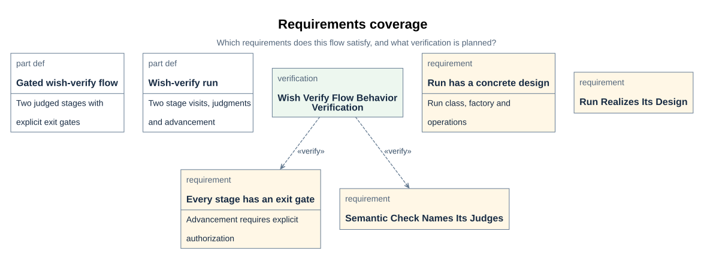
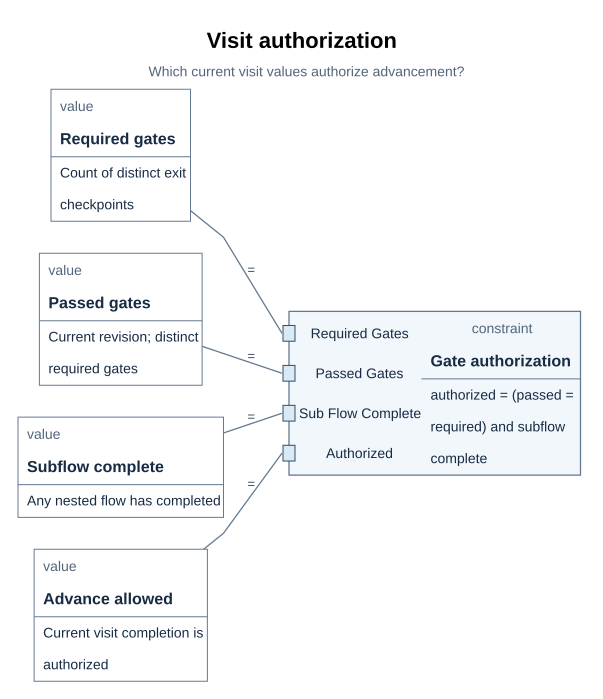
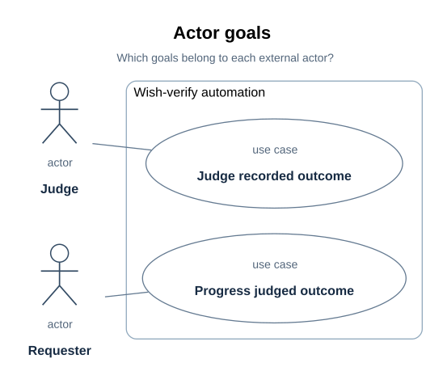

# WishVerifyFlow views

The views that explain the WishVerifyFlow design: the nine-question coverage index, requirements coverage, authorization parametrics, actor goals, view applicability, and design limits. The block/sequence/state/internal views remain with the implementation sections they explain; this page owns their coverage map.

Figure ownership:

| Figure group | Sections | Embedded in |
| --- | --- | --- |
| Coverage, requirements, authorization parametric, actor goals, applicability views | D64, D69-D71, D80 | views.md |
| Designed flow, run/factory/checkpoint figures | D57-D63 | definition.md and implementation.md beside their sections |
| Block, internal-block, sequence, state, and Rust mapping figures | D66-D68, D75-D79 | implementation.md beside the sections they explain |

## 1. Nine-question coverage index

| Concern | Viewpoint → native view in `XDesignDetailedDesign` | Applicability and reason | Embedded at | Question answered |
| --- | --- | --- | --- | --- |
| Block definition | `wishVerifyBlockDefinitionConcern` → `wishVerifyBlockDefinitionDiagram` | Required — the run, factory, and checkpoint types are the design's core | [D66](implementation.md#d66) | Which reusable types make up a wish-verify run? |
| Internal block | `wishVerifyInternalBlockConcern` → `wishVerifyInternalBlockDiagram` | Required — the automation wires exactly one exchange, and showing that no checker is wired is the point | [D67](implementation.md#d67) | How do the run and the judge connect? |
| Requirements | `wishVerifyRequirementsConcern` → `wishVerifyRequirementsDiagram` | Required — the requirements this flow answers and its planned verification case must be visible | [D69](#d69) | Which requirements does this flow satisfy, and what verification is planned? |
| Parametric | `wishVerifyParametricConcern` → `wishVerifyParametricDiagram` | Required — visit completion authorization is a bound relation, not a narration | [D70](#d70) | Which current visit values authorize advancement? |
| Use case | `wishVerifyUseCaseConcern` → `wishVerifyUseCaseDiagram` | Required — the requester and judge goals define the automation boundary | [D71](#d71) | Which goals belong to each external actor? |
| Activity | `wishVerifyActivityConcern` → `wishVerifyActivityDiagram` | Required — one gate's evaluation has a single judged path, and saying so is a design fact | [D63](definition.md#d63) | How does one gate produce an assessment? |
| Sequence | `wishVerifySequenceConcern` → `wishVerifySequenceDiagram` | Required — the normal run's message order across controller, run, and stages | [D68](implementation.md#d68) | In which order are the two stages entered and assessed? |
| State machine | `wishVerifyStateMachineConcern` → `wishVerifyStateMachineDiagram` | Required — blocking, correction, completion, and reopen are guarded transitions | [D68](implementation.md#d68) | When does a wish-verify run activate, block, resume or complete? |
| Package | `wishVerifyPackageConcern` → `wishVerifyPackageDiagram` | Required — the flow's design spans architecture, detailed design, composition, Rust UML, and verification packages | [D65](implementation.md#d65) | Which model packages carry this flow's design? |

All nine rows are applicable for this flow — unlike a software-design document, none is
reasonably omitted, because the flow is small and each question has real modeled
content. The activity view lives with the gates document at
[D63](definition.md#d63), because the checkpoint's evaluate operation *is*
this flow's activity answer; the other eight sit in the module design beside the
behavior they explain.

Four supporting views are not part of the nine questions but are declared and carried
by the run design: `wishVerifyFlowTree` ([D57](definition.md#d57)),
`wishVerifyDesignTree` ([D58](implementation.md#d58)), `wishVerifyFactoryFlow`
([D59](implementation.md#d59)), and `wishVerifyGateEvaluationFlow`
([D60](implementation.md#d60)). The Rust UML views `wishVerifyRustModules` and
`wishVerifyRustTypes` belong to the software design and are indexed in
[D80](#d80). The file-plan view `wishVerifyFlowFilePlanView` is
carried by the implementation plan
([P27](../../../records/plans/wish-verify.md#p27)).

| Model source | Elements | Documented at |
| --- | --- | --- |
| `mbse/model/architecture.sysml` | `WishVerifyFlow` (base flow, `outcomeAccepted`) | [F03](../../flow.md#f03), [D57](definition.md#d57), [D61](definition.md#d61) |
| `mbse/model/detailedDesign.sysml` | `DesignedWishVerifyFlow` | [D57](definition.md#d57), [D61](definition.md#d61) |
| `mbse/model/detailedDesign.sysml` | `WishVerifyFlowRun`, `WishVerifyFlowRunFactory`, `EvaluateWishVerifyGate`, `AdvanceWishVerifyRun`, `ReopenWishVerifyStage` | [D58–D60](implementation.md#d58) |
| `mbse/model/detailedDesign.sysml` | `WishVerifyCheckpoint`, `WishVerifySemanticCheckpoint`, `EvaluateWishVerifyCheckpoint`, `TakeWishVerifyJudgment` | [D61–D63](definition.md#d61) |
| `mbse/model/detailedDesign.sysml` | `WishVerifyAutomation`, `WishVerifyRunTimeline`, `WishVerifyRunLifecycle`, `WishVerifyAuthorization`, use cases | [D65–D71](implementation.md#d65) |
| `mbse/model/detailedDesign.sysml` | `wishVerifyFlowFilePlan` | [P27](../../../records/plans/wish-verify.md#p27) |
| `mbse/model/composition.sysml` | `xdesign.designedWishVerifyFlow` | [F03](../../flow.md#f03), [D57](definition.md#d57) |
| `mbse/model/traceability.sysml` | One satisfier per requirement kept; this flow's coverage recorded by its verification case instead (export limitation, [D69](#d69)) | [D69](#d69), [R02](../../../requirements/requirements.md#r02) |
| `mbse/model/verification.sysml` | `WishVerifyFlowBehaviorVerification`, `WishVerifyFlowFilePlanVerification` | [D73](implementation.md#d73), [P28](../../../records/plans/wish-verify.md#p28) |
| `mbse/model/uml.sysml` | `crate::wishVerify`, `RsWishVerifyFlowPlan`, `RsValidateWishVerifyPlan`, `RsCreateWishVerifyRun`, realization dependencies | [D75–D77](implementation.md#d75) |

> Module: `XDesignDetailedDesign` wish-verify run and judgment automation | Revision: 1
> Status: design specification with an implemented Rust slice; executed behavior
> verification recorded in the plan ([P28](../../../records/plans/wish-verify.md#p28));
> no frozen CDR baseline.
> Audience: module implementers, integrators, verifiers, and reviewers. Basis:
> [requirements inventory](../../../requirements/requirements.md#r01), the base
> [WishVerifyFlow](../../flow.md#f03), and the
> [draft ICD](../../../interfaces/contracts.md#i01).

The project model is the structural source; this document records the module decisions
and their limits. The related [flow plan](definition.md#d57) and
[judgment contract](definition.md#d62) remain detailed sources. The
[view-coverage index](#d64) records why the selected views apply;
the figures themselves sit in the design topics they explain below.

| Revision | Date | Change | Review status |
| --- | --- | --- | --- |
| 1 | 2026-10-20 | First module design for the designed two-stage wish-verify flow | Documentation scope per plan step 3; CDR pending |

## 2. Requirements coverage

> **Figure D69-1 — Requirements coverage.**
> **Question:** Which requirements does this flow satisfy, and what verification is planned?
> **Model view:** `XDesignDetailedDesign::wishVerifyRequirementsDiagram`, a requirements projection.
> **Companions:** [R01](../../../requirements/requirements.md#r01) for the requirement texts and [D73](implementation.md#d73) for the test points.
> **Status:** renderable-now; coverage is recorded by the planned verification case — not an executed result.
> **Reading:** Four requirements apply to this flow's design, and one planned verification case covers gate behavior and judge authority. A verify relationship states coverage; it does not assert a passed test.
> **Limits:** The figure does not record an executed case or a judgment of engineering adequacy.

`mbse/model/traceability.sysml` keeps one satisfier per requirement: the compiler
export cannot attribute two satisfy usages of one requirement (a documented,
still-open limitation), and adding second usages removed the existing edges from
the SimpleFlow requirements figure when tried. This flow's coverage is therefore
recorded here and by its planned verification case instead of by satisfy links:

| Requirement | How this flow answers it | Where recorded |
| --- | --- | --- |
| `designedFlowGatesEveryStage` | Both stages declare their exit checkpoint — `wishAccepted` is the added wish-stage gate | `WishVerifyFlowBehaviorVerification` objective; [D61](definition.md#d61) |
| `flowRunIsRealizedByDesign` | The flow's run has a designed class, factory, and gate/advance functions | This document's [D58](implementation.md#d58)–[D60](implementation.md#d60) |
| `runRealizesItsDesign` | A run of this flow is recorded with the design's class — the typing is the realization | [D58](implementation.md#d58); the run record's plan identity in [P28](../../../records/plans/wish-verify.md#p28) |
| `semanticCheckNamesItsJudges` | Both gates are semantic and name both judge authorities | `WishVerifyFlowBehaviorVerification` objective; [D61](definition.md#d61) |

The planned case is `XDesignVerification::WishVerifyFlowBehaviorVerification`
([P28](../../../records/plans/wish-verify.md#p28)), whose
objective verifies `designedFlowGatesEveryStage` and `semanticCheckNamesItsJudges`.
Its declaration is a plan; execution results are recorded in the plan only after the
commands run. `WishVerifyFlowFilePlanVerification` covers the file-plan conformance
side ([P27](../../../records/plans/wish-verify.md#p27)).

## 3. Authorization parametrics

The principal decision is whether the current visit may complete. It counts distinct
required exit gates with passed assessments at the visit's artifact revision and checks
subflow completion. [D60](implementation.md#d60) specifies how that result controls
advancement; the bound values and exact relation are below. The compiler parses the
relation but does not execute its constraint body.

> **Figure D70-1 — Visit authorization.**
> **Question:** Which current visit values authorize advancement?
> **Model view:** `XDesignDetailedDesign::wishVerifyParametricDiagram`, a projection of `WishVerifyAuthorization` and `GateAuthorization`.
> **Companions:** [E03](../../evidence-and-revisions.md#e03) for revision freshness and [D68](implementation.md#d68) for run transitions.
> **Status:** renderable-now; design view of the implemented Rust slice; executed verification is recorded in [P28](../../../records/plans/wish-verify.md#p28).
> **Reading:** Four bound values feed the reused authorization relation. The table below gives the exact source of each count and Boolean.
> **Limits:** Parsing the relation does not evaluate its bound values or prove runtime authorization.

`WishVerifyAuthorization` binds its context values to the same `GateAuthorization`
constraint the simple flow defines — reuse, not a copied relation
([P26](../../../records/plans/wish-verify.md#p26), decision 7).
The constraint is `authorized == (passedGates == requiredGates and subFlowComplete)`:

| Parameter | Bound source |
| --- | --- |
| `requiredGates` | Count of `visit.stage.exitCheckpoints` — exactly one for each of this flow's stages |
| `passedGates` | Count of distinct exit checkpoints with a current passed assessment whose `evaluatedRevision` equals `visit.artifactRevision` |
| `subFlowComplete` | `visit.subFlowSatisfied` |
| `authorized` | `visit.completionAuthorized` |

A missing gate, a failed judgment, a stale judgment, or an unfinished subflow therefore
leaves completion unauthorized. Counting the required checkpoint identities, rather
than assessment rows, prevents duplicate passes for one gate from replacing another
missing gate ([E03](../../evidence-and-revisions.md#e03)).

This is an authorization constraint for a software workflow. No response time,
throughput, or physical budget is invented for this design. Parameter bindings make the
decision inputs and relation explicit; the compiler's ability to parse or resolve them
does not prove every bound evaluation or runtime result.

## 4. Actor goals

> **Figure D71-1 — Actor goals.**
> **Question:** Which goals belong to each external actor?
> **Model view:** `XDesignDetailedDesign::wishVerifyUseCaseDiagram`, a use-case projection of `WishVerifyAutomation`.
> **Companions:** [D62](definition.md#d62) for the judgment contract and [D67](implementation.md#d67) for the interface.
> **Status:** renderable-now; design view of the implemented Rust slice; executed verification is recorded in [P28](../../../records/plans/wish-verify.md#p28).
> **Reading:** The requester's goal is an evidence-backed judged delivery; the judge's goal is to return a reasoned verdict on the recorded outcome. Gate evaluation is internal behavior, not another external user goal.
> **Limits:** Use cases state goals at the boundary, not a delivered outcome for any particular wish.

`wishVerifyUseCaseDiagram` selects the two use cases with their subjects and actors:
`ProgressJudgedOutcome` — the requester (`WishRequester`) progresses the wish to a
delivery whose outcome a permitted judge accepted on recorded evidence — and
`JudgeRecordedOutcome` — a permitted `Judge` reviews the gate criteria with the
recorded artifacts and evidence and returns a reasoned verdict through
`JudgmentInterface`. Both use cases name `WishVerifyAutomation` as subject. The
automation has exactly these two external goals; everything else the run does is
internal behavior in service of them.

## 5. View applicability and design limits

Applicability follows the documentation contract's selection rule
([U09](../../../interfaces/documentation-contract.md#u09)): each view of this software design is
required, recommended, or not applicable with a reason, stated over the SysML
projection vocabulary this repository renders.

| SysML view projection | Applicability | Figure / status |
| --- | --- | --- |
| package | required — the wishVerify layer's place in the crate and its allowed dependency directions are this slice's central decision | [Figure D76-1](implementation.md#d76), renderable-now; crate-level layer map in [U68](../../api/index.md#u68) |
| block definition | required — the module's three functions and the realization mapping are the design's core | [Figure D77-1](implementation.md#d77), renderable-now |
| internal block | not applicable — the module wires no ports of its own; the judgment-only wiring is the module design's [D67](implementation.md#d67) | companion, not redrawn |
| activity | not applicable — the judged evaluation path is the flow's [D63](definition.md#d63); the Rust side adds no branch | companion, not redrawn |
| sequence | not applicable — the gate interaction is reused unchanged from core ([D78](implementation.md#d78)); a redraw would duplicate [D47](../simple-flow/implementation.md#d47) | companion |
| state machine | not applicable — run states are reused unchanged from core ([D78](implementation.md#d78)); the flow-level lifecycle view is [D68](implementation.md#d68) | companion |
| use case | not applicable — actor goals are the automation's, already in [D71](#d71) | companion |
| requirements | not applicable — this design's requirement coverage is traced in the module design's [D69](#d69) and the plan's cases, not drawn | — |
| parametric | not applicable — authorization arithmetic stays in the module design's [D70](#d70) view | companion |

Design limits, stated once for the whole document: `xdesign::wish_verify` implements
the gated two-stage slice on the unchanged `xdesign::core` engine and writes local JSON
evidence through it, while `XDesignVerification::WishVerifyFlowBehaviorVerification`
remains a declared case, not an executed result — [P28](../../../records/plans/wish-verify.md#p28)
records what has actually run. The module has no checker adapter, no async workflow, no
generic controller integration, and no durable multi-user persistence. A CDR for this
module would still need the evidence package the checklist lists
([V08](../../../verification/review-criteria.md#v08)).
