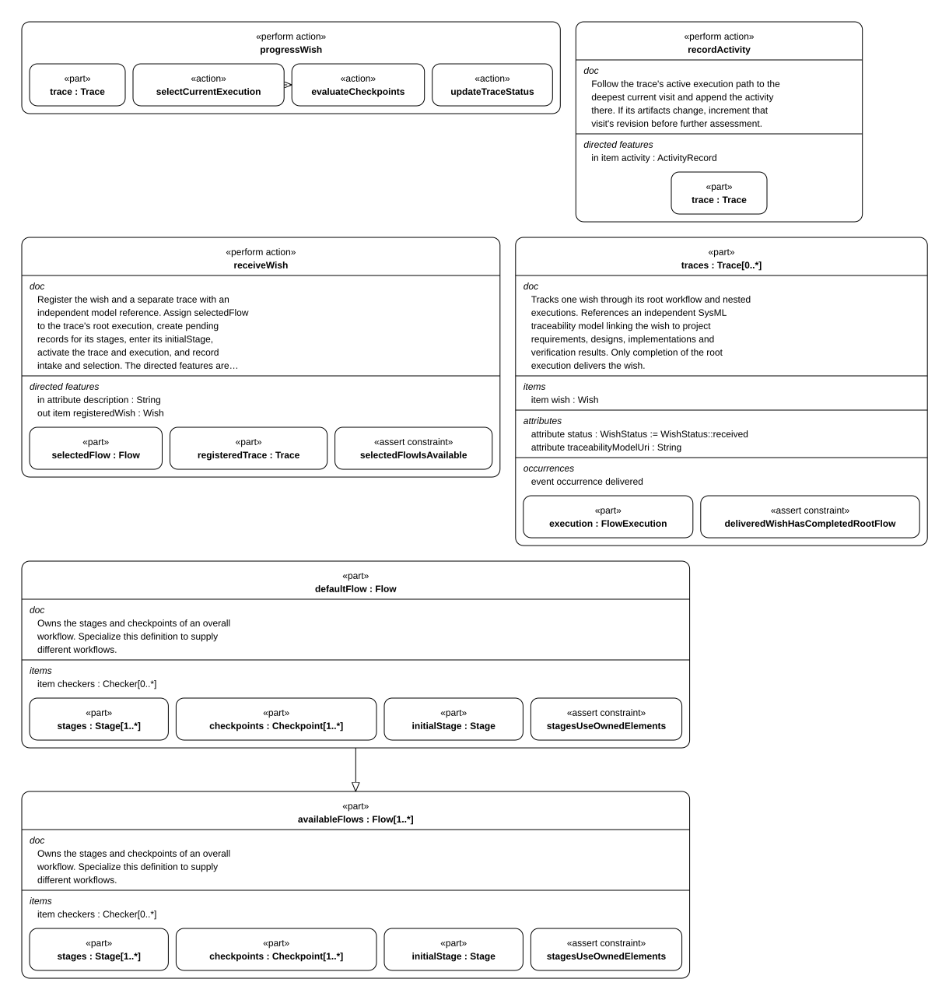

# Run lifecycle

The generic run lifecycle shared by all designed flows: run creation, stage visits, activity and assessment records, gate evaluation, advancement, reopening, blocking, and rework. Flow-specific run and factory classes are described in each flow's implementation page; the common record contract is in interfaces/record-format.md.

## 1. The controller and how a wish advances

> **Figure F04-1 — Controller operations.**  
> **Question:** Which operations register, record, and advance a wish?  
> **Model view:** Internal-structure projection of `XDesignArchitecture::Controller`.  
> **Companions:** [A03](../architecture/wish-lifecycle.md#a03) for lifecycle and [E02](evidence-and-revisions.md#e02) for visit records.  
> **Status:** renderable-now.  
> **Reading:** The controller owns operations for registration, activity recording, and checkpoint-driven progress. The table below supplies each operation's effect on the trace.  
> **Limits:** The figure names operations; it does not execute a checker or judge semantic criteria.

| Action | What it does |
| --- | --- |
| `receiveWish` | Registers the wish and a separate trace with an independent model reference; assigns `selectedFlow` to the trace's root execution; creates one record per stage of that flow; enters the initial stage; activates the trace and execution |
| `recordActivity` | Follows the trace's active execution path to the deepest current visit and appends the activity there. If its artifacts change, it increments that visit's revision before further assessment |
| `progressWish` | `selectCurrentExecution` (descend into an open subflow) → `evaluateCheckpoints` (assess each exit checkpoint against current artifacts, keep the latest per checkpoint) → if `completionAuthorized`: `decideNextStep` and `updateExecutionState`; otherwise `retainCurrentStage` → `updateTraceStatus` |

`StageWork` orchestrates work within one stage. It takes the controller, wish trace,
and stage as inputs; `produceArtifacts` creates an `ActivityRecord`, then calls the
controller's `recordActivity` and `progressWish` in order. The controller still owns
checkpoint assessment and trace-status updates. This is the modeled lifecycle action,
not a claim that the generic controller runs in the current crate.

## 2. Rework, blocking and subflows

- **Blocked is resumable.** A visit that does not pass stays the current record, marked
  blocked, with all prior activities retained. Corrective work appends activities and
  raises the revision, and the next assessment judges the current revision
  (`Workflow::executeWish`, the `blocked` → `correctiveWork` → `verificationReady` path).
- **Rework appends a visit.** A new attempt at a stage is a new `StageRecord` with the
  next `visitIndex`; earlier visits and their evidence are kept
  ([E03](evidence-and-revisions.md#e03)).
- **A subflow must finish first.** If a stage declares a `subFlow`
  (`XDesignComposition::xdesign.nestedFlowExample` shows one), the parent stage cannot complete
  until that execution is completed (`StageRecord::subFlowSatisfied`).
- **The terminal stage decides.** Only a stage with `completesFlow` leaves the flow with no
  successor, and its exit checkpoint is what authorizes delivery
  ([B03](../architecture/system-composition.md#b03)).
