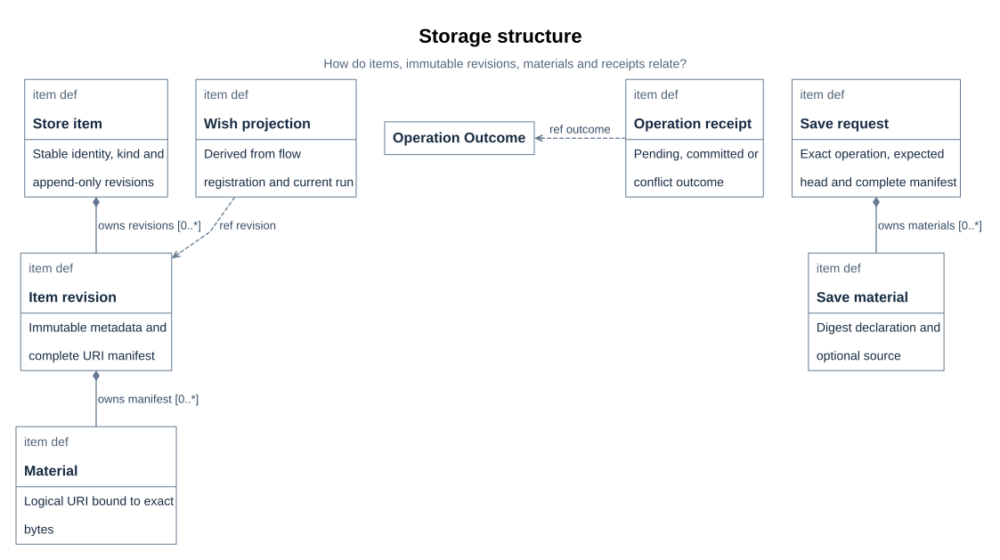
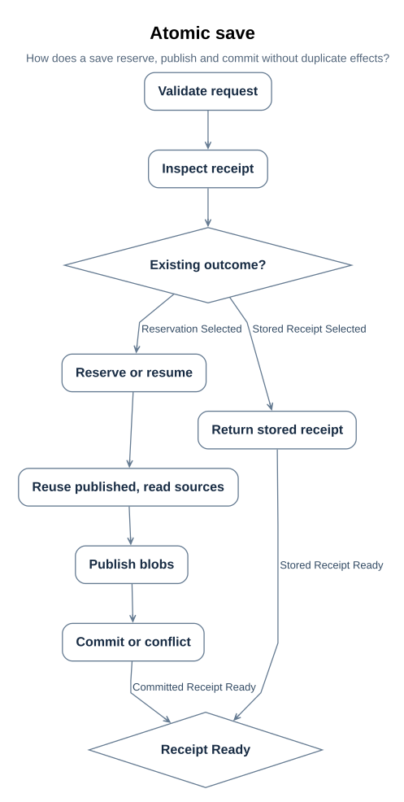

# Operational storage design

> Project: xdesign | Status: implemented; storage acceptance evidence executed within
> disclosed limits | Model: `XDesignStorage` in `mbse/model/storage.sysml`.

This page allocates the selected local item/revision store, its save and recovery
protocol, and its SimpleFlow/WishVerifyFlow adapter. The normative storage
requirements remain in [R01](../requirements/requirements.md#r01); executed evidence and
limits for [STORE-01 through STORE-10](../records/plans/storage.md#p38) are recorded separately.
The [store format and CLI](../interfaces/store-format.md#i11) owns serialized and physical
contracts, and the [storage API set](api/storage/index.md#u79) owns Rust signatures.

## 1. Local item and revision store

### 1.1 Authority, records, and scope

| Authority | Owns | Does not own |
| --- | --- | --- |
| Git | Engineering models, requirements, designs, source, checker and verification definitions, and legacy Git wish traces | New operational wish/run facts or the only copy of newly judged material bytes |
| `.xdesign` store | New wish registrations, run facts, immutable revision manifests, material/evidence bytes, and operation receipts | Engineering meaning, model-claim audit, final human acceptance, or a replacement Git history |
| `cache/` | Materialized wish sources, frozen runtime copies, checker exchanges, generated reports, and other regenerable working material | The sole authoritative run record or evidence copy |

A stored copy of a Git artifact preserves the exact bytes presented to a checker; it does
not transfer engineering authority away from Git. Existing `mbse/wishes/` traces and runs
registered on the legacy cache backend stay there. There is no automatic import, migration,
or retroactive change of their authority.

`ProjectStore` contains generic `StoreItem` records. A store-backed wish uses its wish ID as
`item_id` and `kind = "wish"`; the same item/revision machinery accepts other kinds without
adding wish columns to every record. `ItemRevision` numbers are contiguous from 1, immutable,
and append-only. Every revision carries typed JSON metadata and a **complete** URI manifest,
not a delta. `Material` binds each URI and role to a byte length and SHA-256-identified blob.
`OperationReceipt` binds an operation ID and exact request digest to `pending`, `committed`,
or `conflict` and preserves the request's JSON result.

> **Figure D86-1 — Operational storage structure.**  
> **Question:** How do items, immutable revisions, materials and receipts relate?  
> **Model view:** `XDesignStorage::storageStructure`, a block-definition projection of the native GeneralView.  
> **Companions:** The record table above, [format I12](../interfaces/store-format.md#i12), and [save request API U80](api/storage/rs-save-request.md#u80).  
> **Status:** renderable-now; implemented.  
> **Reading:** `StoreItem` owns ordered immutable revisions, and each revision owns a complete material manifest. `SaveRequest` and `SaveMaterial` describe proposed input, `OperationReceipt` selects its outcome, and `WishProjection` references the selected revision as derived output rather than another stored status authority.  
> **Limits:** The figure omits store lifecycle, individual query operations, and physical SQLite DDL; executable behavior is established by the retained tests and run evidence, not this projection.

The complete-manifest choice makes a selected revision independently inspectable and lets
unchanged source bytes move forward by digest without re-reading their Git or workspace
source. Omitting a URI from a later manifest removes it only from that later view; older
revisions and their blobs remain. There is no user-facing revision update, deletion,
baseline, or whole-store snapshot operation.

The following are explicit non-goals for this slice: whole-store snapshots, backups or
baselines; garbage collection or deletion; automatic legacy or schema migration; auditing
SysML model claims against store facts; a remote service, authentication, or encryption;
nested or arbitrary user-defined flows; and Windows-specific filesystem guarantees.

### 1.2 Physical representation and local trust boundary

The default root is `<project>/.xdesign/`; `XDESIGN_STORE_ROOT` and the explicit CLI root
option select another local root. `open` never creates a store. `init` opens a valid existing
store without changing its identity and otherwise requires an absent or safe empty root;
it never adopts nonempty foreign content. Version 1 uses SQLite for records and queries and
SHA-256-addressed files for exact material bytes. The layout, identity fields, and table
invariants are specified in [I12](../interfaces/store-format.md#i12).

The implementation uses a local POSIX filesystem with stable device/inode identity,
`fsync`, atomic no-replace publication, and owner-only permissions. On macOS, file and
directory flushes use `F_FULLFSYNC` (and the SQLite connections enable the `fullfsync`
pragma) because a plain `fsync` there does not force data out of the device cache; the
slice still does not claim physical power-loss certification. Store-controlled
directories are mode `0700`; mutable private files are `0600`; published blobs are `0400`.
Existing files must belong to the effective user and have no group/other access. Root and
database device/inode pairs are captured at initialization/open and checked again before
each public operation and before commit. A replaced root, replaced database, symlink in a
store-controlled path, non-regular file, or owner/permission mismatch is an integrity
refusal, not a cue to repair or migrate.

**Recovery boundary (operational disclosure).** The recorded identity makes a store
permanently bound to one directory on one filesystem: a moved or restored-from-copy root,
a replaced disk, or a copied `store.db` is refused at open, and no rebinding, backup,
restore, or migration operation exists in this slice. If the store is lost or becomes
unopenable, the recovery path is to re-register the wishes and re-import materials from
Git and the workspace; blobs without their database remain unusable. The SQLite busy
timeout is 5 s per connection and may be overridden with `XDESIGN_STORE_BUSY_TIMEOUT_MS`
(1–600000) for tests and slow local volumes.

Source and destination paths use the normalized project-relative URI rules in
[I13](../interfaces/store-format.md#i13). Sources are opened as regular files beneath the
project without following symlinks, and containment is decided on resolved filesystem
identity: the longest existing prefix of a declared source is canonicalized, so
case-insensitive aliases and symlinks that resolve onto the store root are refused — the
store never ingests its own root under any spelling. Checkout and materialization reject
traversal, absolute paths, backslashes, NUL/control characters, and symlink components;
for destinations, **every** ancestor of the final component must be an existing
non-symlink directory, not only the immediate parent. These are semantic requirements,
not a commitment to `cap-std` or any other path-capability dependency. No such dependency
is selected by this design.

Numbers in requests are stored as exact 64-bit integers or IEEE-754 doubles. A numeric
token that survives neither path unchanged — an integer beyond the u64/i64 range, or a
decimal whose shortest float64 round-trip yields a different value — is rejected with an
`invalid_input` error instead of being silently rounded in metadata and receipts.

WAL readers use one consistent SQLite snapshot, and reads that name a revision are pinned
to it: a `read`/`read_material` that selected revision N returns revision N's verified
bytes even when the head advances concurrently. A local crash, power loss, or another
process can leave pending operations, staging files, or orphan blobs; these are inspectable
facts, not silent success. The design does not claim protection from a malicious owner,
kernel, or filesystem that does not provide the required local semantics.

### 1.3 Exact-operation save and recovery protocol

`save` accepts a typed request; `save_bytes` accepts the exact request bytes. Both perform
the same protocol. Typed requests use the canonical JSON encoding in
[I13](../interfaces/store-format.md#i13); raw requests are never canonicalized before
hashing. Therefore a raw retry must supply identical bytes, including whitespace and member
order. An operation ID with different valid request bytes is `operation_mismatch`, even if
the two documents are semantically equivalent JSON.

1. **Validate before reservation.** Reject oversized/deep JSON, duplicate or unknown
   protocol fields, unsupported schema versions, invalid IDs/digests/URIs, duplicate URIs,
   invalid metadata, and materials over 256 MiB. Material names must be materializable on
   a filesystem: no name may be both a file and an implied directory, and distinct names
   may not fold to the same case-insensitive entry, so manifests stay valid on
   case-insensitive volumes. Numbers that cannot be stored exactly (see §1.2) are rejected.
   The request must also leave room for the response envelope: results and metadata whose
   nesting or serialized size would make the receipt or revision echo exceed the versioned
   JSON envelope limits are rejected here, so a committed operation always has a reportable
   receipt. `expected_revision = 0` means create; positive values mean append at exactly
   that head.
2. **Inspect or reserve the exact operation.** If an exact committed or conflict receipt
   exists, return it before any source read or publication. Reusing an ID with different
   bytes fails without mutation. Otherwise durably write the pending receipt, exact request
   bytes, and digest reservations in one short transaction, or resume that exact pending
   request. No source is read before this reservation.
3. **Reuse published bytes first, then read declared sources.** For each material, content
   already committed in the database or published by an earlier attempt of this operation
   is read back from the store and digest-verified, and no transient source is required:
   a pending recovery completes from its published blobs even if the original sources are
   gone. Only when no such blob exists does the material's `source` get opened through the
   safe path checks, read at most 256 MiB plus one detection byte, and compared by length
   and SHA-256 through end of file. A missing source with no stored blob is refused; it
   never waives integrity checks. The request still restates every URI and digest in the
   new complete manifest.
4. **Publish before row commit.** Write each new blob under `staging/<operation-id>/`,
   flush file contents, and publish it at its digest-derived path with atomic no-replace
   semantics, then `fsync` the containing directories. Existing final files are verified
   through end of file before deduplication. Publication never overwrites a different or
   truncated blob. Blob rows are not made visible to committed revisions yet.
5. **Commit or conflict.** Start `BEGIN IMMEDIATE`, recheck the operation and exact request,
   and recheck the item head and immutable kind. If another writer advanced the head, or
   creation now collides, commit a durable `conflict` receipt with `revision = null` and no
   item/revision/manifest/head change. Otherwise, in this one transaction: create the item
   when expected revision is 0; insert required blob metadata; insert revision
   `expected_revision + 1`, its complete manifest and metadata; finalize the committed
   receipt; and advance the item head. Every referenced blob is already published.
6. **Return or reconcile.** After commit and required filesystem/database synchronization,
   read back and return the stored receipt. A failure after publication but before a
   confirmed commit, or after commit but before a confirmed response, is `unknown_outcome`
   with the operation ID. Call `outcome` or retry the exact request; never use a fresh ID.
   A committed response reports commit state, not the absence of later doctor findings.

> **Figure D86-2 — Exact-operation save protocol.**  
> **Question:** How does a save reserve, publish and commit without duplicate effects?  
> **Model view:** `XDesignStorage::storageSave`, an activity projection of the native ActionFlowView for `SaveOperation`.  
> **Companions:** The six-step protocol above, [save API U82](api/storage/rs-store-save.md#u82), and [crash-boundary format I12](../interfaces/store-format.md#i12).  
> **Status:** renderable-now; implemented.  
> **Reading:** Validation and receipt inspection precede an early return for an exact terminal receipt. The other path reserves or resumes pending work before source reads, publishes blobs, and reaches one commit-or-conflict transaction before the common receipt result.  
> **Limits:** The figure omits SQLite row locks and exhaustive error handling; retained fault, concurrency, and recovery evidence is separate from this projection.

Two writers at one head can both reserve and publish. The transaction is the arbitration:
one can commit the next revision; the other receives its own durable conflict receipt.
Identical bytes deduplicate, but no rows point at unpublished files. Publication left by a
conflict or interrupted operation can be orphaned; `doctor` reports it and this slice does
not garbage-collect it. `pending` and `conflict` never authorize use of the proposed run
facts. The receipt's `result` is copied from the request, so a conflict result is only the
proposed result retained for diagnosis, not an applied response.

### 1.4 Queries and derived wish state

`get(item_id, None)`, `list`, and `history` read consistent committed snapshots; `None`
selects the head at snapshot start. `history` returns complete revisions in ascending order,
not manifests stitched from mutable current files. `outcome` returns the actual pending,
committed, or conflict receipt and treats an unknown operation as not found. Query APIs do
not write, clean staging, or repair defects.

For `kind = "wish"`, version-1 metadata requires `flow_id`, `registry_uri`, and `run_uri`.
At the selected revision, the projection resolves both URIs through that revision's
manifest and validates the strict registry/run binding: registry wish ID equals item ID,
registry `flow_id` equals metadata, registry `run_record_uri` equals `run_uri`, and the
run's `run_id`, plan identity, and plan digest agree with the registry and retained plan.
The existing run JSON keeps its current schema; no `flow_id` or independent wish-status
field is added to it.

| Run record fact | Derived wish output |
| --- | --- |
| `status = "pending"` | `status = "received"` |
| `status = "active"` | `status = "active"` |
| `status = "blocked"` | `status = "blocked"` |
| `status = "completed"` | `status = "delivered"`, `current_stage = null` |
| non-completed with valid `current_visit` | `current_stage = visits[current_visit].stage_id` |

Malformed references, an out-of-range visit, invalid run status, or inconsistent identities
produce an integrity error/finding, never a guessed projection. The stage adapter still
uses the existing full [restore contract](api/core/restore-run.md#u78); the lightweight
query projection does not replace its history and authorization validation. `list` filters
`kind` and projected wish `status` conjunctively. A status filter excludes non-wish kinds,
and the store exposes no independent wish-status or current-stage mutation. Other kinds
have no projection unless a later version defines one.

### 1.5 Verified read, checkout, and doctor

`read_material` selects a committed manifest entry and verifies exact length and SHA-256
through end of file before returning any bytes. An orphan with a matching digest is not a
manifest hit. `checkout` selects one complete revision, verifies every selected blob, and
publishes the URI tree into a previously absent destination using no-replace semantics. It
does not overwrite an existing workspace or expose a partial destination as successful.
[U84](api/storage/rs-store-checkout.md#u84) gives the caller contracts.

`doctor(verify_bytes)` is read-only. It reports invalid records and continuity, pending
operations, orphan blobs, missing blobs, staging residue, root/database identity defects,
and permission defects. Without byte verification it checks presence and recorded lengths;
with `verify_bytes = true` it also hashes every published blob through end of file and
reports altered content. Missing or altered bytes make reads/checkouts fail rather than
returning trusted content. Doctor never cleans, deletes, repairs, adopts, or migrates. Its
CLI result is nonzero when any finding exists; a pending receipt queried directly remains
an explicit pending result, not a silent committed success.

**Scaling limit.** Verification cost is deliberately recompute-over-cache: every finalize
re-reads and re-hashes each referenced blob, every `get`/`history`/`list` re-parses and
cross-validates the full producing request chain, and reads re-verify SHA-256 through end
of file. At the current scale (hundreds of materials) this is negligible; as a stated
limit, per-operation cost grows linearly with manifest and history size, and no
performance target is assigned in this slice.

### 1.6 Implemented stage integration

The adapter keeps the existing two flat flows and their gate engine while replacing only
the operational backend for **new** registrations. Existing legacy registrations, including
`wish-0011`'s early development runs, remain on the legacy cache backend. No flag in a
stored revision silently moves a legacy run to the new backend.

- **Registration.** `xdesign init WISH_ID --flow FLOW [--wish FILE]` imports a wish source.
  The default `FILE` is `mbse/wishes/WISH_ID.sysml`; an explicit file may be outside that
  legacy directory but must still satisfy source path rules. The initial exclusive save
  creates one `kind = "wish"` item and revision containing registration, frozen plan/work,
  initial run, and the imported wish bytes. Only then does it publish the working copy at
  `cache/wishes/WISH_ID.sysml` and operational copies under `cache/xdesign/WISH_ID/`.
  The original source is not rewritten and no new Git wish trace is required.
- **Readers.** `next` restores and validates the immutable stored head in memory and returns
  current work without a store write, lock acquisition, gate evaluation, or cache overwrite.
  It never replaces uncommitted working edits with head bytes. After cache loss it can
  return work from stored materials; missing workspace inputs remain explicit collection
  diagnostics rather than fabricated candidate digests.
- **Writer and restore.** `check` takes an exclusive per-wish writer lock under the store's
  transient lock area, reopens the head, and rejects stale result/state tokens. It restores
  missing regenerable operational files by digest with no-replace writes. The on-disk run
  record is a **projection of the committed head**: readers and writers repair it from the
  store's bytes whenever it differs, because a crash between commit and publication, or an
  abandoned attempt, must never wedge the wish on immutable-record drift. Existing wish or
  artifact working files are never overwritten merely to make them match the head; changed
  bytes are input to the new check, while unexpected drift in frozen plan/work/registry is
  refused.
- **One check, one logical commit, one attempt area.** Engine output is speculative until
  the store commits it. Each `check` stages the engine's working copy of the run record
  and the stage response under `cache/xdesign/WISH_ID/attempts/` instead of the canonical
  locations, so the canonical run record stays at the committed head while the engine
  runs. After the existing record/collect/evaluate/advance logic produces a response, one
  `SaveRequest` appends the wish item, reading those attempt-area files as material
  sources under their canonical URIs. Its complete manifest includes registry, frozen plan
  and work, current run record, wish working source, every immutable checker input and raw
  report (including retained command logs), all current artifact and evidence bytes, and
  the exact response material. Carried full source artifacts retain their URI/role and are
  copied forward by digest when unchanged. The request `result` contains the check
  response and its intended exit classification. Revision, all those materials, and
  receipt commit together; a failed or unevaluated gate therefore commits the blocked run,
  assessments, and evidence just as a passing check commits successor facts. There is no
  "save only on pass" path. **Publication** then replaces the canonical run record with
  the committed bytes and writes the response at its canonical path before the attempt
  scratch is removed. A crash between commit and publication is healed by the projection
  rule above or by republishing on the next `check` of that operation.
- **Retry and uncertainty.** A storage-backed `check` accepts an optional `--operation-id`
  so an unattended caller can reuse the same ID after a crash; otherwise the CLI generates
  one and includes it in responses/errors. `doctor` exposes pending IDs if a process dies
  before that response. Before running any checker, the adapter calls `outcome`. A
  committed receipt replays its stored result without rerunning the engine and republishes
  any attempt-staged material that was not yet published. A pending receipt makes the
  adapter's private recovery path retrieve the already reserved exact request and call
  `save_bytes`; with published blobs reused before sources, that recovery completes even
  when the original transient sources are gone. A conflict or `operation_mismatch` is not
  presented as applied work. A fresh attempt of an operation with no receipt discards that
  operation's stale speculative files first, so a transient failure before reservation —
  for example a database timeout while another process held the write lock — never blocks
  a retry with the same or a new ID. Attempt files of a reserved operation are kept while
  its outcome is unknown, because they are that pending operation's exact recovery
  sources; new work uses a new operation ID, and old pending operations are never
  implicitly abandoned or deleted. `init` distinguishes the same way: leftover
  operational files with no store item and no pending operation are reclaimed, legacy
  cache-backed directories are never adopted or discarded, and files still referenced by a
  pending operation require operator reconciliation first.

The store transaction serializes revision commits, while the per-wish writer lock prevents
two engine executions from interleaving workspace changes in one wish. A read-only `next`
uses immutable heads and needs no writer lock. A storage conflict maps to the store conflict
classification; the existing stage `check` exit 1 still means an evaluated visit remains
blocked, not a storage error.

### 1.7 View applicability and design status

| View concern | Applicability | Decision |
| --- | --- | --- |
| Block definition / logical structure | required | `storageStructure` separates store, item, immutable revision, complete manifest, request, receipt, and derived projection (Figure D86-1). |
| Activity | required | `storageSave` fixes reservation, publication, transaction, and early-return order (Figure D86-2). |
| Internal block | not applicable | The package defines no ports or connected internal parts; filesystem and SQLite boundaries are stated in I12. |
| Requirements | not applicable | This artifact adds no requirement or satisfaction relationship; existing R01/R02 and traceability own that coverage. |
| Parametric | not applicable | The protocol has ordering and integrity predicates, not a computed engineering budget or constraint binding. |
| Use case | not applicable | No new actor or goal is introduced; the existing stage interaction and public CLI contracts own the boundary. |
| Sequence | not applicable | One caller/store action flow answers the required ordering; no multi-lifeline runtime protocol is claimed. |
| State machine | not applicable | The three receipt outcomes and their terminal rules are fully stated without another run-lifecycle model. |
| Package | not applicable | One standalone logical package is added; no crate/package dependency graph is selected in this artifact. |

The implementation projection is `src/storage/{mod,db,blobs,ops,cli}.rs` and the stage
adapter files named by the [source plan](../records/plans/storage.md#p37). The exported
module and adapters exist and have executed store, two-flow, and recovery behavior;
performance targets remain unassigned. Compiler parse/check establishes only supported
model syntax/reference rules, not this protocol's engineering acceptance.
[Verification requirements](../verification/requirements.md#r11) states the test,
fault-injection, demonstration, and inspection obligations; the [execution record](../records/plans/storage.md#p39)
retains their actual evidence and limits, separate from final human acceptance.
