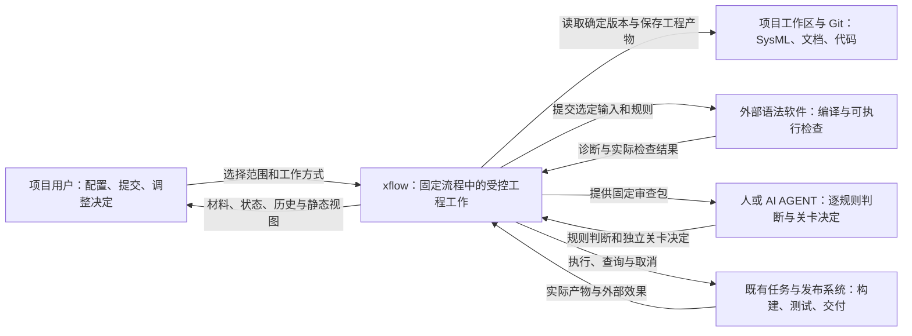
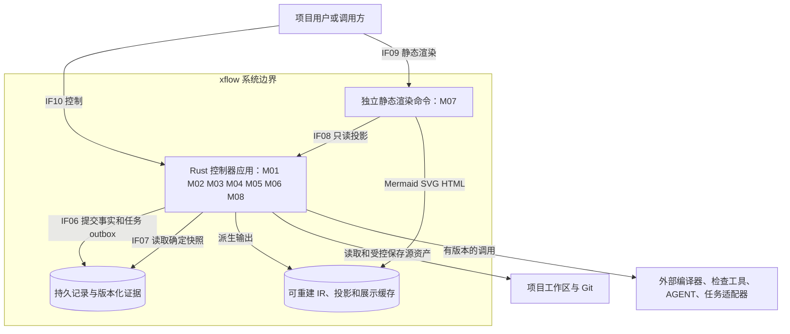
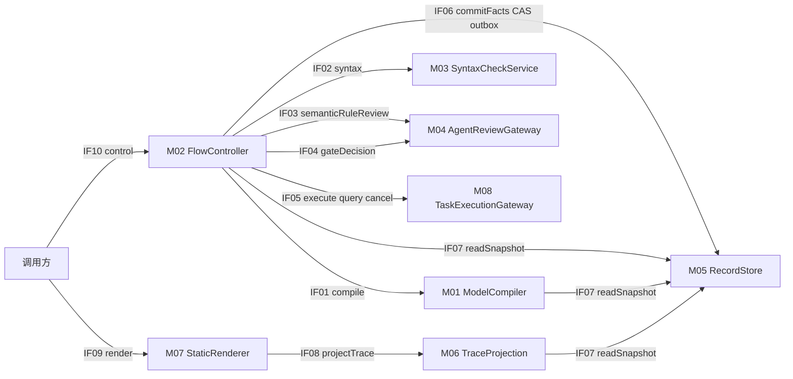
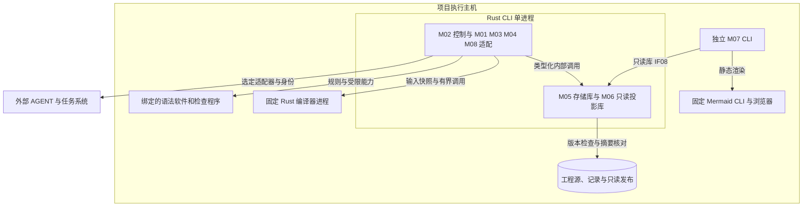
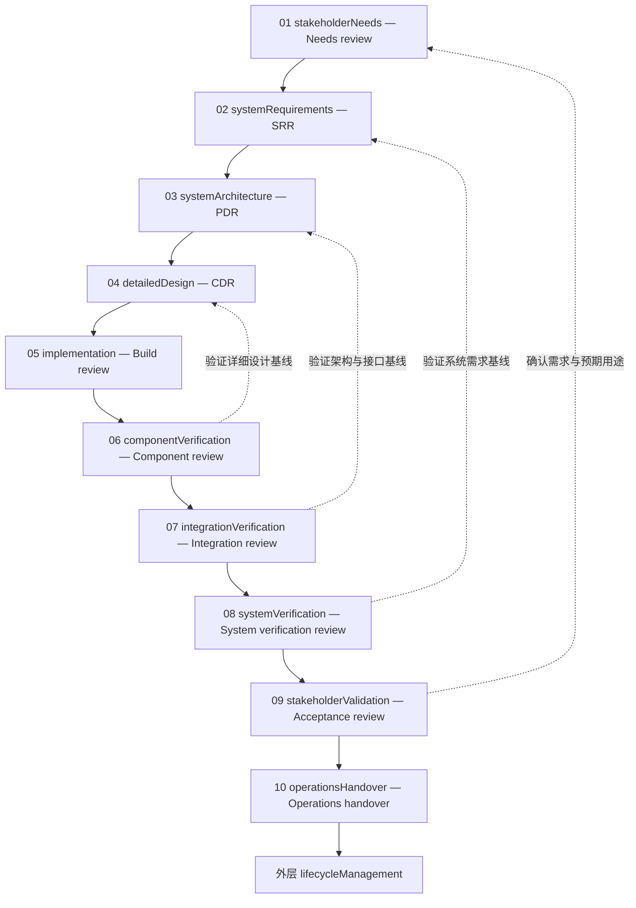
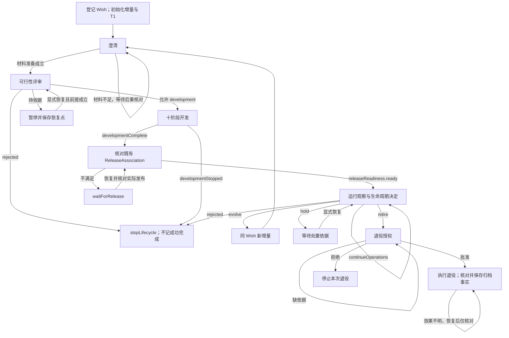
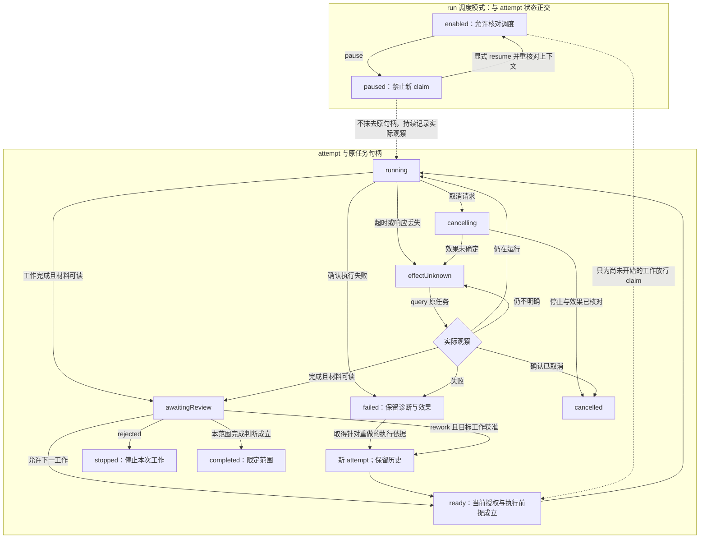
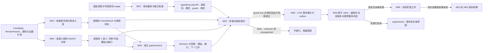
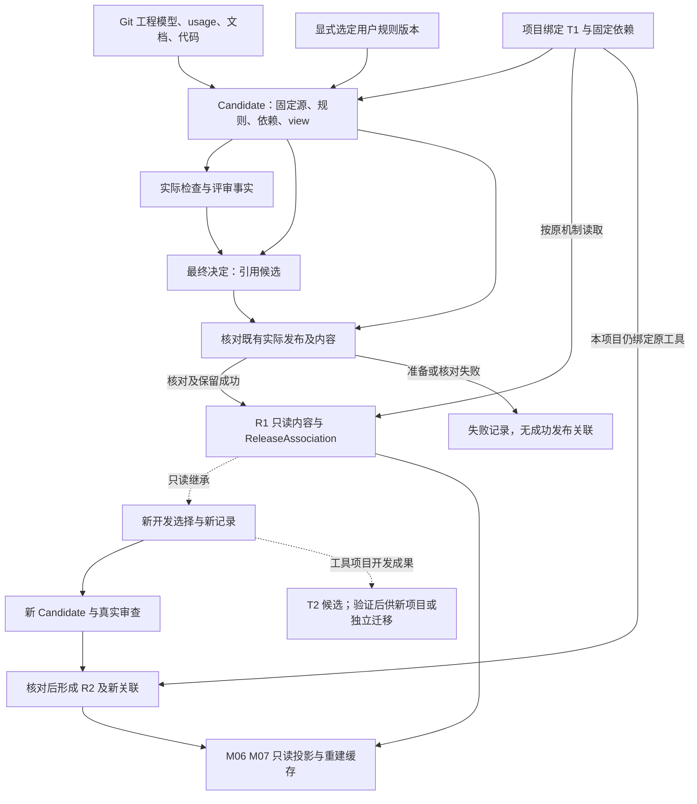
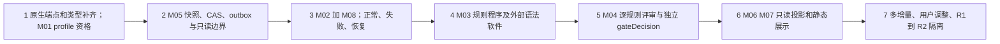

# Workflow 控制器整体架构

文档身份：`workflow_controller_architecture`。版本：**v0.1**。状态：**draft**。日期：**2026-10-13**。范围：Rust 控制器、SysML 流程与规则 usage、外部检查工具、AGENT 评审和独立静态渲染。来源：本次用户讨论的设计要求；关联 W005 暴露的编译、规则求值和展示边界问题。本文不新建 Wish 身份，不声明运行时已实现或 PDR 已批准。

## A01 文档范围与基线

| 本轮主文档 | 产物职责与稳定章节 |
| --- | --- |
| 本文 | 总体架构；方案比较 A03，组成 A04–A05，运行 A06–A09，版本与发布 A10，集成计划 A11，风险与审查准备 A12 |
| [workflow_controller_interfaces.md](workflow_controller_interfaces.md) | M01–M08 之间的 IF01–IF10：两端责任、类型、前提、效果、失败与版本协议 |

采用[公共规范 0.1](../constrains/README.md)、[架构组织规范 0.1](../constrains/system_architecture/index.md)及其 [SYN](../constrains/system_architecture/syntactic_constrains.md)／[SEM](../constrains/system_architecture/semantic_constrains.md)。[当前架构](arch_design.md)和[详细设计](details/overview.md)提供产品边界；旧 `workflow_mbse_architecture.md` 已指向当前架构，不恢复旧稿的强制目录和并行发布体系。

| 输入／标准选择 | 实际位置、版本与本次用途 |
| --- | --- |
| 当前设计来源 | 当前对话中的后续控制器设计讨论；本轮未新增 Wish 编号、运行 increment 或 attempt 事实 |
| 阶段契约 | `systemArchitecture`／`ArchitectureSpec`，PDR 为未来提交目标；当前只是 v0.1 草案 |
| 架构规则 | `docs/constrains/system_architecture/{index,syntactic_constrains,semantic_constrains}.md`，规则集 0.1 |
| 全阶段规则 | `docs/constrains/README.md`、`workflow_execution/` 和 `model_traceability/` 的 SYN／SEM，规则集 0.1；保留项目约定的 `constrains` 拼写 |
| 既有工程来源 | `docs/design/arch_design.md`、`docs/design/details/`，以及 `.xflow/xflow/`、`.xflow/mbse/` 的已存在原生类型与 view |
| 复用资格证据 | `.xflow/wishes/W005_delivery.json` 及其固定候选和限制，仅作已有编译／渲染证据示例 |
| 正式审查上游 | Wish／增量／尝试选择、系统需求基线、SRR 决定与可行性材料尚待固定；缺失项不补默认通过 |

当前控制器设计源自后续讨论，W005 的旧候选不是这次控制器已实现的证据。本轮交付审查限于两份文档的结构、接口一致性和图形可渲染性；阶段运行场景全部仍为 planned。

| 架构标准必需项 | 本文定位 | 当前审查准备状态 |
| --- | --- | --- |
| 1 身份、需求／Wish、流程与规则选择 | A01、A07、A12 | 本次讨论与 W005 关联明确；正式增量／尝试、需求基线和 SRR 决定待选择 |
| 2 目标、边界、参与者、场景与限制 | A02、A06 | 初版设计范围明确 |
| 3 候选方案、比较与选择 | A03 | 初版取舍，仍需实际资格校验 |
| 4 原生组成／行为、分配与满足 | A05、A07、A12 | 复用端点已定位；八模块及新增类型的原生展开待补齐 |
| 5 接口、流程、失败／取消／恢复 | A05、A08–A09、接口文档 | 目标契约，未声称实际执行 |
| 6 信息归属、身份、版本与变更 | A10 | 固定工具、源资产、事实与派生内容分开 |
| 7 部署、资源、复用与执行 profile | A04、A06 | 本地单进程与独立渲染命令 |
| 8 候选／发布、集成验证、风险与后续 | A10–A12 | 验证计划；正式 PDR 提交仍有阻塞项 |

## A02 系统目标与上下文

图 1：箭头表示人与系统的交互职责；外部工作执行可以产生真实工程效果。

| 能力层次 | 范围 |
| --- | --- |
| 已有可复用材料 | 模块化 SysML、原生 view、[W005 工具链交付](../../.xflow/wishes/W005_delivery.json)及其限制；这些材料不证明控制器已运行 |
| 本文目标 | Rust 读取确定流程 usage，调度实际工作，核对 guard、规则与当前决定；同一协议支持人或 AI |
| 首版不展开 | 分布式工作流集群、任意 SysML 行为执行、在线模型编辑器；不另建用户项目的发布系统 |

核心场景：一条 Wish 跨多个增量推进；同一阶段可多次尝试；用户采用缺口继续时保留失败事实；暂停／取消后核对真实外部效果；旧发布按原工具和原依据读取。

## A03 方案选择与取舍

| 方案 | 依据与代价 | 初版选择 |
| --- | --- | --- |
| Rust 控制器＋受限执行 profile＋外部工具 | 控制状态、类型和提交边界明确；需实现 typedExecutionIR 与可执行 guard 子集 | **采用**；不能执行的表达显式阻塞 |
| 直接把任意 SysML action 图当通用运行引擎 | 现有 Rust 编译输出不证明全部行为语义可执行，资格验证面过大 | 不作为初版前提；保持合法返工环和已声明分支 |
| 由 AGENT 自行判断并直接触发下一阶段 | 难以保证版本、权限、幂等与历史一致；规则判断和调度责任混合 | AGENT 只提交材料或判断，M02 核对后调度 |
| 独立微服务与常驻渲染服务 | 当前没有独立扩缩容或隔离需求证据，增加部署和一致性成本 | Rust 模块同进程；渲染保留独立命令 |

编译器复用 W005 选定的 `sysml-v2-rs v0.1.4` 及其[精确锁定](../../.xflow/xflow/tools/rust/toolchain.json)，不把其已观察到的语义缺口视为已修复。T1 表示项目实际绑定的工具发布及固定依赖；本文不替现有项目自动改绑 T1。

## A04 容器与控制边界

图 2：容器是本地应用、独立命令和数据存储。外部编译器／检查器／AGENT 不拥有 xflow 当前决定或运行状态。

M07 的 IF08 通过同一只读库调用 M06，再经 IF07 读取固定快照，不要求控制器守护进程运行或 M02 提交调用事实。IF07–IF09 的响应与诊断直接返回调用方；可选日志和复用缓存由调用方管理，M07 的文件与 manifest 写入允许的缓存区，均不改变 M05 的记录修订、当前选择或 outbox。只读调用的持久化与幂等例外见接口文档 I03.1。图中应用连线表示模块契约；首版存储采用持久 blob 与嵌入式 SQLite，事务及恢复边界见接口文档 I05。

## A05 模块组成与接口方向

图 3：实线为调用方向；M02 是控制入口，M05 是事实提交边界，M07 无控制接口。

| 模块 | 状态／数据责任与可检查输出 | 依赖与写入边界 |
| --- | --- | --- |
| M01 ModelCompiler | 原生源→真实 AST／语义导出→typedExecutionIR，保留源码位置与能力诊断 | IF07；IR 纯派生，无运行事实写权 |
| M02 FlowController | 运行选择、阶段／attempt、guard 求值、启动授权与当前决定适用性、初始化与发布编排 | IF01–IF07、IF10；经 M05 提交，不自行制造批准 |
| M03 SyntaxCheckService | 将选定 SysML 可执行规则转换为检查程序，或调用已绑定工具；逐规则诊断 | 外部检查程序受工具／规则版本约束；结果交 M02 |
| M04 AgentReviewGateway | 固定材料包、逐语义规则结果、独立 gateDecision、真实主体与授权来源 | 人或 AI 配置；判断不直接改当前状态 |
| M05 RecordStore | Candidate、版本化 facts、当前选择 CAS、任务 outbox、证据闭包与只读发布 | IF06／IF07；唯一事实维护来源，拒绝冲突／旧发布写入 |
| M06 TraceProjection | 只读连接真实事实与源身份、关系和覆盖映射，显示缺口和历史适用性 | IF07／IF08；不写模型引用、批准或原事实 |
| M07 StaticRenderer | 显式选定模型／view／记录快照→Mermaid／SVG／HTML | IF08／IF09；独立命令，仅在允许缓存区写派生展示、manifest 及可选日志／复用缓存，不提交运行事实 |
| M08 TaskExecutionGateway | 实际阶段工作、受控模型引用接入、句柄、执行观察、产物引用、查询／取消与效果未知 | IF05；以持久幂等键调用配置适配器，观察交 M02 提交 |

事实引用写回原生模型由 M02 编排 `attachEvidence` 工作，经 M08 的模型写适配器按 `sourceExpectedVersion` 做 CAS。M05 保留 pending／succeeded／conflict；接入冲突只重试引用保存，不重跑原工程任务。M06／M07 显示“事实已存、原生关联待接入”。

M01–M08 是本轮文档稳定设计身份，尚未等同已存在的八个原生 part usage。现有模型复用及待展开端点如下。

| 现有原生来源 | 本轮复用／映射 | 尚待原生展开 |
| --- | --- | --- |
| `XFlowArchitecture::xflow.localApplication.runtime`；`XFlowRuntime::RuntimeCoordinator` | M02 的流程协调责任 | M02／M08 边界、状态和接口 |
| `xflow.sysmlTools`；`XFlowRendering::RustMermaidToolchain` | M01、M07 的编译／投影／渲染责任 | typedExecutionIR 与独立控制／展示端口 |
| `xflow.localApplication.gateRules`、`modelTrace`、`storage`、`release` | M03／M04、M05 及 M02 的发布编排；原 ModelTraceService 的 maintain／attach 分给 M02＋M08，影响评价由 M02 保存，M06 只读投影 | 八模块 allocation／satisfy、连接与行为；不能仅改文档标签充当原生分配 |
| `XFlowEngineering::{Candidate,Attempt,CheckResult,Decision,EvidenceReference,AdoptedGap,ReleaseAssociation}` | 沿用候选、尝试、事实、决定和关联语义 | 运行／增量、调用状态、CAS、outbox 的附属类型与绑定 |
| `XFlowWorkflow::{ToolBinding,WorkflowProfile,ConstraintSet,RuleRequirement,StageContract,TaskBinding}`；`XFlowGate::{ReviewPacket,DecisionApplicability,ExecutionReadiness}` | 流程、规则、工作绑定、判断适用性和可执行性 | 检查程序、AGENT 逐规则结果与 runtime guard 的拟议类型 |

## A06 部署与执行 profile

图 4：同一主机内是 Rust 进程和库，外部任务／AGENT 可远程。共享库不是微服务；独立渲染不获得控制器写权。

| Profile 项 | 初版约束 |
| --- | --- |
| 执行语义 | 顺序、显式条件分支、关卡、声明的返工环、暂停与恢复；不支持的表达报 `unsupported`，不按 DAG 禁止合法返工 |
| 调用资源 | 每次调用显式选择超时、输入／输出上限、并发额度和允许能力；缺失必需配置不补隐式无限值 |
| 工具资格 | 核对 T1、编译器／库／检查程序与 renderer 锁；机器升级不自动替换项目机制 |
| 外部效果 | 超时只说明未拿到结果；不能证明未执行。先 query／reconcile，再决定重试或新 attempt |

## A07 固定十阶段与验证对应

图 5：实线表示通过对应关卡后的固定顺序；虚线表示验证对象，不表示跳转或已执行。返工必须另走模型声明的返工入口。

流程身份沿用 `XFlowVModel::VModelDevelopment`；`WorkflowProfile` 配置主体、规则、材料与任务绑定，不移动关卡。阶段 usage 是静态工程模型，不是一次 run；一个 Wish 可关联多个 increment，一个 increment 可包含多次 run／attempt，完成判断始终限定该 Wish 的具体范围。

| 基线问题 | 控制器处理 |
| --- | --- |
| 当前阶段尚无有效上游决定 | 保留缺失状态，组织本次真实澄清／审查；不为 W005 补造历史 SRR、PDR、CDR |
| 复用已有工具链交付 | 指向 W005 的实际范围和原候选，不把工具链交付扩展成控制器或产品验收 |
| 验证失败指向上游根因 | 按声明路径回到最早受影响阶段，保留旧 attempt，重新选定材料与决定 |

## A08 生命周期与运行状态

图 6：Wish 外层生命周期。开发完成还需核对既有发布；停止与退役归档分别记录。

图 7：attempt 状态与 run 调度模式分别管理。暂停禁止新 claim，已开始工作继续观察；恢复不是重新 execute。

暂停不抹去正在发生的外部效果；已开始工作需持续观察。恢复沿用原 run／attempt／任务句柄，不直接重复 execute。`effectUnknown` 时禁止盲目再执行；核实未发生效果后才能按幂等协议恢复原任务，需重做工程工作时另建 attempt。取消、失败、返工、完成分别留记录，不用同一布尔值概括。

## A09 规则、判断与实际执行链

图 8：SysML usage 选择规则和行为，M01 产生纯派生执行 IR；M02 求值并核对当前事实，只有持久调度意图才能进入 M08。

| 概念 | 值与责任 | 不能推导的结论 |
| --- | --- | --- |
| 校验／决定调用状态 | completed／not-run／timeout／error／unknown；与 IF02–IF04 一致 | completed 不代表规则 true；timeout 不代表规则 false；任务效果、取消状态另由 IF05 描述 |
| guard 求值 | supported 表达式才产生 true／false；unknown／unsupported 单列并阻塞所需动作 | Rust 编译接受表达式不等于已求值 |
| 逐规则结果 | 已成功判定时 `1→pass`、`0→fail`，附规则版本、材料和理由；其余保留 not_run／indeterminate／not_applicable 等状态 | 所有规则为 1 不自动形成关卡批准 |
| gateDecision | 独立的 pending／approved／rework／rejected；协议以 allow 1／0 加 disposition 映射，未完成不伪造 allow；M02 核对主体、候选、规则、范围、当前选择及下一工作 | 文本里声称 approved 或 AI 自报授权不能放行 |
| 采用缺口继续 | 新 Decision 明确缺口、范围与后续动作，原 CheckResult 不改 | 不生成缺失材料，不改变未知执行语义或不可读输入 |

源规则 ID 沿用 `ARCH-*`、`WF-*`、`MT-*` 等既有身份。M03 的规则程序由固定扩展协议约束，未知执行绑定不给默认通过；M04 的 1／0 是有上下文的工程判断，外部材料仅是依据，不授予修改流程或执行命令的权限。

`AuthorizationBasis` 区分两种依据：固定流程声明无需前置关卡的初始动作，使用经认证、限范围的 start／profile 授权；需要前置关卡的动作，必须引用当前有效的 `allow=1` 决定。初始授权不能绕过 gate；`allow=0/rework` 仅启动影响评估，具体返工作业另核对 `ReworkPlan.permission.mayStart`。协议详见 I02–I04。

## A10 信息归属、版本与发布

图 9：实线为内容选择或事实依赖，虚线为后续演进。R1、R2 由项目既有发布体系赋予身份；图不新增发布阶段。

| 内容 | 唯一维护来源与版本边界 |
| --- | --- |
| V-model、公共类型、编译／求值／追溯／渲染机制 | T1 及固定依赖；工具候选 T2 不替换正在运行的机制 |
| 用户约束、workflow usage、模型与 view、文档代码 | 项目工程源；新规则显式选择，不移动关卡，不改旧检查依据 |
| Candidate、CheckResult、Decision、运行观察 | M05 中确定版本的原记录；当前选择由 CAS 更新，旧事实保留 |
| 任务 outbox | 调度意图与相关事实／当前版本核对原子提交；发送前原子 claim 复核依据，失效项记 suppressed；M08 按幂等键发送 |
| typedExecutionIR、Mermaid、HTML 与覆盖映射 | 由源／工具／事实选择重建，记录输入摘要，无业务状态写权 |
| IF07–IF09 的可选调用日志与复用缓存 | 调用方在允许缓存区管理，可关闭或清理；不进入 M05 事实及持久幂等账，不赋予 M06／M07 控制权限 |
| 旧发布及必要依赖 | 保持可恢复且只读；摘要异常报告损坏，重渲染写缓存，不覆盖包内文件 |

变更只传播到所选依赖覆盖的决定，保留无关范围适用性。用户调整追加替代决定；迟到 AI 回答可保存为历史，CAS 不允许它覆盖新用户选择。候选摘要不包含后来产生的最终决定；发布核对和关联保留检查的真实时间、旧输入及适用依据。

claim 后到外部执行之间没有跨系统原子撤回。此时暂停／取消需保留 in-flight／unknown 及真实效果，按原 `effectKey` 查询或取消；不能承诺全局 exactly-once，也不能声称暂停抹去了先前取得执行资格的任务。

## A11 集成路线与架构验证

图 10：箭头表示集成依赖，不表示完成事实。每步使用固定 T1、记录的运行 profile、受控测试工作区和可注入失败的适配器；模拟测试与真实工具测试分别记账。

| 预定场景与通过判据 | 主要模块／接口 | 规则覆盖 |
| --- | --- | --- |
| 固定快照编译；unknown guard／未支持类型定位到源并阻止调度；合法返工环可解释 | M01 M02；IF01 IF07 IF10 | ARCH-SYN-003、WF-SYN-003、MT-SYN-001 |
| 并发版本冲突不提交新任务；崩溃后 outbox 不丢；重复 execute 先核对既有句柄 | M02 M05 M08；IF05 IF06 IF07 | WF-SYN-005、WF-SYN-011、WF-SYN-012 |
| 检查 completed＋false 与工具 timeout 分开；AGENT 逐规则为 1 仍等待独立决定 | M03 M04 M02；IF02 IF03 IF04 | WF-SYN-007、WF-SYN-010、ARCH-SEM-005 |
| 用户采用失败缺口后失败记录仍可读；迟到 AI 不覆盖；材料变化令旧决定不适用 | M02 M04 M05；IF04 IF06 IF10 | WF-SYN-008、WF-SYN-009、WF-SEM-007、WF-SEM-009 |
| 暂停停止后续调度；取消可观察；超时任务先查询；重启不重复不可撤销效果 | M02 M08 M05；IF05 IF06 IF10 | WF-SYN-012、WF-SEM-010、ARCH-SEM-008 |
| 两条 Wish 引用同一原生部件；usage／run 与 verify／实际证据分开；离线页面保留失败和未求值内容 | M06 M07；IF07 IF08 IF09 | MT-SYN-004、MT-SYN-009、MT-SEM-006、MT-SEM-007 |
| R1 后改源／规则／决定并形成 R2；R1 原 T1 可读；旧发布保存拒绝，损坏可诊断，共享依赖未被清理 | M02 M05 M06 M07；IF06–IF10 | ARCH-SYN-014、ARCH-SEM-014、MT-SYN-014、WF-SYN-014 |

以上全部为计划，尚无实际执行结论。接口文档进一步限定每次调用及失败返回；详细设计应选择事务机制、支持的 guard 运算、适配器和资源上限，再形成组件验证规程。

## A12 风险、追溯与 PDR 提交准备

| 风险／未解决问题 | 影响、责任与处理 | 阻塞范围 |
| --- | --- | --- |
| Rust 0.1.4 语义覆盖不足；W005 有未求值规则与端点限制 | M01／M02 设计负责人：限定 profile，给不支持项诊断，建立资格负例；不能继承旧 Pilot 通过结果 | 含未支持必要语义的调度；profile 资格未定前不能进入实现批准 |
| 八模块接口和新增记录类型尚未写回原生模型 | 模型负责人：补 part／port／interface／行为、allocation／satisfy、verify 与每文件 view；拟议 `TypedExecutionIR`、`RunRecord`、`InvocationResult`、`TaskOutboxEntry` 等不冒充现有类型 | ARCH-SYN-003／004／006／011 的正式 PDR 提交 |
| CAS 与外部效果不能跨系统原子提交 | M05／M08 负责人：持久 outbox、稳定请求键、查询／核对与取消协议；不承诺全局 exactly-once | 故障恢复与外部任务集成验收 |
| 缺少选定系统需求、增量／尝试、可行性和历史关卡记录 | 本次设计发起者与模型负责人：固定真实上游依据，新增本次审查；W005 已交付工具链事实保持原范围 | ARCH-SYN-001／012；不得补写“过去已批准” |
| 旧规则文件引用历史架构路径，且发布术语跨文档有差异 | 架构负责人：沿用当前 `arch_design.md` 的既有发布关联；审查包记录解释与适用版本，不改原历史规则结果 | 正式规则选择与发布接口确认 |
| UI／AGENT 自报通过掩盖真实缺口 | M04／M06／M07 负责人：真实渠道、独立 Decision、原始诊断与未求值状态；原生 view 不过滤负面材料 | 语义评审、关卡与展示验收 |

| 架构主张与真实规则 ID | 已有模型依据／拟议分配 | 预定验证 |
| --- | --- | --- |
| 固定十阶段与受限解释：WF-SYN-003、WF-SYN-014、ARCH-SYN-013 | `XFlowVModel::VModelDevelopment`、`XFlowWorkflow::WorkflowProfile`；M01／M02 原生分配待补 | A11 第 1、7 项 |
| 事实／逐规则判断／有效决定分离：WF-SYN-007–010、ARCH-SEM-005 | `XFlowEngineering::CheckResult`／`Decision`、`XFlowGate::DecisionApplicability`；M03／M04／M02 绑定待补 | A11 第 3、4 项 |
| 可恢复调度与真实外部效果：WF-SYN-005、WF-SYN-012、ARCH-SEM-008 | `XFlowEngineering::Attempt`、`XFlowRuntime::ResumeUncertainWork`；M05／M08 类型和行为待补 | A11 第 2、5 项 |
| 原生身份与只读展示：MT-SYN-002、MT-SYN-006、MT-SYN-008–010、MT-SEM-007 | `XFlowModelTrace::sharedIdentity`、`XFlowRendering::faithfulViewProjection`；M06／M07 分配待补 | A11 第 6 项 |
| 版本与旧发布隔离：ARCH-SYN-009、ARCH-SYN-014、ARCH-SEM-014、MT-SYN-014 | `XFlowEngineering::Candidate`／`ReleaseAssociation`、`XFlowStorage::recoverableExactContent`；M05 写边界待补 | A11 第 7 项 |

正式 PDR 提交前，必须补齐原生模型及 view、逐需求分配、需求／SRR／可行性等上游选择、规则版本、真实结构诊断和开放问题，再固定两份主文档及模型为审查包。PDR 若获真实批准，只允许所选范围进入 `detailedDesign`；本文完成不等于 PDR、CDR、控制器实现或产品验收已完成。

图层组织参考 [C4 diagrams](https://c4model.com/diagrams)；Mermaid 是设计说明，不能代替原生 view 或满足关系。全阶段规则依据：[WF 语法](../constrains/workflow_execution/syntactic_constrains.md)、[WF 语义](../constrains/workflow_execution/semantic_constrains.md)、[MT 语法](../constrains/model_traceability/syntactic_constrains.md)、[MT 语义](../constrains/model_traceability/semantic_constrains.md)。
