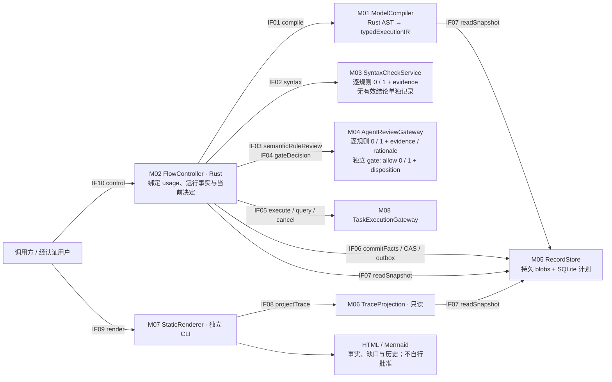
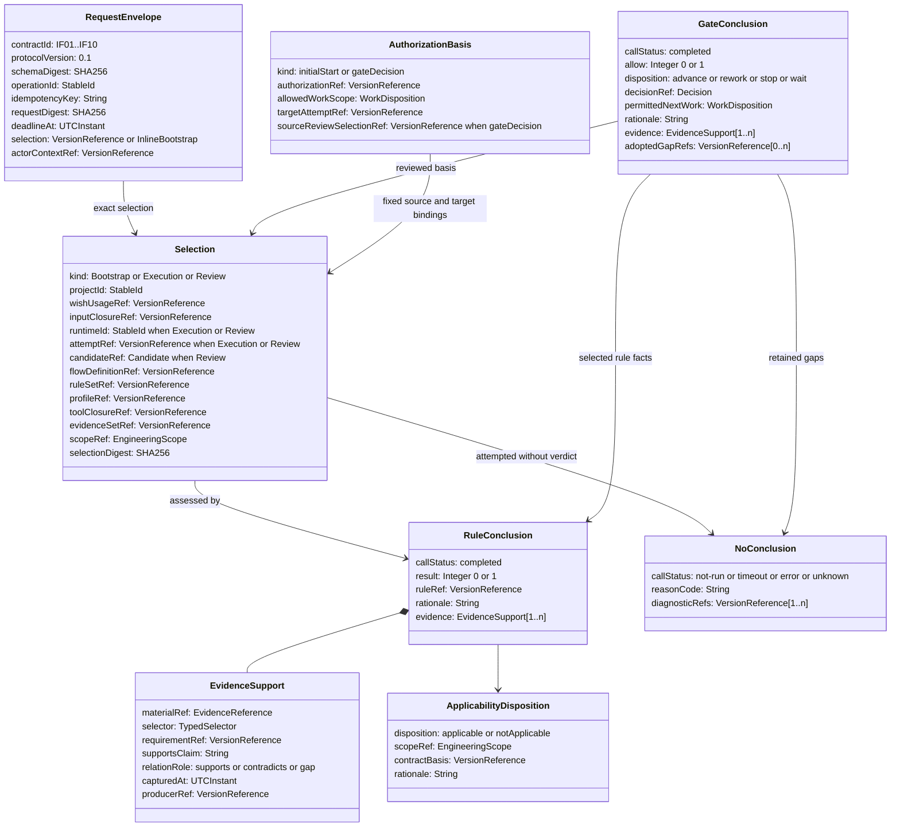
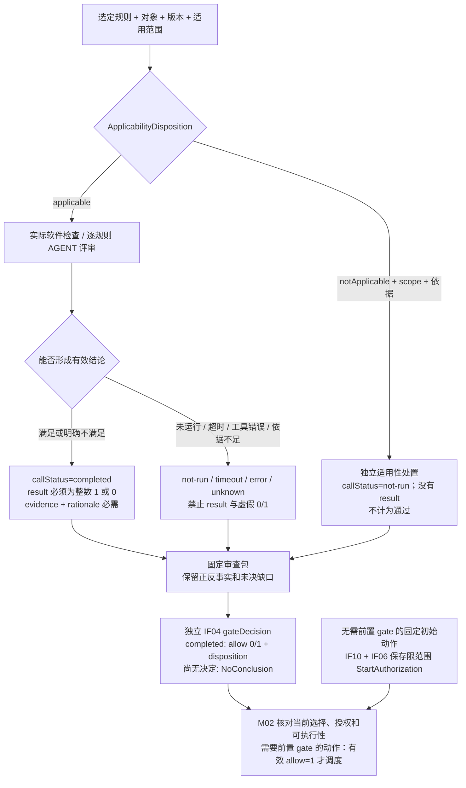
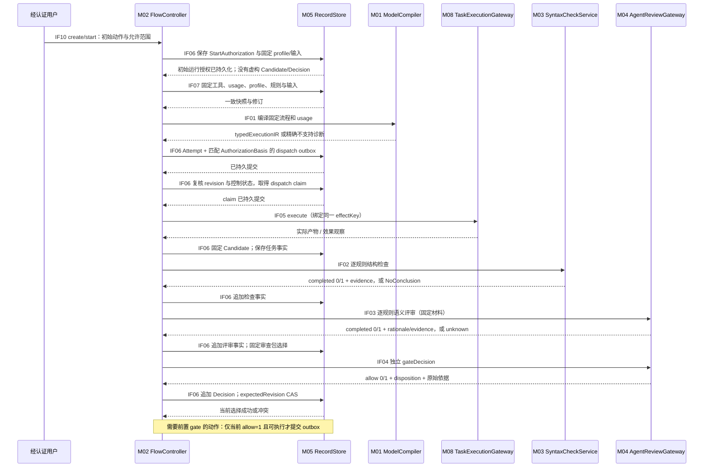
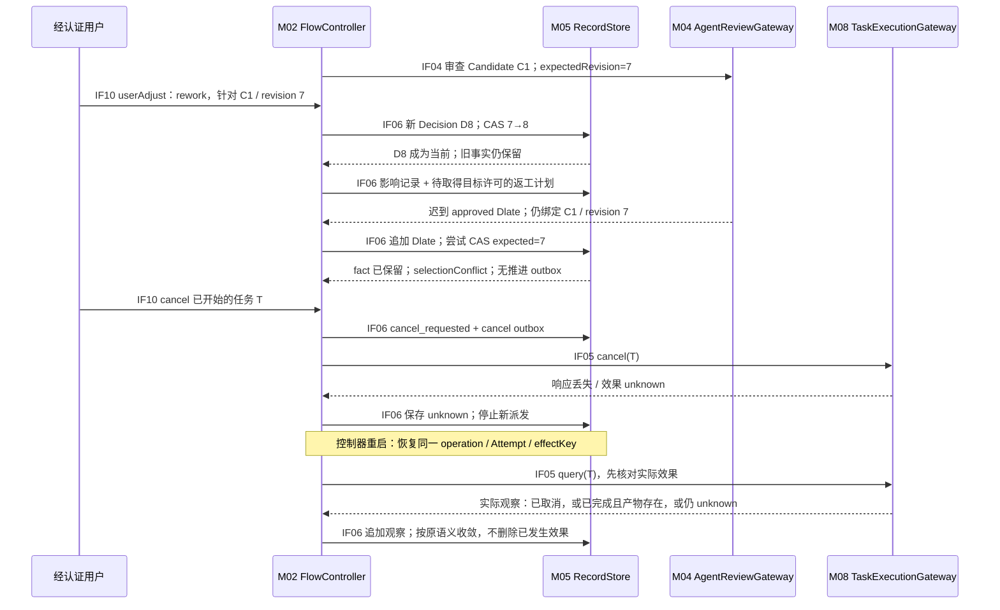
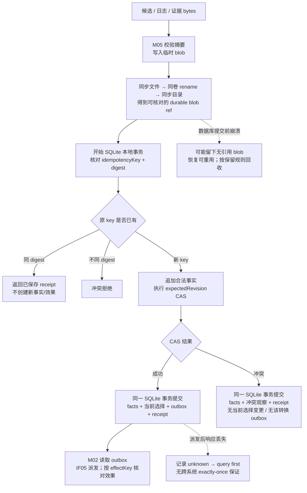
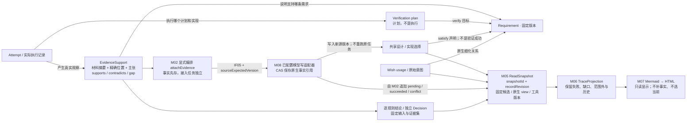
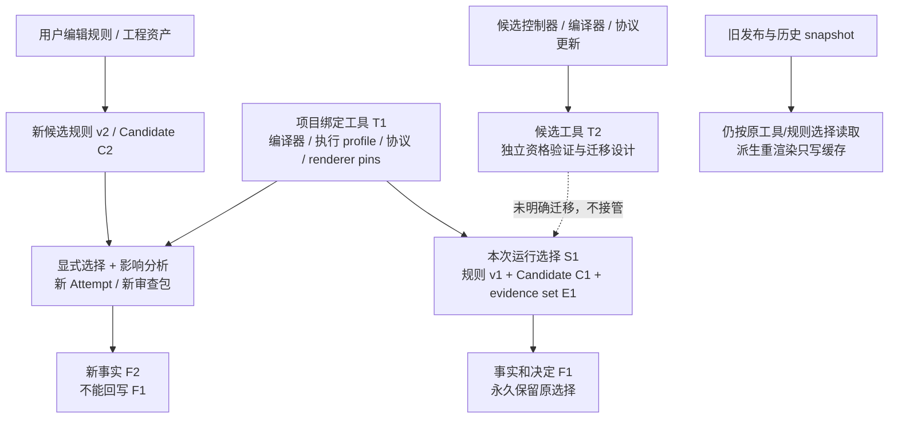

# 流程控制器接口与执行契约

文档身份：`workflow_controller_interfaces`。版本：**0.1**。状态：**初版设计草案，未获 PDR / CDR 批准**。日期：2026-10-13。范围：M01–M08、IF01–IF10，包含记录与验证准备；不实现控制器、不新增 SysML、不登记新的 wish 编号。

所属意图：本轮用户提出的“代码流程控制器、SysML 约束执行、Wish 作为受控 V-model usage、独立流程/evidence 渲染”。正式 Wish、增量及 Attempt 绑定尚未建立。上游为同轮 [架构草案 0.1](workflow_controller_architecture.md#a01)，不是已选择的 PDR 基线。

| 依据及选择 | 本文采用的位置 / 理由 |
| --- | --- |
| [详细设计 index 0.1](../constrains/detailed_design/index.md#必需设计表达)、[DD-SYN](../constrains/detailed_design/syntactic_constrains.md)、[DD-SEM](../constrains/detailed_design/semantic_constrains.md) | 九项必需表达、接口/记录/恢复/验证准备；本文按 I01–I09 映射 |
| [公共协议 0.1](../constrains/README.md#规则身份与结果协议) | 规则身份、结果与工程决定分开；本文的 0/1 是类型化映射，不替换原规则含义 |
| [gate 2026-10-13](details/gate.md#6-决定有效性与推进条件) §§3–8 | 审查选择、主体来源、用户调整、迟到与推进条件 |
| [trace 2026-10-13](details/trace.md#4-确定版本与-candidate) §§2、4–7 | 原生关系、候选与后生事实分离、局部证据、历史适用性 |
| [v_model_sysml 2026-10-13](details/v_model_sysml.md#4-原生模型的执行契约) §§2、4–6 | 固定十阶段、usage 配置、有限执行 profile、合法返工环 |

上述日期/版本是本草案引用选择；正式提交还须固定原文内容摘要及实际 PDR 材料。本文标为“拟议”的类型、接口、存储与算法是 **v0.1 规范性设计**，不代表现有模型或工具已实现。

## I01 组件结构与接口边界



图 I-1：箭头指请求方向，响应沿原接口返回；M02 发出的写入和外部动作都携带固定选择。M03 可运行从 SysML 规则生成的软件，或调用已锁定工具；M04 的逐规则评审与关卡决定是两次不同操作，即使由同一主体承担。

| 组件 | 内部责任 / 所有权 | 现有原生依据；拟议细化 |
| --- | --- | --- |
| M01 ModelCompiler | 源闭包核对、Rust 编译、执行 profile 检查、类型化 IR | `XFlowInterfaces::CompileRequest`；拟议 `ExecutionIR` |
| M02 FlowController | usage 实例、分支、Attempt、推进与恢复；唯一发起调度者 | `XFlowRuntime::RuntimeCoordinator`、`XFlowVModel::VModelDevelopment`；拟议 `RuntimeInstance` |
| M03 SyntaxCheckService | 逐规则结构检查及实际诊断，不产生 gate 许可 | `XFlowEngineering::CheckResult`；拟议 `RuleCall` |
| M04 AgentReviewGateway | 主体渠道核验、逐条语义判断、独立 gate，保留原回答 | `XFlowGate::ReviewPacket`、`SubmissionProvenance`、`XFlowEngineering::Decision` |
| M05 RecordStore | 不可变内容、追加事实、版本选择、幂等账及 outbox | `XFlowStorage::StorageVersionService`；拟议 SQLite/内容寻址实现 |
| M06 TraceProjection | 读取原生关系和选定事实，构造只读展示投影 | `XFlowModelTrace::ModelTraceService`；不另存可修改结论 |
| M07 StaticRenderer | 消费投影，生成 Mermaid/HTML；不调度或写决定 | `XFlowRendering::MermaidHtmlRenderer/RustMermaidToolchain`；拟议独立 CLI 契约 |
| M08 TaskExecutionGateway | 已配置入口的执行、查询、取消和真实效果观察 | `XFlowInterfaces::EngineeringRequest`；拟议 `TaskOperation` |

## I02 类型化记录与严格结论

### I02.1 公共信封与材料选择

所有引用使用现有 [`XFlowEngineering::VersionReference`](../../.xflow/xflow/engineering_types.sysml) 的身份/版本/摘要/定位语义。下图除标注“已有”外均是拟议数据类型；不是当前 SysML 已有字段。



图 I-2：`RuleConclusion` 与 `NoConclusion` 是互斥分支。`Candidate`、`Decision`、`EvidenceReference`、`EngineeringScope` 是已有逻辑类型；新信封不重定义它们。

| 字段 / 约束 | v0.1 契约 |
| --- | --- |
| 必需字段 | 信封及 Selection 的公共字段必需，条件字段依下表联合类型校验；没有输入证据时引用**明确的空证据集版本**。IF10 `create` 可内联 BootstrapSelection，其余调用引用已固定选择；不伪造尚不存在的 Attempt 或 Candidate |
| 请求摘要 | 使用 [RFC 8785 JCS](https://www.rfc-editor.org/rfc/rfc8785.html) 生成 UTF-8 规范字节后求 SHA-256；拒绝重复键、无效 Unicode 和非有限数，超出安全整数范围的身份/计数采用 schema 声明的十进制字符串。摘要覆盖 contract/version/schemaDigest、操作、主体上下文引用、业务载荷、选择、deadline；排除摘要自身、网络重传序号与服务端接收时间 |
| 固定选择 | Candidate 的资产摘要不包括后生检查/决定；`evidenceSetRef` 单独固定评审输入。新增评审材料生成新的 Review Selection；改变工程内容则产生新 Candidate |
| 身份与版本 | 稳定工程身份不等于解析器 UUID。每个引用含 `stableId/version/contentDigest/locator`；跨版本必须明确新选择，不按名称或“最新”隐式替换 |
| 来源 | 实际主体来自认证渠道及 workflow 授权绑定；模型、文档、AI 回答里的“已授权”文本不赋予权限 |
| 证据位置 | `TypedSelector` 为原生元素身份、固定文本行/字节区间、稳定章节、JSON Pointer 或固定页/段范围之一；读取固定版本后核对选择器与片段摘要 |
| 证据支持 | 每项 evidence 必须说明支持哪条 requirement、哪项具体主张及 `supports/contradicts/gap`。找不到材料时可引用**真实保存的查找/不足说明**并选 `gap`，不能伪造成功观察 |
| 持久化 | IF01–IF06、IF10 的信封、原始返回、调用状态变化和结果经 M02 提交 M05；M03/M04/M08 不是独立事实数据库。可追加修正/替代引用，不原位修改事实。IF07–IF09 的成功结果、失败诊断及超时/取消状态直接返回调用方，不要求经 M02/IF06 保存；可选日志与复用缓存按 I03.1 的只读例外管理 |

| `Selection.kind` 联合分支 | 增量必需字段 / 允许的用途 |
| --- | --- |
| `Bootstrap` | 公共版本字段和 `inputClosureRef`，没有 runtime/attempt/candidate；用于 IF10 create、IF01 流程资格编译、IF07 初始源读取。create 先保存实例与该输入选择；start 建立首个 Attempt 后固定 ExecutionSelection |
| `Execution` | Bootstrap 公共字段加 runtimeId/attemptRef；阶段工作未产出 Candidate 时用于 IF05、IF06、IF07 及 IF10 生命周期操作。输入闭包仍有精确版本；新产物固定后生成 ReviewSelection |
| `Review` | Execution 字段加 candidateRef；IF02–IF04 必须采用此分支。IF08/IF09 展示审查链也使用它；M08 的 gateDecision 授权分支保留作为依据的源 ReviewSelection，目标 Attempt 可以尚无新 Candidate，不能拿新输入冒用旧批准 |

选择升级生成新身份/摘要，旧选择不修改。create 返回的 runtimeId 是控制目标引用；尚无 Attempt 时，IF10 start/pause/cancel/resume 必须同时给出该目标及其 expectedRevision，仍选 Bootstrap 输入，不填假 Attempt。IF01/IF07 也可读取 Execution/Review 选择；IF06 保存三种选择对应的真实记录。没有流程实例的只读模型展示可读取 Bootstrap 快照，但必须显示“尚无运行/候选事实”，不能构造空 Candidate。

| `AuthorizationBasis.kind` 拟议联合分支 | 必需依据与允许范围 |
| --- | --- |
| `initialStart` | IF10 保存真实用户的 create/start 意图、认证来源、固定 profile、允许动作/范围与输入选择，经 IF06 持久化为 `StartAuthorization`。仅能执行固定流程明确**无需前置 gate**的初始动作，例如 intake、initialize、clarify；start 建立 targetAttempt 后才能派发该尝试的工作。development 仍须可行性关卡许可。没有前置 Candidate/Decision 时不补假记录，不把 profile 或 source 写权限单独当作启动授权 |
| `gateDecision` | 必须引用当前有效 `allow=1` Decision、所审查的源 ReviewSelection、明确 permittedNextWork 和目标 Attempt/Input 绑定；只允许固定流程中的该次工作。目标 Attempt 尚未产出 Candidate 不影响源批准可定位；不能要求先伪造目标 Candidate 才能启动 |

固定流程 IR 明确每个动作需要哪种授权，调用方不能自行选择较弱分支；跨 gate 动作一律拒收 `initialStart`。同一阶段内部任务只能继承允许范围内的授权；`attachEvidence` 还须独立具备目标源写权限及 sourceExpectedVersion，**运行授权不等于模型源访问权限**。query/cancel 定位原 operation 并核对真实控制权限，不凭它们创建新 execute 许可。C08 按授权分支核对 start authorization/run revision，或 decision/run revision。

### I02.2 0/1、调用状态、不适用与关卡



图 I-3：调用成功送达不是规则通过；`0` 是已经形成的“不满足”判断，语义依据不足应为 `unknown`，不能强迫 AGENT 猜一个 `0`。IF02 批量响应可标记 `deliveryStatus=delivered`，但每条 `RuleCall` 仍各有上述状态；不能用批次状态覆盖逐条结果。

| 本接口值 | 现有 `CheckOutcome` 映射 | 推进含义 |
| --- | --- | --- |
| `completed / result=1` | `pass` | 仅支持所选规则，不批准 gate |
| `completed / result=0` | `fail` | 保留具体不足，可进入返工或明确例外判断 |
| `notApplicable` 适用性处置 + `not-run` | `notApplicable` | 独立类型化依据，不记 `pass`，不跳过必需规则 |
| `not-run`，尚无适用性例外 | `notRun` | 尚无执行结论 |
| `timeout/error/unknown` | `indeterminate` | 原调用状态及原因仍保留，不能从映射反推具体失败类型 |

| 有效 gate 载荷 | 现有 `DecisionOutcome` | 后续动作 |
| --- | --- | --- |
| `allow=1, disposition=advance` | `approved` | 只许可明确的 `permittedNextWork`；M02 仍检查 `ExecutionReadiness` |
| `allow=0, disposition=rework` | `rework` | 给出最早受影响的合法阶段、影响依据和受限工作；建立新 Attempt |
| `allow=0, disposition=stop` | `rejected` | 停止受影响的新调度；已发生效果不被撤销 |
| `allow=0, disposition=wait` | `pending` | 有理由地保持等待；与“调用未返回所以没有 Decision”区分 |
| 其他 allow/disposition 组合 | 不可映射 | `invalid_result`；只保存拒收诊断，不能选择为当前决定 |

`WorkDisposition` 为拟议联合类型：advance 指定后续工作及范围，rework 指定影响评估与建议目标，stop/wait 显式标记 `none`。`allow=0/rework` 否定当前 advance，触发影响评估，**不直接许可返工作业**；按现有 `ReworkPlan.permission.mayStart` 对具体返工目标取得当前有效允许决定后才派发。该许可绑定源 ReviewSelection、目标工作及新 targetAttempt；目标新 Candidate 由工作实际产出后再固定，不能提前伪造。IF04 的 GateConclusion 同样要求证据与理由，不能只提供裸 allow 值。

自动检查和分配 AGENT 的 completed 结论必须有 rationale。**用户调整未提供理由**沿用已有 `Decision.reasonProvided=false`、`rationale` 缺省，保存真实操作依据和所选范围；不得为了新协议填入编造理由或增加全局审批门槛。`stale` 继续是基于当前选择的派生适用性，不新增为 `DecisionOutcome`。

以下为完整 `RuleConclusion` 业务载荷的规范性字段示例，**仅为虚构协议样例，不是实际检查或可引用证据**。`$ref` 是本消息引用表内的索引，不是工程身份缩写；公共信封另行携带。全零摘要和 example locator 仅限样例，生产输入必须能恢复并核对真实内容。

```json
{
  "ruleRef": { "$ref": "rule" },
  "applicability": {
    "disposition": "applicable",
    "scopeRef": { "scopeId": "example-cancel-contract", "description": "IF05 取消接口设计" },
    "contractBasis": { "$ref": "rule" },
    "rationale": "取消状态属于本接口适用的关键状态语义。"
  },
  "callStatus": "completed",
  "result": 0,
  "rationale": "所选设计未定义取消请求与取消已观察之间的区别。",
  "evidence": [{
    "materialRef": { "$ref": "gap" },
    "selector": { "kind": "jsonPointer", "value": "/missingCancelContract" },
    "requirementRef": { "$ref": "rule" },
    "supportsClaim": "本次设计还不能给出取消操作的可判定契约。",
    "relationRole": "gap",
    "capturedAt": "2026-10-13T00:00:00Z",
    "producerRef": { "$ref": "reviewer" }
  }],
  "references": {
    "rule": { "stableId": "DD-SEM-002", "version": "0.1", "locator": "docs/constrains/detailed_design/semantic_constrains.md", "location": "rule:DD-SEM-002", "contentDigest": "sha256:0000000000000000000000000000000000000000000000000000000000000000" },
    "gap": { "stableId": "example-gap-observation", "version": "1", "locator": "example:gap.json", "location": "/missingCancelContract", "contentDigest": "sha256:0000000000000000000000000000000000000000000000000000000000000000", "capturedAt": "2026-10-13T00:00:00Z", "producerId": "example-reviewer" },
    "reviewer": { "stableId": "example-reviewer", "version": "1", "locator": "example:reviewer-binding.json", "location": "/actor", "contentDigest": "sha256:0000000000000000000000000000000000000000000000000000000000000000" }
  }
}
```

序列化允许内联 VersionReference，或在同一消息内以 `$ref` 解析到上述完整引用；未定义引用索引拒收。完整响应还须复述请求的 operationId 与 selectionDigest，并保留可信渠道来源。若材料本身未能读取，响应改为 `callStatus=unknown` 并记录诊断，**省略 `result`**。

## I03 IF01–IF10 契约登记

### I03.1 共用调用规则

| 协议规则 | 前置 / 后置 / 失败处理 |
| --- | --- |
| C01 固定输入 | 服务核对信封、工具锁、协议与选择摘要；响应复述原 `operationId/selectionDigest`。不匹配返回 `selection_mismatch/tool_mismatch/version_unsupported`，不产生成功载荷 |
| C02 幂等 | key 唯一范围为 `(projectId, contractId, idempotencyKey)`。IF01–IF06、IF10：同 key + 同 `requestDigest` 返回同一 operation 与已保存结果；运行中返回同一进度。相同 key + 不同 digest 返回 `idempotency_conflict`，不覆盖旧事实、不触发新效果。IF07–IF09 采用下述固定输入重读/重算语义，不要求 M05 持久幂等账 |
| C03 时间与重试 | `deadlineAt` 为必需绝对 UTC 时间；未开始且过期记 `not-run/deadline_expired`。已发起调用到期记 `timeout`，不是已停止。网络重传保持 key/digest/deadline；延长期限须新调用并引用前次，外部 `effectKey` 不因重传改变 |
| C04 取消 | 取消是独立 operation，引用目标 operation；`cancel_requested` 不等于 `cancel_observed`。只有适配器真实观察可记录停止；迟到产物和已发生效果仍追加保存。IF07–IF09 的取消范围与诊断处理见下述只读例外 |
| C05 版本与来源 | 固定 flow、profile、rules、工具/库、candidate、evidence set；规则生成软件另有生成器/源码/二进制摘要。服务只能使用已配置入口；返回来源由渠道验证 |
| C06 失败分类 | schema/权限/版本冲突不重试原不变请求；暂时不可用可在原 deadline 内同 key 查询/重传；效果未知先 query。服务崩溃、工具错误、语义不确定分别保存，不统一为 `result=0`；IF07–IF09 保留这些分类并直接返回诊断，不强制保存运行事实 |
| C07 保存责任 | M02 经 IF06 保存实际响应及其选择后，才能据此改变当前状态或发出新 outbox。迟到事实可以保存；选择当前仍需独立 CAS |
| C08 派发边界 | 派发前 M02 经 IF06 原子核对 AuthorizationBasis 分支、expected run revision 及对应 start authorization/decision revision、暂停/取消状态并记录 dispatch claim；失效 outbox 标为 suppressed，不调用 M08。claim 后到 send 之间无法跨系统撤销：此时暂停/改决定按 in-flight/unknown 效果用原 effectKey query/cancel，不保证暂停后没有先前授权的效果。崩溃恢复读取原 claim/effectKey；不靠清空 outbox 重发 |

生命周期策略：`P` 纯计算（可重算，无外部业务效果）；`A` AGENT 调用（重传不重复派发、取消须观察）；`E` 外部效果（unknown 必先查询）；`W` 持久写（同事务幂等账、CAS）；`R` 固定快照读取（重读同 snapshot）；`O` 派生输出（临时输出成功后发布缓存）。共用规则按操作语义适用；IF07–IF09 保留 C01/C03/C05 的校验、期限与来源要求，C02/C04/C06 采用以下只读例外。C07 仅在 M02 据响应改变当前状态或发出新 outbox 时要求持久化依据；C08 约束 IF05 新 execute 的派发，不适用于 IF07–IF09。

| IF07–IF09 只读例外 | 契约与归属 |
| --- | --- |
| 保存与权限 | 调用链不调用 IF06，不追加运行事实，不改变 recordRevision、当前选择或 outbox；读取/投影仅需源/记录读取权限，IF09 另需所选派生输出位置的写权限。IF07 的存储读取与 M06 的投影不直接写调用日志或缓存；诊断随响应返回 |
| C02 重读/重算 | 接收端在进程内核对已知 key 与 requestDigest 的绑定，同 key 异摘要仍拒收；固定 snapshot/输入/工具的相同请求可重读或重算，并复述原 operationId/selectionDigest。不承诺跨重启或缓存清理后恢复原响应及历史键绑定；仍遵守 C03，延长期限必须新调用，不隐式改读最新快照 |
| 日志与缓存 | 调用方可在允许缓存区保存诊断日志和复用缓存；M07 管理渲染文件及 manifest。可选日志/复用缓存可关闭，派生内容可清理，均不进入 M05 事实或持久幂等账；日志/复用缓存不可写时仍可返回读取/投影结果，IF09 的所选输出位置不可写则返回渲染失败 |
| C04/C06 取消与失败 | 取消只影响本次读取、计算或渲染，并清理本次临时输出；仍区分 cancel_requested 与 cancel_observed。取消状态与失败分类直接返回，可选记录到派生日志，不创建业务取消事实或 outbox，也不取消原工程任务 |

### I03.2 编译、检查、评审与执行

| 身份 / 两端责任 | 输入 → 输出 | 前置 → 后置 | 效果、失败与调用策略 |
| --- | --- | --- | --- |
| **IF01 compile v0.1**；M02 固定输入，M01 编译及 profile 资格检查 | `CompileRequest + flowUsageRef + executionProfileRef` → `CompileResult{nativeAstRef, executionIrRef, sourceMapRef, diagnostics, unsupported}` | 源/库可恢复且工具锁一致 → IR 中节点、类型、参数、边、guard 均追到原生身份；不支持项有精确位置 | `P`；只产生派生 IR。解析失败、缺引用、profile 不支持则没有可执行 IR；超时/取消不能发布半份 IR；同版本重算只作为派生结果 |
| **IF02 syntax v0.1**；M02 选择规则，M03 执行确定方法 | `RuleBatch{ruleRefs, selectedSubjects, executableBindings}` → 各条 `RuleCall`、原始诊断引用 | 每条规则有软件/锁定工具绑定与输入 → 每条有结论或明确 NoConclusion；每个 1/0 带位置证据 | `P`；工具若有外部效果必须转 IF05。缺能力 `not-run/unsupported_rule`；崩溃 `error`；生成源码存在不等于执行通过；deadline/取消按每条调用保存 |
| **IF03 semanticRuleReview v0.1**；M02 固定评审题与材料，M04 调用所分配人/AI并验返回 | `SemanticRuleRequest{ruleRef, requirementRefs, reviewPacketRef, reviewerBinding}` → `RuleConclusion` 或 `NoConclusion`，可附独立适用性处置 | 该规则的主体、范围和材料明确 → 返回逐规则 0/1 + rationale + evidence，或 unknown；不产生 gate 许可 | `A`；证据不足保留 unknown，不强制二选一。原始回答与解析诊断保留；格式错误 `invalid_result`，重评须新 operation，迟到返回不能选当前 |
| **IF04 gateDecision v0.1**；M02 提供完整审查包，M04 记录独立 gate判断 | `GateRequest{gateId, reviewPacketRef, requestedNextWork, expectedDecisionRevision}` → `GateConclusion/NoConclusion`、`Decision`、provenance | 主体对该关卡/范围有授权；包列出正反检查和缺口 → allow/disposition 与 I02 映射一致，绑定真实审查选择 | `A`；决定本身不产生外部动作、不自动执行 CAS。未分配 `not-run`；无法判断 `unknown`；超时无新结论。用户调整走 IF10 的实际用户渠道；迟到决定仍须 IF06 竞争当前选择 |
| **IF05 execute/query/cancel v0.1**；M02 持有调度依据，M08 对配置任务入口执行并观察 | `TaskCommand{operation, taskBinding, workContract, effectKey, authorizationBasis}` → `TaskReceipt/TaskObservation{externalTaskId, artifactRefs, effectState, cancellationState}`；拟议 `attachEvidence` 工作另带 `factRefs/nativeTargetRefs/sourceExpectedVersion` | execute 必须已有持久 outbox、匹配 IR 的 AuthorizationBasis 及可执行依据，并取得 C08 dispatch claim；需要前置 gate 的动作使用 gateDecision 分支；query/cancel 必须定位原 task → 返回真实观察；模型写按 sourceExpectedVersion CAS 接入原生事实引用，返回实际 sourceVersion 或 conflict | `E`；`effectState=notObserved/running/completed/failed/unknown`；完成须有产物/效果观察，不能靠退出码推断交付。未知先 query；适配器不支持去重/查询则停在待核查，不能承诺 exactly-once。cancel 仅请求，直到观察确认；模型写需独立源访问权限、已配置入口和可恢复新源版本 |

### I03.3 存储、投影、渲染与控制

| 身份 / 两端责任 | 输入 → 输出 | 前置 → 后置 | 效果、失败与调用策略 |
| --- | --- | --- | --- |
| **IF06 commitFacts/CAS/outbox v0.1**；M02 说明意图，M05 保证本地提交语义 | `CommitIntent{newFacts, durableBlobRefs, expectedRevision, selectionChange?, outboxIntent?}` → `CommitReceipt{factRefs, selectionStatus, revision, outboxRefs}` | blobs 已持久可核对；事实身份及 key 未冲突 → 事实、幂等答复、允许的 CAS/outbox 在同一 SQLite 事务中提交 | `W`；CAS 冲突仍可追加合法迟到事实与冲突观察，但不改变当前选择、不得创建该转换 outbox；schema/digest 冲突整项拒收。提交结果未知同 key 查询；提交前可取消，提交后只能追加补偿/取消请求 |
| **IF07 readSnapshot v0.1**；M01/M02/M06 选择读范围，M05 返回一致选择 | `SnapshotQuery{selectionRef, recordRevision, viewRefs?, scope, cursor?}` → `ReadSnapshot{snapshotId, selectionDigest, records, materialRefs, omissions, nextCursor?}` | 每项内容摘要可核对；权限/范围明确 → 同 snapshot 的页来自同一记录修订和固定内容集合；是否含 Candidate 由 Selection.kind 决定 | `R`；读不改变事实。断链、损坏、游标失效、范围外分别返回；不能隐式补读“最新”。deadline/取消只终止本次读取；重试同 snapshot，失效后显式新选 |
| **IF08 projectTrace v0.1**；M07 提供展示选择，M06 解释只读原生关系 | `TraceQuery{snapshotId, nativeViewRefs, projectionProfile, budget}` → `TraceProjection{nodes, relations, recordLinks, gaps, omissions, coverage}` | view/来源与 snapshot 一致 → 每个展示节点/边有来源、类型、版本；计划、实际事实、当前适用性分别标注 | `P+R`；不创建满足关系或批准。预算不足返回明示分页/省略；必要端点未知则诊断，不能猜边。重算固定 snapshot，不随 UI 当前选中变化 |
| **IF09 render v0.1**；调用方选择输出，M07 请求投影并渲染 | `RenderRequest{snapshotId, nativeViewRefs, format, outputLocation, rendererPin}` → `RenderManifest{projectionRef, files, hashes, diagnostics}` | 输出在允许缓存区且渲染器固定 → 成功文件均绑定同一 snapshot/view/projection，保留缺口和历史 | `O`；临时文件渲染完后替换本次派生输出；失败无“完整成功”清单。拒绝覆盖旧发布包；重试固定输入可重建，取消清理本次临时文件，不改工程事实 |
| **IF10 control v0.1**；调用方提交真实操作，M02 核对配置与变更 | `ControlCommand{create/start/pause/resume/cancel/rework/userAdjust, target, expectedRevision, selection, payload}` → `ControlReceipt{acceptedFactRefs, authorizationRef?, derivedState, pendingEffects}` | 来源及作用范围可验证；create 有原始意图/usage绑定；其余定位当前实例 → create/start 经 IF06 保存真实意图、限范围 StartAuthorization；按固定流程和 C01–C08 推导行动 | `W+E`；初始授权只覆盖无需前置 gate 的明确动作，不能跨 gate。pause 阻止新派发；resume 复核原 attempt/选择；rework 先固定影响和目标许可再绑定新 attempt；userAdjust 必须绑定 ReviewSelection，追加 Decision 不改失败事实。cancel 返回 requested；同 key 重放，revision 冲突不抢占新决定 |

接口载荷不接收任意 shell 命令、动态工具下载或随材料提供的授权。M08 的 `taskBinding`、M03 的检查入口和 M04 的 AGENT 通道都来自固定工具与显式 profile 选择。

## I04 正常阶段与有限执行算法



图 I-4：图中的调用表示拟议正常行为，没有任何步骤被声明已经执行。控制器使用同一求值规则解释条件；M06/M07 仅显示已保存的评价与依据，不各实现一套批准算法。

| `xflow-execution-v0.1` 拟议支持项 | 解释规则 / 不支持边界 |
| --- | --- |
| 元素与控制 | 固定十阶段、action usage 绑定、顺序 succession、条件分支、明确返工边、等待/恢复；返工创建新 Attempt，合法回路不做 DAG 拒绝 |
| 标量与身份 | Boolean、Integer、String、声明的 enum、版本引用身份；字段读取必须通过编译器已解析的端点及记录绑定，不按同名字段猜测 |
| 最小表达式 | 字面量、括号、已绑定字段链、`not/and/or`、`==/!=`、Integer 的 `< <= > >=`。引用比较为明确身份/版本比较，不是任意对象深比较；不提供隐式数字/字符串转换或默认真值 |
| 派生值与约束 | 选定 `attribute = expression` 依赖按已解析图求值；循环依赖报不支持。assert/guard 采用同一类型规则；当前阶段缺字段返回 `missing_input`，不是默认 `false` |
| 分支选择 | 所有候选 guard 必须可确定为布尔值；恰一条 true 才选边。多条 true 为 `ambiguous_branch`；全 false 仅在显式等待出口存在时等待，否则 `no_enabled_transition`；任一 unknown/不支持先阻止调度 |
| 不支持项 | 任意函数调用、一般集合量词、连续时间/单位计算、任意并发 token/fork/join、未经定义的状态机和副作用表达式。返回原生元素/源码位置；不得套用上游 rustgen 的默认 guard=true |
| 任务映射 | 动作只映射到已配置 `taskBinding`，IR 固定所需 AuthorizationBasis 分支；初始授权只覆盖无前置 gate 的指定动作，跨 gate 必须当前允许决定。依赖/满足/verify 关系不变成执行边；AGENT 质量判断由 IF03/IF04 取得 |

第一版 profile 是工具机制的一部分；用户规则可以在该子集内增补检查，不得改变固定关卡拓扑。求值失败与规则 `result=0` 分开，用户仍可保存想要的 Decision，但技术不可执行时没有新派发。

## I05 并发、返工、取消与恢复



图 I-5：返工、迟到返回和取消共享“事实追加、当前选择 CAS”的机制。恢复不创建一次冒充原操作的全新任务；无法查询的效果继续保持 unknown。



图 I-6：**文件系统与 SQLite 没有被宣称跨资源原子提交。** 先确保 blob 持久，再提交数据库引用；数据库本地事务原子地维护事实、CAS、outbox 与幂等答复。发布对象及被历史引用的共享 blob 不在开发缓存清理范围。

| 不变量 | 责任 / 恢复点 |
| --- | --- |
| DB 不指向未持久 blob | M05 在事务前验证 durable receipt 与摘要；落盘失败不写成功引用 |
| 一个 operation 的事实不因重传复制 | M05 幂等账与事实同事务；调用方收不到 receipt 时查询原 key |
| 当前选择只由 CAS 改变 | M02 提供 expected revision，M05 决定是否提交；时间较晚没有优先权 |
| 追加事实不等于批准 | 合法迟到事实可保留；无当前有效选择就没有相关推进 outbox；已排队事件还须通过 C08 才能派发 |
| 外部副作用不能回滚成未发生 | M08 观察真实效果；M02 追加 reconcile/cancel 事实，必要补偿是新的受控任务 |
| 模型接入失败不重跑任务 | M02 编排 `attachEvidence`，M08 模型写适配器按 sourceExpectedVersion CAS 接入；M05 追加 `pending/succeeded/conflict` 及原生源版本。冲突后重新选择目标版本、重试接入，不重复产生事实的原任务 |

`attachEvidence` 的源保存与 M05 记录仍是两个提交：先保存事实及 pending/outbox，再由 M08 写入原生事实引用，最后追加 succeeded/conflict。若源已写入但确认丢失，先用 effectKey 查询所产生版本和引用；不能把保存记录失败误判为原任务未执行。Git/模型源冲突分别保留，未解决前展示“待接入”；发布只读对象不作原位接入目标。

## I06 证据链与只读快照



图 I-7：图上连接是来源与主张，不是“已满足”的自动证明。每条 wish 独立绑定自己的完成范围；共享设计保留一个原生身份，不能复制成各自可修改的事实。M06/M07 没有模型写权；原生实际记录引用由 M02 经 M08 接入，planned 与 actual 角色仍须区分。

| 快照 / 投影规则 | 显示要求 |
| --- | --- |
| candidate 与 recordRevision 同时固定 | 同一候选在不同证据修订上的审查必须可区分；分页游标绑定 snapshot + 查询摘要 + 位置 |
| 截止修订后产生新事实 | 原 snapshot 不混入新事实；用户显式选择新 snapshot 才展示新的当前状态 |
| required view 内容超过预算 | 返回预算与分页/省略清单，完整性标记为不完整；不能静默截断后称“全部通过” |
| 材料不可恢复、位置失效、真正断链 | 显示各自原因及影响；不自动改指新版同名章节或整篇文档 |
| 原生引用尚未接入，但事实已保存 | 显示“已有记录，待建立原生关联”；不隐藏事实，也不伪造已有原生边 |
| 当前适用性 | 读取 M02 已记录的评价及依据；M06 可显示陈旧/缺评价，不根据 Mermaid 文本自行批准 |

## I07 版本演进、工具依赖与资源界限



图 I-8：协议版本、执行 profile、规则版本和工具版本分别选择。兼容消息格式不意味着新规则自动适用于旧运行；候选工具不能在开发中替换当前执行机制。

| 设计选择 | v0.1 边界 / 依据 |
| --- | --- |
| M02 使用 Rust | 与编译器 AST 类型和执行 IR 对接；仍需固定 Cargo.lock、验证源码构建和目标平台。现有 v0.1.4 发布二进制只证明已测解析/导出，不证明控制器存在 |
| 执行编译与规则软件 | 不直接运行任意 SysML→Rust 生成物；生成源码和编译产物需要明确工具 pin、可执行子集验证、未实现项拒收及约束覆盖 |
| 原生编译限制 | 保留未求值规则；已知重复定义与反向 multiplicity 探针缺口需执行 profile 的专门检查或阻止相应输入，不能以 Rust `check.ok` 覆盖 |
| 资源配置 | `maxInputBytes/maxAstBytes/maxRuleCount/maxProjectionNodes/maxProjectionEdges/maxOutputBytes` 必须在工具/profile中有正整数上限；触限返回 `resource_limit`。具体初始数值待测量，未确定前禁止无界生产部署 |
| 超时配置 | 每次调用必有 deadline；服务配置 concurrency/queue 上限。超时仅影响观察状态，不假设外部任务已停；长任务通过 query 观察，不能延长旧请求摘要内的期限 |
| 协议兼容 | 接收端先核对 contractId + version + schemaDigest；新增可选字段只有在声明兼容时可忽略。未知必需字段、枚举和执行 opcode 拒绝；不降级成旧语义 |
| 升级过程 | 定义旧→新载荷映射、能力差异、历史读取与回滚计划；只迁移显式选定项目，新版本不重写旧 candidate/facts |

## I08 工程追溯与组件验证准备

### I08.1 设计—规则—原生依据

| 设计端点 | 现有原生依据 / 对应 view | 真实规则身份 |
| --- | --- | --- |
| I01、IF01、I04 执行 profile | `XFlowVModel::VModelDevelopment`、`vModelView/stageExecutionView/reworkView`；`XFlowWorkflow::WorkflowProfile`、`workflowProfileView` | WF-SYN-001/002/003/014/015；DD-SYN-003/013；DD-SEM-009/013 |
| I02、IF02–IF04 结果与证据 | `XFlowEngineering::CheckResult/Decision/EvidenceReference`、`engineeringTypesView`；`XFlowGate::DecisionApplicability/ProgressEvaluation`、`gateContractView` | WF-SYN-006/007/008/010；WF-SEM-003/004/006；DD-SYN-005/006；DD-SEM-004/007 |
| IF05/IF06/IF10、I05 恢复 | `XFlowGate::CurrentDecisionSelection/AppendUserAdjustment`、`userAdjustmentView`；`XFlowStorage::StorageVersionService`、`storageView` | WF-SYN-005/009/011/012；WF-SEM-007/008/010；DD-SYN-007/008；DD-SEM-003/005/006 |
| IF07–IF09、I06 来源展示 | `XFlowInterfaces::identityPreserved/noImplicitExecutionAuthority`、`interfacesView`；`XFlowModelTrace::ModelTraceService`、`modelTraceView` | MT-SYN-004/006/008/009/010/011/012/013/014；MT-SEM-003/004/006/007/008/009/010/013/014；DD-SEM-008 |
| 本次初版与正式提交边界 | 现有模型只作依据；拟议接口、记录、用例尚未形成原生元素及自己的 view | DD-SYN-001/002/004/009/010/011/012/014；DD-SEM-001/002/010/011/012/014 |

这是设计追溯，**不是新增原生 satisfy/verify 的声明**。接口规范的原生细化关系、每个新模型的 view、正式 Wish/Attempt/PDR/CDR 绑定见 I09，不能由本表冒充已经完成。

### I08.2 验证环境与判据

以下全部是**待执行规程**。共同环境：隔离测试项目、固定 T1 工具与用户规则快照、可控制延迟/重复/失败的 AGENT 和 task adapter、可注入落盘/SQLite/进程崩溃点的存储替身；真实适配器仍须单独验证，模拟不能证明真实外部系统幂等。

每例记录源/规则/profile/工具/fixture 摘要、逐步事件、原始返回、SQLite 前后修订、相关 blob 摘要与精确断言位置。通过判据是下表可观察不变量成立，不是仅返回 exit 0。

| 用例 ID / 设计端点 | 输入与操作步骤 | 预期 / 通过判据与证据 |
| --- | --- | --- |
| **WFC-IF-T01** IF01/I04 | 固定现有十阶段流程及跨文件 usage；编译，再加入未支持函数/缺类型各重编译 | 正例 IR 保留原生节点/guard；反例无可执行 IR且定位准确。证据：AST/IR对照及拒收位置 |
| **WFC-IF-T02** IF01/I04 | 对同一阶段分别提供缺字段、两个 guard=true、全部false无等待出口 | 分别为 missing_input/ambiguous_branch/no_enabled_transition，无 dispatch outbox；不是三个假 result=0 |
| **WFC-IF-T03** IF02/I02 | 同规则跑满足、明确违规、工具崩溃、未配置工具四组输入 | completed 1/0 均有证据；error/not-run 无 result，批次不能覆盖逐条状态 |
| **WFC-IF-T04** IF03/I02 | AGENT 返回充分、明确不足、无法读取依据、不适用四种回答 | 分别为 1、0、unknown、独立 notApplicable+scope依据；不适用不记pass，未知不猜0 |
| **WFC-IF-T05** IF04/I02 | 提交所有合法 allow/disposition 对；再提交 allow=1/stop 和缺 evidence 的批准 | 合法组合映射已有 DecisionOutcome；非法组合无当前决定，保存拒收诊断 |
| **WFC-IF-T06** IF02–IF06/C01-C02 | 首次提交 K/D；重传 K/D；再传 K/D2；再错传 selection/tool版本；对 Unicode、键序、数字表示及非法输入运行跨语言 JCS 向量 | 等价载荷规范字节/摘要相同，非法输入拒收；同请求重放相同operation/facts；不同digest及版本错配拒绝，无重复任务或事实 |
| **WFC-IF-T07** IF04/IF06/IF10/I05 | revision7开始AI评审；用户改成返工并CAS至8；再交回迟到approved | 迟到事实保留但CAS冲突；用户决定仍当前，无迟到批准的推进outbox |
| **WFC-IF-T08** IF05/IF10/I05 | 已启动任务；发cancel；丢失回应；重启；query返回实际completed | 先是cancel_requested/unknown，后记录completed实际产物；不能宣称取消已成功或重复execute |
| **WFC-IF-T09** IF05/C03 | execute 已发出后deadline到期；重传同key，再query；适配器不支持查询 | timeout不等于停止；重传不创建第二任务；无法核对保持unknown/待人工处置，无exactly-once宣称 |
| **WFC-IF-T10** IF06/I05 | 在blob同步前、blob持久后/DB前、DB提交后/receipt前分别崩溃并重启 | 无DB引用未持久blob；孤儿blob可核对；最后一种同key恢复相同receipt与单份事实 |
| **WFC-IF-T11** IF06/I05 | 新事实有效但expectedRevision过期；另一次schema/digest非法 | 前者提交历史事实+冲突且无outbox；后者不提交可信事实；检查DB事务与blob引用 |
| **WFC-IF-T12** IF07/I06 | 读snapshot分页过程中追加新记录；重复原页；另改游标查询摘要 | 原snapshot各页仍同修订；重读一致；错游标拒绝，不混入新“当前决定” |
| **WFC-IF-T13** IF08/I06 | 两wish引用同一设计；一条失败证据；一个断链；一个预算省略 | 同一共享身份，失败/断链/范围省略有不同标记；没有复制设计或省略失败后全通过 |
| **WFC-IF-T14** IF07–IF09/I03/I06-I07 | 记录存储以只读权限打开且无 M02 参与；关闭可选日志，删除派生cache，再以有效 deadline 用原snapshot独立重渲染；最后请求输出到旧发布包 | 重建绑定相同来源/工具，无 IF06 调用；事实、recordRevision、当前选择及outbox均不变；发布覆盖被拒绝，manifest写允许缓存区、拒收诊断直接返回，不要求恢复已清理的历史响应或键绑定 |
| **WFC-IF-T15** IF10/I04-I05 | pause后送达新任务许可；resume前改变候选；再按合法返工目标恢复 | pause无新派发；旧许可不用于新候选；返工新Attempt且原历史不覆盖，合法循环不被DAG拒绝 |
| **WFC-IF-T16** IF03/IF08/I02/I06 | evidence选旧文档特定章节，新版同名章节内容已变；旧材料缺失 | 不自动换新版；真实不足说明以gap定位所支持的requirement，不能伪造已阅读或成功观察 |
| **WFC-IF-T17** IF01–IF10/I07 | 加入未知协议必需字段/新opcode；安装新工具但不迁移项目 | 拒绝不兼容输入；原项目继续使用T1，历史事实/旧发布摘要保持不变 |
| **WFC-IF-T18** IF10/I02 | 用户未填理由调整决定且真实渠道成立；再由AI文本冒称用户 | 前者保存reasonProvided=false与原事实；后者不能取得userAdjustment来源或覆盖当前决定 |
| **WFC-IF-T19** IF06/IF10/C08 | outbox已持久但尚未claim时pause；再模拟claim后/send前pause；另在send后崩溃且外部已完成 | 前者suppressed且无派发；后两者保持in-flight/unknown，以原effectKey query/cancel恢复真实结果；不能宣称暂停已撤回外部效果，不删除claim盲目重发 |
| **WFC-IF-T20** IF05/IF06/I05-I06 | 事实已存；attachEvidence遇源版本冲突；再模拟源已写成但M05确认丢失 | 保留pending/conflict并只重试接入；后者query原effectKey找回实际源版本再补succeeded。原生产任务执行计数不增加，原生引用不伪造成功 |
| **WFC-IF-T21** IF05/IF10/I02-I04 | 仅有认证create/start及固定profile，无Candidate/Decision时执行合法初始动作；用同授权请求跨gate；再从rework0取得指向合法目标的allow1并绑定新Attempt，尚无目标Candidate时派发 | 初始动作可达且StartAuthorization已存；跨gate请求被拒且无claim；rework0单独不能派发，取得源ReviewSelection+目标许可后可达，不伪造目标Candidate。证据记录授权分支、IR动作条件、claim及前后事实 |

## I09 正式提交前缺口与章节覆盖

| 缺口 ID | 影响 / 责任 | 处置与下游限制 |
| --- | --- | --- |
| **WFC-IF-G01** 上游与Wish绑定尚未形成 | 无实际 PDR 选择、Wish/增量/Attempt；架构负责人 / 项目所有者 | 固定原始意图、正式工程身份及上游材料后再提交；本文不构成 implementation 放行 |
| **WFC-IF-G02** 原生接口模型及view未新增 | IF01–IF10、新记录和验证用例尚无原生细化/verify；模型负责人 | 正式提交前按模块补原生接口/记录模型，每份有自己的view并联合编译；本轮仅两份文档，不能记 DD-SYN-003/011 已满足 |
| **WFC-IF-G03** 执行 IR与表达式绑定待资格验证 | 不能保证现有全部约束可执行；M01/M02负责人 | 用现有阶段/关卡真例验证子集、引用比较、未知分支、循环与拒收；明确opcode/schema及覆盖后才实现受控执行 |
| **WFC-IF-G04** 具体存储与崩溃保证待实证 | SQLite配置、fsync/rename与目标平台尚未实测；M05负责人 | 选择平台、DB模式与持久化参数，执行T10/T11；不能先承诺文件系统+DB跨资源原子性 |
| **WFC-IF-G05** 真实AGENT/任务协议未资格验证 | 实际取消/查询/去重能力可能不足；M04/M08负责人 | 固定适配器能力表，执行真实延迟/重复/unknown试验；不能用模拟或“任务完成”文本冒充实际效果 |
| **WFC-IF-G06** 配额与性能初值未测 | 无吞吐/最大模型性能承诺；各服务负责人 | 测量输入/AST/规则/投影预算，固定profile正整数限额、队列与deadline策略；禁止无界生产部署 |
| **WFC-IF-G07** 工具构建与协议演进未封存 | 只有既有Rust发布二进制资格证据；工具负责人 | 固定Cargo.lock、源码构建、schemaDigest与迁移用例；新工具不能自动接管已绑定项目 |

| 详细设计九项必需表达 | 本文定位 | 当前含义 |
| --- | --- | --- |
| 1 组件结构 | I01 | 8模块及10接口设计 |
| 2 接口契约 | I02、I03 | 类型、责任、前后条件、效果与完整调用策略 |
| 3 数据与记录 | I02、I05、I06 | 单一事实来源、固定选择、持久化与局部证据 |
| 4 行为与算法 | I04、I05 | 正常交接、有限执行profile、分支/返工/恢复 |
| 5 一致性与异常 | I03、I05 | 幂等、CAS、outbox、部分成功与外部unknown |
| 6 约束与取舍 | I04、I07 | 语言/profile、固定工具、兼容与资源边界 |
| 7 工程追溯 | I08.1 | 引用真实DD/WF/MT规则与现有原生端点；新关系待建立 |
| 8 组件验证准备 | I08.2 | 21项待执行规程，不是执行结果 |
| 9 未解决问题 | I09 | 责任、处置与正式提交/实现限制 |

本稿交付的是接口与执行契约设计；实际语法检查、逐项工程语义评审、PDR/CDR 决定和运行验证仍须保存各自真实记录。
