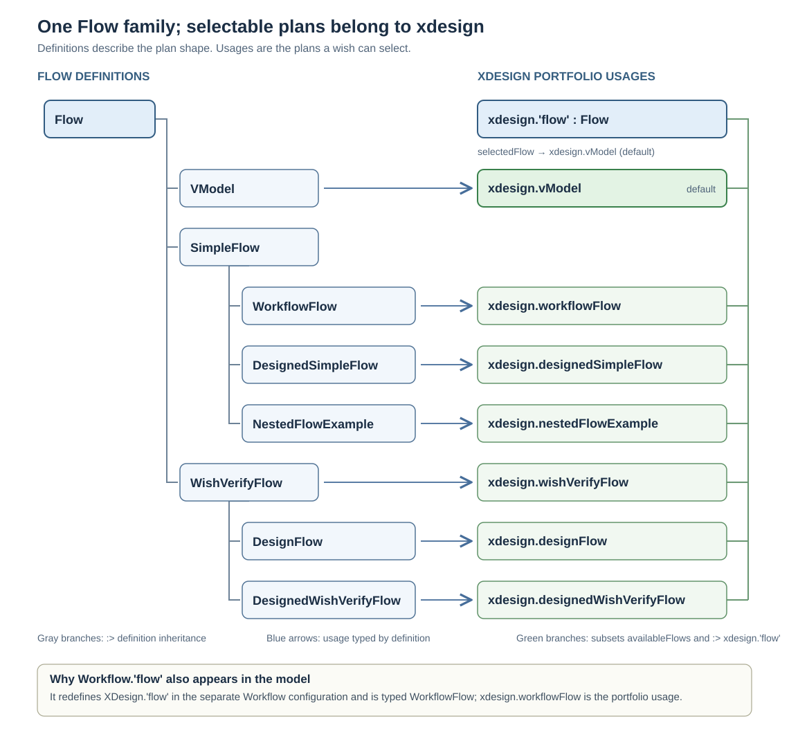
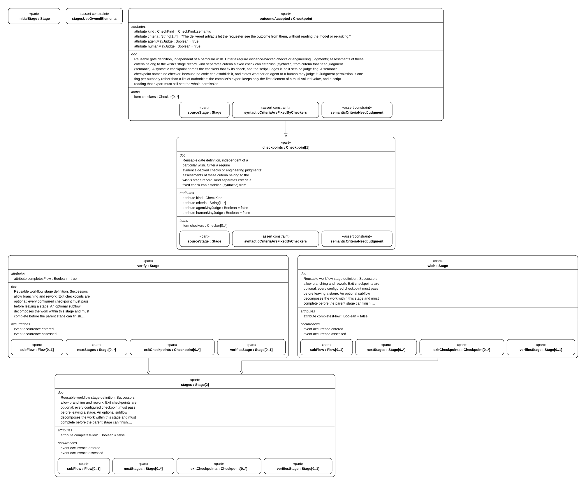
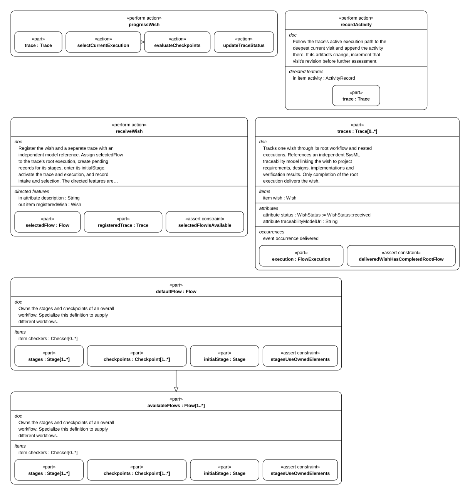

# Flows, stages and checkpoints

The mechanism that moves work forward: what a flow is made of, how a checkpoint decides
whether work may advance, which flows this model defines, and the controller that applies
them.

## F01 Flow, stage, checkpoint, checker

| Definition | Fields | Meaning |
| --- | --- | --- |
| `Flow` | `stages [1..*]`, `checkpoints [1..*]`, `checkers [0..*]`, `initialStage` | Owns the stages and gates of one workflow. `stagesUseOwnedElements` requires every stage to reference only stages, checkpoints and checkers of its own flow |
| `Stage` | `subFlow [0..1]`, `nextStages [0..*]`, `exitCheckpoints [0..*]`, `verifiesStage [0..1]`, `completesFlow`; events `entered`, `assessed` | One step: work happens here, successors allow branching and rework, exit checkpoints gate leaving. A verification stage names the stage it checks |
| `Checkpoint` | `sourceStage`, `kind`, `criteria [1..*]`, `checkers [0..*]`, `agentMayJudge`, `humanMayJudge` | A gate. Criteria are what must hold before the stage is left |
| `Checker` | `checkerId`, `commandUri`, `establishes [1..*]`, `rules [0..*]` | A deterministic check fixed as code or a script, so the flow runs it unchanged instead of judging afresh. A designed flow's checkers declare the rules that decide them ([D06](simple_flow/02_gates_and_rules.md#d06)) |
| `CheckerRule` | `ruleId`, `condition`, `reads [1..*]` | One logical rule a checker applies; the checker's outcome is the conjunction of its rules' verdicts, and its report names each rule with its verdict |

A flow is independent of any wish: it says what work exists and what must hold, never who
wants it or when it ran. The state of one wish inside a flow is recorded separately
([E01](02_records_and_evidence.md#e01)).

## F02 Checkpoint kinds and judges

`CheckKind` separates criteria a fixed check can establish from criteria that need
judgment; `JudgeAuthority` names who judges an assessment. `ConformanceKind` describes
what a checker establishes: `artifactPresence` checks that a required artifact exists,
`identifierConformance` checks declared identities, `definitionCoverage` checks that
required definitions are present, and `traceConformance` checks required links.
These are coverage categories, not verdicts about engineering adequacy.

| Kind | Names checkers | Judge flags | Judged by | Example here |
| --- | --- | --- | --- | --- |
| `CheckKind::syntactic` | yes, at least one | none set | a script (`JudgeAuthority::script`) | `requirementsAccepted` — "requirements and their verification criteria trace to the wish", fixed by `requirementTraceCheck` |
| `CheckKind::semantic` | no | `agentMayJudge` and/or `humanMayJudge` | an agent or a human | `verificationAccepted` — "verification evidence demonstrates that the implementation satisfies the requirements" |

Three assertions make the split enforceable rather than conventional:

- `Checkpoint::syntacticCriteriaAreFixedByCheckers` — a syntactic checkpoint has at least
  one checker and sets no judge flag.
- `Checkpoint::semanticCriteriaNeedJudgment` — a semantic checkpoint has no checker and
  names at least one judge.
- `CheckpointAssessment::judgmentMatchesCheckpointKind` — an assessment judged by a script
  may only concern a syntactic checkpoint, and vice versa.

Judgment permission is one boolean per authority rather than a list, because the
compiler's export keeps only the first element of a multi-valued value — found in
wish-0002 and recorded in its trace ([T04](03_toolchain.md#t04)).

## F03 The flows in this model

`XDesignArchitecture::Flow` is the reusable workflow type. Its definitions form
three branches: `VModel`; `SimpleFlow` with `WorkflowFlow`, `DesignedSimpleFlow`, and
`NestedFlowExample`; and `WishVerifyFlow` with `DesignFlow` and
`DesignedWishVerifyFlow`. In particular,
`WorkflowFlow` and `DesignedSimpleFlow` are siblings. One does not inherit the other.

`XDesignComposition::xdesign` owns the concrete selectable usages. The abstract
`xdesign.'flow' : Flow` is their shared feature origin; each usage is typed by one
definition, specializes that origin, and belongs to `availableFlows`. In the model,
`part def DesignedSimpleFlow :> SimpleFlow` means **definition inheritance**;
`part designedSimpleFlow : DesignedSimpleFlow :> 'flow'` means **an xdesign-owned
usage with a definition type and a shared feature origin**. These are different
relationships, drawn separately below.

> **Figure F03-1 — Flow definitions and selectable usages.**  
> **Question:** How do the named flows relate to `Flow` and `xdesign.'flow'`?  
> **Model view:** Compiler-export projection of `Flow` subclassifications, `XDesignComposition::xdesign` feature typing and portfolio subsettings, and the separate `Workflow.'flow'` redefinition.  
> **Companions:** [F01](#f01) for the reusable flow contract and [B01](../arch/01_system_composition.md#b01) for xdesign ownership and controller bindings.  
> **Status:** renderable-now.  
> **Reading:** Follow gray branches for definition inheritance, blue arrows for each usage's type, and green branches for the usages that share `xdesign.'flow'` and `availableFlows`. `selectedFlow` identifies `xdesign.vModel` as the default.  
> **Limits:** This shows type and ownership relationships, not stage order, gate outcomes, or evidence from a wish run.

`XDesignWorkflow::Workflow` is another *definition* that specializes `XDesign`.
Its `Workflow.'flow' : WorkflowFlow` redefines the inherited `'flow'` feature for
the `Workflow::executeWish` scenario. The concrete portfolio in this project is
`XDesignComposition::xdesign : XDesign`; its corresponding selectable member is
`xdesign.workflowFlow`. This explains why both names appear in model views.

`xdesign.selectedFlow` points to `xdesign.vModel` by default. The composition
binds the controller's `availableFlows` and `defaultFlow` to its portfolio and
selection. `receiveWish` may choose another owned member and records that choice
in the trace. Its `selectedFlowIsAvailable` assertion requires portfolio
membership; the generic controller is a model specification, not an implemented
application.

| Flow usage | Stages | Exit checkpoints | Selected when |
| --- | --- | --- | --- |
| `xdesign.vModel : VModel` | 11 stages: `wishIntake` → `stakeholderNeeds` → `systemRequirements` → `systemArchitecture` → `detailedDesign` → `implementation` → `componentVerification` → `integrationVerification` → `systemVerification` → `acceptanceValidation` → `delivery` | 11, one per stage: 3 syntactic (`requirementsAccepted`, `implementationReady`, `deliveryAccepted`), 8 semantic | The default full V-model |
| `xdesign.workflowFlow : WorkflowFlow` | `requirements` → `design` → `implement` → `'verify'` | `verificationAccepted` (semantic) | Historical four-stage runs for wishes 0001–0004 and 0007; also the plan illustrated by `Workflow::executeWish` |
| `xdesign.wishVerifyFlow : WishVerifyFlow` | `wish` → `'verify'` | `outcomeAccepted` (semantic) | A judged artifact, such as documentation or analysis |
| `xdesign.designFlow : DesignFlow` | `wish` → `'verify'` | `sysmlDeliverableAccepted` (syntactic, judged by the pinned compiler), `outcomeAccepted` (semantic) | A SysML design deliverable and its documentation, before implementation ([V05](../review/01_wish_status.md#v05)) |
| `xdesign.designedSimpleFlow : DesignedSimpleFlow` | The four `SimpleFlow` stages, in order | 5: four fixed syntactic gates and inherited semantic `verificationAccepted` | An executable gated run ([D01](simple_flow/01_run_design.md#d01), [D07](simple_flow/02_gates_and_rules.md#d07), [P08](../prj_manage/03_simple_flow_execution_record.md#p08)) |
| `xdesign.designedWishVerifyFlow : DesignedWishVerifyFlow` | The two `WishVerifyFlow` stages, `wish` → `'verify'`, in order | 2, both semantic: `wishAccepted` (added at the wish stage) and inherited terminal `outcomeAccepted`, each judged by a permitted agent or human | An executable gated judged run ([D57](wish_verify_flow/01_run_design.md#d57), [D61](wish_verify_flow/02_gates_and_judgment.md#d61), [P25](../prj_manage/09_wish_verify_flow_implementation_plan.md#p25)) |
| `xdesign.nestedFlowExample : NestedFlowExample` | Four `SimpleFlow` stages; `design` has a nested four-stage subflow | `verificationAccepted` (semantic) at the outer terminal stage | Demonstrates the subflow completion rule ([F05](#f05)) |

> **Figure F03-2 — Wish-to-verification flow.**  
> **Question:** How is a judged artifact delivered without implementation stages?  
> **Model view:** Internal-structure projection of `XDesignArchitecture::WishVerifyFlow`.  
> **Companions:** [F02](#f02) for checkpoint kinds and [V03](../review/01_wish_status.md#v03) for a recorded run.  
> **Status:** renderable-now.  
> **Reading:** The wish stage produces the artifact, then verification judges the outcome at its semantic checkpoint. The figure makes the two-stage boundary explicit.  
> **Limits:** It does not describe `DesignFlow`'s additional compiler check or a particular assessment's evidence.

`WishVerifyFlow` is the flow for semantic-only work: no requirement, design or
implementation stage, so nothing is produced that pretends to be checkable. The wish
stage records the request and does the work; verification judges the outcome
([V03](../review/01_wish_status.md#v03)).

`DesignFlow` is the design-stage flow: the wish stage produces the SysML deliverable and
its documentation; verification is a syntactic check by the pinned compiler
(`sysmlDeliverableAccepted`) and the inherited semantic judgment of what the design means
(`outcomeAccepted`). It has no implementation stage: implementation starts only after a
language is selected ([V05](../review/01_wish_status.md#v05),
[D07](simple_flow/02_gates_and_rules.md#d07)).

`DesignedSimpleFlow` specializes `SimpleFlow` without changing the historical
`xdesign.workflowFlow` stages or gates. Its concrete usage adds an exit gate to every
stage, the first three syntactic and verification by a syntactic record gate plus the
inherited semantic judgment. The rules
and commands for each syntactic gate are implemented in the four-stage local slice
([D05](simple_flow/02_gates_and_rules.md#d05),
[D06](simple_flow/02_gates_and_rules.md#d06),
[D07](simple_flow/02_gates_and_rules.md#d07),
[P08](../prj_manage/03_simple_flow_execution_record.md#p08)).

`DesignedWishVerifyFlow` specializes `WishVerifyFlow` the same way, without changing
the historical `xdesign.wishVerifyFlow` usage or its wish-0005 and wish-0009 records.
It adds a semantic exit gate, `wishAccepted`, to the wish stage the architecture left
ungated — a designed flow gates every stage — and retypes the inherited terminal
`outcomeAccepted` so the run evaluates both gates through one checkpoint class. Both
gates are judged by a permitted agent or human; the flow declares no syntactic
checkpoint and no checker, because the architecture states that nothing in this flow's
outcome is established by a fixed check. Its design, judgment contract, and views are
documented under [details/wish_verify_flow/](wish_verify_flow/00_overview.md#d56),
and its Rust slice is `xdesign::wish_verify`
([P25](../prj_manage/09_wish_verify_flow_implementation_plan.md#p25)).

The shared flow definitions and controller rules stay in this document. A flow's
specialized design belongs in its own addressable location: the current developed
SimpleFlow design is under [details/simple_flow/](simple_flow/01_run_design.md#d01).
A new selectable plan must be added to the `xdesign` portfolio and documented in the
[entry](../00_index.md); its design can have a sibling directory when needed. Adding
one does not recast SimpleFlow sections or make its gates apply to another flow
([D30](05_documentation_contract.md#d30)).

## F04 The controller and how a wish advances

> **Figure F04-1 — Controller operations.**  
> **Question:** Which operations register, record, and advance a wish?  
> **Model view:** Internal-structure projection of `XDesignArchitecture::Controller`.  
> **Companions:** [A03](../arch/00_overview.md#a03) for lifecycle and [E02](02_records_and_evidence.md#e02) for visit records.  
> **Status:** renderable-now.  
> **Reading:** The controller owns operations for registration, activity recording, and checkpoint-driven progress. The table below supplies each operation's effect on the trace.  
> **Limits:** The figure names operations; it does not execute a checker or judge semantic criteria.

| Action | What it does |
| --- | --- |
| `receiveWish` | Registers the wish and a separate trace with an independent model reference; assigns `selectedFlow` to the trace's root execution; creates one record per stage of that flow; enters the initial stage; activates the trace and execution |
| `recordActivity` | Follows the trace's active execution path to the deepest current visit and appends the activity there. If its artifacts change, it increments that visit's revision before further assessment |
| `progressWish` | `selectCurrentExecution` (descend into an open subflow) → `evaluateCheckpoints` (assess each exit checkpoint against current artifacts, keep the latest per checkpoint) → if `completionAuthorized`: `decideNextStep` and `updateExecutionState`; otherwise `retainCurrentStage` → `updateTraceStatus` |

`StageWork` orchestrates work within one stage. It takes the controller, wish trace,
and stage as inputs; `produceArtifacts` creates an `ActivityRecord`, then calls the
controller's `recordActivity` and `progressWish` in order. The controller still owns
checkpoint assessment and trace-status updates. This is the modeled lifecycle action,
not a claim that the generic controller runs in the current crate.

## F05 Rework, blocking and subflows

- **Blocked is resumable.** A visit that does not pass stays the current record, marked
  blocked, with all prior activities retained. Corrective work appends activities and
  raises the revision, and the next assessment judges the current revision
  (`Workflow::executeWish`, the `blocked` → `correctiveWork` → `verificationReady` path).
- **Rework appends a visit.** A new attempt at a stage is a new `StageRecord` with the
  next `visitIndex`; earlier visits and their evidence are kept
  ([E03](02_records_and_evidence.md#e03)).
- **A subflow must finish first.** If a stage declares a `subFlow`
  (`XDesignComposition::xdesign.nestedFlowExample` shows one), the parent stage cannot complete
  until that execution is completed (`StageRecord::subFlowSatisfied`).
- **The terminal stage decides.** Only a stage with `completesFlow` leaves the flow with no
  successor, and its exit checkpoint is what authorizes delivery
  ([B03](../arch/01_system_composition.md#b03)).
