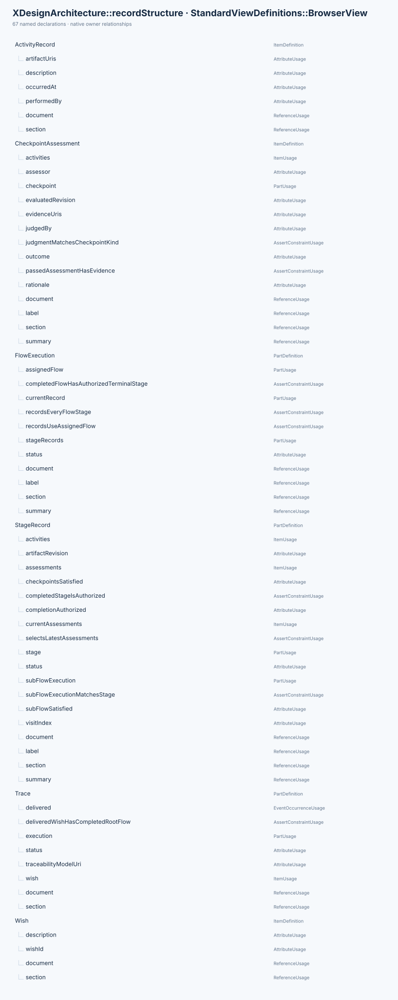
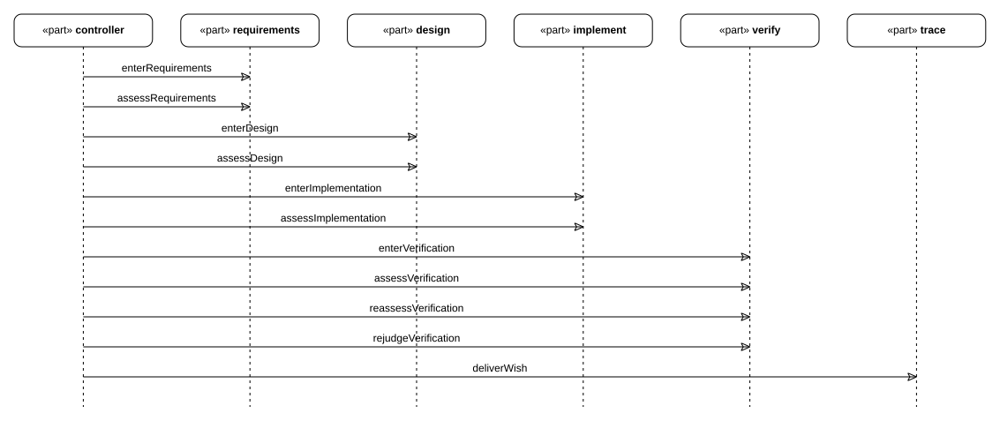

# Records and evidence

How one wish's run is recorded: activities, stage visits, revisions, assessments and the
invariants that make a delivery trustworthy.

## E01 The record vocabulary

> **Figure E01-1 — Record vocabulary.**  
> **Question:** Which types hold a wish's execution history and evidence?  
> **Model view:** `XDesignArchitecture::recordStructure`, a browser view of the record definitions.  
> **Companions:** [E03](#e03) for revision rules and [F01](01_flows_and_checkpoints.md#f01) for flow definitions.  
> **Status:** renderable-now.  
> **Reading:** The structure separates a wish and its trace from the flow, stage, activity, and assessment records. Each definition in the figure has its role summarized in the table below.  
> **Limits:** The figure shows record types, not the history or validity of any one wish.

| Definition | Role |
| --- | --- |
| `Wish` | The requested outcome: `wishId`, `description`. Carries no work history |
| `Trace` | One wish's state: `wish`, `status`, `traceabilityModelUri`, and its root `execution`. Declares the `delivered` event |
| `FlowExecution` | The execution history of one flow — the wish's root flow, or a subflow inside a stage visit: `assignedFlow`, `status`, `stageRecords [1..*]`, `currentRecord` |
| `StageRecord` | One planned or actual visit to one stage: `visitIndex`, `status`, `artifactRevision`, `subFlowExecution`, `activities`, `assessments` |
| `ActivityRecord` | One piece of work: `description`, `performedBy`, `occurredAt` (ISO 8601), `artifactUris` |
| `CheckpointAssessment` | One preserved evaluation of one checkpoint for one revision: `outcome`, `judgedBy`, `assessor`, `rationale`, `evidenceUris` |

`Trace` and its records are the working record of one wish. Definitions stay in
`mbse/model/`; a wish file declares only usages of them
([A02](../arch/00_overview.md#a02)).

## E02 Activities and stage visits

- An activity records work, the actor, the time and the artifacts it touched. Artifact
  references are URIs to the real files — model sources, documents, logs, evidence.
- A `FlowExecution` records one `StageRecord` per stage of its assigned flow and no
  others (`recordsEveryFlowStage`, `recordsUseAssignedFlow`). `currentRecord` is the visit
  being worked on.
- A stage visit keeps its activities and assessments in execution order (`ordered`).
  `currentAssessments` is the latest assessment per checkpoint, not the list of all
  attempts (`selectsLatestAssessments`).

## E03 Revisions and re-assessment

The revision is what keeps evidence honest:

- `artifactRevision` starts at 0 for a visit and increments when the visit's artifacts
  change. Old passes do not carry over.
- A stage's checkpoints count as satisfied only when each exit checkpoint has a current
  assessment with `outcome = passed` and `evaluatedRevision == artifactRevision`
  (`StageRecord::checkpointsSatisfied`).
- A completed stage must stay authorized (`completedStageIsAuthorized`), so new evidence
  is recorded as a further assessment; an existing passed assessment is never edited.
- Rework at the same stage appends a new visit (`visitIndex` + 1); earlier visits and
  their evidence stay.

Worked example, wish-0002: verification was assessed three times — revision 1 failed (the
export showed only one of two permitted judges), revision 2 passed after one flag per
authority replaced the list, revision 3 passed again after another wish moved that wish's
requirements into the model. See the journey in [E06](#e06).

## E04 Assessments and evidence

An assessment is the only thing that authorizes progress, and it carries its reasons:

- `outcome` starts `unevaluated`; criteria that were not evaluated provide no
  authorization to advance.
- `passed` requires evidence: `passedAssessmentHasEvidence` refuses a pass with no
  `evidenceUris`.
- `judgedBy` must match the checkpoint's kind: a script may only judge a syntactic
  checkpoint, an agent or a human only a semantic one
  (`judgmentMatchesCheckpointKind`, see [F02](01_flows_and_checkpoints.md#f02)).
- `evidenceUris` point at retained files under `cache/` — logs, exports, rendered figures
  — so a later reader can re-examine the judgment, not just its conclusion.

## E05 Delivery invariants

A delivered wish has come all the way through, and the model says so in four places:

| Invariant | Where |
| --- | --- |
| Every wish has exactly one trace, and every trace a wish | `XDesign::everyWishHasOneTrace` |
| Every stage of the assigned flow has a record, and no other stage does | `FlowExecution::recordsEveryFlowStage`, `recordsUseAssignedFlow` |
| A completed flow has an authorized terminal stage | `FlowExecution::completedFlowHasAuthorizedTerminalStage` |
| Only a completed root flow delivers the wish | `Trace::deliveredWishHasCompletedRootFlow` |

The compiler does not evaluate these constraint bodies ([T04](03_toolchain.md#t04)),
so they are obligations verified by reading; each wish's verification activity says how.
For runs on the designed simple flow, the record gate is designed to establish the record
invariants — at least one visit per stage (a reworked stage appends a visit), assessments
cited at the visited revision, evidence that exists, the run typed by the design's class —
once implementation supplies its checker and command
([D06](simple_flow/02_gates_and_rules.md#d06), [D07](simple_flow/02_gates_and_rules.md#d07)).
That checker is not declared yet: implementation is a later stage and no language is
selected, so the model-level constraints and the record are read at the design stage; the
early Python prototype is research under `cache/research/checks/`.

## E06 Journeys

> **Figure E06-1 — wish-0002 rework journey.**  
> **Question:** How were repeated verification assessments ordered for this wish?  
> **Model view:** Sequence projection of `Wish0002::Wish0002Journey`.  
> **Companions:** [E03](#e03) for artifact revisions and [V02](../review/01_wish_status.md#v02) for the wish status.  
> **Status:** renderable-now; historical record.  
> **Reading:** The same verification stage is assessed three times as its evidence changes. The messages retain the order of stage entry, assessment, and delivery events.  
> **Limits:** This is one wish's recorded journey, not the behavior of every selectable flow.

A wish's journey is its own interaction: `ref part` lifelines bound to the real
participants (`workflow.controller`, the flow's stages, the wish's `Trace`), and `message`
usages anchored on their event occurrences — `entering`/`entered` around a stage,
`assessing`/`assessed` around a checkpoint, `delivering`/`delivered` for the wish. The
figure above is wish-0002's, so the repeated `assessVerification` is the revision history
of [E03](#e03): three assessments of one verification stage, in order.
