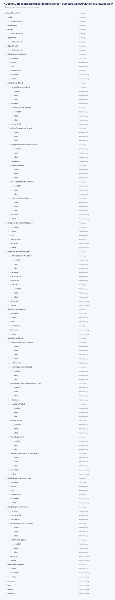
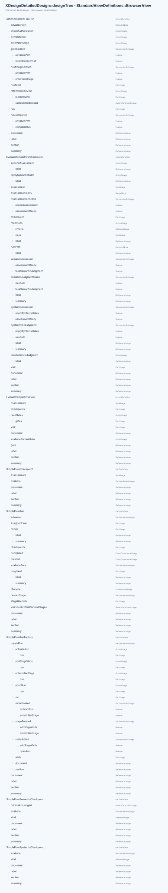
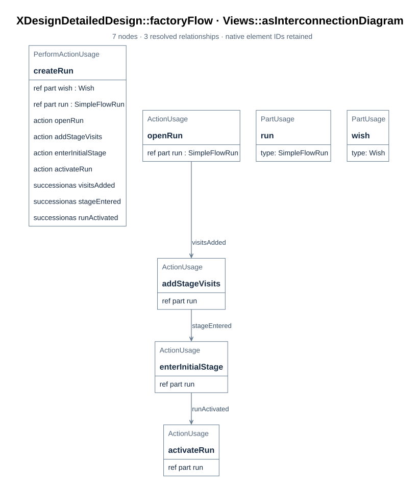
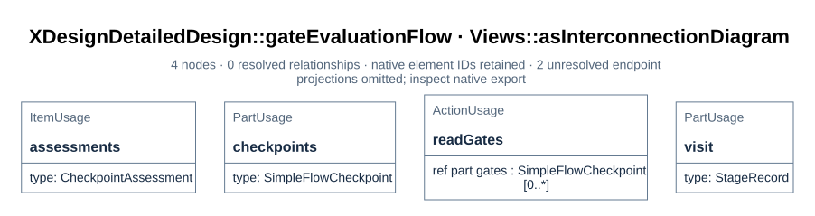

# SimpleFlow run design

The simple flow resolved into what a run of it is actually made of: the class of a run, the
factory that creates it, and the functions that evaluate its gates and advance it. The
design lives in `mbse/model/detailedDesign.sysml`; every top-level element there carries a
`DocSection` annotation pointing at the section of this documentation that covers it
([B04](../../arch/01_system_composition.md#b04)), and every figure is rendered from the model
by `tools/render_docs.py`.

The flow *definition* is unchanged. `XDesignArchitecture::SimpleFlow` still gates only
verification ([F03](../01_flows_and_checkpoints.md#f03)), so the runs already
recorded against `workflow.'flow'` — wishes 0001–0004 and 0007 — stay valid: they were judged by
the gates that existed when they ran, and completed visits stay authorized. The design adds
a *designed usage*, `XDesignDetailedDesign::designedSimpleFlow`, which a wish selects at
registration when it wants every stage gated.

The checkpoints themselves are instances of one checkpoint class with syntactic and
semantic adaptations, and the run evaluates a gate through its class's operation rather than
through a case analysis beside it ([D11](02_gates_and_rules.md#d11)).

The design is expressed in SysML v2 constructs that carry the UML reading, so no separate
UML model exists to drift from this one: `part def` is a class, a `perform`ed action on it
is an operation, `:>` is generalization (the run class specializes `FlowExecution`),
`ref part` and typed parts are associations, ports and interface definitions are the
interfaces (their graph is [D10](03_structure_graphs.md#d10)), successions with guards are
control flow, and the views declared in the model render that structure as the figures
below.

## D01 The designed simple flow

> **Figure D01-1 — Designed SimpleFlow plan.**  
> **Question:** Which stages and exit gates make up the designed flow usage?  
> **Model view:** `XDesignDetailedDesign::designedFlowTree`, a browser view of `designedSimpleFlow`.  
> **Companions:** [D05](02_gates_and_rules.md#d05) for gate criteria and [F03](../01_flows_and_checkpoints.md#f03) for selectable flows.  
> **Status:** renderable-now; design view with a tested first executable slice.  
> **Reading:** Four stages retain the SimpleFlow order and the usage adds gates to their exits. The table below distinguishes the four declared fixed checks from the final semantic judgment.  
> **Limits:** The figure does not show implemented checker commands or a run that passed these gates.

`designedSimpleFlow : SimpleFlow` keeps the four stages in the definition's order and adds
an exit gate to every one of them. Four gates are syntactic — facts the implemented
fixed commands check; the one judgment stays where the definition put it, at the end:

| Stage | Exit gate | Kind | Established by |
| --- | --- | --- | --- |
| `requirements` | `simpleRequirementsAccepted` | syntactic | `simpleRequirementsCheck`, 2 declared rules in [D06](02_gates_and_rules.md#d06) |
| `design` | `simpleDesignAccepted` | syntactic | `simpleDesignCheck`, 7 declared rules in [D06](02_gates_and_rules.md#d06) |
| `implement` | `simpleImplementationAccepted` | syntactic | `simpleImplementationCheck`, 2 declared rules in [D06](02_gates_and_rules.md#d06) |
| `verify` | `simpleRecordAccepted` | syntactic | `simpleRecordCheck`, 7 declared rules in [D06](02_gates_and_rules.md#d06) |
| `verify` | `verificationAccepted` | semantic | a judge, agent or human — inherited and restated ([D05](02_gates_and_rules.md#d05)) |

Each syntactic gate states its criteria and names a checker. The four checkers, their
command paths, and 18 rules are declared in the model and explained in
[D06](02_gates_and_rules.md#d06). A declared path alone cannot authorize a visit:
the command must run and return a valid, retained, revision-bound report
([D07](02_gates_and_rules.md#d07)).

Why the definition is not the place for this: adding gates to `SimpleFlow` would apply them
to `workflow.'flow'` and to every run already recorded against it. A completed visit whose
stage gained a new exit checkpoint would lose its authorization retrospectively — the
record would be rewritten by a design change. The design instead states the gated
configuration as a usage, the same way `nestedFlowExample` states a nested one
([F05](../01_flows_and_checkpoints.md#f05)).

## D02 The run class

> **Figure D02-1 — Run design definitions.**  
> **Question:** Which classes and functions realize one run of the designed flow?  
> **Model view:** `XDesignDetailedDesign::designTree`, a browser view of the run design.  
> **Companions:** [D03](#d03) for creation and [D11](02_gates_and_rules.md#d11) for checkpoint evaluation.  
> **Status:** renderable-now; design view with a tested first executable slice.  
> **Reading:** The run class specializes `FlowExecution` and names its visits, ports, events, and operations. The factory and action definitions provide the creation, assessment, and advancement roles.  
> **Limits:** Declared members do not establish an implemented class or an executed run.

`SimpleFlowRun` specializes the architecture's generic `FlowExecution`
([E01](../02_records_and_evidence.md#e01)): one run of the designed flow, with the flow's plan
and operations fixed. A wish's execution is typed by it — the realization is the typing,
not a declaration beside it ([R01](../../requirements/01_baseline.md#r01),
`runRealizesItsDesign`), and a check establishes it for a run on the designed usage.

| Member | What it is |
| --- | --- |
| `assignedFlow` (redefined) = `designedSimpleFlow` | The plan this run executes |
| `stageRecords : StageRecord [4..*]` (redefined) | A visit to each of the four stages; a reworked stage appends a further visit, so the count grows |
| `check : ~CheckCommandExchange`, `judgment : ~JudgmentExchange` | The run's ports — the interfaces it invokes checks and presents judgments through ([D10](03_structure_graphs.md#d10)) |
| `created`, `completed` | The run's events — the ends of its timeline ([D08](03_structure_graphs.md#d08)) |
| `checkpoints : SimpleFlowCheckpoint [0..*]` | The designed flow's gates as checkpoint-class instances; the run evaluates them ([D11](02_gates_and_rules.md#d11)) |
| `evaluateGate : EvaluateSimpleFlowGate` | The operation that hands each gate of the current visit to its class's `evaluate` operation ([D04](#d04)) |
| `advance : AdvanceSimpleFlowRun` | The operation that moves the run on when the gates authorize it ([D04](#d04)) |
| `reopenStage : ReopenSimpleFlowStage` | Explicitly reopen a completed terminal visit as a new visit while retaining the completed record ([D04](#d04)) |
| `visitsRealizeThePlannedStages` | Assertion: every visit is a visit to one of the plan's stages, and every stage of the plan has a visit |

The assertion, like every `assert constraint` in this model, is not evaluated by the
compiler ([T04](../03_toolchain.md#t04)); it is read, and the factory ([D03](#d03)) and the
controller's rules are what keep it true.

## D03 The factory

> **Figure D03-1 — Run creation.**  
> **Question:** How does the factory initialize a designed run?  
> **Model view:** `XDesignDetailedDesign::factoryFlow`, an action-flow view of `SimpleFlowRunFactory::createRun`.  
> **Companions:** [D02](#d02) for the run's members and [F04](../01_flows_and_checkpoints.md#f04) for registration.  
> **Status:** renderable-now; design view with a tested first executable slice.  
> **Reading:** Creation opens the run, adds planned stage visits, enters the first stage, and activates the run. Those steps shape the execution record the controller will own.  
> **Limits:** The figure is an operation specification and does not show a completed registration test.

`SimpleFlowRunFactory::createRun` models a `Wish` input and the designed flow's plan and
produces the run. The local Rust `create_run` receives `wish_model_uri`, a path identifying
the independent wish SysML source; it does not load a `Wish` item. The factory realizes
the run-creation part of `Controller::receiveWish`
that assigns the flow, opens the run and enters its initial stage
([F04](../01_flows_and_checkpoints.md#f04)) — so an implementation of the simple flow builds
one factory instead of re-deriving the generic controller's behaviour.

| Step | What it does |
| --- | --- |
| `openRun` | Creates the run, bound to the plan, with no visits yet |
| `addStageVisits` | Adds one pending visit per stage — `requirements`, `design`, `implement`, `verify` — each bound to its stage, at visit index 0 and artifact revision 0 |
| `enterInitialStage` | The `requirements` visit becomes current and active at revision 0; the rest stay pending |
| `activateRun` | The run becomes active, so the controller records activities against it |

The boundary stays where the architecture put it: the wish remains an item of the
`Workflow` composition and the trace that holds the run is the controller's, produced by
`receiveWish` ([B01](../../arch/01_system_composition.md#b01)); the factory only shapes the
run itself.

## D04 The functions

> **Figure D04-1 — Gate evaluation function.**  
> **Question:** How does a run obtain checkpoint assessments before advancing?  
> **Model view:** `XDesignDetailedDesign::gateEvaluationFlow`, an action-flow view of `EvaluateSimpleFlowGate`.  
> **Companions:** [D11](02_gates_and_rules.md#d11) for the checkpoint class and [E04](../02_records_and_evidence.md#e04) for assessment records.  
> **Status:** renderable-now; design view with a tested first executable slice.  
> **Reading:** The function takes the current visit's exit gates and delegates each assessment to its checkpoint class. It records the outcome before the separate advance function tests authorization.  
> **Limits:** The figure does not make an absent checker command runnable or establish a pass.

**`EvaluateSimpleFlowGate`** selects only the current visit's stage exit gates from the
plan, then iterates over them in plan order. Each gate's class `evaluate` operation
appends one `CheckpointAssessment` to the visit. The verify stage has both a fixed
record gate and a semantic gate; both iterations are required. The class operation
is `EvaluateSimpleFlowCheckpoint`; its two adaptations implement it as `RunSyntacticCheck`
(a syntactic checkpoint) and `TakeSemanticJudgment` (a semantic checkpoint)
([D11](02_gates_and_rules.md#d11)).

- **The script path (syntactic).** The gate's checker command runs through the run's check
  port, applies the rules the checker declares — rule by rule, reporting each verdict —
  and its report for the visited revision is the evidence; the assessment is recorded with
  `judgedBy = script` and holds only when every rule holds. Nothing is judged afresh,
  which is what makes one check reproducible and comparable across revisions
  ([F02](../01_flows_and_checkpoints.md#f02)).
- **The judge path (semantic).** The gate's criteria and the visit's artifacts and evidence
  go through the judgment port to a judge the gate permits; the rationale and evidence are
  recorded. No code settles it, and none pretends to.
- Either way: a gate with no assessment authorizes nothing, and `unevaluated` criteria
  provide no authorization to advance ([E04](../02_records_and_evidence.md#e04)).

**`AdvanceSimpleFlowRun`** is the successor rule of the designed flow: when the current
visit is authorized *at the visited revision*, the stage that follows hands the run its
pending visit; the `verify` stage has no successor, so its completion completes the run,
which is what lets the controller deliver the trace ([E05](../02_records_and_evidence.md#e05)).
A visit that is not authorized stays current and blocked. Corrective work records a
content-change activity in that same visit and increments its artifact revision, even
when the artifact URI stays the same; earlier assessments remain attached to the
revision they judged ([E03](../02_records_and_evidence.md#e03)).
`ReopenSimpleFlowStage` is a separate explicit action for a completed terminal run:
it preserves the completed verification visit and appends a new active verification
visit with the next visit index and revision 0. Reopening an earlier completed stage
needs downstream invalidation rules and is outside this action.

These action bodies are specifications, not executed results: the compiler resolves
their names but does not evaluate their `assert constraint` bodies
([T04](../03_toolchain.md#t04)). The executable cases in
[D54](07_file_plan_and_verification.md#d54) must establish their behavior.
