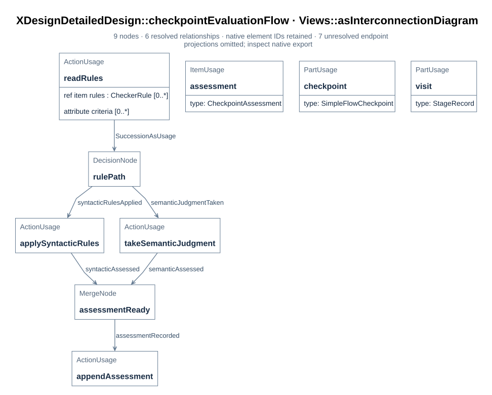

# SimpleFlow gates and rules

The designed simple flow's gates, checker declarations, and rules live in
`mbse/model/detailedDesign.sysml`; `mbse/model/architecture.sysml` defines their
reusable types. D06 records the exact pass conditions and diagnostics. The four
command paths are fixed in the model and their Python implementation belongs under
`tools/checks/` ([D53](07_file_plan_and_verification.md#d53)). A gate is a `Checkpoint`
([F01](../01_flows_and_checkpoints.md#f01)); each fixed rule is a `CheckerRule` item
([F02](../01_flows_and_checkpoints.md#f02)).

## D05 The gates, exactly

Each gate states the criteria a judge or script must establish. The four syntactic
gates each name one checker, command URI, and declared rule set. D06 specifies what
those commands must decide; command existence and passing execution are checked
separately. The semantic gate names its permitted judges and has no checker.

| Gate | Kind | Criteria (verbatim from the model) | Check at design stage | Establishes |
| --- | --- | --- | --- | --- |
| `simpleRequirementsAccepted` | syntactic | "Every requirement declared in the project model carries its rationale, and every satisfy link resolves to a requirement that is declared." | `simpleRequirementsCheck`, 2 rules in [D06](#d06) | identifier conformance, trace conformance |
| `simpleDesignAccepted` | syntactic | "The design declares the run class, the factory, the functions that evaluate gates and advance the run, and the checkpoint class with its syntactic and semantic adaptations and its evaluate operation; every exit checkpoint of this flow is an instance of that class; every stage of this flow declares its exit checkpoint; every design element names its documentation section; and all nine SysML diagram views are declared, drawn and carried by their document." | `simpleDesignCheck`, 7 rules in [D06](#d06) | artifact presence, definition coverage |
| `simpleImplementationAccepted` | syntactic | "The stage's current visit records at least one artifact, and every recorded artifact exists at its URI." | `simpleImplementationCheck`, 2 rules in [D06](#d06) | artifact presence |
| `simpleRecordAccepted` | syntactic | "The run records at least one visit per stage; every completed visit has a latest passed assessment of each exit gate at its artifact revision; and evidence of every passed assessment on current or completed visits is retained." | `simpleRecordCheck`, 7 rules in [D06](#d06) | trace conformance, artifact presence |
| `verificationAccepted` | semantic | "Verification evidence demonstrates that the implementation satisfies the requirements." and "The record and the evidence stand on their own: a reader can re-examine the judgment from them without re-asking." | — (no checker) | judged by an agent or a human (`agentMayJudge`, `humanMayJudge`) |

Every gate is an instance of the checkpoint class: the four syntactic gates are
`SimpleFlowSyntacticCheckpoint` instances and the semantic gate is a
`SimpleFlowSemanticCheckpoint` instance ([D11](#d11)). The class adapts both rule kinds
for the run, so the flow evaluates a gate through the class that declares how it is
decided, not through a case analysis beside it.

The semantic gate is inherited from the flow definition and restated with both
criteria; the four syntactic gates are the design's. Each syntactic gate names one
checker and sets no judge flag; the semantic gate names no checker and permits an
agent or human ([F02](../01_flows_and_checkpoints.md#f02)). The compiler resolves
these declarations but does not evaluate the model's assertions
([T04](../03_toolchain.md#t04)). The checker commands and their reports must establish
the scripted outcomes before a run may use them.

## D06 The rules documented for the syntactic gates

The designed flow declares four checkers and 18 `CheckerRule` usages. Each rule has an ID,
condition, and input set in the model; the tables below expand their diagnostics and
implementation contract. A command may apply but must not redefine a rule. The gate's
outcome is the conjunction of its rules' verdicts, with exact rule-set equality between
declaration and report. This implements the declaration side of
`checkerRulesAreDeclared` ([R01](../../requirements/01_baseline.md#r01)); report agreement
still requires execution ([D07](#d07)).

For every rule, `Reads` is the input set and `Condition` is the pass condition. The
implementer evaluates the condition against the checked revision, emits one record with
`rule_id`, `verdict`, `inputs`, `observed`, and `failures`, and sets `verdict = passed` only
when the condition holds. The report names the checker ID, stage, assessed artifact
revision, all declared rule IDs once each, the per-rule results, and a retained report
URI. A missing input or unparseable snapshot means no trustworthy report and records
`Unevaluated`; a rule condition that evaluates false records `Failed`. A report with
missing, extra, duplicate, stale or contradictory rule results is rejected before
creating an assessment. [D31](../05_documentation_contract.md#d31) defines the project
documentation rule contract; the specific expected diagnostics and observed evidence for
these planned SimpleFlow rules follow the conditions below.

The invocation checks plan identity, the current visit, and recorded artifact
bytes before reporting rules. If that preflight fails, it returns no trusted report:
a wrong plan hash, an absent current visit, or a missing recorded file is
`Unevaluated`. These conditions overlap `flow-is-supported`, `visit-exists`, and
artifact existence. Their rule rows still describe the required conditions. An
empty current implementation artifact set is an evaluated `Failed` result, while
an unreadable file named in that set is an unevaluated input failure. Missing
documentation figures, checker command targets, or retained evidence discovered
after preflight can produce evaluated `Failed` rules with diagnostics below.

| Planned checker | Rules |
| --- | --- |
| `simpleRequirementsCheck` | 2 |
| `simpleDesignCheck` | 7 |
| `simpleImplementationCheck` | 2 |
| `simpleRecordCheck` | 7 |

### `simpleRequirementsCheck` — 2 rules

| Rule id | Planned pass condition | Reads |
| --- | --- | --- |
| `requirements-carry-rationale` | Every requirement declaration inside XDesignRequirements carries a nonempty rationale attribute. | `mbse/model/requirements.sysml` |
| `satisfy-links-resolve` | Every satisfy link names a requirement declared inside XDesignRequirements. | `mbse/model/requirements.sysml`, `mbse/model/traceability.sysml` |

### `simpleDesignCheck` — 7 rules

| Rule id | Planned pass condition | Reads |
| --- | --- | --- |
| `design-declarations-present` | The run, factory, gate, advance, designed flow, checkpoint class, both adaptations, and checkpoint evaluation action are declared. | `mbse/model/detailedDesign.sysml` |
| `every-stage-gated` | Every stage names nonempty exit gates declared by this flow and typed by `SimpleFlowCheckpoint`; each syntactic exit binds its designated one of the four fixed SimpleFlow checkers. | `mbse/model/detailedDesign.sysml` |
| `design-elements-carry-doc-sections` | Every top-level detailed design element has a `DocSection` that resolves to a document and section. | `mbse/model/detailedDesign.sysml`, `docs/` |
| `checker-commands-exist` | Every declared SimpleFlow checker command URI names an existing repository file. | `mbse/model/detailedDesign.sysml`, `tools/checks/` |
| `checker-rules-are-declared` | All four fixed SimpleFlow checkers are declared, each with at least one rule with a nonempty ID, condition, and reads value. | `mbse/model/detailedDesign.sysml` |
| `rule-sets-agree-with-commands` | Each of the four fixed checkers' declared rule IDs exactly equal its command's rule ID list. | `mbse/model/detailedDesign.sysml`, `tools/checks/` |
| `structure-graphs-are-carried` | Each of the nine primary SimpleFlow views names a distinct model figure, and every required figure exists and is embedded in the document named by its `DocFigure` annotation. Supporting run and interface views are included. | `mbse/model/detailedDesign.sysml`, `docs/` |

The nine views and their source-model elements are inventoried in
[D12](04_sysml_diagrams.md#d12). This rule requires each named view to be declared and its
figure to be generated and carried by the document; three generic overview figures do not
meet the nine-view coverage requirement. Their engineering meaning is reviewed separately
through the planned `SimpleFlowViewReview` case ([D15](../../requirements/01_baseline.md#d15)).

### `simpleImplementationCheck` — 2 rules

| Rule id | Planned pass condition | Reads |
| --- | --- | --- |
| `visit-exists` | The checked implementation stage has a current visit in the run record. | runtime run record JSON |
| `artifacts-of-current-visit-exist` | The current implementation visit records at least one artifact URI and every recorded artifact exists at that URI. | runtime run record JSON, recorded artifact URIs |

### `simpleRecordCheck` — 7 rules

| Rule id | Planned pass condition | Reads |
| --- | --- | --- |
| `flow-is-supported` | The run record has `plan_id = designedSimpleFlow` and `plan_sha256` equal to the SHA-256 of the retained frozen plan serialization. | runtime run record JSON, retained plan serialization |
| `every-stage-visited` | Every planned stage has at least one visit and every visit names a stage in that plan. | runtime run record JSON |
| `completed-visits-authorized` | For every completed visit, the latest assessment of each required exit gate passed at that visit's artifact revision and snapshot digest, and every recorded artifact still matches its file digest. | runtime run record JSON, recorded artifact URIs |
| `assessments-name-exit-gates` | Every passed assessment names an exit gate of its visit's stage. | runtime run record JSON |
| `passed-assessments-carry-evidence` | Every passed assessment names at least one evidence URI. | runtime run record JSON |
| `evidence-exists` | Every evidence URI of every passed assessment on current or completed visits resolves to retained evidence. | runtime run record JSON, recorded evidence URIs |
| `designed-runs-are-typed-by-the-design-class` | A run on designed SimpleFlow records its execution as `SimpleFlowRun`. | runtime run record JSON |

The rule table above is the decision source. This output table makes each planned rule
implementation-followable: `observed` must include the named facts, and `failures`
contains one entry for each offending identifier or URI. For a rule that finds no
offenders, `failures` is empty. Every row is a model-declared condition. Passing execution requires a retained command report for the assessed revision.

| Rule id | Failure diagnostic when the condition is false | Required `observed` evidence | Status |
| --- | --- | --- | --- |
| `requirements-carry-rationale` | Requirement `<id>` has no rationale attribute. | Inspected requirement IDs and IDs missing rationale. | model-declared |
| `satisfy-links-resolve` | Satisfy link `<id>` targets an undeclared requirement or a requirement outside `XDesignRequirements`. | Inspected satisfy links, their qualified targets, and resolved project requirement IDs. | model-declared |
| `design-declarations-present` | Required design declaration `<name>` is missing. | Presence result for each named run, factory, function, flow, checkpoint class, adaptation, and action. | model-declared |
| `every-stage-gated` | Stage `<name>` has no exit checkpoint; checkpoint `<name>` is not a declared `SimpleFlowCheckpoint` instance or its syntactic exit lacks the designated checker binding. | Stage-to-gate map, each gate's declaration and type, and syntactic gate-to-checker bindings. | model-declared |
| `design-elements-carry-doc-sections` | Design element `<name>` has no resolvable `DocSection` document and anchor. | Every inspected top-level element, declared target, and path/anchor resolution result. | model-declared |
| `checker-commands-exist` | Checker `<name>` names missing command `<path>`. | Checker IDs, command URIs, and existence results. | model-declared |
| `checker-rules-are-declared` | A fixed checker `<name>` is missing, has no rule, or rule `<id>` lacks an ID, condition, or reads value. | Four required checker IDs, checker-to-rule map, and completeness result for each required field. | model-declared |
| `rule-sets-agree-with-commands` | A fixed checker `<name>` is missing, declares a rule ID absent from its command list, or the command lists an undeclared ID. | Four required checker IDs and declared/command rule ID sets, with their symmetric difference. | model-declared |
| `structure-graphs-are-carried` | `DocFigure` asset `<path>` is missing or is not embedded in its declared document; named view `<name>` lacks its figure or reuses another primary view's asset. | View-to-asset and asset-to-document map, distinctness, existence and embed results for the supporting overviews and nine question views. | model-declared |
| `visit-exists` | Checked stage `<name>` has no visit. | Checked stage ID and matching visit IDs. | model-declared |
| `artifacts-of-current-visit-exist` | Current implementation visit `<id>` records no artifact, or cites missing artifact `<URI>`. | Visit ID, nonempty recorded artifact URI list, and existence results. | model-declared |
| `flow-is-supported` | Run record names another flow plan, omits its hash, or its hash differs from the retained frozen plan serialization. | `plan_id`, `plan_sha256`, and independently computed plan hash. | model-declared |
| `every-stage-visited` | Flow stage `<name>` lacks a visit, or visit `<id>` names a stage outside the assigned flow. | Assigned stage IDs and all visit-to-stage links. | model-declared |
| `completed-visits-authorized` | Completed visit `<id>` has a missing, failed, unevaluated, or stale latest assessment of exit gate `<name>`, or artifact `<URI>` no longer matches its recorded file digest. | Each completed visit's revision and snapshot digest, required gate IDs, latest assessment per gate in append order, and independently computed file digests. | model-declared |
| `assessments-name-exit-gates` | Passed assessment `<id>` names a gate outside visit `<id>`'s stage exits. | Passed assessment-to-gate links and the stage's exit gate IDs. | model-declared |
| `passed-assessments-carry-evidence` | Passed assessment `<id>` has no evidence URI. | Passed assessment IDs and their evidence URI lists. | model-declared |
| `evidence-exists` | Passed assessment `<id>` on current or completed visit `<id>` cites missing evidence `<URI>`. | Those visits' passed assessments, evidence URIs, and retrieval results. | model-declared |
| `designed-runs-are-typed-by-the-design-class` | Run on `designedSimpleFlow` lacks `SimpleFlowRun` typing. | Assigned flow and resolved execution type; mark other SimpleFlow usages not applicable. | model-declared |

## D07 Checker command contract

The designed flow declares four checkers, their command paths, and all 18 rules in
`mbse/model/detailedDesign.sysml`. The command at each path must apply the declared
conditions. The first executable slice reads both an independent SysML wish trace URI
(`wishModel`) and an executable JSON run-record snapshot URI (`recordUri`). The former
preserves the per-wish trace identity; the latter carries visit and assessment data that
the first implementation can check. A separate adapter is needed before the commands
can audit all historical `mbse/wishes/*.sysml` records. The commands require an
existing SysML wish file as a control precondition, but the four D06 rule sets do
not validate that file's internal trace relationships. The wish path therefore
identifies the run; it is not itself a passing per-wish trace check.

The invocation also carries `checkerId`, `planId`, `planSha256`, `stage`,
`artifactRevision`, and `snapshotDigest`. The last value is the SHA-256 digest of the
canonical artifact set: URI and file-digest pairs for the current visit. It is distinct
from the JSON record URI and from the frozen plan hash. A fixed checker verifies those
files against the requested digest before it can pass. Its report returns the assessed
revision and artifact-set digest, exact rule IDs once each, per-rule verdicts and
diagnostics, overall verdict, and retained report URI. The caller rejects a stale or
malformed report; one successful command process is not itself a passing gate.

For the requirements and design commands, every repository file actually read to
decide a rule must also be listed in the current visit's artifact set with its exact
file digest. This includes the model sources, documentation sources and figures, and
checker commands that a rule inspects. Otherwise the command cannot establish that
its answer belongs to the visited snapshot and returns an unevaluated command error.
The frozen plan, executable run-record input, and newly written report are separate
exchange artifacts: including the run record or its own report in the visit digest
would make the check circular. The raw report lists its read-file digests to
make the decision auditable; the visit digest remains the authorization anchor
for these repository inputs.

The implemented report adapter requires hashes for the wish, frozen plan, and run
record bytes and for every input named by a passed rule. It checks that each
passed rule's inputs cover its declared file or runtime reads. The record checker
also rejects malformed visit, assessment, and lifecycle fields before applying
its seven rules. These checks bind the report to the bytes it evaluated; command
and harness version binding remains a separate delivery obligation.

| Planned checker | Designed command contract |
| --- | --- |
| `simpleRequirementsCheck` | `tools/checks/simple_requirements.py`; reads `mbse/model/requirements.sysml` and `mbse/model/traceability.sysml`; reports two rules. |
| `simpleDesignCheck` | `tools/checks/simple_design.py`; reads `mbse/model/detailedDesign.sysml`, command files, documentation sections and figures; reports seven rules. |
| `simpleImplementationCheck` | `tools/checks/simple_implementation.py`; reads the JSON run record's current implementation visit and its artifact URIs; reports two rules. |
| `simpleRecordCheck` | `tools/checks/simple_record.py`; reads the JSON run record, its frozen plan identity and retained evidence URIs; reports seven rules. |

Research prototypes under `cache/research/checks/` do not count as the project
implementation. Executed evidence must name the repository command, source revision,
input snapshot and retained report. The pinned SysML compiler (`parse` and `check`)
remains a separate mechanical check with the limits in [T04](../03_toolchain.md#t04).

### What is not established

- **A declared command path is not an executed result.** Each gate now names its checker;
  run conformance requires the command file, an exact report, and a recorded assessment.
- **`VModel`'s three checkers do not exist and declare no rules.** The paths in
  `architecture.sysml` (`requirement_trace.py`, `implementation_artifacts.py`,
  `delivery_record.py`) are intended locations, not project code.
- **The designed flow is not the default.** `xdesign.'flow'` remains the `VModel`; a
  wish selects `designedSimpleFlow` at registration
  ([F03](../01_flows_and_checkpoints.md#f03)).
- **The documentation audit and design gate have different scope.** The stand-alone
  audit checks `DocSection` and `DocFigure` paths, anchors, assets, and embeds
  ([T02](../03_toolchain.md#t02)); the seven-rule `simpleDesignCheck` must also check
  declarations, command files, and rule-set agreement. Neither judges the engineering
  content of a figure.
- **Constraint bodies are not evaluated** ([T04](../03_toolchain.md#t04)): the run class's
  assertion and the gates' kind/judge split are verified by reading, and the reading is
  stated in [D05](#d05).
- **`wishProductsAreRetained`, `modelStandsWithoutWishes` and
  `runRecordIsScriptChecked` remain unsupported by the tool**
  ([R01](../../requirements/01_baseline.md#r01)); nothing in this design changed that.

## D11 The checkpoint class and its evaluation loop

> **Figure D11-1 — Checkpoint evaluation loop.**  
> **Question:** How does one checkpoint class handle fixed checks and semantic judgment?  
> **Model view:** `XDesignDetailedDesign::checkpointEvaluationFlow`, an action-flow view of `EvaluateSimpleFlowCheckpoint`.  
> **Companions:** [D06](#d06) for rule conditions and [D10](03_structure_graphs.md#d10) for checker and judge interfaces.  
> **Status:** renderable-now; design view with a tested first executable slice.  
> **Reading:** The common evaluate operation chooses the syntactic or semantic adaptation by checkpoint kind. Both paths produce an assessment linked to the gate and the current visit.  
> **Limits:** The diagram does not prove the declared command files exist, execute, or satisfy their rule conditions.

Every gate of the designed flow is an instance of one class, `SimpleFlowCheckpoint`: the
flow's checkpoints are not five unrelated `Checkpoint` usages, and the run does not judge
them beside their class. The class carries the common checkpoint contract — source stage,
kind, criteria, checkers, judge flags — and owns the `evaluate` operation and the
assessments that operation produces. Two adaptations put the two rule kinds on that one
class:

| Class | Kind | Adapts | Operation |
| --- | --- | --- | --- |
| `SimpleFlowCheckpoint` | both | the common checkpoint contract and the assessment loop | `EvaluateSimpleFlowCheckpoint` |
| `SimpleFlowSyntacticCheckpoint` | syntactic | the declared checker, command URI, and rules in [D06](#d06) | `RunSyntacticCheck` |
| `SimpleFlowSemanticCheckpoint` | semantic | the semantic rules: criteria a permitted judge reads, with no checker | `TakeSemanticJudgment` |

The loop closes on the class:

1. `designedSimpleFlow.checkpoints` is typed `SimpleFlowCheckpoint`; each gate is an
   instance of one adaptation.
2. `SimpleFlowRun.checkpoints` holds those instances, and its `evaluateGate` hands each
   gate to the class's `evaluate` operation ([D04](01_run_design.md#d04)).
3. The syntactic adaptation's operation runs its declared checker command and applies
   the declared rules; the semantic adaptation's operation presents the
   criteria to a permitted judge. Each produces a `CheckpointAssessment`
   ([E04](../02_records_and_evidence.md#e04)).
4. The assessment's `checkpoint` points back to the class instance it judged, and the class
   keeps the assessments it produced — the design and the record point at each other.

What the design deliberately does not encode is the *logic of a rule*. A syntactic rule's
condition is declared in the model and explained in [D06](#d06); its command applies it
([D07](#d07)). A semantic rule's criterion is prose for the judge. Where a
condition does not reduce well to one SysML expression, the condition is written in the
documentation, not moved into code beside the model: the commands apply the rules, they do
not define them. The class fixes who evaluates a checkpoint and what is recorded; the
documentation fixes what each rule means.
