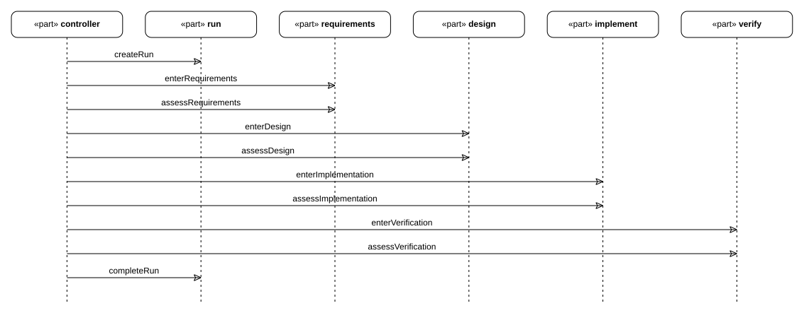
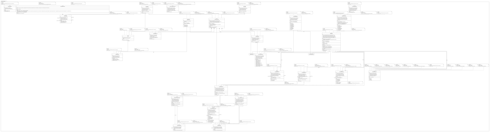
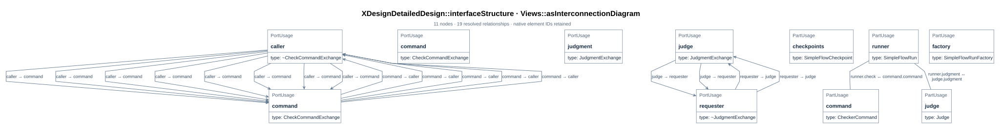

# SimpleFlow structure graphs

Three overview pictures of the design: its timeline, its logical structure, and its
interfaces. [D12](04_sysml_diagrams.md#d12) is the applicability and stage-ownership
index for the nine question views. Their figures appear in the linked requirements,
architecture, and module-design sections, including the
[requirements trace](../../requirements/01_baseline.md#d15),
[package view](../../arch/02_design.md#d21), and
[focused module views](05_module_design.md#d13).
They are declared in `mbse/model/detailedDesign.sysml`, drawn by `tools/render_docs.py`,
and located from the model by `DocFigure` annotations
([B04](../../arch/01_system_composition.md#b04)). The design states the check that each
declared figure exists and is referenced by the document here
([02_gates_and_rules.md#d06](02_gates_and_rules.md#d06),
`structure-graphs-are-carried`); `simpleDesignCheck` now executes that rule and
reports the figure-to-document results for its checked snapshot. The requirement is
`structureGraphsAreDocumented` ([R01](../../requirements/01_baseline.md#r01)).

## D08 The timeline

> **Figure D08-1 — Designed run timeline.**  
> **Question:** In what order does the normal run enter stages and assess gates?  
> **Model view:** Sequence projection of `XDesignDetailedDesign::SimpleFlowRunTimeline`.  
> **Companions:** [D19](05_module_design.md#d19) for the focused sequence and [D20](05_module_design.md#d20) for blocked and rework paths.  
> **Status:** renderable-now; design view with a tested first executable slice.  
> **Reading:** The controller creates a run, stages are entered in order, and each gate is assessed before the next entry. The terminal stage ends the run after authorization.  
> **Limits:** This normal path omits the alternative visits and evidence of any actual wish.

`SimpleFlowRunTimeline` is the flow's own sequence view: the run is created, each stage is
entered and its gate assessed in order, and the terminal stage's completion finishes the
run. Its lifelines are the controller (`workflow.controller`), the designed flow's four
stages, and the run class — whose `created` and `completed` events bound the run's life
([D02](01_run_design.md#d02)). A particular wish's journey is this shape with that wish's
records and its rework on the same lifelines ([E06](../02_records_and_evidence.md#e06)).
The corresponding nine-view sequence is [D19](05_module_design.md#d19); blocked and rework
behavior is explicit in the lifecycle view ([D20](05_module_design.md#d20)).

## D09 The logical structure

> **Figure D09-1 — Detailed design definitions.**  
> **Question:** Which definitions and specializations form the simple-flow design?  
> **Model view:** Definitions-and-specializations projection of `mbse/model/detailedDesign.sysml`.  
> **Companions:** [D13](05_module_design.md#d13) for focused type ownership and [D21](../../arch/02_design.md#d21) for packages.  
> **Status:** renderable-now.  
> **Reading:** This broad graph shows the run, factory, functions, checkpoint adaptations, and interface definitions together. It gives a map of the design file before the focused views explain each relationship.  
> **Limits:** The broad graph is an inventory and is not the primary article-size view for every detail.

The logical graph is the design file's definitions and specializations, drawn by the
compiler from `mbse/model/detailedDesign.sysml` with the rest of the model loaded as
library only: the run class and what it specializes (`FlowExecution`), its visits, ports,
events, operations and assertion; the factory and its creation steps; the two functions and
their paths; the ports, interfaces and the automation that wires them. The model carries
the figure's location itself — a `DocFigure` annotation on the package — so the design says
where its picture lives rather than leaving the correspondence to this prose.
The focused block definition view ([D13](05_module_design.md#d13)) separates types and
ownership from package organization ([D21](../../arch/02_design.md#d21)).

## D10 The interfaces

> **Figure D10-1 — Check and judgment interfaces.**  
> **Question:** Which ports connect the run to a checker command and a judge?  
> **Model view:** `XDesignDetailedDesign::interfaceStructure`, an interconnection view of `SimpleFlowAutomation`.  
> **Companions:** [D14](05_module_design.md#d14) for the focused internal-block view and [D11](02_gates_and_rules.md#d11) for evaluation.  
> **Status:** renderable-now; design view with a tested first executable slice.  
> **Reading:** One exchange sends a fixed check request and returns a per-rule report. The other sends criteria and artifacts to a permitted judge and returns a reasoned outcome.  
> **Limits:** Port and interface declarations do not prove an implementation honors the exchange contracts.

A run is automated through two interfaces, both declared in the design and drawn above:

| Draft interface | Ends | What crosses it |
| --- | --- | --- |
| IF-003 `CheckCommandInterface` (`CheckCommandExchange`) | the run's `check` port → a `CheckerCommand`'s `command` port | `wishModel` and `stage` from run to command; per-rule `report` and `holds` verdict back |
| IF-004 `JudgmentInterface` (`JudgmentExchange`) | the run's `judgment` port → a `Judge`'s `judgment` port | `criteria` and `artifactsUris` from run to judge; `outcome` and `rationale` back |

`SimpleFlowAutomation` wires them: it owns the run, the factory, a checker command and a
judge, and connects the run's ports to the command and the judge. The interface is where
the checker scripts' argument contract lives — the same contract
[02_gates_and_rules.md](02_gates_and_rules.md) states for the commands — and where the
semantic gate's boundary is explicit: what crosses the judgment interface is what a script
cannot settle.
The focused internal block view is [D14](05_module_design.md#d14); it selects the same
automation parts and interface usages. The [draft ICD](../../icd/01_interfaces.md#i01)
records the modeled fields under IF-003 and IF-004 and lists the operational contract
fields still open; neither interface has a frozen baseline or verified endpoint.
