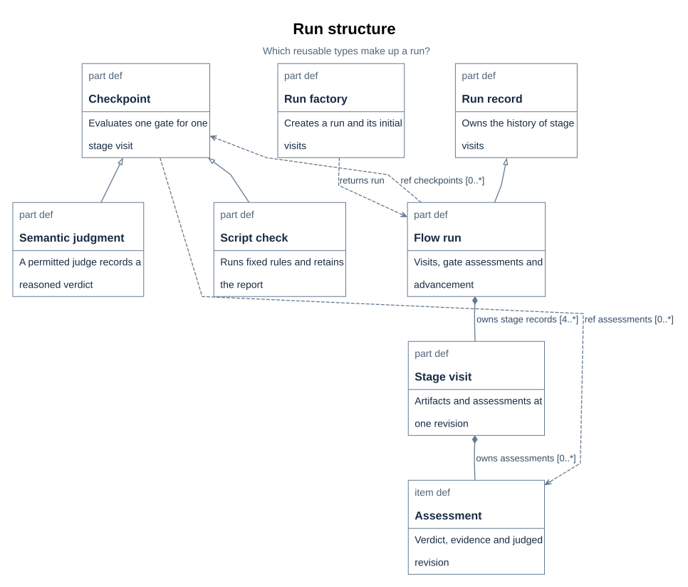
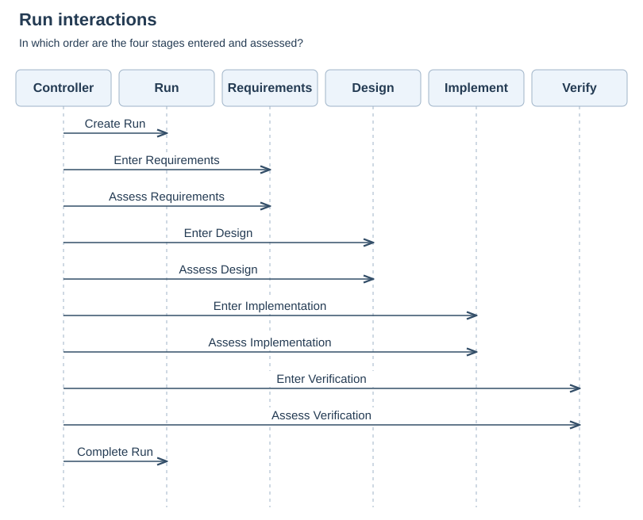
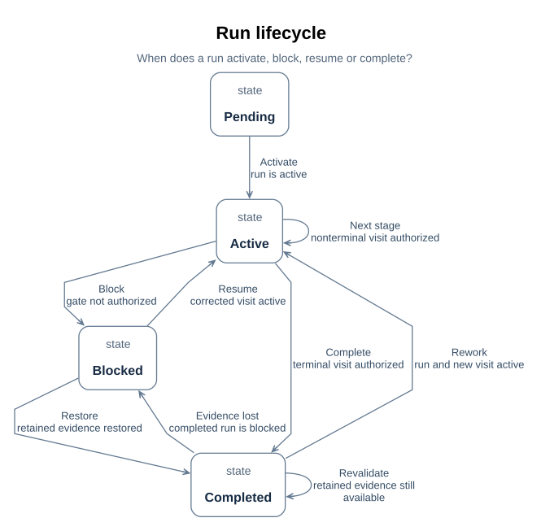
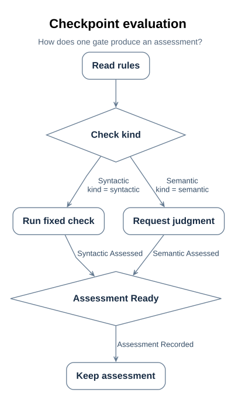
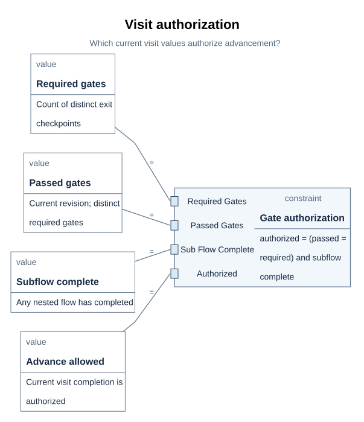
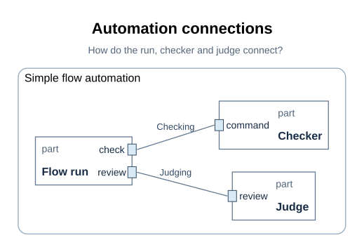

# SimpleFlow module detailed design

> Module: `XDesignDetailedDesign` SimpleFlow run and checkpoint automation | Revision: 3
> Status: design specification; no frozen CDR baseline.
> Audience: module implementers, integrators, verifiers, and reviewers. Basis:
> [architecture design](../../arch/02_design.md#b13),
> [requirements inventory](../../requirements/01_baseline.md#r01), and the
> [draft ICD](../../icd/01_interfaces.md#i01).

The project model is the structural source; this document records the module decisions
and their limits.

This document follows the detailed-design stage topics in the project template. The
related [flow plan](01_run_design.md#d01), [gate contracts](02_gates_and_rules.md#d05),
and [structure overviews](03_structure_graphs.md#d08) remain detailed sources. The
[view-coverage index](04_sysml_diagrams.md#d12) records why the selected views apply;
the figures themselves sit in the design topics they explain below.

| Revision | Date | Change | Review status |
| --- | --- | --- | --- |
| 2 | 2026-10-19 | Stage-organized module design and figure locations for wish-0008 correction | Documentation scope assessed; CDR pending |
| 3 | 2026-10-19 | Clarified the existing draft interface contracts and current stage-document paths | Documentation scope reviewed; CDR pending |

## D32 Module overview and allocation

`SimpleFlowRun` records a wish's planned and visited stages. The factory constructs that
run; `SimpleFlowCheckpoint` evaluates a gate and retains its assessment; the advance
operation consults the current visit before entering another stage. The module boundary
is the designed SimpleFlow automation, with a checker-command exchange and a separate
judge exchange. [D01–D04](01_run_design.md#d01) state the run and operation contract;
[D05–D07](02_gates_and_rules.md#d05) state gate criteria and the planned fixed rules.

| Concern | Current source | Status |
| --- | --- | --- |
| Requirements and design allocation | [R01–R02](../../requirements/01_baseline.md#r01), [D15](../../requirements/01_baseline.md#d15) | Structural satisfaction and planned verification; some gates have no executable checker |
| Module boundary and roles | [D17](../../requirements/01_baseline.md#d17), [D14](#d14) | Modelled design; application implementation pending |
| Package ownership | [D21](../../arch/02_design.md#d21) | Model organization, not deployment |
| Stage and gate realization | [D01](01_run_design.md#d01), [D05](02_gates_and_rules.md#d05) | Designed, with historical wish assessments kept separately |

The module does not own the user's engineering judgment or turn a passed compiler check
into verification of engineering meaning. Those outcomes belong to the wish trace and
its assessed artifact revision.

## D33 Classes and data structures

The run, factory, checkpoint, stage visit, and assessment types are the module's core
structures. [D02](01_run_design.md#d02) gives the run's key features and multiplicities;
[E01–E04](../02_records_and_evidence.md#e01) define the retained visit and evidence
records. The type figure below explains ownership and specialization. Persistent storage
layout and application-language classes have not been selected.

| Core type | Modeled shape and responsibility | Range or invariant | Implementation status |
| --- | --- | --- | --- |
| `SimpleFlowRun` | `FlowExecution` specialization with planned stages and visits | At least one visit per planned stage; current visit determines advancement | Design only; persistence and language class open |
| `SimpleFlowRunFactory` | Creation operation for a typed run and its initial plan | One creation path per requested run in [D03](01_run_design.md#d03) | Design only |
| `SimpleFlowCheckpoint` | Common gate evaluation operation with syntactic and semantic specializations | Assessment kind follows its declared checkpoint kind | Design only; command endpoint absent |
| `StageRecord` | Stage, visit index, artifact revision, activities, assessments, and completion state | New rework visit preserves previous visit history | Model record; runtime storage open |
| `CheckpointAssessment` | Checkpoint, evaluated revision, outcome, judge, rationale, and evidence references | Current pass must match the visit's artifact revision | Model record; runtime storage open |

These are logical records, not a database schema. No units, byte sizes, persistence keys,
or serialized layouts are assigned where the model has not selected them.

### D13 Block definition: types, ownership, and specialization

> **Figure D13-1 — Block definition.**  
> **Question:** What types make up the run, and how do they own and specialize one another?  
> **Model view:** `XDesignDetailedDesign::blockDefinitionDiagram`, a focused type projection.  
> **Companions:** [D14](#d14) for connected instances and [D15](../../requirements/01_baseline.md#d15) for requirements.  
> **Status:** renderable-now; design reviewed.  
> **Reading:** Type boxes show the run, factory, checkpoint classes, and records. Ownership and specialization edges preserve the selected multiplicities and inherited contracts.  
> **Limits:** The figure does not show communicating parts, run order, or an executed class implementation.

`blockDefinitionDiagram` selects `SimpleFlowRun`, its parent `FlowExecution`,
`SimpleFlowRunFactory`, `SimpleFlowCheckpoint`, its syntactic and semantic
specializations, `StageRecord`, and `CheckpointAssessment`. SysML v2 definitions provide
the reusable types that a SysML v1 block definition diagram would show. Their owned
features and multiplicities state what instances carry; specialization states which
common contract each adaptation inherits.

`SimpleFlowRun` specializes `FlowExecution` and owns stage visits, with at least one visit
per planned stage. `SimpleFlowCheckpoint` owns the common evaluation operation and
assessment history. `SimpleFlowSyntacticCheckpoint` and `SimpleFlowSemanticCheckpoint`
specialize that common class rather than introducing unrelated gate contracts. The factory
creates the run; the run performs the gate and advance functions.

The figure keeps short type labels and the relevant ownership and specialization
relationships. Ownership multiplicities remain beside their edges; they are not activity
guards. Full names and source identities remain in SVG details. This view supports
architecture decomposition and detailed type review. The actual parts and their
connections are selected in [D14](#d14).

## D34 Key flow design

The normal scenario starts with a controller-created run, enters a stage, obtains its
current-revision assessment, and advances only when the visit is authorized. Correction
of a blocked visit stays in that visit; explicit reopening of a completed terminal
visit creates another one without overwriting history. The three views below
divide interaction order, lifecycle state, and gate-evaluation control flow.

### D19 Sequence: run creation, stage entry, and assessment

> **Figure D19-1 — Run sequence.**  
> **Question:** Which participants exchange the normal run's events, and in what order?  
> **Model view:** `XDesignDetailedDesign::sequenceDiagram`, a projection of `SimpleFlowRunTimeline`.  
> **Companions:** [D14](#d14) for exchange boundaries and [D20](#d20) for blocked and rework behavior.  
> **Status:** renderable-now; design reviewed.  
> **Reading:** Six lifelines carry ten ordered messages from creation through the terminal completion event. Each later stage entry assumes the previous visit was authorized.  
> **Limits:** This normal sequence does not show rework loops, performance, or actual wish evidence.

`sequenceDiagram` selects `SimpleFlowRunTimeline`. Its lifelines are the controller, the
run, and the four designed stages. Messages start with run creation, proceed through stage
entry and gate assessment, and finish with the run's completion event. A stage-entry
message after initial entry is authorized only by the current visit's exit gates; the ordering does not grant
permission by itself.

The compact timeline retains all six lifelines and ten messages, using short model-owned
labels to keep the interaction readable in the article. It expresses the normal
interaction order. It declares no
alternative or loop fragments. A blocked gate holds the current visit; explicit terminal
reopening adds another visit and repeats the applicable stage interactions. Those guards and the return path are
selected in the activity and lifecycle views
([D18](#d18), [D20](#d20)), and remain part of interpreting this sequence. The interfaces in
[D14](#d14) specify what crosses the checker and judge boundaries during assessment.

The view supports protocol and scenario review. Message ordering supplies no latency or
throughput evidence. A particular wish's actual journey and assessment results belong to
its independent trace ([E06](../02_records_and_evidence.md#e06)).

### D20 State machine: run status, blocking, and rework

> **Figure D20-1 — Run lifecycle.**  
> **Question:** Which states and guarded transitions control blocking, recovery, and completion?  
> **Model view:** `XDesignDetailedDesign::stateMachineDiagram`, a state-transition projection of `SimpleFlowRunLifecycle`.  
> **Companions:** [D16](#d16) for completion authorization and [D18](#d18) for assessment actions.  
> **Status:** renderable-now; design reviewed.  
> **Reading:** Pending, active, blocked, and completed states are connected by recovery and advance transitions. The table below gives the exact guards behind the short visible captions.  
> **Limits:** The state machine is a design specification; it does not show a recorded run or evaluate constraint bodies.

`stateMachineDiagram` selects `SimpleFlowRunLifecycle`, exhibited by `SimpleFlowRun`, with
its `run` reference bound to that run. Its four states are `pending`, `active`, `blocked`,
and `completed`. It distinguishes the status of the run from the stage whose visit is
current. Its transitions have explicit conditions:

| Transition | From → to | Guard |
| --- | --- | --- |
| `activate` | pending → active | `run.status == FlowStatus::active` |
| `gateBlocked` | active → blocked | `run.status == FlowStatus::blocked and not run.currentRecord.completionAuthorized` |
| `resumeAfterCorrection` | blocked → active | `run.currentRecord.status == StageStatus::active` |
| `advanceStage` | active → active | `run.currentRecord.completionAuthorized and not run.currentRecord.stage.completesFlow` |
| `complete` | active → completed | `run.currentRecord.completionAuthorized and run.currentRecord.stage.completesFlow` |
| `reopenForRework` | completed → active | `run.status == FlowStatus::active and run.currentRecord.status == StageStatus::active` |

The figure uses short transition captions so the recovery and completion paths remain
readable; the table above retains the exact guards. A caption describes its source
condition and does not replace that condition.

Assessment and authorization decide whether work can advance. A missing, failed, or stale
gate cannot authorize the current visit. The blocked transition also requires the run's
recorded status to be blocked, so an active visit is not blocked merely because its gates
have yet to be assessed. Corrective work resumes the same current visit at a new content
revision. `ReopenSimpleFlowStage`, separate from advancement, can reopen only a completed
terminal run; it appends a new visit and preserves the completed record
([D04](01_run_design.md#d04)).

Completion requires authorization at the terminal stage; passing an intermediate stage
does not complete the run. The state-machine guards are read together with
`StageRecord.completionAuthorized` and the bound authorization constraint in [D16](#d16).
They prevent the stage timeline from being mistaken for unconditional progress.

This view supports lifecycle and recovery review. Its states describe where the run can
remain and which events or conditions move it; the activity view describes what its
operations do. Neither constitutes an executed application test.

### D18 Activity: checkpoint evaluation and guarded paths

> **Figure D18-1 — Checkpoint activity.**  
> **Question:** Which guarded path obtains an assessment for each checkpoint kind?  
> **Model view:** `XDesignDetailedDesign::activityDiagram`, an action-flow projection of `EvaluateSimpleFlowCheckpoint`.  
> **Companions:** [D11](02_gates_and_rules.md#d11) for the class operation and [D20](#d20) for later run state changes.  
> **Status:** renderable-now; design reviewed.  
> **Reading:** Reading the rules precedes a kind-dependent syntactic or semantic path, and both paths append an assessment. The guard table below preserves the exact expressions omitted from compiler interchange.  
> **Limits:** The figure specifies control flow, not concurrent execution or a passing assessment.

`activityDiagram` selects `EvaluateSimpleFlowCheckpoint` and its actions and successions.
Evaluation reads the checkpoint's rules and takes the path guarded by its declared kind:
the syntactic path runs the declared fixed checker; the semantic path
asks a permitted judge to assess the criteria. An explicit merge joins the mutually
exclusive paths before appending one assessment to the visit
and the checkpoint's history ([D11](02_gates_and_rules.md#d11)).

| Named succession | Guard | Next action |
| --- | --- | --- |
| `syntacticRulesApplied` | `checkpoint.kind == CheckKind::syntactic` | `applySyntacticRules` |
| `semanticJudgmentTaken` | `checkpoint.kind == CheckKind::semantic` | `takeSemanticJudgment` |

The source declares both guards explicitly. The compiler's diagram interchange preserves
the branch names but omits their guard text. Concise model-owned captions identify the
syntactic and semantic branches, while the table retains the exact conditions from the
SysML source. The branch choice says how the assessment is obtained, not whether it passes.
Failed and insufficient outcomes are still recorded. `AdvanceSimpleFlowRun` subsequently
checks authorization; an absent, failed, or stale assessment blocks the same current visit
([D04](01_run_design.md#d04), [D20](#d20)). Existing evidence remains attached to its
original visit and revision.

This view answers control-flow questions. The selected operation is sequential apart from
its alternative guarded paths; the figure does not claim concurrent rule evaluation.

## D35 Algorithms and authorization logic

The principal decision is whether the current visit may complete. It counts distinct
required exit gates with passed assessments at the visit's artifact revision and checks
subflow completion. [D04](01_run_design.md#d04) specifies how that result controls
advancement; the bound values and exact expression are below. The compiler parses the
relation but does not execute its constraint body.

### D16 Parametric: completion authorization from bound values

> **Figure D16-1 — Gate authorization parameters.**  
> **Question:** Which bound values determine whether a visit may complete?  
> **Model view:** `XDesignDetailedDesign::parametricDiagram`, a projection of `GateAuthorization` and `SimpleFlowAuthorization`.  
> **Companions:** [E03](../02_records_and_evidence.md#e03) for revision freshness and [D20](#d20) for run transitions.  
> **Status:** renderable-now; design reviewed.  
> **Reading:** Four bound values feed the central authorization relation. The table below gives the exact source of each count and Boolean.  
> **Limits:** Parsing the relation does not evaluate its bound values or prove runtime authorization.

`parametricDiagram` selects `GateAuthorization` and `SimpleFlowAuthorization`. The
constraint expresses the software engineering condition for advancement: all required exit
gates must have passed at the current artifact revision, and any required subflow must be
complete. Its parameters are bound to the authorization part's values rather than copied
into an unrelated calculation.

The constraint is `authorized == (passedGates == requiredGates and subFlowComplete)`.
`SimpleFlowAuthorization` binds its context values to the constraint's corresponding
parameters:

| Parameter | Bound source |
| --- | --- |
| `requiredGates` | Count of `visit.stage.exitCheckpoints`. |
| `passedGates` | Count of distinct exit checkpoints with a current passed assessment whose `evaluatedRevision` equals `visit.artifactRevision`. |
| `subFlowComplete` | `visit.subFlowSatisfied`. |
| `authorized` | `visit.completionAuthorized`. |

The central constraint exposes four parameter terminals connected to their bound values.
The main relation is visible in the figure; long counting and selection expressions remain
in the source model and the binding table above.

A missing gate, a failed assessment, a stale assessment, or an unfinished subflow therefore
leaves completion unauthorized. Counting the required checkpoint identities, rather than
assessment rows, prevents duplicate passes for one gate from replacing another missing
gate ([E03](../02_records_and_evidence.md#e03)).

This is an authorization constraint for a software workflow. No response time, throughput,
or physical budget is invented for this design. Parameter bindings make the decision
inputs and relation explicit; the compiler's ability to parse or resolve them does not
prove every bound evaluation or runtime result.

## D36 Interface implementation contract

The module design declares two draft interfaces: a fixed checker-command exchange for
syntactic gates and a permitted agent or human judgment exchange for semantic gates. The
model separates their ports; [D10](03_structure_graphs.md#d10) shows topology, while the
[interface control document](../../icd/01_interfaces.md#i01) inventories modeled fields,
directions, and unresolved operational fields. These are existing draft definitions;
neither endpoint has a running implementation or a frozen ICD baseline.

| Draft interface | Module role | Modeled fields and direction | Operational fields still open | ICD source |
| --- | --- | --- | --- | --- |
| IF-003 `CheckCommandInterface` | Run invokes; command responds | `wishModel`, `recordUri`, `checkerId`, `planId`, `planSha256`, `stage`, `artifactRevision`, `snapshotDigest` run → command; `report`, `reportedRevision`, `reportedSnapshotDigest`, `reportedRuleIds`, `holds` command → run | Report serialization, timeout, retry, idempotency, failure codes, versioning | [I04](../../icd/01_interfaces.md#i04) |
| IF-004 `JudgmentInterface` | Run presents; permitted judge responds | `criteria` and `artifactsUris` run → judge; `outcome` and `rationale` judge → run | Identity enforcement, URI resolution, response schema, timeout, retry, versioning | [I05](../../icd/01_interfaces.md#i05) |

The endpoint implementation must validate fields, retain the assessed revision, and
distinguish command failure from a failed engineering criterion. Transport, failure codes,
contract owners, and review authorities are still unassigned; [I09](../../icd/01_interfaces.md#i09)
tracks those decisions. The modeled item flows establish design intent, not interface
conformance evidence.

### D14 Internal blocks: parts, ports, and interfaces

> **Figure D14-1 — Internal block.**  
> **Question:** How do the run, checker command, and judge connect inside the automation?  
> **Model view:** `XDesignDetailedDesign::internalBlockDiagram`, an interconnection projection of `SimpleFlowAutomation`.  
> **Companions:** [D13](#d13) for types and [D19](#d19) for interaction order.  
> **Status:** renderable-now; design reviewed.  
> **Reading:** The enclosure is the automation boundary and the ports attach to their owning parts. Separate check and judgment connectors retain the two exchange contracts.  
> **Limits:** The connection topology does not prove that a checker or judge endpoint exists at runtime.

`internalBlockDiagram` selects `SimpleFlowAutomation`. The figure focuses on its three
communicating parts: the runner, checker command, and judge. The factory remains in the
model and the block-definition view; it is not a communicating endpoint in this figure. Its `checkpoints` reference selects the runner's plan gates,
so the automation does not create another set of gates. The `checking`
and `judging` interface usages connect the run's ports to their counterparts. The model
declares each exchange's type, direction, and fields ([D10](03_structure_graphs.md#d10)).

The check exchange sends the wish model and stage and returns a per-rule report and
verdict. The judgment exchange sends criteria and artifact URIs and returns an outcome and
rationale. A permitted judge and a command have different responsibilities, so both
interfaces are retained. A connector records the designed contract; implementation must
still supply the checker command and establish that the communicating ends honor it.

The automation enclosure makes the selected boundary visible, with the ports attached
to their owning parts and the check and judgment interfaces connecting those ports. The
figure retains the two different exchange contracts rather than reducing their endpoints
to long qualified connection labels.

This view supports interface review and integration planning. It complements the type
definitions in [D13](#d13) and the message ordering in [D19](#d19).

## D37 Errors, rework, and logging

A missing, failed, or stale assessment prevents completion of the current visit. The
design retains the assessment's outcome, rationale, and evidence URIs. Correction
increments the same visit's artifact revision on a content-change event; explicit
terminal reopening creates a new visit only after completion
([E03–E05](../02_records_and_evidence.md#e03), [D20](#d20)).
[D06](02_gates_and_rules.md#d06) specifies diagnostics for planned checker
rules. Application error codes, retry policy, operational log levels, and correlation IDs
are not yet designed; they cannot be treated as implementation commitments.

## D38 Performance and resource design

The model defines no latency, throughput, CPU, memory, or concurrency budget for the run
and its gates. The sequence view states order, not duration; the authorization relation
is a logical condition, not a timing analysis. Performance targets and margins require
requirements and analysis before a CDR or release claim. The renderer's 900-pixel figure
readability target is a documentation quality requirement, not a workflow performance
budget ([D24](../04_diagram_presentation.md#d24)).

## D39 Test points and verification planning

| Test focus | Requirement or rule | Method and expected evidence | Status |
| --- | --- | --- | --- |
| One assessment per required gate at the current revision | `designedFlowGatesEveryStage`, `GateAuthorization` | Model review, Rust behavior tests, and a retained four-stage run | Tested for SimpleFlow; [P08](../../prj_manage/03_simple_flow_execution_record.md#p08) |
| Failed or stale gate blocks advancement | `gateSyntaxIsRunnable`, [D16](#d16) | Boundary tests against the run and retained visit evidence | Tested for the crate; [P08](../../prj_manage/03_simple_flow_execution_record.md#p08) |
| Correction preserves the blocked visit; explicit terminal reopen preserves the completed visit | `runRecordIsScriptChecked`, [D20](#d20) | Record-check command and recovery tests | Tested for the crate; [P08](../../prj_manage/03_simple_flow_execution_record.md#p08) |
| Correct checker and judge routing | `syntacticAssessmentIsScripted`, `semanticCheckNamesItsJudges` | Rule report for script checks and rationale/evidence for agent or human checks | Tested for the local command boundary; [P08](../../prj_manage/03_simple_flow_execution_record.md#p08) |

The requirements view in [D15](../../requirements/01_baseline.md#d15) shows a focused
model review case. Its declaration does not record a pass. The separate SimpleFlow
execution record [P08](../../prj_manage/03_simple_flow_execution_record.md#p08)
identifies the tests that actually ran; historical wish design-stage assessments
remain in the independent wish records.

## D40 CDR evidence and design baseline status

| Template evidence item | Current state |
| --- | --- |
| Allocated types, gates, and interface definitions | Model and sections above describe them; the ICD is proposed, not frozen |
| Every requirement's verification case, method, and phase | The selected model review is declared; full matrix and executable cases remain incomplete |
| Build, assembly, integration, and test maturity | The four-stage Rust crate, four commands, unit/integration tests, and local CLI example run; generic workflow application remains open |
| Residual risks and waivers | Unevaluated constraint bodies, incomplete performance/interface behavior, historical evidence, and default V-model automation remain open |

No CDR has frozen this module design. The template's checklist is used to expose the
remaining evidence, not to imply a passed gate ([V08](../../review/02_checklist.md#v08)).

## D41 Open module decisions

| Decision needed | Why it matters | Current state |
| --- | --- | --- |
| Checker command implementations and rule-report schema | Syntactic SimpleFlow exits cannot run without them | Planned in [D06–D07](02_gates_and_rules.md#d06) |
| Persistence, retries, and observability for run records | Needed to execute and diagnose rework safely | Unspecified |
| Performance and capacity targets | Needed for measurable resource design | No target in current requirements |
| Interface versioning and runtime transport | Needed before binding consumers to an implementation | Proposed contract in [I01](../../icd/01_interfaces.md#i01) |
