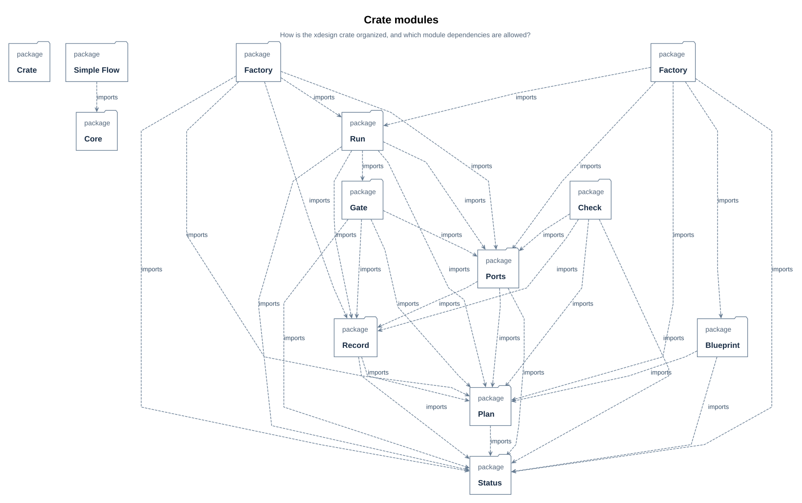
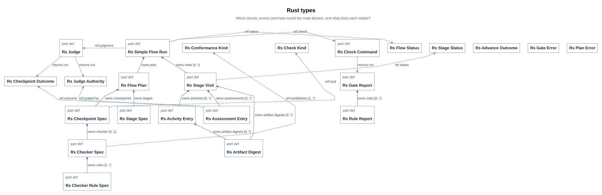
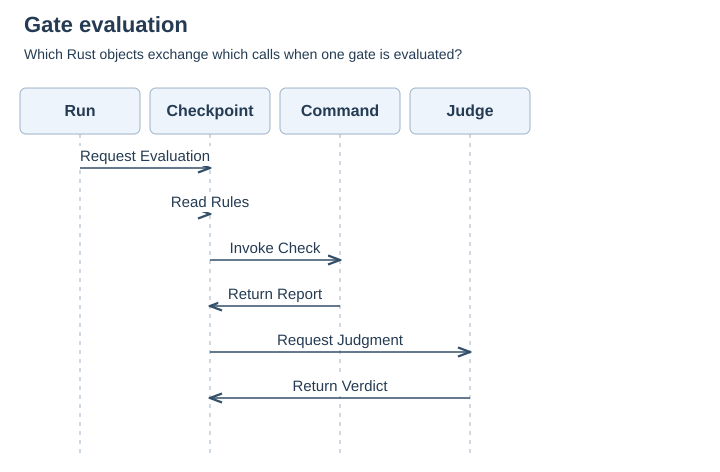
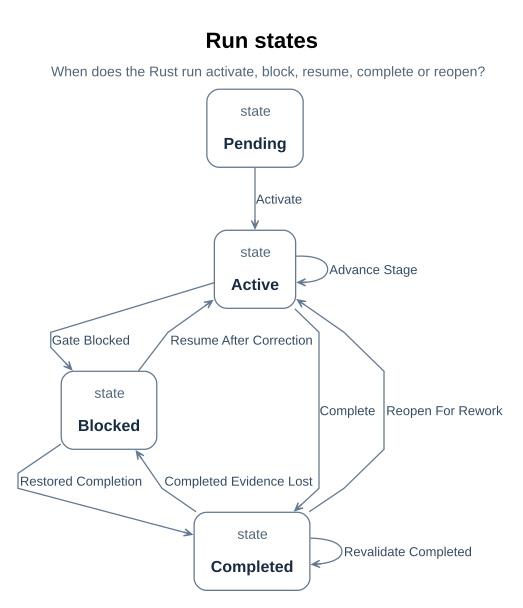

# SimpleFlow Rust UML design

> Module: simpflow crate (SimpleFlow workflow automation) | Version: v0.1 | Status:
> implemented four-stage slice in `src/`, exercised by `tests/simple_flow.rs`
> and the fixed-command tests; model views remain design projections.
> Audience: module implementers, integrators, verifiers, and reviewers.
> Relation: [module design](05_module_design.md#d32) | requirements
> [R01](../../requirements/01_baseline.md#r01) (`rustUmlDesignMapsEveryDesignElement`,
> `umlViewsAreSelectedWithReasons`, `softwareDesignClaimsNoImplementation`) | interface
> contract [I01](../../icd/01_interfaces.md#i01) | notation guide
> [U06](../../uml/01_c4_and_uml_guide.md#u06). Model source: `mbse/model/uml.sysml`
> (package `SimpleFlowRustUml`).

## Revision history

| Version | Date | Author | Change summary | Reviewed by |
| --- | --- | --- | --- | --- |
| v0.1 | 2026-10-19 | kimi-agent | First draft: crate layout, types, gate interaction, run states | wish-0009 `outcomeAccepted` assessment ([V16](../../review/01_wish_status.md#v16)) |
| v0.1 implementation alignment | 2026-10-20 | Codex | Reconciled the crate, API, local record writes, and executable test points with the model design | [SimpleFlow implementation plan](../../prj_manage/02_simple_flow_implementation_plan.md#p06) |

## D44 Purpose, scope and reading order

This document is the UML software design of the designed simple flow
([D01](01_run_design.md#d01)) realized by the Rust `simpflow` crate.
The SysML detailed design fixes what a run is made of; this design decides what a Rust
program declares to realize it — modules, structs, enums, traits and functions —
and records which SysML design element each Rust element realizes. The design model is
`SimpleFlowRustUml` in `mbse/model/uml.sysml`; its UML views are SysML projections
rendered by the pinned toolchain ([U10](../../uml/01_c4_and_uml_guide.md#u10)).

The source files and executable tests now exist. This document explains their
design relationship, while the [project implementation plan](../../prj_manage/02_simple_flow_implementation_plan.md#p06)
records executed results. Async runtimes, durable multi-user persistence, generic
controller integration, and the default V-model remain outside this crate's scope.
The local JSON record under `cache/` supports the fixed checkers but is not a
durable product evidence store.

Reading order: [crate layout](#d45) -> [types](#d46) -> [interactions](#d47) ->
[states](#d48) -> [interfaces](#d49) -> [errors and performance](#d50) ->
[tests and traceability](#d51) -> [view applicability](#d52). The class-and-function
level of this design — every public API with its full Rust signature, contracts and
stepwise logic — lives in the [simpflow API reference](../../uml/simpflow/00_overview.md#u13),
one page per API in the style of the PyTorch API reference.

## D45 Crate and module structure

The `simpflow` crate is one component with seven modules. One module owns one concern:
`status` defines vocabulary, `plan` and `record` hold data and hash identities,
`ports` adapts commands and judgments, `gate` evaluates one checkpoint, `run` owns
state changes, and `factory` builds the designed plan and run. The source imports
are declared in the model and shown in the diagram. The diagram covers the
crate-internal `use` dependencies of the current seven modules.

> **Figure D45-1 — Crate module layout.**  
> **Question:** How is the simpflow crate organized, and which module dependencies are allowed?  
> **Model view:** Package projection of `SimpleFlowRustUml::rustModuleLayout`.  
> **Companions:** [class structure](#d46), [package rules U11](../../uml/01_c4_and_uml_guide.md#u11), [module design D32](05_module_design.md#d32).  
> **Status:** renderable-now; crate modules implemented.  
> **Reading:** Each box is one Rust module; an arrow is an allowed `use` dependency. `status` sits at the bottom with no dependencies, `factory` and `run` at the top.  
> **Limits:** Shows crate-internal module dependencies, not external crates or deployment.

| Module | Responsibility | Depends on |
| --- | --- | --- |
| `status` | Flow, stage, check-kind, outcome and judge-authority enums | — |
| `record` | Visit, activity and assessment entries; artifact hashing | `status`, `plan` |
| `plan` | Stage, checkpoint, checker and rule specifications | `status` |
| `ports` | `CheckCommand` and `Judge` traits; process check and supplied judge adapters | `status`, `plan`, `record` |
| `gate` | Gate evaluation and visit authorization | `record`, `plan`, `ports`, `status` |
| `run` | The run type, its state handling and advancement | `record`, `plan`, `gate`, `ports`, `status` |
| `factory` | Run construction | `run`, `plan`, `ports`, `record`, `status` |

The crate component `SimpflowCrate` exposes the two automation boundaries as ports typed
by the design's existing exchanges ([D49](#d49)), so the crate honors the modeled
interfaces instead of inventing new ones.
The project package view [D21](../../arch/02_design.md#d21) includes
`SimpleFlowRustUml` beside architecture, detailed design, verification, and
traceability. Each Rust model element's `DocSection` points to its specific
[API page](../../uml/simpflow/00_overview.md#u14); the views and package retain
their module-level sections here. This keeps the software design in the same
model-to-document chain as the rest of the system.

## D46 Types: structs, enums and traits

The crate's types fall in three groups. **Status enums** mirror the model's lifecycle
vocabulary one-to-one (`RsFlowStatus`, `RsStageStatus`, `RsCheckKind`,
`RsCheckpointOutcome`, `RsJudgeAuthority`, `RsConformanceKind`), plus
`RsAdvanceOutcome`, which names the successor outcomes. **Record and plan structs**
carry data: a visit owns activities, assessments and artifact digests; completed
visits remain in history while blocked visits receive corrective work. The plan makes the
designed flow — stages, checkpoints, checkers, rules — data the run consults.
`validate()` enforces the exact four-stage, five-checkpoint blueprint represented by
that data. **Traits** are the two automation boundaries, `CheckCommand` and
`Judge`; the run holds trait objects and knows no concrete checker or reviewer.

> **Figure D46-1 — Rust type structure.**  
> **Question:** Which structs, enums and traits does the crate declare, and what does each realize?  
> **Model view:** Block-definition projection of `SimpleFlowRustUml::rustClassStructure`.  
> **Companions:** [gate interaction](#d47), [run states](#d48), [block definition D13](05_module_design.md#d13).  
> **Status:** renderable-now; core types implemented.  
> **Reading:** Each card is one Rust type with its fields; the `Rs` prefix marks the crate's own vocabulary. Composition (`Vec`-owned entries) runs from visit to activity and assessment entries and from plan to its specifications.  
> **Limits:** Field types are design-level (strings, integers, enums); concrete Rust generics, lifetimes and serialization derives are implementation decisions.

Core data structures:

| Name | Shape / type | Range / units | Invariant |
| --- | --- | --- | --- |
| `RsStageVisit` | struct; `visit_index`, `artifact_revision`, current artifact digest | revision starts at 0 | Latest assessments cite both current revision and exact artifact snapshot digest ([D16](05_module_design.md#d16)) |
| `RsAssessmentEntry` | struct; `outcome`, `judged_by`, evaluated snapshot digest | SHA-256 | `checkpoint_id` resolves against the plan; a syntactic gate's entry is `judged_by = script` |
| `RsArtifactDigest` | struct; artifact URI and SHA-256 | lowercase 64-digit hash | Changes at the same URI invalidate the former byte identity ([U51](../../uml/simpflow/35_artifact_digest.md#u51)) |
| `RsCheckpointSpec` | struct; `kind` enum, `checker` option | — | `checker` is present exactly when `kind = syntactic`; a semantic spec names judge flags and no checker |
| `RsFlowPlan` | struct; 4 stage specs and frozen plan URI/SHA-256 | exact plan file bytes | Stage order and exit gates equal `designedSimpleFlow` ([D01](01_run_design.md#d01)) |
| `RsSimpleFlowRun` | struct; `visits: Vec<RsStageVisit>` | ≥ 4 visits | One initial visit per stage at creation; requirements is active and the others pending |

Every type realizes a named SysML design element, recorded as a `dependency` in
`SimpleFlowRustUml` (for example `rsSimpleFlowRunRealizes` from `RsSimpleFlowRun` to
`SimpleFlowRun`); `rustUmlDesignMapsEveryDesignElement` makes that mapping the coverage
obligation the design review reads ([D52](#d52)). Each type's fields, methods,
invariants and per-function contracts are specified entry by entry in the
[simpflow API reference](../../uml/simpflow/00_overview.md#u14); the two error enums
`RsPlanError` and `RsGateError` are Rust-side additions with their own pages
([U45](../../uml/simpflow/30_plan_error.md#u45), [U46](../../uml/simpflow/31_gate_error.md#u46)).

## D47 Interaction design

The key scenario is one gate evaluation. The run asks the current visit's checkpoint
spec to evaluate; the spec reads its own rules and branches on `kind`: a syntactic spec
invokes its checker through the `CheckCommand` trait and holds only when every rule
holds; a semantic spec presents its criteria and the visit's artifact and evidence URIs
through the `Judge` trait and records the returned verdict. Either way the run appends
the assessment to the current visit. The caller later invokes `advance()` for the
transition decision. The branch is exclusive for one spec; the figure draws both
paths because it specifies the operation, not one execution.

> **Figure D47-1 — Gate evaluation interaction.**  
> **Question:** Which Rust objects exchange which calls when one gate is evaluated?  
> **Model view:** Sequence projection of `SimpleFlowRustUml::RsGateEvaluationInteraction`.  
> **Companions:** [type structure](#d46), [interface implementation](#d49), [activity view D18](05_module_design.md#d18).  
> **Status:** renderable-now; gate evaluation implemented.  
> **Reading:** Lifelines are the run, the checkpoint spec, the check command and the judge. The middle four messages are the kind branch: check invocation and report for a syntactic spec, judgment request and verdict for a semantic one.  
> **Limits:** One gate only; `evaluateGates` repeats it per exit checkpoint. No timeouts, retries or concurrency are designed — see [D50](#d50).

The run and gate functions map onto the model's operations (full signatures,
contracts and stepwise logic: the linked API pages):

| Rust function | Realizes | Decides | API entry |
| --- | --- | --- | --- |
| `factory::create_run(...) -> Result<RsSimpleFlowRun, RsPlanError>` | `SimpleFlowRunFactory::createRun` ([D03](01_run_design.md#d03)) | Validates frozen plan and both record URIs; initial stage active | [U16](../../uml/simpflow/01_create_run.md#u16) |
| `run.evaluate_gates()` | `EvaluateSimpleFlowGate` ([D04](01_run_design.md#d04)) | One assessment per exit gate of the current visit | [U18](../../uml/simpflow/03_evaluate_gates.md#u18) |
| `evaluate_checkpoint(...) -> Result<RsAssessmentEntry, RsGateError>` | `EvaluateSimpleFlowCheckpoint` ([D11](02_gates_and_rules.md#d11)) | Scripted report or permitted judgment, by `kind` | [U20](../../uml/simpflow/05_evaluate_checkpoint.md#u20) |
| `run.advance() -> RsAdvanceOutcome` | `AdvanceSimpleFlowRun` ([D04](01_run_design.md#d04)) | Enter next stage, complete, or retain a blocked visit | [U19](../../uml/simpflow/04_advance.md#u19) |
| `run.record_activity(activity) -> Result<(), String>` | `Controller::recordActivity` ([F04](../01_flows_and_checkpoints.md#f04)) | Validate artifact bytes and correct the same blocked visit | [U48](../../uml/simpflow/32_run_record_activity.md#u48) |
| `run.reopen_stage(stage_id) -> bool` | `ReopenSimpleFlowStage` ([D04](01_run_design.md#d04)) | Append a new terminal-stage visit after completion | [U49](../../uml/simpflow/33_reopen_stage.md#u49) |

## D48 State design

The run's state handling mirrors `SimpleFlowRunLifecycle`
([D20](05_module_design.md#d20)) with `RsFlowStatus` as the state variable the methods
maintain: `create_run` moves pending to active; a gate that is not authorized blocks the
run and its current visit; corrective work resumes that same visit and increments
its revision when artifact bytes change; an authorized nonterminal
visit advances within active; an authorized terminal visit completes it; and a completed
run can reopen its terminal stage as a new revision-zero visit without erasing history.
Calling `advance()` on an already completed run rechecks retained artifacts and passed
assessment evidence. Missing bytes block the run; after restoration a further
`advance()` can complete it again without appending a visit.

> **Figure D48-1 — Run state machine.**  
> **Question:** When does the Rust run activate, block, resume, complete or reopen?  
> **Model view:** State-machine projection of `SimpleFlowRustUml::RsRunLifecycle`.  
> **Companions:** [gate interaction](#d47), [lifecycle D20](05_module_design.md#d20).  
> **Status:** renderable-now; run states implemented.  
> **Reading:** Four states with transitions keyed on `run.status`, which `create_run`, `evaluate_gates`, `advance`, `record_activity` and `reopen_stage` set. Blocked correction keeps the current visit; terminal reopening appends one. A completed run may revalidate in place, become blocked if retained evidence is lost, and complete again after restoration.
> **Limits:** This view's guards are status projections weakened for compiler support; they do not encode the artifact and evidence checks in [D16](05_module_design.md#d16) and the API methods.

| Transition | From → to | Model guard | Rust event |
| --- | --- | --- | --- |
| `revalidateCompleted` | completed → completed | `run.status == RsFlowStatus::completed` | `advance()` finds current and completed visit artifacts and passed evidence intact. |
| `completedEvidenceLost` | completed → blocked | `run.status == RsFlowStatus::blocked` | `advance()` finds missing or changed retained artifacts or missing passed evidence. |
| `restoredCompletion` | blocked → completed | `run.status == RsFlowStatus::completed` | After restoration, `advance()` revalidates the terminal visit and persists completion. |

## D49 Interface implementation

The crate honors the design's two modeled exchanges through its traits; the ports on
`SimpflowCrate` are typed by those exchanges, so no new interface is invented here.
Field-level contracts stay in the interface control document
([I01](../../icd/01_interfaces.md#i01)).

| Interface | Role | Signature or message | Timeout / retry / idempotency | Interface contract |
| --- | --- | --- | --- | --- |
| `CheckCommand` trait ↔ `CheckCommandExchange` | consumer (run invokes a checker) | `run_check(checker, plan identity/digest, wish model URI, run record URI, stage, revision, snapshot digest) -> Result<RsGateReport, RsGateError>` | One synchronous subprocess per gate; no timeout or automatic retry in this slice | [U22](../../uml/simpflow/07_run_check.md#u22), [U58](../../uml/simpflow/42_process_check.md#u58), [I04](../../icd/01_interfaces.md#i04) |
| `Judge` trait ↔ `JudgmentExchange` | consumer (run presents to a judge) | `review(criteria, evidence_uris) -> (outcome, rationale)` after authority check | Synchronous caller-supplied verdict; no timeout or automatic retry | [U24](../../uml/simpflow/09_review.md#u24), [U59](../../uml/simpflow/43_supplied_judge.md#u59), [I05](../../icd/01_interfaces.md#i05) |

Ordering in the implementation: the run writes its JSON record before each checker,
appends that gate's assessment, and writes again before the next gate. The verify
judge therefore receives the preceding record-check report as evidence. The
checker verifies the frozen plan file, current run snapshot, and artifact SHA-256
values; `advance()` rechecks the current bytes and latest assessments. A failed
record write blocks advancement. Subprocess failure becomes an `Unevaluated`
assessment; the project CLI configures the process adapter to retain stdout
and stderr logs under `cache/`.

## D50 Errors, logging and performance

- Error taxonomy, designed at the type level: a failed rule is data (`RsRuleReport`
  with `holds = false` and a diagnostic), not an exception; a missing checker for a
  syntactic spec is a plan error the factory must reject; a judge's refusal is an
  `unevaluated` outcome, never a fabricated pass.
- Retry, degradation and recovery: none designed. A blocked run resumes through
  corrective work and a new assessment at the new revision ([D48](#d48)); the design
  adds no automatic retry of commands or judgments.
- Logging: the local JSON run record retains activities and assessments; each
  fixed-command report has stdout and stderr logs. No separate telemetry or
  durable product evidence store is implemented.
- Performance: no budget is set. Gate evaluation is linear in the stage's exit
  checkpoints and their rules; authorization counting is linear in a visit's
  assessments. No measurement exists, and none is claimed.

## D51 Test points and traceability

The crate has executable Rust cases in `tests/simple_flow.rs`,
`tests/plan_model_sync.rs`, and `tests/process_check_contract.rs`, command-line
wish cases in `src/main_wish_tests.rs`, and fixed-command cases in
`tests/test_simple_flow_checkers.py` and `tests/test_simple_flow_design_layout.py`,
mapped to the [SF verification
matrix](07_file_plan_and_verification.md#d54). The `TC-UML` identifiers below remain
design review points, not separately executed case records. Source tests cover
the behavioral rows named in the last column; model-view review remains separate.

| Requirement | UML element(s) | Design review point | Executable source coverage |
| --- | --- | --- | --- |
| `rustUmlDesignMapsEveryDesignElement` | `RsSimpleFlowRun`, `RsCheckpointSpec`, `RsFlowPlan` | TC-UML-01: every designed checkpoint resolves to a spec | `malformed_plans_are_rejected_before_run` checks plan shape; mapping review remains planned |
| `rustUmlDesignMapsEveryDesignElement` | `create_run` | TC-UML-02: initial stage and planned visits | `initial_visits_stage_scope_and_mixed_verify_gates` |
| `umlViewsAreSelectedWithReasons` | [D52](#d52) table | TC-UML-03: each view has applicability and reason | Design review remains planned |
| `softwareDesignClaimsNoImplementation` | whole document | TC-UML-04: claims match repository artifacts | Documentation review remains planned |
| Gate authorization ([D16](05_module_design.md#d16)) | `evaluate_checkpoint`, `RsAdvanceOutcome` | TC-UML-05: latest verdict and snapshot control authorization | `latest_verdict_and_revision_control_authorization`; `later_unevaluated_supersedes_pass_at_same_revision` |
| Lifecycle ([D48](#d48)) | `RsSimpleFlowRun::reopen_stage` | TC-UML-06: blocked correction and terminal reopen preserve history | `failed_correction_reuses_visit_and_completed_run_needs_reopen` |
| Frozen plan and evidence ([D47](#d47)) | `RsFlowPlan`, `RsArtifactDigest`, `RsGateReport` | TC-UML-07: exact plan and artifact hashes reject drift | `malformed_plans_are_rejected_before_run`; `latest_verdict_and_revision_control_authorization` |
| Gate authority and report validity ([D49](#d49)) | `RsJudge`, `RsCheckCommand`, `evaluate_checkpoint` | TC-UML-08: invalid report or judge cannot pass | `malformed_reports_never_pass_but_rule_failure_is_failed`; `unauthorized_or_unreasoned_semantic_judge_cannot_complete` |

## D52 UML view applicability and design limits

Applicability follows the guide's selection rule ([U09](../../uml/01_c4_and_uml_guide.md#u09)):
each UML 2.5 view is required, recommended, or not applicable with a reason.

| UML view | Applicability | Figure / status |
| --- | --- | --- |
| class | required — the crate's types are the design's core | [Figure D46-1](#d46), renderable-now |
| object | not applicable — no instance snapshot answers a question the class view cannot; run instances are recorded runs, documented in [E01](../02_records_and_evidence.md#e01) | — |
| component | required — the crate boundary and its two trait ports | table in [D45](#d45); figure planned |
| composite structure | recommended — port wiring already shown by [D14](05_module_design.md#d14) | companion, not redrawn |
| deployment | not applicable — no node or protocol decision has been made for the crate | — |
| package | required — module layout and allowed dependencies | [Figure D45-1](#d45), renderable-now |
| profile | not applicable — no domain stereotypes extend the notation | — |
| use case | not applicable — actor goals are the automation's, already in [D17](../../requirements/01_baseline.md#d17) | companion |
| activity | recommended — checkpoint evaluation flow already in [D18](05_module_design.md#d18) | companion, not redrawn |
| state machine | required — run state handling | [Figure D48-1](#d48), renderable-now |
| sequence | required — gate evaluation interaction | [Figure D47-1](#d47), renderable-now |
| communication | not applicable — the sequence view answers the collaboration question for one scenario | — |
| interaction overview | not applicable — one scenario; no fragment composition to show | — |
| timing | not applicable — no time constraint is set on gates or judgments ([D50](#d50)) | — |

Design limits, stated once for the whole document: the crate implements the gated
four-stage slice and writes local JSON evidence, while
`XDesignVerification::RustUmlDesignReview` remains a declared design review case,
not an executed formal review. The crate has no async workflow, default V-model
controller integration, or durable multi-user persistence. A CDR for this module
would still need the evidence package the
checklist lists ([V08](../../review/02_checklist.md#v08)).
