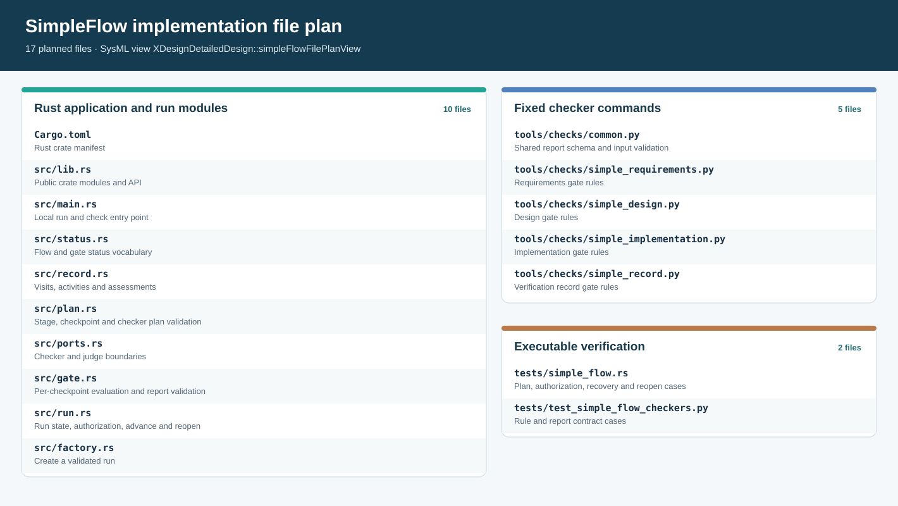

# SimpleFlow file plan and verification cases

> Scope: first executable `designedSimpleFlow` slice | Status: implemented source
> layout and verification design. A declared case is not an executed result;
> [P08](../../prj_manage/03_simple_flow_execution_record.md#p08) records actual runs.

This file connects the project requirements and [run design](01_run_design.md#d01) to
the Rust [module/API design](06_rust_uml_design.md#d44), the [fixed gate rules](02_gates_and_rules.md#d06),
the [record contract](../02_records_and_evidence.md#e03), and the
[draft checker and judge interfaces](../../icd/01_interfaces.md#i04). The executable
slice is the four-stage designed usage; the eleven-stage V-model has a separate default
flow and command set ([A10](../../00_index.md#a10)).

## D53 Repository file plan

> **Figure D53-1 — SimpleFlow file plan.**  
> **Question:** Which repository files carry the run, its fixed checks, and its verification?  
> **Model view:** Focused file-plan projection of `XDesignDetailedDesign::simpleFlowFilePlanView`, exposing the native `simpleFlowFilePlan` item and its `repositoryPath` and `responsibility` values.  
> **Companions:** [D45](06_rust_uml_design.md#d45) for module dependencies, [D06](02_gates_and_rules.md#d06) for the four checker rule sets, and [D54](#d54) for verification.  
> **Status:** renderable-now; model-declared file plan, with source and executable results checked separately.  
> **Reading:** Application sources, fixed checker commands, and tests are separate groups. The `repositoryPath` values below give exact filenames; labels in the figure stay short.  
> **Limits:** A planned path does not prove that a file exists, compiles, or fulfills its contract.

| Group | Repository files | Responsibility |
| --- | --- | --- |
| Crate entry | `Cargo.toml`, `src/lib.rs`, `src/main.rs` | Build and expose the library; provide a local command entry point. |
| Run modules | `src/status.rs`, `src/record.rs`, `src/plan.rs`, `src/ports.rs`, `src/gate.rs`, `src/run.rs`, `src/factory.rs` | Implement the seven modules selected by the Rust UML design. |
| Fixed gates | `tools/checks/common.py`, `tools/checks/simple_requirements.py`, `tools/checks/simple_design.py`, `tools/checks/simple_implementation.py`, `tools/checks/simple_record.py` | Share a JSON report contract and report the 2, 7, 2, and 7 fixed rules in [D06](02_gates_and_rules.md#d06). |
| Executable cases | `tests/simple_flow.rs`, `tests/test_simple_flow_checkers.py` | Exercise run behavior and checker results, including negative cases. |

The existing project model in `mbse/model/` defines stages, gates, records, views, and
planned verification. The existing documentation in `docs/` explains their contracts;
the compiler at `tools/sysml_web/bin/sysml`, `tools/check_documentation.py`, and
`tools/render_docs.py` check or render them. These are inputs and supporting tools for
the file plan, not replacements for its source files. Reports, previews, dependency
caches, and local development environments belong under ignored `cache/` as the root
`AGENTS.md` requires. Durable product evidence needs a separate retention design
([E04](../02_records_and_evidence.md#e04)); a cache path by itself is not one.

## D54 Verification case contract

`XDesignVerification::SimpleFlowGateBehaviorVerification`,
`SimpleFlowRecoveryVerification`, and `SimpleFlowFilePlanVerification` are case
definitions in `mbse/model/verification.sysml`. Their objectives trace to the named
project requirements. The following inputs and expected results make those definitions
executable; actual case results are recorded in
[P08](../../prj_manage/03_simple_flow_execution_record.md#p08).

| Case | Input or operation | Expected result |
| --- | --- | --- |
| SF-01 Plan rejection | Remove an exit gate, duplicate a checkpoint ID, point an exit to another stage, remove a nonterminal successor, or remove the terminal stage. | `validate` rejects every malformed plan before creating a run; an empty gate set cannot authorize a designed stage. |
| SF-02 Initial visit | Create a valid four-stage run. | Four planned stage visits in stage order, each at `visitIndex = 0` and `artifactRevision = 0`; only the requirements visit is active. |
| SF-03 Stage scope | Evaluate the requirements, design, and implementation visits in turn. | Each receives only its own syntactic gate assessment; no other stage's gate is invoked. |
| SF-04 Mixed verify gates | Evaluate the verify visit. | The record gate and semantic gate each produce one assessment in plan order; both are required to complete the run. |
| SF-05 Report and authority failures | Return a missing, duplicate, extra, or contradictory rule report; try a judge whose authority the gate forbids. | No malformed report or unpermitted judge yields a passed assessment; a fixed rule failure is `Failed`, while a channel unable to conclude is `Unevaluated`. |
| SF-06 Latest verdict | At one artifact revision, append pass then fail, pass then unevaluated, and fail then pass for the same gate. | The latest assessment for that gate controls authorization; only the last sequence can authorize it, if all other gates pass. |
| SF-07 Content revision | Record a content change to an artifact, including a change at an unchanged URI. | The current visit's revision increments once for the content event and its artifact-set digest changes; old assessments remain retained but cannot authorize the new revision. |
| SF-08 Failed advancement | Call `advance` with a missing, failed, stale, or unevaluated current gate. Correct the artifact and reassess. | The same visit remains current and blocked until corrected; no new visit is appended merely because a gate failed. |
| SF-09 Terminal reopen | Complete and explicitly reopen the terminal stage, then attempt to reopen an active run or a nonterminal stage. | A valid reopen appends the next visit index at revision 0 and preserves the completed visit and its evidence; invalid requests are rejected. |
| SF-10 Command conformance | Run the four fixed gate commands on passing and targeted failing fixtures. | Their reports contain exactly the 18 declared rule IDs across the four rule sets, one result per rule, with a diagnostic for each failure and an aggregate verdict equal to the conjunction. |
| SF-11 File and model integration | Compare the file-plan paths, crate exports, command URIs, declared rule IDs, model links, and generated figures; run the compiler and documentation checks. | Every source path and mapping resolves; model `parse`/`check`, documentation audit, figure render, and strict site build pass at the same source revision. |

The authorization oracle for SF-06 and SF-08 is the generic
`StageRecord.currentAssessments` latest-per-checkpoint selection and
`completionAuthorized` predicate ([E03](../02_records_and_evidence.md#e03),
[D16](05_module_design.md#d16)). SF-07 treats revision as a recorded content event,
not a difference between URI lists. SF-08 follows the controller's same-visit correction
path ([F04](../01_flows_and_checkpoints.md#f04)). SF-09 uses the explicit
`ReopenSimpleFlowStage` design action, currently limited to a completed terminal run;
upstream-stage reopening needs downstream invalidation rules before implementation.

## D55 Evidence and limits

Retain each executed case's inputs, output report, source revision, and verdict under
`cache/` while developing. A final delivery needs evidence locations that survive the
cache lifecycle. The bundled compiler checks syntax, name resolution, and its supported
model rules; it does not evaluate the 26 currently unevaluated constraint bodies or run
these cases ([T04](../03_toolchain.md#t04)). The fixed gates check declared structure,
record integrity, and artifact presence. Engineering adequacy remains a semantic
judgment at the applicable checkpoint, supported by retained evidence.
