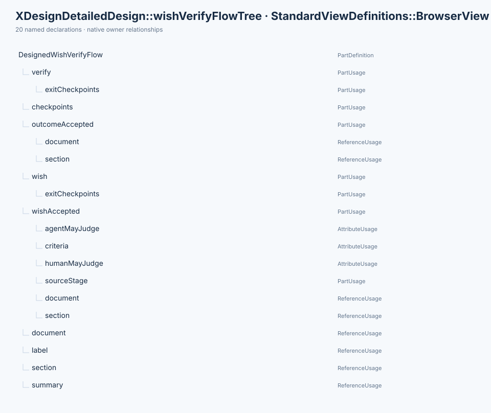
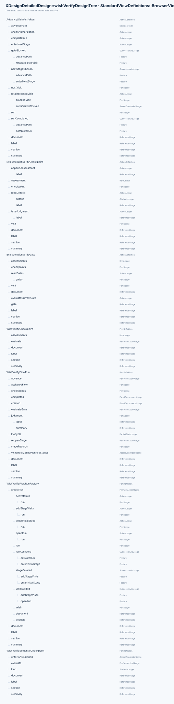
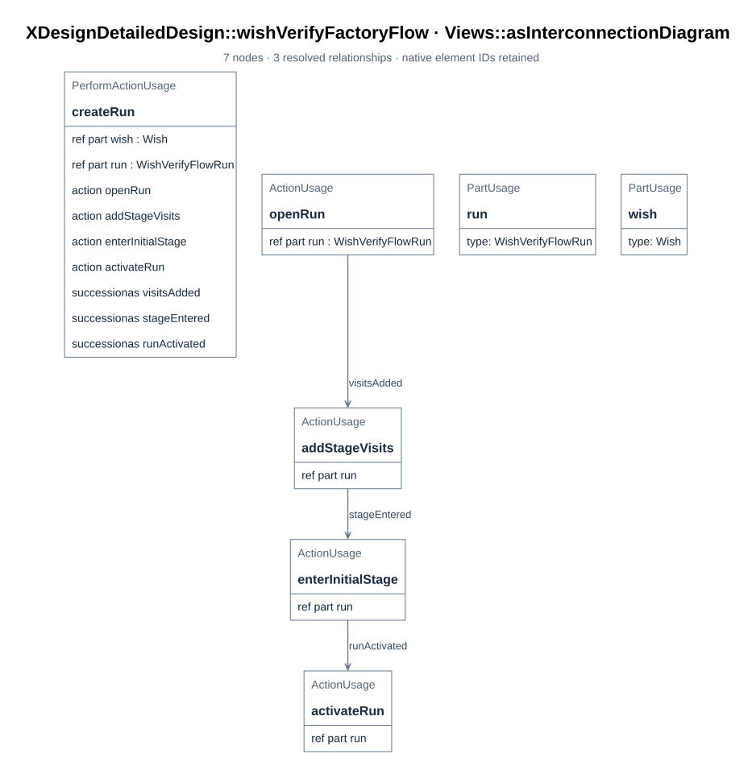
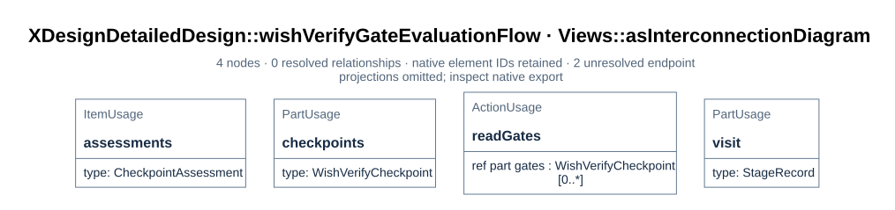

# WishVerifyFlow run design

The wish-verify flow resolved into what a run of it is actually made of: the class of a
run, the factory that creates it, and the functions that evaluate its gates and advance
it. The design lives in `mbse/model/detailedDesign.sysml`; every top-level element there
carries a `DocSection` annotation pointing at the section of this documentation that
covers it ([B04](../../arch/01_system_composition.md#b04)), and every figure is rendered
from the model by `tools/render_docs.py`.

The base `XDesignArchitecture::WishVerifyFlow` still gates only verification
([F03](../01_flows_and_checkpoints.md#f03)). Historical runs on
`xdesign.wishVerifyFlow` — wishes 0005 and 0009 — retain their original gates and
assessments. This file defines `XDesignDetailedDesign::DesignedWishVerifyFlow` as a
gated specialization. `XDesignComposition::xdesign.designedWishVerifyFlow` is its
concrete selectable usage in the system's flow portfolio.

The gates are instances of one checkpoint class with a single semantic adaptation, and
the run evaluates a gate through its class's operation rather than through a case
analysis beside it ([D63](02_gates_and_judgment.md#d63)).

## D57 The designed wish-verify flow

> **Figure D57-1 — Designed wish-verify flow plan.**
> **Question:** Which stages and exit gates make up the designed flow?
> **Model view:** `XDesignDetailedDesign::wishVerifyFlowTree`, a browser view of `DesignedWishVerifyFlow`.
> **Companions:** [D61](02_gates_and_judgment.md#d61) for gate criteria and [F03](../01_flows_and_checkpoints.md#f03) for selectable flows.
> **Status:** renderable-now; design view of the implemented Rust slice; executed verification is recorded in [P28](../../prj_manage/09_wish_verify_flow_implementation_plan.md#p28).
> **Reading:** Two stages retain the WishVerifyFlow order, and the usage adds a semantic gate to each stage's exit. The wish-stage gate is the design's addition; the terminal gate is inherited.
> **Limits:** The figure does not show a run that passed these gates or the judge who assessed them.

`DesignedWishVerifyFlow :> WishVerifyFlow` keeps the two stages in the definition's
order and adds an exit gate to the one stage the architecture left ungated:

| Stage | Exit gate | Kind | Established by |
| --- | --- | --- | --- |
| `wish` | `wishAccepted` | semantic | a permitted agent or human judge — added by this design ([D61](02_gates_and_judgment.md#d61)) |
| `verify` | `outcomeAccepted` | semantic | a permitted agent or human judge — inherited and retyped ([D61](02_gates_and_judgment.md#d61)) |

Both gates are semantic. The architecture states the intent directly: `WishVerifyFlow`
is the flow for work whose outcome is judged rather than checked — nothing is derived
that a fixed check could establish, so the flow carries no requirement, design, or
implementation stage. The designed specialization honors that intent: it declares no
syntactic checkpoint, no checker, and no command under `tools/checks/`. What the
`designedFlowGatesEveryStage` requirement
([R01](../../requirements/01_baseline.md#r01)) does demand is that every stage of a
designed flow declare its exit gate — the engine authorizes nothing for an ungated
stage — so this design adds `wishAccepted` to the wish stage and retypes the inherited
`outcomeAccepted` to the designed checkpoint class, leaving its criteria, kind, and
judge flags exactly as the architecture states them.

Why the base definition is not the place for the wish-stage gate: adding a gate to
`WishVerifyFlow` would apply it to `xdesign.wishVerifyFlow` and to every run already
recorded against it. A completed visit whose stage gained a new exit checkpoint would
lose its authorization retrospectively — the record would be rewritten by a design
change. The design instead states the gated specialization and instantiates it as
`xdesign.designedWishVerifyFlow`; the historical usage and its wish records are
untouched (plan decision 6,
[P26](../../prj_manage/09_wish_verify_flow_implementation_plan.md#p26)).

## D58 The run class

> **Figure D58-1 — Run design definitions.**
> **Question:** Which classes and functions realize one run of the designed flow?
> **Model view:** `XDesignDetailedDesign::wishVerifyDesignTree`, a browser view of the run design.
> **Companions:** [D59](#d59) for creation and [D63](02_gates_and_judgment.md#d63) for checkpoint evaluation.
> **Status:** renderable-now; design view of the implemented Rust slice; executed verification is recorded in [P28](../../prj_manage/09_wish_verify_flow_implementation_plan.md#p28).
> **Reading:** The run class specializes `FlowExecution` and names its visits, judgment port, events, and operations. The factory and action definitions provide the creation, assessment, and advancement roles.
> **Limits:** Declared members do not establish an implemented class or an executed run.

`WishVerifyFlowRun` specializes the architecture's generic `FlowExecution`
([E01](../02_records_and_evidence.md#e01)): one run of the designed flow, with the
flow's plan and operations fixed. A wish's execution is typed by it — the realization is
the typing, not a declaration beside it ([R01](../../requirements/01_baseline.md#r01),
`runRealizesItsDesign`).

| Member | What it is |
| --- | --- |
| `assignedFlow : DesignedWishVerifyFlow` (redefined) | The class of plan this run executes; a concrete run binds the `xdesign.designedWishVerifyFlow` usage |
| `stageRecords : StageRecord [2..*]` (redefined) | A visit to each of the two stages; a reworked terminal stage appends a further visit, so the count grows |
| `judgment : ~JudgmentExchange` | The run's only port — the interface it presents judgments through; no check port exists because no syntactic gate exists ([D67](04_module_design.md#d67)) |
| `created`, `completed` | The run's events — the ends of its timeline ([D68](04_module_design.md#d68)) |
| `checkpoints : WishVerifyCheckpoint [0..*]` | The designed flow's two gates as checkpoint-class instances, bound to the assigned flow's plan; the run evaluates them ([D63](02_gates_and_judgment.md#d63)) |
| `lifecycle : WishVerifyRunLifecycle` | The run's exhibited state, bound to itself ([D68](04_module_design.md#d68)) |
| `evaluateGate : EvaluateWishVerifyGate` | The operation that hands each gate of the current visit to its class's `evaluate` operation ([D60](#d60)) |
| `advance : AdvanceWishVerifyRun` | The operation that moves the run on when the gates authorize it ([D60](#d60)) |
| `reopenStage : ReopenWishVerifyStage` | Explicitly reopen a completed terminal visit as a new visit while retaining the completed record ([D60](#d60)) |
| `visitsRealizeThePlannedStages` | Assertion: every visit is a visit to one of the plan's stages, and every stage of the plan has a visit |

The assertion, like every `assert constraint` in this model, is not evaluated by the
compiler ([T04](../03_toolchain.md#t04)); it is read, and the factory ([D59](#d59)) and
the run's rules are what keep it true.

## D59 The factory

> **Figure D59-1 — Run creation.**
> **Question:** How does the factory initialize a designed run?
> **Model view:** `XDesignDetailedDesign::wishVerifyFactoryFlow`, an action-flow view of `WishVerifyFlowRunFactory::createRun`.
> **Companions:** [D58](#d58) for the run's members and [F04](../01_flows_and_checkpoints.md#f04) for registration.
> **Status:** renderable-now; design view of the implemented Rust slice; executed verification is recorded in [P28](../../prj_manage/09_wish_verify_flow_implementation_plan.md#p28).
> **Reading:** Creation opens the run, adds planned stage visits, enters the wish stage, and activates the run. Those steps shape the execution record the controller will own.
> **Limits:** The figure is an operation specification and does not show a completed registration test.

`WishVerifyFlowRunFactory::createRun` models a `Wish` input and the designed flow's
plan and produces the run. The local Rust `create_wish_verify_run` receives
`wish_model_uri`, a path identifying the independent wish SysML source; it does not
load a `Wish` item. The factory realizes the run-creation part of
`Controller::receiveWish` that assigns the flow, opens the run and enters its initial
stage ([F04](../01_flows_and_checkpoints.md#f04)) — so an implementation of this flow
builds one factory instead of re-deriving the generic controller's behaviour.

| Step | What it does |
| --- | --- |
| `openRun` | Creates the run, bound to the plan, with no visits yet |
| `addStageVisits` | Adds one pending visit per stage — `wish` and `verify` — each bound to its stage, at visit index 0 and artifact revision 0 |
| `enterInitialStage` | The `wish` visit becomes current and active at revision 0; the verify visit stays pending |
| `activateRun` | The run becomes active, so the controller records activities against it |

The boundary stays where the architecture put it: the wish remains an item of the
`Workflow` composition and the trace that holds the run is the controller's, produced by
`receiveWish` ([B01](../../arch/01_system_composition.md#b01)); the factory only shapes
the run itself.

## D60 The functions

> **Figure D60-1 — Gate evaluation function.**
> **Question:** How does a run obtain checkpoint assessments before advancing?
> **Model view:** `XDesignDetailedDesign::wishVerifyGateEvaluationFlow`, an action-flow view of `EvaluateWishVerifyGate`.
> **Companions:** [D63](02_gates_and_judgment.md#d63) for the checkpoint class and [E04](../02_records_and_evidence.md#e04) for assessment records.
> **Status:** renderable-now; design view of the implemented Rust slice; executed verification is recorded in [P28](../../prj_manage/09_wish_verify_flow_implementation_plan.md#p28).
> **Reading:** The function takes the current visit's exit gates and delegates each assessment to its checkpoint class's judged path. It records the outcome before the separate advance function tests authorization.
> **Limits:** The figure does not supply a judge or establish a pass.

**`EvaluateWishVerifyGate`** selects only the current visit's stage exit gates from the
plan, then iterates over them in plan order. Each gate's class `evaluate` operation
appends one `CheckpointAssessment` to the visit. Each of the two stages has exactly one
exit gate, so one iteration runs per stage evaluation. The class operation is
`EvaluateWishVerifyCheckpoint`; its single adaptation implements it as
`TakeWishVerifyJudgment` ([D63](02_gates_and_judgment.md#d63)).

- **The judged path (the only path).** The gate's criteria and the visit's artifacts
  and evidence go through the judgment port to a judge the gate permits; the outcome,
  rationale, and evidence are recorded. No code settles it, and none pretends to —
  there is no syntactic branch because this flow declares no syntactic gate
  ([D62](02_gates_and_judgment.md#d62)).
- Either way: a gate with no assessment authorizes nothing, and `unevaluated` criteria
  provide no authorization to advance ([E04](../02_records_and_evidence.md#e04)).

**`AdvanceWishVerifyRun`** is the successor rule of the designed flow: when the current
visit is authorized *at the visited revision*, the stage that follows hands the run its
pending visit — an authorized `wish` visit makes the pending `verify` visit current.
The `verify` stage has no successor, so its completion completes the run, which is what
lets the controller deliver the trace ([E05](../02_records_and_evidence.md#e05)). A
visit that is not authorized stays current and blocked. Corrective work records a
content-change activity in that same visit and increments its artifact revision, even
when the artifact URI stays the same; earlier assessments remain attached to the
revision they judged ([E03](../02_records_and_evidence.md#e03)).
`ReopenWishVerifyStage` is a separate explicit action for a completed terminal run: it
preserves the completed verify visit and appends a new active verify visit with the next
visit index and revision 0. Reopening the wish stage of a completed run needs
downstream invalidation rules and is outside this action.

These action bodies are specifications, not executed results: the compiler resolves
their names but does not evaluate their `assert constraint` bodies
([T04](../03_toolchain.md#t04)). The executable cases WV-01–WV-10 in
[P28](../../prj_manage/09_wish_verify_flow_implementation_plan.md#p28) must establish
their behavior.
