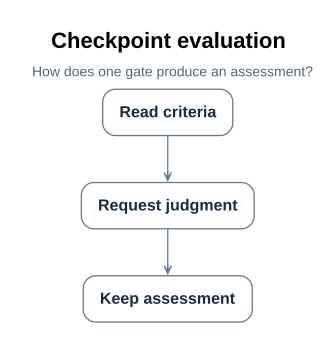

# WishVerifyFlow gates and judgment

The designed wish-verify flow's gates live in `mbse/model/detailedDesign.sysml`; the
inherited terminal gate's criteria live in `mbse/model/architecture.sysml` on
`WishVerifyFlow`. A gate is a `Checkpoint`
([F01](../01_flows_and_checkpoints.md#f01)); both gates of this flow are semantic, so
this document has no rule tables and no command contracts — it states the judgment
contract instead.

## D61 The two gates, exactly

Each gate states the criteria a judge must establish. Both gates name no checker and
permit an agent or a human (`agentMayJudge` and `humanMayJudge` both true,
[F02](../01_flows_and_checkpoints.md#f02)). The criteria below are verbatim from the
model.

| Gate | Source stage | Kind | Criteria (verbatim from the model) | Judge flags |
| --- | --- | --- | --- | --- |
| `wishAccepted` | `wish` | semantic | "The wish statement is recorded, and the artifacts that answer it are named in the current visit." / "A reader can see from the recorded artifacts what the wish asked and what was produced for it, without re-asking the requester." | `agentMayJudge`, `humanMayJudge` |
| `outcomeAccepted` | `verify` (terminal) | semantic | "The delivered artifacts let the requester see the outcome from them, without reading the model or re-asking." / "Diagrams carry the explanation where a diagram is clearer than prose, no statement goes beyond what the evidence supports, and nothing is added that the requester did not ask for." | `agentMayJudge`, `humanMayJudge` |

`wishAccepted` is this design's addition: the architecture's `WishVerifyFlow` leaves the
wish stage ungated, and a designed flow gates every stage
(`designedFlowGatesEveryStage`, [R01](../../requirements/01_baseline.md#r01)) — the
judgment that the request and its answering artifacts are recorded is made explicit
here rather than left to the passage of work. `outcomeAccepted` is inherited from the
flow definition and restated by retyping: its criteria, kind, and judge flags stay
exactly as the architecture states them; only its class changes, to
`WishVerifySemanticCheckpoint`, so the run evaluates it through the class like every
other gate.

Every gate is an instance of the checkpoint class: both are
`WishVerifySemanticCheckpoint` instances ([D63](#d63)). The compiler resolves these
declarations but does not evaluate the model's assertions
([T04](../03_toolchain.md#t04)); the recorded judgments must establish the outcomes
before a run may use them.

## D62 The judgment contract

There are no fixed commands in this flow, and that is a decision, not a gap. The
architecture states that a wish-verify flow produces nothing a fixed check could
establish; plan decision 2
([P26](../../prj_manage/09_wish_verify_flow_implementation_plan.md#p26)) makes it
binding for this design: no syntactic checkpoint, no checker declaration, and no new
command under `tools/checks/`. A syntactic gate would contradict the architecture's
stated intent and is rejected by blueprint conformance
([U75](../../api/wish_verify_flow/02_validate_wish_verify_plan.md#u75)).

**Who may judge.** A judge the gate's flags permit — here an agent or a human, since
both flags are set on both gates. The judge is reached through the judgment port:
`JudgmentExchange`, `JudgmentInterface`, and `Judge`, reused unchanged from the
SimpleFlow design ([D10](../simple_flow/03_structure_graphs.md#d10)). The run wires no
other automation boundary.

**What a judgment must carry.** One recorded `CheckpointAssessment`
([E04](../02_records_and_evidence.md#e04)) per gate evaluation, with:

- an outcome from the checkpoint vocabulary — `passed`, `failed`, or `unevaluated`;
- a judge identity whose authority the gate permits, recorded in `judgedBy`;
- a nonempty rationale a later reader can re-examine;
- evidence URIs that resolve to existing retained artifacts, evaluated at the visit's
  current artifact revision and snapshot.

**What never becomes a pass.** A script judgment on these semantic gates; a judge
whose authority the flags do not permit or whose identity is empty; a pass with an
empty rationale; a pass that cites no evidence or names evidence files that do not
exist; and a pass recorded at a stale revision after the visit's artifacts changed.
Each of these is refused or recorded `unevaluated`, and an `unevaluated` or `failed`
latest assessment authorizes nothing ([E03](../02_records_and_evidence.md#e03)). The
executable counterexamples are cases WV-03, WV-04, and WV-05 of
[P28](../../prj_manage/09_wish_verify_flow_implementation_plan.md#p28).

## D63 The checkpoint class and its evaluation

> **Figure D63-1 — Checkpoint evaluation.**
> **Question:** How does one gate produce an assessment?
> **Model view:** `XDesignDetailedDesign::wishVerifyActivityDiagram`, an action-flow view of `EvaluateWishVerifyCheckpoint`.
> **Companions:** [D62](#d62) for the judgment contract and [D67](04_module_design.md#d67) for the judgment interface.
> **Status:** renderable-now; design view of the implemented Rust slice; executed verification is recorded in [P28](../../prj_manage/09_wish_verify_flow_implementation_plan.md#p28).
> **Reading:** The evaluate operation reads the gate's criteria, requests the judgment through the judgment port, and appends one assessment. There is a single judged path because this flow declares no syntactic gate.
> **Limits:** The diagram does not prove a judge answered or that the recorded verdict passed.

Every gate of the designed flow is an instance of one class, `WishVerifyCheckpoint`:
the flow's checkpoints are not two unrelated `Checkpoint` usages, and the run does not
judge them beside their class. The class carries the common checkpoint contract —
source stage, kind, criteria, checkers, judge flags — and owns the `evaluate` operation
and the assessments that operation produces. Unlike the SimpleFlow class it needs no
syntactic adaptation: this flow's gates are all judged, so one adaptation puts the
semantic rule kind on the class:

| Class | Kind | Adapts | Operation |
| --- | --- | --- | --- |
| `WishVerifyCheckpoint` | any | the common checkpoint contract and the assessment loop | `EvaluateWishVerifyCheckpoint` |
| `WishVerifySemanticCheckpoint` | semantic | the semantic rules: criteria a permitted judge reads, with no checker | `TakeWishVerifyJudgment` |

The loop closes on the class:

1. `designedWishVerifyFlow.checkpoints` is typed `WishVerifyCheckpoint`; each gate is
   an instance of the semantic adaptation.
2. `WishVerifyFlowRun.checkpoints` holds those instances, and its `evaluateGate` hands
   each gate of the current visit to the class's `evaluate` operation
   ([D60](01_run_design.md#d60)).
3. The adaptation's operation presents the criteria with the visit's artifacts and
   evidence to a permitted judge and records the returned outcome and rationale as a
   `CheckpointAssessment` ([E04](../02_records_and_evidence.md#e04)).
4. The assessment's `checkpoint` points back to the class instance it judged, and the
   class keeps the assessments it produced — the design and the record point at each
   other.

What the design deliberately does not encode is the *logic of a criterion*. A criterion
is prose for the judge; the class fixes who may judge a checkpoint and what is
recorded, and [D61](#d61) fixes what each criterion says. The adaptation's assertion
`criteriaAreJudged` — no checkers, and at least one judge flag — is read, not evaluated
by the compiler ([T04](../03_toolchain.md#t04)); blueprint conformance
([U75](../../api/wish_verify_flow/02_validate_wish_verify_plan.md#u75)) is what rejects
a plan that violates it in the implementation.

This activity view is also the flow's answer to the activity question of the nine-view
coverage index ([D64](03_sysml_diagrams.md#d64)): how one checkpoint is evaluated, by
which guarded path. Here the guard is trivial — every gate takes the judged path — and
the figure says so.
