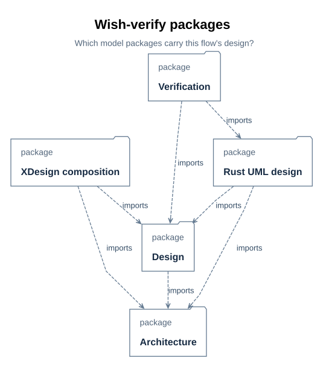
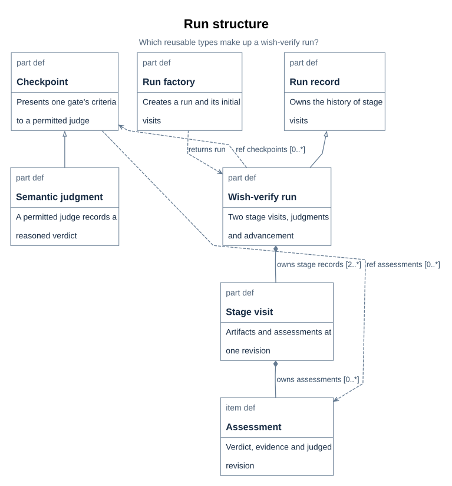
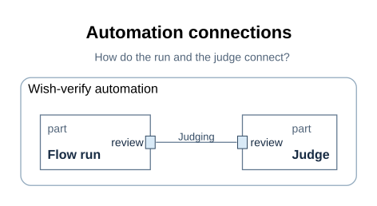
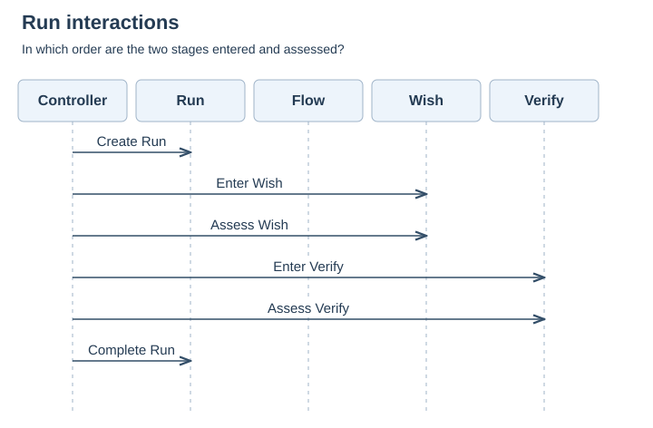
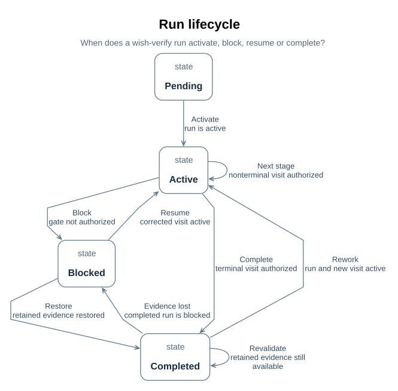
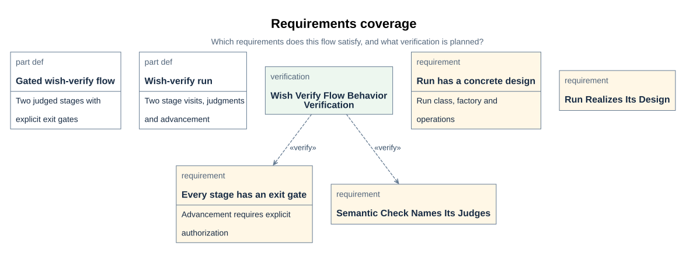
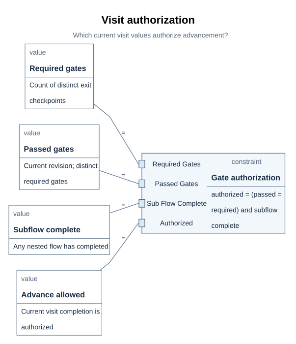
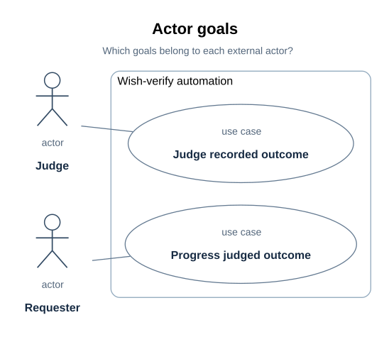

# WishVerifyFlow module detailed design

> Module: `XDesignDetailedDesign` wish-verify run and judgment automation | Revision: 1
> Status: design specification with an implemented Rust slice; executed behavior
> verification recorded in the plan ([P28](../../prj_manage/09_wish_verify_flow_implementation_plan.md#p28));
> no frozen CDR baseline.
> Audience: module implementers, integrators, verifiers, and reviewers. Basis:
> [requirements inventory](../../requirements/01_baseline.md#r01), the base
> [WishVerifyFlow](../01_flows_and_checkpoints.md#f03), and the
> [draft ICD](../../icd/01_interfaces.md#i01).

The project model is the structural source; this document records the module decisions
and their limits. The related [flow plan](01_run_design.md#d57) and
[judgment contract](02_gates_and_judgment.md#d62) remain detailed sources. The
[view-coverage index](03_sysml_diagrams.md#d64) records why the selected views apply;
the figures themselves sit in the design topics they explain below.

| Revision | Date | Change | Review status |
| --- | --- | --- | --- |
| 1 | 2026-10-20 | First module design for the designed two-stage wish-verify flow | Documentation scope per plan step 3; CDR pending |

## D65 Module overview and package ownership

`WishVerifyFlowRun` records a wish's planned and visited stages. The factory constructs
that run; `WishVerifyCheckpoint` evaluates a gate and retains its assessment; the
advance operation consults the current visit before entering another stage. The module
boundary is the designed wish-verify automation, with a single judgment exchange and no
checker exchange. [D57–D60](01_run_design.md#d57) state the run and operation contract;
[D61–D63](02_gates_and_judgment.md#d61) state gate criteria and the judgment contract.

> **Figure D65-1 — Wish-verify packages.**
> **Question:** Which model packages carry this flow's design?
> **Model view:** `XDesignDetailedDesign::wishVerifyPackageDiagram`, a package projection.
> **Companions:** [D21](../../arch/02_design.md#d21) for the whole-project package view and [D76](05_rust_uml_design.md#d76) for the crate layout.
> **Status:** renderable-now; design view of the implemented Rust slice; executed verification is recorded in [P28](../../prj_manage/09_wish_verify_flow_implementation_plan.md#p28).
> **Reading:** The architecture owns the base flow, the detailed design owns the gated specialization, the composition owns the selectable usage, the Rust UML package maps the software realization, and the verification package holds the planned cases.
> **Limits:** The figure shows model organization, not deployment or executable code.

The module does not own the judge's engineering judgment or turn a recorded pass into
project-level acceptance. Those outcomes belong to the wish trace and its assessed
artifact revision.

## D66 Classes and data structures

The run, factory, checkpoint, stage visit, and assessment types are the module's core
structures. [D58](01_run_design.md#d58) gives the run's key features and
multiplicities; [E01–E04](../02_records_and_evidence.md#e01) define the retained visit
and evidence records. A Rust realization exists on the generic `xdesign::core` engine;
durable storage layout remains open.

> **Figure D66-1 — Block definition.**
> **Question:** Which reusable types make up a wish-verify run?
> **Model view:** `XDesignDetailedDesign::wishVerifyBlockDefinitionDiagram`, a focused type projection.
> **Companions:** [D67](#d67) for connected instances and [D69](#d69) for requirements.
> **Status:** renderable-now; design view of the implemented Rust slice; executed verification is recorded in [P28](../../prj_manage/09_wish_verify_flow_implementation_plan.md#p28).
> **Reading:** Type boxes show the run, its parent `FlowExecution`, the factory, the checkpoint class and its semantic adaptation, and the visit and assessment records. Ownership and specialization edges preserve the selected multiplicities and inherited contracts.
> **Limits:** The figure does not show communicating parts, run order, or an executed class implementation.

`wishVerifyBlockDefinitionDiagram` selects `WishVerifyFlowRun`, its parent
`FlowExecution`, `WishVerifyFlowRunFactory`, `WishVerifyCheckpoint`, its semantic
specialization, `StageRecord`, and `CheckpointAssessment`. `WishVerifyFlowRun`
specializes `FlowExecution` and owns stage visits, with at least one visit per planned
stage; `WishVerifyCheckpoint` owns the common evaluation operation and assessment
history; `WishVerifySemanticCheckpoint` specializes that common class rather than
introducing an unrelated gate contract. The factory creates the run; the run performs
the gate and advance functions.

| Core type | Modeled shape and responsibility | Range or invariant | Implementation status |
| --- | --- | --- | --- |
| `WishVerifyFlowRun` | `FlowExecution` specialization with planned stages and visits | At least one visit per planned stage; current visit determines advancement | Realized by the generic `RsFlowRun` bound to the designed blueprint; durable persistence open |
| `WishVerifyFlowRunFactory` | Creation operation for a typed run and its initial plan | One creation path per requested run in [D59](01_run_design.md#d59) | Realized by `create_wish_verify_run` ([U76](../../api/wish_verify_flow/03_create_wish_verify_run.md#u76)) |
| `WishVerifyCheckpoint` | Common gate evaluation operation with its semantic specialization | Assessment kind is always semantic in this flow | Realized by `RsCheckpointSpec` and the judge port; generic controller integration open |
| `StageRecord` | Stage, visit index, artifact revision, activities, assessments, and completion state | New rework visit preserves previous visit history | Realized by `RsStageVisit` in the JSON run; durable storage open |
| `CheckpointAssessment` | Checkpoint, evaluated revision, outcome, judge, rationale, and evidence references | Current pass must match the visit's artifact revision | Realized by `RsAssessmentEntry` in the JSON run; historical SysML records remain separate |

These are logical records, not a database schema. No units, byte sizes, persistence
keys, or serialized layouts are assigned where the model has not selected them.

## D67 Interface contract: judgment only

The module design wires exactly one interface: the judgment exchange by which the run
presents criteria and receives a reasoned verdict. The judgment port types —
`JudgmentExchange`, `JudgmentInterface`, and `Judge` — are reused unchanged from the
SimpleFlow design ([D10](../simple_flow/03_structure_graphs.md#d10)); no checker
command interface is wired, because this flow declares no syntactic gate
([D62](02_gates_and_judgment.md#d62)). The
[interface control document](../../icd/01_interfaces.md#i01) inventories the modeled
fields, directions, and unresolved operational fields; it is a draft, not a frozen
baseline.

> **Figure D67-1 — Internal block.**
> **Question:** How do the run and the judge connect?
> **Model view:** `XDesignDetailedDesign::wishVerifyInternalBlockDiagram`, an interconnection projection of `WishVerifyAutomation`.
> **Companions:** [D66](#d66) for types and [D68](#d68) for interaction order.
> **Status:** renderable-now; design view of the implemented Rust slice; executed verification is recorded in [P28](../../prj_manage/09_wish_verify_flow_implementation_plan.md#p28).
> **Reading:** The enclosure is the automation boundary. The factory creates the run, and the run's judgment port connects to the judge's port through the judgment interface; no check connector exists.
> **Limits:** The connection topology does not prove that a judge endpoint answered at runtime.

| Draft interface | Module role | Modeled fields and direction | Operational fields still open | ICD source |
| --- | --- | --- | --- | --- |
| IF-004 `JudgmentInterface` | Run presents; permitted judge responds | `criteria` and `artifactsUris` run → judge; `outcome` and `rationale` judge → run | Identity enforcement, URI resolution, response schema, timeout, retry, versioning | [I05](../../icd/01_interfaces.md#i05) |

`WishVerifyAutomation`'s `checkpoints` reference selects the runner's plan gates, so
the automation does not create another set of gates. The endpoint implementation must
validate fields, retain the assessed revision, and distinguish a refused judgment from
a failed engineering criterion. Transport, failure codes, contract owners, and review
authorities are still unassigned; [I09](../../icd/01_interfaces.md#i09) tracks those
decisions. The modeled item flows establish design intent, not interface conformance
evidence.

## D68 Key flow design: timeline and lifecycle

The normal scenario starts with a factory-created run, enters the wish stage, obtains
its current-revision judgment, advances to verify when authorized, and completes when
the terminal visit is authorized. Correction of a blocked visit stays in that visit;
explicit reopening of a completed terminal visit creates another one without
overwriting history. The two views below divide interaction order from lifecycle state.

> **Figure D68-1 — Run sequence.**
> **Question:** In which order are the two stages entered and assessed?
> **Model view:** `XDesignDetailedDesign::wishVerifySequenceDiagram`, a projection of `WishVerifyRunTimeline`.
> **Companions:** [D67](#d67) for the exchange boundary and the lifecycle below for blocked and rework behavior.
> **Status:** renderable-now; design view of the implemented Rust slice; executed verification is recorded in [P28](../../prj_manage/09_wish_verify_flow_implementation_plan.md#p28).
> **Reading:** Five lifelines — controller, run, flow, and the two stages — carry six ordered messages from creation through the terminal completion event. Entry into verify assumes the wish visit was authorized.
> **Limits:** This normal sequence does not show rework loops, performance, or actual wish evidence.

`wishVerifySequenceDiagram` selects `WishVerifyRunTimeline`. Its messages start with
run creation, proceed through wish-stage entry and assessment, then verify-stage entry
and assessment, and finish with the run's completion event. A stage-entry message after
initial entry is authorized only by the current visit's exit gate; the ordering does
not grant permission by itself. The view declares no alternative or loop fragments: a
blocked gate holds the current visit, and explicit terminal reopening adds another
visit and repeats the applicable stage interactions. A particular wish's actual journey
and assessment results belong to its independent trace
([E06](../02_records_and_evidence.md#e06)).

> **Figure D68-2 — Run lifecycle.**
> **Question:** When does a wish-verify run activate, block, resume or complete?
> **Model view:** `XDesignDetailedDesign::wishVerifyStateMachineDiagram`, a state-transition projection of `WishVerifyRunLifecycle`.
> **Companions:** [D70](#d70) for completion authorization and [D60](01_run_design.md#d60) for the advance and reopen actions.
> **Status:** renderable-now; design view of the implemented Rust slice; executed verification is recorded in [P28](../../prj_manage/09_wish_verify_flow_implementation_plan.md#p28).
> **Reading:** Pending, active, blocked, and completed states are connected by activation, blocking, resume, advance, completion, revalidation, and rework transitions. The table below gives the exact guards behind the short visible captions.
> **Limits:** The state machine is a design specification; it does not show a recorded run or evaluate constraint bodies.

`wishVerifyStateMachineDiagram` selects `WishVerifyRunLifecycle`, exhibited by
`WishVerifyFlowRun` with its `run` reference bound to that run. Its four states are
`pending`, `active`, `blocked`, and `completed`. It distinguishes the status of the run
from the stage whose visit is current. Its transitions have explicit conditions:

| Transition | From → to | Guard |
| --- | --- | --- |
| `activate` | pending → active | `run.status == FlowStatus::active` |
| `gateBlocked` | active → blocked | `run.status == FlowStatus::blocked and not run.currentRecord.completionAuthorized` |
| `resumeAfterCorrection` | blocked → active | `run.currentRecord.status == StageStatus::active` |
| `advanceStage` | active → active | `run.currentRecord.completionAuthorized and not run.currentRecord.stage.completesFlow` |
| `complete` | active → completed | `run.currentRecord.completionAuthorized and run.currentRecord.stage.completesFlow` |
| `revalidateCompleted` | completed → completed | `run.status == FlowStatus::completed and run.currentRecord.completionAuthorized` |
| `completedEvidenceLost` | completed → blocked | `run.status == FlowStatus::blocked and run.currentRecord.status == StageStatus::blocked` |
| `restoredCompletion` | blocked → completed | `run.status == FlowStatus::completed and run.currentRecord.status == StageStatus::completed and run.currentRecord.stage.completesFlow` |
| `reopenForRework` | completed → active | `run.status == FlowStatus::active and run.currentRecord.status == StageStatus::active` |

Assessment and authorization decide whether work can advance. A missing, failed, or
stale judgment cannot authorize the current visit. The blocked transition also requires
the run's recorded status to be blocked, so an active visit is not blocked merely
because its gate has yet to be assessed. Corrective work resumes the same current visit
at a new content revision. Repeating `advance` on a completed run rechecks retained
artifact digests and the existence of passed-assessment evidence URIs; loss blocks the
run, and restoration can complete it again without appending a visit.
`ReopenWishVerifyStage`, separate from advancement, can reopen only a completed
terminal run; it appends a new visit and preserves the record
([D60](01_run_design.md#d60)).

Completion requires authorization at the terminal verify stage; passing the wish stage
does not complete the run. The state-machine guards are read together with
`StageRecord.completionAuthorized` and the bound authorization constraint in
[D70](#d70). They prevent the stage timeline from being mistaken for unconditional
progress.

## D69 Requirements coverage

> **Figure D69-1 — Requirements coverage.**
> **Question:** Which requirements does this flow satisfy, and what verification is planned?
> **Model view:** `XDesignDetailedDesign::wishVerifyRequirementsDiagram`, a requirements projection.
> **Companions:** [R01](../../requirements/01_baseline.md#r01) for the requirement texts and [D73](#d73) for the test points.
> **Status:** renderable-now; coverage is recorded by the planned verification case — not an executed result.
> **Reading:** Four requirements apply to this flow's design, and one planned verification case covers gate behavior and judge authority. A verify relationship states coverage; it does not assert a passed test.
> **Limits:** The figure does not record an executed case or a judgment of engineering adequacy.

`mbse/model/traceability.sysml` keeps one satisfier per requirement: the compiler
export cannot attribute two satisfy usages of one requirement (a documented,
still-open limitation), and adding second usages removed the existing edges from
the SimpleFlow requirements figure when tried. This flow's coverage is therefore
recorded here and by its planned verification case instead of by satisfy links:

| Requirement | How this flow answers it | Where recorded |
| --- | --- | --- |
| `designedFlowGatesEveryStage` | Both stages declare their exit checkpoint — `wishAccepted` is the added wish-stage gate | `WishVerifyFlowBehaviorVerification` objective; [D61](02_gates_and_judgment.md#d61) |
| `flowRunIsRealizedByDesign` | The flow's run has a designed class, factory, and gate/advance functions | This document's [D58](01_run_design.md#d58)–[D60](01_run_design.md#d60) |
| `runRealizesItsDesign` | A run of this flow is recorded with the design's class — the typing is the realization | [D58](01_run_design.md#d58); the run record's plan identity in [P28](../../prj_manage/09_wish_verify_flow_implementation_plan.md#p28) |
| `semanticCheckNamesItsJudges` | Both gates are semantic and name both judge authorities | `WishVerifyFlowBehaviorVerification` objective; [D61](02_gates_and_judgment.md#d61) |

The planned case is `XDesignVerification::WishVerifyFlowBehaviorVerification`
([P28](../../prj_manage/09_wish_verify_flow_implementation_plan.md#p28)), whose
objective verifies `designedFlowGatesEveryStage` and `semanticCheckNamesItsJudges`.
Its declaration is a plan; execution results are recorded in the plan only after the
commands run. `WishVerifyFlowFilePlanVerification` covers the file-plan conformance
side ([P27](../../prj_manage/09_wish_verify_flow_implementation_plan.md#p27)).

## D70 Authorization parametrics

The principal decision is whether the current visit may complete. It counts distinct
required exit gates with passed assessments at the visit's artifact revision and checks
subflow completion. [D60](01_run_design.md#d60) specifies how that result controls
advancement; the bound values and exact relation are below. The compiler parses the
relation but does not execute its constraint body.

> **Figure D70-1 — Visit authorization.**
> **Question:** Which current visit values authorize advancement?
> **Model view:** `XDesignDetailedDesign::wishVerifyParametricDiagram`, a projection of `WishVerifyAuthorization` and `GateAuthorization`.
> **Companions:** [E03](../02_records_and_evidence.md#e03) for revision freshness and [D68](#d68) for run transitions.
> **Status:** renderable-now; design view of the implemented Rust slice; executed verification is recorded in [P28](../../prj_manage/09_wish_verify_flow_implementation_plan.md#p28).
> **Reading:** Four bound values feed the reused authorization relation. The table below gives the exact source of each count and Boolean.
> **Limits:** Parsing the relation does not evaluate its bound values or prove runtime authorization.

`WishVerifyAuthorization` binds its context values to the same `GateAuthorization`
constraint the simple flow defines — reuse, not a copied relation
([P26](../../prj_manage/09_wish_verify_flow_implementation_plan.md#p26), decision 7).
The constraint is `authorized == (passedGates == requiredGates and subFlowComplete)`:

| Parameter | Bound source |
| --- | --- |
| `requiredGates` | Count of `visit.stage.exitCheckpoints` — exactly one for each of this flow's stages |
| `passedGates` | Count of distinct exit checkpoints with a current passed assessment whose `evaluatedRevision` equals `visit.artifactRevision` |
| `subFlowComplete` | `visit.subFlowSatisfied` |
| `authorized` | `visit.completionAuthorized` |

A missing gate, a failed judgment, a stale judgment, or an unfinished subflow therefore
leaves completion unauthorized. Counting the required checkpoint identities, rather
than assessment rows, prevents duplicate passes for one gate from replacing another
missing gate ([E03](../02_records_and_evidence.md#e03)).

This is an authorization constraint for a software workflow. No response time,
throughput, or physical budget is invented for this design. Parameter bindings make the
decision inputs and relation explicit; the compiler's ability to parse or resolve them
does not prove every bound evaluation or runtime result.

## D71 Actor goals

> **Figure D71-1 — Actor goals.**
> **Question:** Which goals belong to each external actor?
> **Model view:** `XDesignDetailedDesign::wishVerifyUseCaseDiagram`, a use-case projection of `WishVerifyAutomation`.
> **Companions:** [D62](02_gates_and_judgment.md#d62) for the judgment contract and [D67](#d67) for the interface.
> **Status:** renderable-now; design view of the implemented Rust slice; executed verification is recorded in [P28](../../prj_manage/09_wish_verify_flow_implementation_plan.md#p28).
> **Reading:** The requester's goal is an evidence-backed judged delivery; the judge's goal is to return a reasoned verdict on the recorded outcome. Gate evaluation is internal behavior, not another external user goal.
> **Limits:** Use cases state goals at the boundary, not a delivered outcome for any particular wish.

`wishVerifyUseCaseDiagram` selects the two use cases with their subjects and actors:
`ProgressJudgedOutcome` — the requester (`WishRequester`) progresses the wish to a
delivery whose outcome a permitted judge accepted on recorded evidence — and
`JudgeRecordedOutcome` — a permitted `Judge` reviews the gate criteria with the
recorded artifacts and evidence and returns a reasoned verdict through
`JudgmentInterface`. Both use cases name `WishVerifyAutomation` as subject. The
automation has exactly these two external goals; everything else the run does is
internal behavior in service of them.

## D72 Errors, blocked correction and rework

A missing, failed, or stale judgment prevents completion of the current visit. The
design retains the assessment's outcome, rationale, and evidence URIs. Correction
increments the same visit's artifact revision on a content-change event; explicit
terminal reopening creates a new visit only after completion
([E03–E05](../02_records_and_evidence.md#e03), [D68](#d68)). A judge's refusal is an
`unevaluated` outcome, never a fabricated pass, and missing evidence files fail
evaluation rather than being replaced by an inferred pass
([D62](02_gates_and_judgment.md#d62)). Because this flow wires no checker, there are
no command failure codes of its own; the unused-check stub on the Rust side fails any
call, so an accidental invocation surfaces as an error instead of a silent pass
([U77](../../api/wish_verify_flow/04_unused_check.md#u77)). Application error codes,
retry policy, operational log levels, and correlation IDs are not yet designed; they
cannot be treated as implementation commitments.

## D73 Test points and verification planning

The executable cases are WV-01–WV-10 of the
[implementation plan](../../prj_manage/09_wish_verify_flow_implementation_plan.md#p28);
their modeled counterparts are `WishVerifyFlowBehaviorVerification` and
`WishVerifyFlowFilePlanVerification` ([D69](#d69)). A declared case is a plan until a
test has run and its result is recorded in P28.

| Test focus | Requirement or rule | Planned case | Method and expected evidence | Status |
| --- | --- | --- | --- | --- |
| Blueprint conformance rejects a wrong stage, an absent, duplicate or foreign gate | `designedFlowGatesEveryStage` | WV-01 | Rust construction tests; no run exists | Planned |
| Happy path: both semantic gates judged, run advances and completes with a re-readable record | `runRealizesItsDesign` | WV-02 | Rust behavior test plus the `wish-verify demo` command; retained JSON record under `cache/` | Planned |
| Unpermitted judge, script authority, empty identity or rationale never pass | `semanticCheckNamesItsJudges` | WV-03 | Rust counterexample tests; refused or unevaluated assessments | Planned |
| Missing artifacts or evidence files fail evaluation | judgment contract [D62](02_gates_and_judgment.md#d62) | WV-04 | Rust counterexample tests; visit stays blocked | Planned |
| Content change stales an earlier pass; latest assessment governs | [D70](#d70) authorization | WV-05 | Rust revision tests; advance remains blocked | Planned |
| Terminal reopen appends a visit; invalid reopens rejected | [D68](#d68) lifecycle | WV-06 | Rust reopen tests; history retained | Planned |
| Frozen plan drift is rejected | plan identity, [D57](01_run_design.md#d57) | WV-07 | Rust hash-drift tests | Planned |
| End-to-end demo command | [P25](../../prj_manage/09_wish_verify_flow_implementation_plan.md#p25) | WV-08 | `xdesign wish-verify demo`; retained plan, record, and rationale | Planned |
| File-plan conformance, model ↔ repository | `wishVerifyFlowFilePlan` | WV-09 | `tests/plan_model_sync.rs` case | Planned |
| Documentation and model gates | [D31](../05_documentation_contract.md#d31) | WV-10 | Compiler parse/check, documentation audit, figure regeneration, strict site build, full test suite | Planned |

## D74 Evidence status and open decisions

| Template evidence item | Current state |
| --- | --- |
| Allocated types, gates, and interface definitions | Model and sections above describe them; the judgment interface is a reused draft, not frozen |
| Every requirement's verification case, method, and phase | The behavior and file-plan cases are declared with planned case rows; executed results are recorded in [P28](../../prj_manage/09_wish_verify_flow_implementation_plan.md#p28) |
| Build, assembly, integration, and test maturity | The `xdesign::wish_verify` module slice exists on the unchanged `xdesign::core` engine; generic controller integration remains open |
| Residual risks and waivers | Unevaluated constraint bodies, draft interface operational fields, durable persistence, and project-level acceptance remain open |

| Decision needed | Why it matters | Current state |
| --- | --- | --- |
| Judgment provenance and identity policy | Who judged, on which revision, must stay re-examinable | Assessment records carry judge identity, rationale, and evidence URIs; durable policy open |
| Persistence, retries, and observability for run records | Needed to execute and diagnose rework safely across restarts and users | Local JSON serialization exists on the core engine; durable storage remains unspecified |
| Interface versioning and runtime transport | Needed before binding consumers to an implementation | Proposed contract in [I01](../../icd/01_interfaces.md#i01) |
| Executed verification of the slice | Declared cases do not establish behavior | WV-01–WV-10 executed; results and retained logs recorded in [P28](../../prj_manage/09_wish_verify_flow_implementation_plan.md#p28) |

No CDR has frozen this module design. The checklist's evidence items are used to expose
the remaining evidence, not to imply a passed gate
([V08](../../review/02_checklist.md#v08)).
