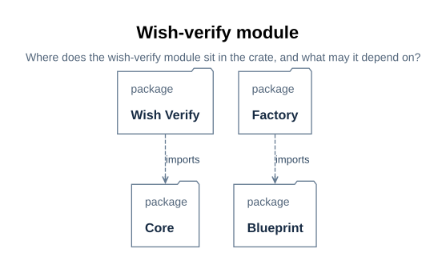
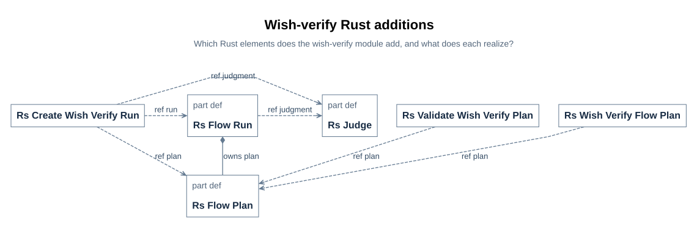

# xdesign crate wish-verify Rust UML design

> Module: the `xdesign::wish_verify` layer of the `xdesign` crate | Version: v0.1 |
> Status: implemented two-stage slice on the unchanged `xdesign::core` engine;
> executable behavior cases are executed and recorded in the implementation plan
> ([P28](../../prj_manage/09_wish_verify_flow_implementation_plan.md#p28)); model views
> remain design projections.
> Audience: module implementers, integrators, verifiers, and reviewers.
> Relation: [module design](04_module_design.md#d65) | requirements
> [R01](../../requirements/01_baseline.md#r01) (`rustUmlDesignMapsEveryDesignElement`,
> `umlViewsAreSelectedWithReasons`, `softwareDesignClaimsNoImplementation`) | view
> applicability and figure rules [U09](../05_documentation_contract.md#u09). Model
> source: `mbse/model/uml.sysml` (package `XDesignRustUml`).

## Revision history

| Version | Date | Author | Change summary | Reviewed by |
| --- | --- | --- | --- | --- |
| v0.1 | 2026-10-20 | kimi-agent | First draft: wishVerify layer layout, types, realization mapping, view applicability | Executed verification recorded in [P28](../../prj_manage/09_wish_verify_flow_implementation_plan.md#p28); plan review remains with the requester ([P25](../../prj_manage/09_wish_verify_flow_implementation_plan.md#p25)) |

## D75 Purpose, scope and reading order

This document is the UML software design of the designed wish-verify flow
([D57](01_run_design.md#d57)) realized by the `xdesign` crate — a new
`xdesign::wish_verify` layer built on the unchanged generic `xdesign::core` run engine.
The SysML detailed design fixes what a run is made of; this design decides what a Rust
program declares to realize it and records which SysML design element each Rust element
realizes. The design model is `XDesignRustUml` in `mbse/model/uml.sysml`: the
`crate::wishVerify` package, the three flow-level functions `RsWishVerifyFlowPlan`,
`RsValidateWishVerifyPlan`, and `RsCreateWishVerifyRun`, and the realization
dependencies from shared core elements to the wish-verify design elements. Its views
are SysML projections rendered by the pinned toolchain, under the figure rules of the
documentation contract ([U10](../05_documentation_contract.md#u10)).

Plan decision 4
([P26](../../prj_manage/09_wish_verify_flow_implementation_plan.md#p26)) fixes the
scope: new Rust code is limited to the flow module — the blueprint plan as data, its
blueprint conformance, the run factory, and an unused-check stub — while the generic
run, record, gate, and judge elements of `core` realize the corresponding
WishVerifyFlow design elements through added realization dependencies instead of
parallel Rust types. Async runtimes, durable multi-user persistence, generic controller
integration, and the default V-model remain outside this module's scope.

Reading order: [crate layers](#d76) -> [types and realization](#d77) ->
[interactions and states](#d78) -> [errors and performance](#d79) ->
[view applicability](#d80). The class-and-function level — every public API with its
full Rust signature, contracts and stepwise logic — lives in the
[wish-verify API pages](../../api/wish_verify_flow/00_overview.md#u73) of the
[xdesign API reference](../../api/00_overview.md#u14).

## D76 Crate layers and the wishVerify module

The `xdesign` crate splits into layers, and dependencies point one way:
`simple_flow` and `wish_verify` may use `core`, never the reverse, and the flow layers
do not use each other. `wish_verify` owns the designed two-stage flow in two source
modules: `blueprint` holds the designed plan as data with its blueprint conformance,
and `factory` constructs the designed run through the generic constructor with the
unused-check stub and the caller's judge. The module declares no checker adapter: both
gates are semantic, so there is no process adapter like `simple_flow::check`; the
never-invoked check stub lives in the factory. The model declares this layout under
`XDesignRustUml::crate::wishVerify`; the figure projects it.

> **Figure D76-1 — wishVerify module layout.**
> **Question:** Where does the wish-verify module sit in the crate, and what may it depend on?
> **Model view:** `XDesignRustUml::wishVerifyRustModules` (GeneralView projection of `crate::wishVerify` and `crate::core`).
> **Companions:** [crate layers U68](../../api/01_struct.md#u68), [module design D65](04_module_design.md#d65).
> **Status:** renderable-now; the wishVerify source modules are implemented.
> **Reading:** The wishVerify package sits beside simpleFlow over the shared core; the leaf boxes are its Rust source modules and the arrows are the allowed `use` dependencies. Dependencies point from wishVerify into core, and core depends on no flow layer.
> **Limits:** Shows the designed module layout, not the future generic controller, external crates, or deployment.

| Module | Responsibility | Depends on |
| --- | --- | --- |
| `wish_verify::blueprint` | The designed two-stage plan as data; blueprint conformance | `core::plan`, `core::status` |
| `wish_verify::factory` | Designed-run construction `create_wish_verify_run`, with the `RsUnusedCheck` stub | `wish_verify::blueprint`, `core::run`, `core::plan`, `core::ports`, `core::status` |

The model records these directions as dependencies: `wishVerifyUsesCore` from
`crate::wishVerify` to `crate::core`, `wishVerifyBlueprintUsesCorePlan` and
`wishVerifyBlueprintUsesCoreStatus` from the blueprint package, and
`wishVerifyFactoryUsesBlueprint`, `wishVerifyFactoryUsesCoreRun`,
`wishVerifyFactoryUsesCorePlan`, `wishVerifyFactoryUsesCorePorts`, and
`wishVerifyFactoryUsesCoreStatus` from the factory package. The crate-level layer map
is [U68](../../api/01_struct.md#u68). Each Rust model element's `DocSection` points to
its specific [API page](../../api/wish_verify_flow/00_overview.md#u73); the views and
package retain their module-level sections here.

## D77 Types and the realization mapping

The flow layer adds exactly three functions and one stub; everything else the run needs
is reused from `core`. The realization dependencies in `mbse/model/uml.sysml` record
both directions of the mapping: the flow module's own functions realize the flow's
blueprint, conformance, and factory, while the shared core elements realize the run,
checkpoint, evaluation, advance, reopen, authorization, and lifecycle elements — one
Rust element realizes both designed flows' elements where the design is shared.

> **Figure D77-1 — wishVerify Rust additions.**
> **Question:** Which Rust elements does the wish-verify module add, and what does each realize?
> **Model view:** `XDesignRustUml::wishVerifyRustTypes` (GeneralView projection of the three functions and the core types they build on).
> **Companions:** [module layout](#d76), [block definition D66](04_module_design.md#d66), [SimpleFlow Rust types D46](../simple_flow/06_rust_uml_design.md#d46).
> **Status:** renderable-now; the three functions and the stub are implemented.
> **Reading:** The three cards at the flow level are the module's functions; the core cards are the shared types they build on. Realization dependencies run from the Rust elements back to the wish-verify design elements.
> **Limits:** The figure shows the mapping, not per-function contracts; those live in the API pages.

| Design element | Realizing Rust element | Realization dependency in the model |
| --- | --- | --- |
| `DesignedWishVerifyFlow` (as plan data) | `wish_verify_flow_plan` ([U74](../../api/wish_verify_flow/01_wish_verify_flow_plan.md#u74)) | `rsWishVerifyFlowPlanProjects` from `RsWishVerifyFlowPlan` |
| `DesignedWishVerifyFlow` (blueprint conformance) | `validate_wish_verify_plan` ([U75](../../api/wish_verify_flow/02_validate_wish_verify_plan.md#u75)) | `rsValidateWishVerifyPlanConformance` from `RsValidateWishVerifyPlan` |
| `WishVerifyFlowRunFactory` | `create_wish_verify_run` ([U76](../../api/wish_verify_flow/03_create_wish_verify_run.md#u76)) | `rsCreateWishVerifyRunRealizes` from `RsCreateWishVerifyRun` |
| `WishVerifyFlowRun` | `RsFlowRun` ([U17](../../api/core/40_flow_run.md#u17)) — a run whose plan is the frozen `designedWishVerifyFlow` blueprint plays the `WishVerifyFlowRun` role | `rsFlowRunRealizesWishVerifyRun` |
| `WishVerifyCheckpoint`, `WishVerifySemanticCheckpoint` | `RsCheckpointSpec` ([U34](../../api/core/14_checkpoint_spec.md#u34)) — a semantic spec names judge flags and no checker | `rsCheckpointSpecRealizesWishVerify`, `rsCheckpointSpecRealizesWishVerifySemantic` |
| `EvaluateWishVerifyCheckpoint`, `TakeWishVerifyJudgment` | `evaluate_checkpoint` ([U20](../../api/core/39_evaluate_checkpoint.md#u20)) — the semantic path | `rsEvaluateCheckpointRealizesWishVerify`, `rsEvaluateCheckpointTakesWishVerifyJudgment` |
| `EvaluateWishVerifyGate` | `RsFlowRun::evaluate_gates` ([U18](../../api/core/41_evaluate_gates.md#u18)) | `rsEvaluateGatesRealizesWishVerify` |
| `AdvanceWishVerifyRun` | `RsFlowRun::advance` ([U19](../../api/core/42_advance.md#u19)) | `rsAdvanceRealizesWishVerify` |
| `ReopenWishVerifyStage` | `RsFlowRun::reopen_stage` ([U49](../../api/core/44_reopen_stage.md#u49)) | `rsReopenStageRealizesWishVerify` |
| `WishVerifyAuthorization` | `RsStageVisit::completion_authorized` ([U30](../../api/core/20_completion_authorized.md#u30)) | `rsCompletionAuthorizedRealizesWishVerify` |
| `WishVerifyRunLifecycle` | `RsRunLifecycle` state design ([D48](../simple_flow/06_rust_uml_design.md#d48)) | `rsRunLifecycleMirrorsWishVerify` |
| — none | `RsUnusedCheck` ([U77](../../api/wish_verify_flow/04_unused_check.md#u77)) | Rust-side addition with no matching UML class |

`rustUmlDesignMapsEveryDesignElement` makes this mapping the coverage obligation the
design review reads; `RsUnusedCheck` is the one element with no model counterpart, and
its page states why it exists anyway ([U77](../../api/wish_verify_flow/04_unused_check.md#u77)).

## D78 Interactions and states: reuse, not redesign

This module designs no new interaction and no new state machine. One gate evaluation
of a wish-verify run *is* the core gate interaction's semantic path: the run asks the
current visit's checkpoint spec to evaluate; the spec presents its criteria and the
visit's artifact and evidence URIs through the `RsJudge` trait; the returned verdict
and rationale are appended as the assessment. That interaction, its lifelines, and its
limits are specified once in the core design
([D47](../simple_flow/06_rust_uml_design.md#d47)) and are unchanged here — a
wish-verify run simply never takes the syntactic branch.

The same holds for states: the run's state handling mirrors
`WishVerifyRunLifecycle` ([D68](04_module_design.md#d68)) with `RsFlowStatus` as the
state variable, exactly the lifecycle the core engine maintains
([D48](../simple_flow/06_rust_uml_design.md#d48)) — activation at creation, blocking on
an unauthorized gate, resumption of the same visit by corrective work, completion at
the authorized terminal visit, revalidation of retained evidence, and explicit terminal
reopening. The model records this as `rsRunLifecycleMirrorsWishVerify`; drawing a
second, identical state machine would only add a document to keep in sync.

## D79 Errors, logging and performance

- Error taxonomy, designed at the type level: a failed criterion is data (a recorded
  `failed` assessment with its rationale), not an exception; a judge's refusal is an
  `unevaluated` outcome, never a fabricated pass; a plan that differs from the
  blueprint — including one carrying a syntactic gate — is a conformance error the
  factory rejects before any run exists
  ([U75](../../api/wish_verify_flow/02_validate_wish_verify_plan.md#u75)). The
  `RsUnusedCheck` stub converts any accidental check invocation into a command-failed
  error ([U77](../../api/wish_verify_flow/04_unused_check.md#u77)).
- Retry, degradation and recovery: none designed. A blocked run resumes through
  corrective work and a new judgment at the new revision ([D78](#d78)); the design adds
  no automatic retry of judgments.
- Logging: the local JSON run record retains activities and assessments; no fixed
  commands run, so there are no command logs of this flow's own. No separate telemetry
  or durable product evidence store is implemented.
- Performance: no budget is set. Gate evaluation is linear in the stage's exit
  checkpoints — one per stage in this flow — and authorization counting is linear in a
  visit's assessments. No measurement exists, and none is claimed.

## D80 View applicability and design limits

Applicability follows the documentation contract's selection rule
([U09](../05_documentation_contract.md#u09)): each view of this software design is
required, recommended, or not applicable with a reason, stated over the SysML
projection vocabulary this repository renders.

| SysML view projection | Applicability | Figure / status |
| --- | --- | --- |
| package | required — the wishVerify layer's place in the crate and its allowed dependency directions are this slice's central decision | [Figure D76-1](#d76), renderable-now; crate-level layer map in [U68](../../api/01_struct.md#u68) |
| block definition | required — the module's three functions and the realization mapping are the design's core | [Figure D77-1](#d77), renderable-now |
| internal block | not applicable — the module wires no ports of its own; the judgment-only wiring is the module design's [D67](04_module_design.md#d67) | companion, not redrawn |
| activity | not applicable — the judged evaluation path is the flow's [D63](02_gates_and_judgment.md#d63); the Rust side adds no branch | companion, not redrawn |
| sequence | not applicable — the gate interaction is reused unchanged from core ([D78](#d78)); a redraw would duplicate [D47](../simple_flow/06_rust_uml_design.md#d47) | companion |
| state machine | not applicable — run states are reused unchanged from core ([D78](#d78)); the flow-level lifecycle view is [D68](04_module_design.md#d68) | companion |
| use case | not applicable — actor goals are the automation's, already in [D71](04_module_design.md#d71) | companion |
| requirements | not applicable — this design's requirement coverage is traced in the module design's [D69](04_module_design.md#d69) and the plan's cases, not drawn | — |
| parametric | not applicable — authorization arithmetic stays in the module design's [D70](04_module_design.md#d70) view | companion |

Design limits, stated once for the whole document: `xdesign::wish_verify` implements
the gated two-stage slice on the unchanged `xdesign::core` engine and writes local JSON
evidence through it, while `XDesignVerification::WishVerifyFlowBehaviorVerification`
remains a declared case, not an executed result — [P28](../../prj_manage/09_wish_verify_flow_implementation_plan.md#p28)
records what has actually run. The module has no checker adapter, no async workflow, no
generic controller integration, and no durable multi-user persistence. A CDR for this
module would still need the evidence package the checklist lists
([V08](../../review/02_checklist.md#v08)).
