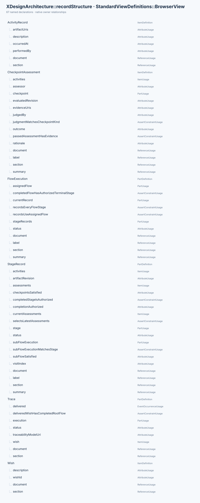

# Record format

## 1. The record vocabulary

> **Figure E01-1 — Record vocabulary.**  
> **Question:** Which types hold a wish's execution history and evidence?  
> **Model view:** `XDesignArchitecture::recordStructure`, a browser view of the record definitions.  
> **Companions:** [E03](../design/evidence-and-revisions.md#e03) for revision rules and [F01](../design/flow.md#f01) for flow definitions.  
> **Status:** renderable-now.  
> **Reading:** The structure separates a wish and its trace from the flow, stage, activity, and assessment records. Each definition in the figure has its role summarized in the table below.  
> **Limits:** The figure shows record types, not the history or validity of any one wish.

| Definition | Role |
| --- | --- |
| `Wish` | The requested outcome: `wishId`, `description`. Carries no work history |
| `Trace` | One wish's state: `wish`, `status`, `traceabilityModelUri`, and its root `execution`. Declares the `delivered` event |
| `FlowExecution` | The execution history of one flow — the wish's root flow, or a subflow inside a stage visit: `assignedFlow`, `status`, `stageRecords [1..*]`, `currentRecord` |
| `StageRecord` | One planned or actual visit to one stage: `visitIndex`, `status`, `artifactRevision`, `subFlowExecution`, `activities`, `assessments` |
| `ActivityRecord` | One piece of work: `description`, `performedBy`, `occurredAt` (ISO 8601), `artifactUris` |
| `CheckpointAssessment` | One preserved evaluation of one checkpoint for one revision: `outcome`, `judgedBy`, `assessor`, `rationale`, `evidenceUris` |

`Trace` and its records are the working record of one wish. Definitions stay in
`mbse/model/`; a wish file declares only usages of them
([A02](../architecture/index.md#a02)).
`FlowStatus` has the literals `pending`, `active`, `blocked`, and `completed` for
the execution as a whole. It is separate from the wish's `WishStatus` and each visit's
`StageStatus`.
