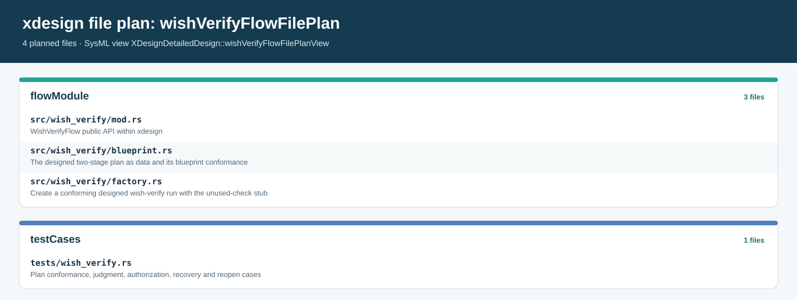

# WishVerifyFlow implementation plan

> Status: executed — model, documents, crate module, demo and tests are in
> place and the results are recorded in [P28](#p28). Scope: one executable run of the
> designed two-stage `designedWishVerifyFlow` — both gates semantic, judged by a
> permitted agent or human — modeled in SysML, documented, and realized by a new
> `xdesign::wish_verify` module on the unchanged `xdesign::core` engine.
> This plan follows the model → documentation → realization order strictly; no
> code is written before its design and documentation sections exist.

## P25 Task and acceptance goal

Implement the architecture's `WishVerifyFlow` (wish → verify, terminal semantic
`outcomeAccepted`) as an executable designed flow, reusing the SimpleFlow
machinery: the generic `xdesign::core` run engine plus a flow module of the
same shape as `xdesign::simple_flow`. A caller must be able to construct a
validated two-stage plan, record work, have both stage exits judged by a
permitted agent or human at the current artifact revision, inspect the retained
assessments, and advance only while the latest verdict of every required exit
gate passed at the current artifact revision and snapshot.

Acceptance requires a runnable library and command entry point, one successful
two-stage example with both semantic gates judged, counterexamples for
unpermitted judges, missing evidence, stale revisions, blocked correction and
reopen semantics, and a machine-readable record whose plan and evidence
identities can be re-examined. Model, documentation and code are reconciled:
every design element carries its documentation section, every declared figure
renders and is embedded, and every new Rust element maps back to the design it
realizes. A declared SysML verification case is a plan until a test has run and
its result is recorded in [P28](#p28).

## P26 Basis and decisions before code

The basis is the [SimpleFlow implementation plan](02_simple_flow_implementation_plan.md#p03),
its [execution record](03_simple_flow_execution_record.md#p08), the
[restructure reconciliation](08_api_layering_restructure_plan.md#p20) — which
records that no second flow yet proves the core layer's generality — and the
modeled `WishVerifyFlow` in `mbse/model/architecture.sysml`. The root
`AGENTS.md`, `docs/AGENTS.md`, and `mbse/AGENTS.md` control layout, language,
source/model separation, and cache placement.

Use these decisions consistently:

1. Strict model → documentation → realization order. The SysML design comes
   first and passes the pinned compiler's parse and check; documentation
   sections and figures follow and pass the documentation audit; only then is
   the Rust module implemented against them. The plan's own status sections are
   reconciled last, with the executed verification recorded.
2. Gate design follows the architecture, not invention. `WishVerifyFlow`
   declares one terminal semantic gate and states that nothing in its outcome
   is established by a fixed check. The designed variant adds exactly one exit
   gate, `wishAccepted`, on the wish stage — every stage of a designed flow
   declares its exit gate, and the engine authorizes nothing for an ungated
   stage. Both gates are semantic: no syntactic checkpoint, no checker, and no
   new command under `tools/checks/` is introduced.
3. The `xdesign::core` engine is reused unchanged. Plan freezing, activity
   recording, gate evaluation, advance and reopen are already generic; this
   slice proves that generality. The engine's check-command port is carried but
   never invoked by an all-semantic plan; the flow module supplies an explicit
   unused-check stub so that boundary is honest rather than absent.
4. New Rust code is limited to the flow module: the blueprint plan as data, its
   blueprint-conformance validation, the run factory, and the stub. The generic
   run, record, gate and judge elements of `core` realize the corresponding
   WishVerifyFlow design elements through added realization dependencies in
   `mbse/model/uml.sysml`, instead of parallel Rust types.
5. The plan identity is `designedWishVerifyFlow`; the module is
   `src/wish_verify/`; the command is `xdesign wish-verify demo`. Plans,
   records, reports and logs stay under `cache/`.
6. The selectable usage is `xdesign.designedWishVerifyFlow` in
   `mbse/model/composition.sysml`. The historical `xdesign.wishVerifyFlow`
   usage and the wish-0005 and wish-0009 records on it are untouched.
7. Shared design elements are reused rather than duplicated:
   `JudgmentExchange`, `JudgmentInterface` and `Judge` for the judgment port,
   `GateAuthorization` for the parametric binding, `SimpleFlowFileEntry` for
   file-plan entries, and `DocumentationViewpoint` for viewpoint usages. The
   run carries a judgment port only; a check port would name a boundary this
   flow never uses.
8. The designed flow declares the nine coordinated views required of a designed
   flow; every figure lives under `docs/details/wish_verify_flow/assets/` and is
   embedded in the section that answers its question, with the activity view
   carried by the gates document.
9. This slice is recorded like the SimpleFlow slice: plan and executed results
   in this directory, not as a new wish model. Generic controller integration,
   durable persistence and V-model gate commands remain outside the boundary.

## P27 Implementation sequence and file ownership

| Step | Work product | Completion check |
| --- | --- | --- |
| 1. Model the design | `DesignedWishVerifyFlow`, its checkpoint class and semantic adaptation, run, factory, gate/advance/reopen actions, judgment-only automation, timeline, lifecycle, parametric binding, use cases, file plan, and nine views with viewpoints in `mbse/model/detailedDesign.sysml`; the `xdesign.designedWishVerifyFlow` usage in `mbse/model/composition.sysml`; planned cases in `mbse/model/verification.sysml`; the `crate::wishVerify` package and realization dependencies in `mbse/model/uml.sysml`. Requirement coverage is recorded by the planned verification case and the design documents: `mbse/model/traceability.sysml` keeps one satisfier per requirement because the export cannot attribute two satisfy usages of one requirement (its documented open limitation). | Pinned compiler parse/check passes on `mbse/model` alone and with `mbse/wishes`; reports retained under `cache/sysml/`. |
| 2. Register and render figures | New `FIGURES` entries in `tools/render_docs.py`; the flow-family layout in `tools/sysml_web/flow_relationships.py` admits the new definition. | `python3 tools/render_docs.py` renders every figure, old and new; logs under `cache/docs-render/`. |
| 3. Write the flow's design documents | `docs/details/wish_verify_flow/` — overview, run design, gates and judgment, view coverage index, module design, Rust UML design — with every figure embedded once beside its question. | `python3 tools/check_documentation.py --json` passes; strict site build passes. |
| 4. Extend the API reference | `docs/api/wish_verify_flow/` overview and one page per new API; inventory, routing, boundary and crate-structure updates in `docs/api/`; navigation. | Inventory completeness holds: every API exactly once; designed-only status is stated honestly. |
| 5. Implement the flow module | `src/lib.rs`, `src/wish_verify/{mod,blueprint,factory}.rs`, `src/main.rs` `wish-verify demo`. | `cargo test` passes with build and target dirs under `cache/`; the demo retains a re-readable record under `cache/`. |
| 6. Add behavior and sync tests | `tests/wish_verify.rs`; a wish-verify file-plan case in `tests/plan_model_sync.rs`. | Cases WV-01–WV-10 of [P28](#p28) run and their results are recorded. |
| 7. Reconcile delivery records | Executed results and limits recorded in [P28](#p28); status rows in the documentation entry, flows document and reviews updated; root `AGENTS.md` active-plan pointer updated. | Every stated check names its retained log; nothing is claimed from a declaration alone. |

New files owned by this slice: the `docs/details/wish_verify_flow/` and
`docs/api/wish_verify_flow/` directories, `src/wish_verify/`,
`tests/wish_verify.rs`, and this plan. Shared files extended, not reinvented:
`mbse/model/detailedDesign.sysml`, `uml.sysml`, `composition.sysml`,
`traceability.sysml`, `verification.sysml`, `tools/render_docs.py`,
`tools/sysml_web/flow_relationships.py`, `src/lib.rs`, `src/main.rs`,
`tests/plan_model_sync.rs`, `docs/00_index.md`, `docs/details/00_overview.md`,
`docs/details/01_flows_and_checkpoints.md`, `docs/api/00_overview.md`,
`docs/api/01_struct.md`, `docs/prj_manage/00_overview.md`, `mkdocs.yml`, and
the root `AGENTS.md`.

> **Figure P27-1 — Wish-verify file plan.**
> **Question:** Which repository files realize the wish-verify flow module and its executable verification?
> **Model view:** `XDesignDetailedDesign::wishVerifyFlowFilePlanView`, a browser view of the `wishVerifyFlowFilePlan` item.
> **Companions:** [D76](../details/wish_verify_flow/05_rust_uml_design.md#d76) for module dependencies and [P28](#p28) for the verification cases.
> **Status:** renderable-now; model-declared file plan, with source and executable results checked separately.
> **Reading:** The flow-module group holds the three source files under `src/wish_verify/`; the test group holds `tests/wish_verify.rs`. Shared files this slice extends keep their SimpleFlow file-plan entries.
> **Limits:** A planned path does not prove that a file exists, compiles, or fulfills its contract.

## P28 Verification and record of completion

The planned cases below bind inputs to expected outcomes; the modeled
counterparts are `WishVerifyFlowBehaviorVerification` and
`WishVerifyFlowFilePlanVerification` in `mbse/model/verification.sysml`.
Execution results are recorded here only after the commands have run with their
logs retained under `cache/`.

| Case | Input | Expected result |
| --- | --- | --- |
| WV-01 | A plan differing from the two-stage blueprint — wrong stage, absent, duplicate or foreign gate | Construction rejects it; no run exists. |
| WV-02 | Happy path: work recorded at both stages, both semantic gates passed by a permitted judge with retained evidence | Run advances wish → verify and completes; the JSON record is re-readable with plan identity, both assessments, revisions and digests. |
| WV-03 | A judge whose authority is script, or not permitted by the gate's flags, or an empty identity or rationale | The assessment is refused or recorded unevaluated; never a pass. |
| WV-04 | A semantic pass attempted with no recorded artifacts or with missing evidence files | Evaluation fails as missing evidence; the visit stays blocked. |
| WV-05 | A pass at revision N, then a content change at the same URI, then re-judgment failed or unevaluated | The change increments the revision and stale the earlier pass; the latest assessment governs; advance remains blocked. |
| WV-06 | Reopen the terminal stage of a completed run; reopen an active or nonterminal stage | A new visit at index 1 and revision 0 is appended with history retained; the invalid reopens are rejected. |
| WV-07 | Frozen plan bytes changed after freezing | Gate evaluation and advance reject the drift; nothing passes silently. |
| WV-08 | `xdesign wish-verify demo` end to end | A completed two-stage run with plan, record and judgment rationale retained under `cache/`. |
| WV-09 | Model sync: `wishVerifyFlowFilePlan` paths against the repository and back | Every planned file exists with its responsibility; no in-scope file is unplanned. |
| WV-10 | Documentation and model gates: compiler parse/check, documentation audit, figure regeneration, strict site build, full test suite | All pass with logs and unevaluated-constraint counts retained under `cache/`. |

Executed results (2026-10-20, this branch; all commands run from the repository
root with build, temporary and output directories under `cache/`):

| Case | Executed command and evidence | Observed result |
| --- | --- | --- |
| WV-01–WV-07 | `cargo test --test wish_verify` within `cargo test --no-fail-fast`; log `cache/implementation/cargo-test-final.log` | 8 of 8 wish-verify tests pass: plan conformance (wrong stage, absent, duplicate or foreign gate, syntactic gate, wrong plan id all rejected), happy-path completion with a re-readable record, judge authority refusals, missing evidence blocked, stale-revision latest-wins, reopen semantics, frozen-plan drift rejection. `RsUnusedCheck` errors on any direct call, and the passing happy path proves it is never invoked. |
| WV-08 | `cargo run -- wish-verify demo --wish-model … --plan … --record … --verify-evidence … --judge-authority human --judge-outcome passed …`; log `cache/implementation/wish-verify-demo.log` | Run `ffa51c30-d7ef-4610-a790-daf16f1d4256` completed: wish gate `passed` at revision 1 → `EnterNextStage`, verify gate `passed` at revision 1 → `CompleteRun`. Plan, record and rationale retained at `cache/implementation/wish-verify-demo/` (`plan.json`, `run.json`); a negative run with `--judge-outcome failed` exited 1 with `RemainBlocked` and a retained blocked record (`run-blocked.json`). |
| WV-09 | `cargo test --test plan_model_sync`; same log | 4 of 4 pass, including `wish_verify_file_plan_covers_the_flow_module_inventory` (planned paths equal the `src/wish_verify/*.rs` + `tests/wish_verify.rs` inventory) and `wish_verify_gate_criteria_match_the_sysml_design`. |
| WV-10 | Model: pinned compiler `parse`/`check` — `cache/sysml/parse.json`, `cache/sysml/check.json`. Docs: `python3 tools/check_documentation.py --json` — `cache/implementation/doc-audit-final.json`. Figures: `python3 tools/render_docs.py` — `cache/implementation/render-final.log`; `python3 tools/verify_diagrams.py --node-modules cache/diagram-tooling/node/node_modules` — `cache/implementation/verify-diagrams-final.log` and `cache/docs-render/review/figure-manifest.json`. Site: `python3 tools/docs.py build` — `cache/implementation/site-build-final.log`. Suites: cargo log above; `python3 -m unittest discover -s tests -p "test_simple_flow_*.py"` — `cache/implementation/python-tests-final.log`; `python3 -m unittest discover -s tools/sysml_web/tests -p "test_*.py"` — `cache/implementation/sysml-web-tests-final.log`. | Compiler: exit 0, 0 parse errors, 0 unresolved references, 0 collisions, 0 violations; rules 129 held, 26 unevaluated (constraint bodies the compiler does not evaluate, as before). Documentation audit: all six rules pass, 0 failures. All 53 figures render; the nine primary figures pass presentation review. Strict site build exits 0. Cargo: 31 tests pass (1 main, 4 plan-model sync, 4 process-check contract, 14 simple-flow, 8 wish-verify). Python checker/layout tests: 22 pass. |

Two pre-existing failures in `tools/sysml_web/tests/test_documentation_views.py`
are **not** caused by this slice: `test_requirements_verify_original_obligations`
(5 edges against a pinned 6) and
`test_state_guards_remain_in_native_tooltips_with_short_visible_captions` (9
against a pinned 6) fail identically with every branch change stashed (clean
`main`). Their pinned counts predate the current model and renderer; repairing
them belongs to the diagram-presentation owners, not to this plan.

Two findings worth recording from execution:

1. The documented export limitation is real: adding second `satisfy` usages for
   `designedFlowGatesEveryStage`, `flowRunIsRealizedByDesign` and
   `runRealizesItsDesign` removed the existing edges from the SimpleFlow
   requirements figure's export. The links were reverted; this flow's coverage
   is recorded by `WishVerifyFlowBehaviorVerification` and
   [D69](../details/wish_verify_flow/04_module_design.md#d69) instead, and the
   limitation is now stated in `mbse/model/traceability.sysml`.
2. This slice retires the restructure plan's remaining limit that no second
   flow proved the core layer's generality
   ([P23](08_api_layering_restructure_plan.md#p23)): `xdesign::wish_verify`
   exercises `xdesign::core` unchanged. No new `RsCheckCommand` adapter was
   needed because this flow declares no syntactic gate; the boundary is carried
   by the engine and documented by the `RsUnusedCheck` stub
   ([U77](../api/wish_verify_flow/04_unused_check.md#u77)).

Completion boundary: this plan establishes the executed gated two-stage
wish-verify slice — model, documentation, crate module, demo and tests — on top
of the existing SimpleFlow slice. It does not establish the default V-model,
generic controller integration, durable multi-user persistence, project-level
baseline approvals, or engineering verification of a user's developed system.

## P29 Risks and recovery

| Risk | Control or recovery |
| --- | --- |
| A semantic-only flow drifts into a hidden fixed check | The two gates and their criteria are modeled exactly; a syntactic gate would contradict the architecture's stated intent and is out of scope by decision 2. |
| The generic engine carries an unused check boundary | The flow module's stub returns an error if ever invoked, and the plan carries no syntactic checkpoint that could invoke it; tests assert it is never called. |
| Figure family layouts hardcode the flow set | `flow_relationships.py` fails rendering when the family changes by design; update its layout in step 2 and re-render rather than bypassing. |
| Model/compiler accepts an unevaluated invariant | Executable cases WV-01–WV-08 carry authorization and lifecycle behavior; report unevaluated constraint counts with the compiler logs. |
| Evidence absent after a run | The record names evidence URIs and digests; a missing file fails evaluation and is reported, never replaced by an inferred pass. |

Source changes are reversible through Git commits. The historical wish-0005 and
wish-0009 records on `xdesign.wishVerifyFlow` keep their exact flow reference;
the new designed usage is a separate portfolio member.
