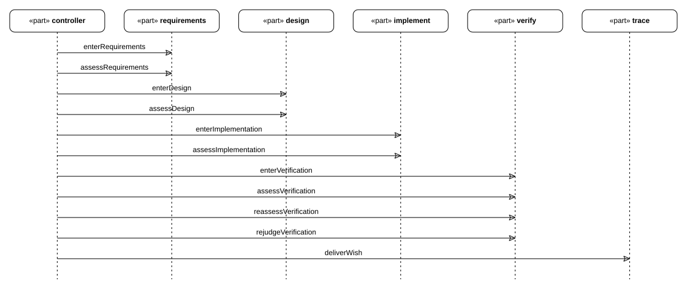

# Wish journeys

## Journeys

> **Figure E06-1 — wish-0002 rework journey.**  
> **Question:** How were repeated verification assessments ordered for this wish?  
> **Model view:** Sequence projection of `Wish0002::Wish0002Journey`.  
> **Companions:** [E03](../../design/evidence-and-revisions.md#e03) for artifact revisions and [V02](../wishes/wish-history.md#v02) for the wish status.  
> **Status:** renderable-now; historical record.  
> **Reading:** The same verification stage is assessed three times as its evidence changes. The messages retain the order of stage entry, assessment, and delivery events.  
> **Limits:** This is one wish's recorded journey, not the behavior of every selectable flow.

A wish's journey is its own interaction: `ref part` lifelines bound to the real
participants (`workflow.controller`, the flow's stages, the wish's `Trace`), and `message`
usages anchored on their event occurrences — `entering`/`entered` around a stage,
`assessing`/`assessed` around a checkpoint, `delivering`/`delivered` for the wish. The
figure above is wish-0002's, so the repeated `assessVerification` is the revision history
of [E03](../../design/evidence-and-revisions.md#e03): three assessments of one verification stage, in order.
