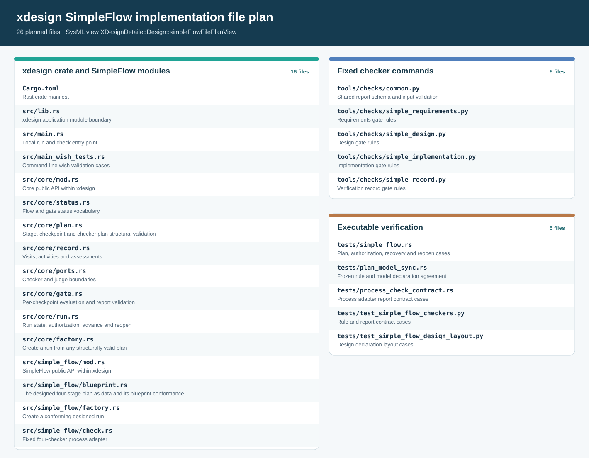

# SimpleFlow implementation file plan and verification cases

> Scope: first executable `designedSimpleFlow` slice | Status: implemented source
> layout and verification design. The D53–D55 section identifiers remain stable after
> relocation from detailed design. A declared case is not an executed result;
> [P08](../executions/simple-flow.md#p08) records actual runs.

This project-management record connects the project requirements and [run design](../../design/flows/simple-flow/definition.md#d01) to
the Rust [module/API design](../../design/flows/simple-flow/implementation.md#d44), the [fixed gate rules](../../design/flows/simple-flow/definition.md#d06),
the [record contract](../../design/evidence-and-revisions.md#e03), and the
[draft checker and judge interfaces](../../interfaces/contracts.md#i04). The executable
slice is the four-stage designed usage; the eleven-stage V-model has a separate default
flow and command set ([A10](../../index.md#a10)).

## Repository file plan

> **Figure D53-1 — SimpleFlow file plan.**  
> **Question:** Which repository files carry the run, its fixed checks, and its verification?  
> **Model view:** Focused file-plan projection of `XDesignDetailedDesign::simpleFlowFilePlanView`, exposing the native `simpleFlowFilePlan` item and its `repositoryPath` and `responsibility` values.  
> **Companions:** [D45](../../design/flows/simple-flow/implementation.md#d45) for module dependencies, [D06](../../design/flows/simple-flow/definition.md#d06) for the four checker rule sets, and [D54](../../verification/design.md#d54) for verification.  
> **Status:** renderable-now; model-declared file plan, with source and executable results checked separately.  
> **Reading:** Application sources, fixed checker commands, and tests are separate groups. The `repositoryPath` values below give exact filenames; labels in the figure stay short.  
> **Limits:** A planned path does not prove that a file exists, compiles, or fulfills its contract.

| Group | Repository files | Responsibility |
| --- | --- | --- |
| xdesign entry | `Cargo.toml`, `src/lib.rs`, `src/main.rs`, `src/main_wish_tests.rs` | Build and expose the application library; provide a local command entry point and its wish-validation cases. |
| Core module | `src/core/mod.rs`, `src/core/status.rs`, `src/core/plan.rs`, `src/core/record.rs`, `src/core/ports.rs`, `src/core/gate.rs`, `src/core/run.rs`, `src/core/factory.rs` | Implement the flow-agnostic layer selected by the Rust UML design: vocabulary, plan data and structural validation, records, ports, gate evaluation, the run engine, and generic run construction. |
| SimpleFlow module | `src/simple_flow/mod.rs`, `src/simple_flow/blueprint.rs`, `src/simple_flow/factory.rs`, `src/simple_flow/check.rs` | Implement the designed four-stage flow on the core layer: the blueprint plan data and conformance, the designed-run factory, and the fixed-checker adapter. |
| Fixed gates | `tools/checks/common.py`, `tools/checks/simple_requirements.py`, `tools/checks/simple_design.py`, `tools/checks/simple_implementation.py`, `tools/checks/simple_record.py` | Share a JSON report contract and report the 2, 7, 2, and 7 fixed rules in [D06](../../design/flows/simple-flow/definition.md#d06). |
| Executable cases | `tests/simple_flow.rs`, `tests/plan_model_sync.rs`, `tests/process_check_contract.rs`, `tests/test_simple_flow_checkers.py`, `tests/test_simple_flow_design_layout.py` | Exercise run behavior, model-plan agreement, process report validation, and checker results, including negative cases. |

The file-plan audit compares in both directions: every declared path must exist, and
every source or test file in `src/`, `tests/`, and `tools/checks/` that belongs to this
slice must have one declaration. The 26 entries above cover the current source plane.

The existing project model in `mbse/model/` defines stages, gates, records, views, and
planned verification. The existing documentation in `docs/` explains their contracts;
the compiler at `tools/sysml_web/bin/sysml`, `tools/check_documentation.py`, and
`tools/render_docs.py` check or render them. These are inputs and supporting tools for
the file plan, not replacements for its source files. Reports, previews, dependency
caches, and local development environments belong under ignored `cache/` as the root
`AGENTS.md` requires. Durable product evidence needs a separate retention design
([E04](../../design/evidence-and-revisions.md#e04)); a cache path by itself is not one.

## Evidence and limits

Retain each executed case's inputs, output report, source revision, and verdict under
`cache/` while developing. A final delivery needs evidence locations that survive the
cache lifecycle. The bundled compiler checks syntax, name resolution, and its supported
model rules; it does not evaluate the 26 currently unevaluated constraint bodies or run
these cases ([T04](../../architecture/constraints.md#t04)). The fixed gates check declared structure,
record integrity, and artifact presence. Engineering adequacy remains a semantic
judgment at the applicable checkpoint, supported by retained evidence.
