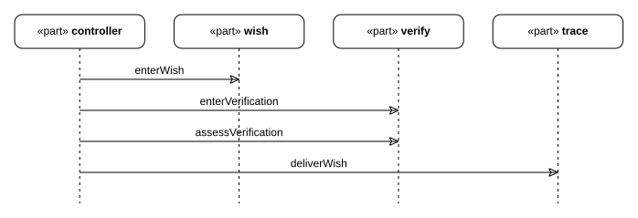
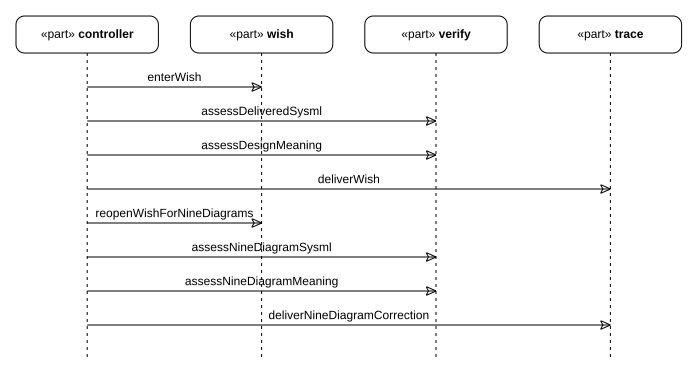
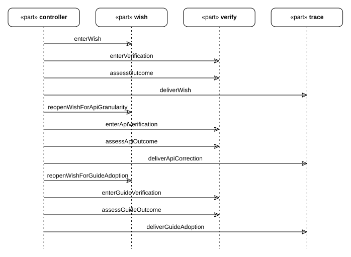

# Review and wish status

How verification is done in this project, where each wish stands, and what is still open.
This is a reading of the records under `mbse/wishes/`, not a separate source of truth: the
assessment it summarises lives in each wish's own file.

## How verification works here

Verification is a checkpoint assessment recorded in the wish's trace
([E04](../../design/evidence-and-revisions.md#e04)). Two kinds exist
([F02](../../design/adapters.md#f02)):

- A **syntactic** checkpoint is judged by a script whose command is fixed in the flow.
  wish-0006's design-stage run is the project's first: its verification uses the pinned
  SysML compiler as the fixed check of the delivered model, and the syntactic assessment
  cites the compiler's report for the assessment's revision ([V05](#v05)). The designed
  SimpleFlow's four checks now execute in the local four-stage Rust run: their rules are
  documented in [D06](../../design/flows/simple-flow/definition.md#d06), and their
  checker commands and report contract are in
  [D07](../../design/flows/simple-flow/definition.md#d07). `VModel`'s three checkers
  declare no rules and no command exists ([R03](../status.md#r03)).
- A **semantic** checkpoint is judged by an agent or a human reading its criteria. Most
  assessments in this project are one of these, recorded with a rationale and evidence
  URIs.

Current runs retain compiler reports under `cache/sysml/`, per-wish evidence under
`cache/evidence/<wish>/`, and rendered figures under each carrying document directory's
`assets/`. A pass names the files it used and the revision it judged
([E03](../../design/evidence-and-revisions.md#e03)). Historical exceptions include
wish-0001's absent files and earlier documentation paths renamed after passed
assessments; [V04](#v04) records those limits.

## Wish status board

| Wish | Flow | Status | What its record establishes | Note |
| --- | --- | --- | --- | --- |
| wish-0001 — export the project model as a reviewable report | `xdesign.workflowFlow` | recorded delivered; evidence not presently verifiable | Verification failed at revision 3 and was recorded as passed at revision 4 after corrective work, in one visit | Every recorded evidence URI and the named artifacts (`src/report.rs`, `cache/build/report.xml`) are absent. The activity now describes four candidate checks, while the unchanged passed-assessment rationale claims four requirements without retained derivation links. The historical assessment is read as written, not accepted as current proof. |
| wish-0002 — split checkpoints into syntactic and semantic | `xdesign.workflowFlow` | delivered | Three assessments over three revisions; the export's truncation of multi-valued values was found and worked around | Its five requirements now live in `mbse/model/`; the file keeps the derivation ([R02](../../requirements/requirements.md#r02)) |
| wish-0003 — retain wish products in the project model | `xdesign.workflowFlow` | delivered | Moved wish-0002's requirements into the model and added the two boundary requirements | Verified by reading (`cache/evidence/wish-0003/invariants.txt`); no checker enforces the boundary |
| wish-0004 — make the traceability chain a tool capability | `xdesign.workflowFlow` | active, registered | Nothing attempted yet; the wish is registered with its trace at intake | Asks first whether one requirement may have two satisfiers, because the export cannot attribute them — see [V04](#v04) |
| wish-0005 — documentation from the model | `wishVerifyFlow` | delivered | Produced this documentation set and the `DocSection` references; the outcome was judged against `outcomeAccepted` | Ran without requirements or implementation stages by the requester's direction; see [V03](#v03) |
| wish-0006 — detailed design of the simple flow | `designFlow` | delivered, historical assessment | Visit 0 accepted revision 1: eight requirements, detailed design, three structure graphs, and documentation. Visit 1 accepted the semantic contents of nine diagram types at revision 2. | Those passes did not establish usable presentation at normal article size. Their records remain history; wish-0007 addresses presentation separately. See [V05](#v05). |
| wish-0007 — make the nine diagrams readable | `xdesign.workflowFlow` (`SimpleFlow`) | delivered, revision 1 | Replaced fixed-grid rendering with model-owned captions, diagram-specific projection, Graphviz layout, and a compact sequence. All nine primary figures passed source-fidelity, typography, and final-image review. | Reviewed at 900-pixel article width and in the built desktop article; final SVG, PNG, and screenshot hashes bind the evidence to the assets. See [V06](#v06). |
| wish-0008 — reorganize the documentation structure and the SysML v2 specification | `designFlow` | delivered, revision 4 | Revision 1 established the locator and viewpoint contract; revision 2 added stage topics and placed the nine primary views; revision 3 added directory overviews and contiguous topic numbering; revision 4 places figures in each document directory's own `assets/`. | Separate script and agent assessments are recorded for each revision; the revision-4 evidence and remaining stage-gate gaps are in [V07](#v07). |
| wish-0009 — Rust UML design for SimpleFlow | `wishVerifyFlow` | delivered, revision 3 (closed) | Revision 1 delivered the module-level design; revision 2 corrected granularity to an API reference (inventory plus one page per API); revision 3 adopted the API-reference structure into the project's conventions ([U47](../../design/api/index.md#u47)) | At that wish's closure the result was design only; the later Rust implementation is recorded in [P08](../executions/simple-flow.md#p08). See [V16](#v16). |
| wish-0010 — uniform stage CLI | `xdesign.designedSimpleFlow` | technical root flow completed; final human acceptance pending | Final acceptance run after implementation completed four visits at revision 1 with four fixed-check passes (2/7/2/7 rules) and one explicit agent semantic pass. The flat `init` / `next` / `check` interface resumes both supported local flows. | [Executed evidence and limits](../plans/stage-cli.md#p34); [current wish record](#v17). The model's `delivered` state denotes root completion, not human approval. |

## This wish's run

> **Figure V03-1 — wish-0005 journey.**  
> **Question:** How did the documentation wish move through its two-stage flow?  
> **Model view:** Sequence projection of `Wish0005::Wish0005Journey`.  
> **Companions:** [F03](../../design/flow.md#f03) for the flow definition and [E04](../../design/evidence-and-revisions.md#e04) for assessments.  
> **Status:** renderable-now; historical record.  
> **Reading:** The journey shows the wish-stage work and the subsequent semantic verification. The trace retains the assessment and its evidence for this wish.  
> **Limits:** This historical sequence does not describe the result of wish-0008 or certify later documentation changes.

wish-0005 was registered at intake on the default flow, then re-assigned to
`wishVerifyFlow` before any work because the requested outcome is a semantic artifact: no
requirement to derive, nothing a fixed check could establish, and verification should be a
reading of the documents ([F03](../../design/flow.md#f03)). The
wish stage produced the documents under `docs/` and the model changes they needed — the
`WishVerifyFlow` definition, the `DocSection` metadata, the record-structure view. The
verify stage judged the result against `outcomeAccepted`: every module resolves to a
section, the diagrams carry the explanation, and no statement goes beyond the model. The
assessment, its rationale and its evidence URIs are recorded in
`mbse/wishes/wish-0005.sysml`.

## Open items

| Item | Where it stands |
| --- | --- |
| `VModel`'s three checkers (`tools/checks/requirement_trace.py`, `implementation_artifacts.py`, `delivery_record.py`) do not exist and declare no rules | Their syntactic checkpoints cannot pass until the commands exist and their rules are declared ([R03](../status.md#r03)) |
| Default V-model and historical wish records lack executable checks | Four SimpleFlow checkers and their rule lists now execute for the new JSON run, but do not judge `VModel` or old SysML records ([D07](../../design/flows/simple-flow/definition.md#d07), [R03](../status.md#r03)) |
| `runRecordIsScriptChecked` has no project-wide satisfier | `simpleRecordCheck` now checks the new SimpleFlow JSON run; broader records remain outside its scope ([R01](../../requirements/requirements.md#r01), [R03](../status.md#r03)) |
| `wishProductsAreRetained`, `modelStandsWithoutWishes` have no satisfier | Kept by hand; wish-0003 aligned the files with them, nothing enforces them ([R01](../../requirements/requirements.md#r01)) |
| May one requirement have two satisfiers? | Unsettled — wish-0004's first question, raised because the compiler's export cannot attribute two `satisfy` usages of one requirement to their requirement. Nothing should be built on that attribution until it is answered. Later requirements with model satisfiers each name one; four later documentation requirements have no SysML satisfier ([R02](../../requirements/requirements.md#r02)). |
| Mechanical documentation links still require an engineering reading | `tools/check_documentation.py --json` audits directory layout, section targets, assets, embeds, and figure blocks ([D31](../../interfaces/documentation-contract.md#d31)); wish-0008 has separate agent readings at revisions 1, 2, 3, and 4, and every later change needs its own review of meaning ([V07](#v07)). The early `simple_flow_design.py` prototype remains research under `cache/research/checks/`. |
| wish-0005's passed assessment cites documentation paths renamed by later work | The record is read as it stood; no project checker judges `wishVerifyFlow` records, so the dangling evidence is disclosed here, not prevented ([V03](#v03)) |
| wish-0001's named artifacts and evidence are not retained here | All recorded evidence URIs and its named artifacts point at files this repository does not contain; its passed-assessment rationale still claims four requirements, but no derived project requirements are retained. Its recorded delivered/passed state is historical and not presently evidence-backed; the early record-check prototype fails on absent files, and no project checker judges this SysML record ([V02](#v02)). |
| Earlier SysML wish visits' artifact and evidence paths are read as written | Documentation paths were renamed after passed assessments in wishes 0005–0008. Those assessments retain their old URIs, which may no longer resolve; wish-0008's revision-4 record names current paths. The JSON-run record checker does not re-audit historical SysML wish traces. Repair requires a new assessment at a new revision, not editing a passed assessment. |
| The docs numbering rule is per directory | Every prose subdirectory has `00_overview.md`, followed by contiguous numbered topics (`docs/AGENTS.md`); the `directory-layout` audit checks the filesystem rule, while topic suitability remains a review judgment. |

## This wish's run

> **Figure V05-1 — wish-0006 design journey.**  
> **Question:** How did the simple-flow design wish progress through delivery and revision?  
> **Model view:** Sequence projection of `Wish0006::Wish0006Journey`.  
> **Companions:** [F03](../../design/flow.md#f03) for `DesignFlow` and [E03](../../design/evidence-and-revisions.md#e03) for visit revisions.  
> **Status:** renderable-now; historical record.  
> **Reading:** The sequence records the design flow's stage interactions for wish-0006. The prose below distinguishes its original design assessment from the later nine-view correction.  
> **Limits:** Historical passes apply to their recorded revisions and do not establish readability for changed figures.

wish-0006 runs on `designFlow`, the two-stage design flow: the wish stage produces the
deliverable, and verification judges it with the pinned compiler's syntactic check and an
agent's semantic reading ([F03](../../design/flow.md#f03)). Its record now
keeps two visits to each stage: the original delivery at artifact revision 1, and a
correction at artifact revision 2. No implementation stage was entered and no language has
been selected.

**Original delivery, visit 0 / revision 1.** The accepted scope designed the simple flow
down to what a run of it is made of, including three structure graphs. That scope did not
cover the nine SysML diagram types identified in the supplied course PDFs. The original
passed assessments remain unchanged as evidence for revision 1.

**The original wish stage.** Derived eight requirements — a run realized by design elements, every
stage gated, gate syntax backed by checks that exist, the rules declared and documented, a
record check, documentation sections on every design element, the structure graphs, and the
run typed by the design's class — and retained them with their rationales and satisfiers
([R01](../../requirements/requirements.md#r01)). It produced the detailed design: the run class,
the factory, the gate and advance functions; the unified checkpoint class
`SimpleFlowCheckpoint` with its syntactic and semantic adaptations and its `evaluate`
operation; the designed flow with five gates typed by that class; the three structure graphs;
and the documentation, including the rules that will decide the four planned checks
([D05-D07, D11](../../design/flows/simple-flow/definition.md#d05),
[D08-D10](../../design/flows/simple-flow/views.md#d08)).

**The original syntactic check.** Revision 1 parsed and checked with the pinned compiler:
12 files, no parse errors; 73,638 elements, 19,248/19,248 references resolved, 101 rules
held, 23 unevaluated, no unresolved names, collisions or violations. The assessment is
judged by the compiler and cites its reports for the revision; the reports are
`cache/sysml/parse.json` and `cache/sysml/check.json`, read in place.

**The original semantic check.** The agent read revision 1 against the wish: the unified
checkpoint class adapts both rule kinds, the gates are its instances, the run hands them to the class's
`evaluate` operation, the assessment points back to the class, the requirements and design
classes and documentation details are present, and the rules that implementation must satisfy
are documented. Recorded with its rationale and evidence
`cache/evidence/wish-0006/design-deliverable-check.md`.

**At original delivery, not implemented.** The four designed checks then had no checkers,
commands or rule lists: that design stage kept the rules as documentation
([D06](../../design/flows/simple-flow/definition.md#d06),
[D07](../../design/flows/simple-flow/definition.md#d07)). The early Python checkers are
research conclusions under `cache/research/checks/`, not project implementation at
that time; the earlier script-based rounds of this wish are superseded by this
corrected record. The later implementation is recorded separately in
[P08](../executions/simple-flow.md#p08).

**Nine-diagram correction, visit 1 / revision 2.** The requester reopened the wish on
19 October 2026 because the three structure graphs did not deliver all nine SysML diagram
types in `00_overview.pdf`, `01_requirements.pdf` and `02_modeling_and_design.pdf`. The
diagram taxonomy is listed on page 14 of `02_modeling_and_design.pdf`, with individual
explanations on pages 15–23: block definition, internal block, requirements, parametric,
use case, activity, sequence, state machine and package diagrams. The correction adds
model views, rendered figures, and documentation for that full set, now mapped from
[D12](../../design/flows/simple-flow/views.md#d12) to their stage-owned sections. The trace
appends a wish-stage visit and a verification-stage visit with `visitIndex = 1` and
`artifactRevision = 2`; it preserves both original visits and their assessments.

The correction passed both revision-2 assessments and is delivered. The pinned compiler
parsed the source files and checked all references without parse errors, unresolved names,
collisions or violations; the project model also checked independently of the wish records.
The reports retain their held and unevaluated rules. Their pass establishes supported
syntactic checks; the compiler does not execute constraint bodies.

The separate semantic review checked the nine views' contents, source-page mappings,
figures and explanations, including parameter bindings, actor goals, verification targets,
and blocked and rework behavior. Documentation targets and all nine figure mappings
resolve. All documentation figures regenerated; the renderer suite and focused diagram
regressions passed; the documentation built in strict mode. Ten finite authorization
examples agreed with the reviewed stage predicate, including missing, stale and duplicate
passes and unfinished subflows. Those examples are a review calculation, not execution of
the designed application or SysML expressions.

Revision-2 evidence is retained under `cache/evidence/wish-0006/nine-diagrams/`:
`parse.json`, `check.json`, `model-check.json`, `render.log`, `renderer-tests.log`,
`documentation-tests.log`, `docs-build.log`, `authorization-cases.json`, `inventory.json`
and `review.md`. The semantic review also records the compiler export's omitted initial
start links and activity guards; the figures disclose the omitted links and D18 preserves
the exact guards. The revision-1 pass establishes no result for the new artifact revision;
the two new passed assessments authorize this delivery.

The requester subsequently found the figures difficult to read at normal documentation
size. Revision 2 established semantic coverage and asset generation, but its review did
not establish adequate composition, notation, or legibility of the final displayed figures.
The renderer used fixed grids and flattened some diagram-specific structure; wide figures
shrunk their labels in the article, and some reviewed previews were stale. These findings
are retained as a limitation of that historical acceptance. The new presentation wish is
recorded separately in [V06](#v06).

## Diagram presentation correction

wish-0007 was requested on 19 October 2026 after the requester found the nine figures
hard to read. It is a new wish for a rendering and documentation improvement, with its own
requirements, implementation, verification, and trace. The earlier wish-0006 assessments
remain as historical judgments of their artifact revisions. Their semantic inventory and
successful asset generation did not establish legible presentation at normal article size.

The diagnosed faults crossed several stages: views exposed overly long visible content;
the custom renderer used fixed grids and basic edge routing; some diagram-specific
boundaries and terminals were flattened into ordinary cards; wide SVGs shrank their labels
in the article; and the acceptance review checked structure and some stale previews rather
than binding review to every final figure. The compiler had export omissions, but those
do not explain the general layout failure.

The correction separates semantic selection, model-owned labels, notation projection,
layout, SVG generation, and article display. The presentation contract and review case
are in [D22–D26](../../interfaces/documentation-contract.md#d22). It covers all nine primary
SimpleFlow figures at a 900 CSS-pixel article width, with no visible text below 11 pixels,
readable relationship labels, meaningful system boundaries and ports, source IDs retained,
and no clipping or ambiguous overlaps. Whole-model exports and long historical journeys
remain reference figures with their own scope.

**Revision 1 is delivered.** The new wish ran through the workflow composition's own
`xdesign.workflowFlow` four-stage path:
requirements, design, implementation, and verification stages. Its semantic assessment
judged the two presentation requirements using the final figures and their source
relationships. It did not inherit authorization from wish-0006's earlier assessments.

All nine primary figures were visually inspected at the specified width and in the built
article. Their smallest visible text is about 12.11 CSS pixels at a 900-pixel article width
or their smaller natural size, above the 11-pixel requirement. At a 1440-pixel desktop
viewport, the built article's widest figure is about 876 pixels and the text remains above
11 pixels. Browser text geometry found zero text-to-text overlaps and zero canvas
clipping; visual review judged ports, boundaries, arrow direction, labels, and crossings.
These results apply to the nine primary figures, not every whole-model or historical
reference export.

The 52 renderer and documentation tests passed, all 27 documentation figures regenerated,
and the strict MkDocs build passed. The pinned compiler's parse/check and the independent
project-model check passed without parse errors, unresolved references, collisions, or
violations. The combined check retains 127 held and 26 unevaluated rules; those unevaluated
rules remain limits rather than inferred successes.

Evidence is retained under `cache/evidence/wish-0007/`: `visual-review.md`,
`figure-manifest.json`, `browser-review.json`, `renderer-tests.log`, `render.log`,
`parse.json`, `check.json`, `model-check.json`, and `docs-build.log`. The manifest binds the
reviewed SVG and preview PNG hashes, rendering settings, source identities, and repeat
rasterizations. The browser record binds the corresponding built SVG hashes and actual
article screenshots. Repeat PNG hashes match, and each inspected source SVG matches its
built-site copy. A changed figure requires a new matching preview and review.

The enlargement dialog also provides **Open SVG with source details**, because embedded
images do not expose the SVG's internal element titles. The compiler's omitted initial
references and activity guard interchange remain disclosed; exact conditions remain in the
model and explanatory tables. This delivery establishes the presentation requirements for
the nine primary figures. It does not execute the designed workflow or evaluate SysML
constraint bodies.

## Documentation structure and SysML v2 specification (delivered)

wish-0008 was registered on 19 October 2026 on `designFlow`. It asks for one
documentation entry, per-flow organization that permits more flows, design figures beside
their explanatory blocks, implementation-followable checker rules, and explicit
`DocSection`/`DocFigure` and view/viewpoint roles between documents and the SysML model.

The independent trace, `mbse/wishes/wish-0008.sysml`, retains four visits to each
`designFlow` stage. **Revision 1** derived six requirements in
[R01](../../requirements/requirements.md#r01), added the documentation entry and locator
contract, formalized viewpoint roles, and placed local explanations beside the 27
model-rendered figures. Its separate compiler and agent assessments passed for that
scope; their evidence remains under `cache/evidence/wish-0008/`.

The requester then found a real scope gap: the live design documents did not carry the
stage subtopics prescribed by `cache/templates/`, and the nine primary SimpleFlow views
still formed a separate diagram chapter. The revision-1 assessments remain historical;
they do not assess the corrected stage documents. **Revision 2** adds a requirements
specification ([R04–R14](../../requirements/requirements.md#r04)), architecture design
([B05–B29](../../architecture/system-context.md#b05)), SimpleFlow module design
([D32–D41](../../design/flows/simple-flow/implementation.md#d32)), draft
[ICD](../../interfaces/contracts.md#i01), [ADR register](../status.md), and
[stage review checklist](../../verification/review-criteria.md#v08). Each topic states present model facts and
open decisions. No SRR, PDR, CDR, FRR, or frozen baseline is claimed.

The two requirements and use-case views now sit in the SRS at [D15](../../verification/requirements.md#d15)
and [D17](../../requirements/requirements.md#d17). The package view sits in the SAD at
[D21](../../architecture/system-composition.md#d21). The other six views sit beside type, behavior,
authorization, and interface explanations in the module design
([D13–D20](../../design/flows/simple-flow/views.md#d13)). [D12](../../design/flows/simple-flow/views.md#d12)
is now an applicability and navigation index with no figure gallery. The corresponding
`DocSection`/`DocFigure` annotations and rendered asset paths point to those sections.

At artifact revision 2, the scripted `sysmlDeliverableAccepted` assessment cites fresh
parse, combined check, and independent-model check reports. The agent-judged
`outcomeAccepted` assessment cites the template coverage inventory, semantic review,
documentation audit, strict site build, regenerated figures, renderer tests, and
nine-diagram verification. The reports and rationale are retained under
`cache/evidence/wish-0008/revision-2/` and named in the trace. The model still declares
`XDesignVerification::DocumentationContractReview` as planned coverage; this wish
assessment is separate from execution of that case.

This is a design-stage delivery. The compiler leaves constraint bodies unevaluated; the
documentation audit establishes locators and figure blocks, while the agent assessment
judges stage-content meaning for revision 2. At that revision, the planned SimpleFlow
and VModel gate commands and workflow application had not been implemented
([D06](../../design/flows/simple-flow/definition.md#d06),
[D31](../../interfaces/documentation-contract.md#d31)).

The requester found a further directory contract gap after revision 2:
`docs/AGENTS.md` still allowed topic files at `00`, several prose subdirectories lacked
an overview, and some existing `00_index.md` or `00_*` topic names conflicted with the
requested entry convention. **Revision 3** reserves `00_overview.md` in each prose
subdirectory, shifts existing numbered topics forward, and keeps `docs/00_index.md` as
the repository entry. The migration also updates navigation, model locators, renderer
and verification paths, and the corresponding SVG asset prefixes. At revision 3,
`docs/assets/` was a separate asset tree rather than a prose-document directory.

Revision 3 adds a `directory-layout` rule to the documentation checker, regression cases
for missing and complete overviews, and a new pair of wish-stage and verification-stage
visits in the independent trace. Its compiler reports, documentation audit, strict site
build, regenerated figures, figure verification, migration map, directory inventory,
and semantic review are under `cache/evidence/wish-0008/revision-3/`. These assessments
apply to the revised document and model paths; the revision-1 and revision-2 evidence
remains historical. The new review does not claim an SRR, PDR, CDR, FRR, frozen baseline,
or running workflow application.

The requester then specified that figure assets belong **inside** each document
directory: `docs/arch/assets/`, `docs/details/assets/`, and the existing
`docs/details/simple_flow/assets/`, with the same pattern for requirements and review.
**Revision 4** moves all 27 SVGs into those sibling asset directories, preserving their
bytes during the move, then regenerates them from the current model. It updates document embeds, `DocFigure` annotations, renderer and figure
verification paths, and the documentation checker so a model figure must be under its
carrying document directory's `assets/`. The seven `00_overview.md` entries and numbered
topic files stay in place; nested asset directories contain figures, not topic documents.

The revision-4 trace adds separate wish and verification visits with current compiler,
documentation, render, site, test, and nine-diagram evidence under
`cache/evidence/wish-0008/revision-4/`. Earlier assessments keep their original URIs.
The checks established this layout and their stated syntactic and figure properties at
revision 4. They did not establish an executable workflow at that time. The later
four-stage SimpleFlow implementation has separate evidence in
[P08](../executions/simple-flow.md#p08); complete application and
VModel gates remain open.

## Rust UML design for SimpleFlow (delivered)

> **Figure V16-1 — wish-0009 journey.**  
> **Question:** How did the Rust UML design wish move through its two-stage flow?  
> **Model view:** Sequence projection of `Wish0009::Wish0009Journey`.  
> **Companions:** [F03](../../design/flow.md#f03) for `WishVerifyFlow` and [E04](../../design/evidence-and-revisions.md#e04) for assessments.  
> **Status:** renderable-now; historical record.  
> **Reading:** The journey shows the revision-1 module-level delivery and the revision-2 correction that reopened the wish stage for API-level granularity, each with its own verification and delivery.  
> **Limits:** Historical passes apply to their recorded revisions; the sequence does not certify any later change to the design or its figures.

wish-0009 was registered on 19 October 2026 on `wishVerifyFlow`. It asks for a Rust
UML design of the designed simple flow: requirements where they apply, the design
model, and its documentation — without code implementation. The outcome is a judged
artifact, so the two-stage flow applies ([F03](../../design/flow.md#f03)).

The wish stage derived three requirements in
[R01](../../requirements/requirements.md#r01) — `rustUmlDesignMapsEveryDesignElement`,
`umlViewsAreSelectedWithReasons` and `softwareDesignClaimsNoImplementation` — and
produced `mbse/model/uml.sysml` (package `SimpleFlowRustUml`, since renamed
`XDesignRustUml`): the then-named `simpflow` crate's
module layout, its structs, enums and traits with a recorded realization dependency
per element, the gate-evaluation interaction, and the run's state handling, plus four
declared views with viewpoint usages. The documentation adds the
UML overview and guide (since reorganized into the
[API reference](../../design/api/index.md#u01)) adapted from the template package's
C4/UML guide under `cache/templates/`, the module's
[Rust UML design](../../design/flows/simple-flow/implementation.md#d44) with four rendered
figures and a fourteen-view applicability table, a planned
`RustUmlDesignReview` verification case, and convention updates to `docs/AGENTS.md`,
`mbse/AGENTS.md` and the documentation index and navigation.

The verify stage judged the outcome against `outcomeAccepted` at revision 1: the
compiler parsed and checked the extended model, including an independent project-model
check; the documentation audit passed for the new locators, figures and blocks; the
four UML figures and the journey rendered from the model; and the strict site build
passed. The semantic reading confirmed the mapping covers the designed flow's run,
factory, checkpoint class, gate and advance functions, records, statuses and ports,
and that no implementation is claimed. Evidence is retained under
`cache/evidence/wish-0009/`; the assessment and its rationale are recorded in
`mbse/wishes/wish-0009.sysml`.

The requester then found revision 1 **module-level**: it named types and
responsibilities but gave no class-level attribute and operation tables, no function
signatures, and no per-function contracts or logic — the granularity of
`cache/kimi_template`'s class-and-function template — and named the PyTorch API
reference as the target organization. The revision-1 assessments remain historical.
**Revision 2** added the [SimpleFlow API reference](../../design/api/index.md#u13):
an inventory page listing every public API of the designed crate exactly once, plus
31 pages at that revision — one per API — each with a full Rust signature, parameter, return and
error contracts, stepwise logic and examples. The model gains the `RsPlanError` and
`RsGateError` enums, an API-level template
(`cache/kimi_template/docs/detailed-design/DD-API参考级设计模板.md`)
sits beside the requester's, and the module-level documents link onward. At revision
2 the compiler reports, documentation audit (ninth directory, contiguous numbering,
new anchors), regenerated figures and strict site build all pass; the semantic
review read the inventory against the model for one-to-one coverage and the five
behavioral pages for contract depth. Evidence is under
`cache/evidence/wish-0009/revision-2/`; the new passed assessment is recorded in the
trace. Inventory-versus-model coverage is an agent reading, not a mechanical check;
signatures are not compiled.
The reference later grew to 48 API pages during implementation and review
reconciliation; that growth does not represent a new wish-0009 assessment
([U13](../../design/api/index.md#u13)).

**Revision 3 closes the wish.** With the requester's acceptance, the API-reference
structure was adopted into the project's conventions: [U47](../../design/api/index.md#u47)
defines the two required granularities — module level and class-and-function level —
the inventory-page plus one-page-per-API organization, the entry contents, and the
trivial-getter, naming, traceability and status conventions, with the then-named simpflow
reference as its first instance. The [U12](../../verification/review-criteria.md#u12) review
checklist now audits it, and `docs/AGENTS.md` records the per-module API-reference
layout rule. At revision 3 the compiler reports, documentation audit, regenerated
figures and strict site build pass again; evidence is under
`cache/evidence/wish-0009/revision-3/`. Adoption of the convention by future
modules cannot be established by this wish and is not claimed.

At that revision this was a design-stage delivery: the crate, its types and its
functions were designed-only, `RustUmlDesignReview` was declared but not executed,
and the workflow application and gate commands were unimplemented. The later
executable SimpleFlow slice has its own evidence record in
[P08](../executions/simple-flow.md#p08); it does not retroactively
change wish-0009's historical assessment.

## wish-0010 — uniform stage CLI

Registered on 2026-10-22 at the requester's direction to implement the agreed CLI
as a new wish using SimpleFlow. The independent trace is
`mbse/wishes/wish-0010.sysml`, assigned to `xdesign.designedSimpleFlow`. Its initial
registration left requirements active and the later stages pending. The completed
trace now records the actual final acceptance run; the original registration bytes
remain in the evidence directory.

The requested interaction is one-time `init`, followed by repeated `next` and
`check`: obtain current work, let the agent perform it, and evaluate the selected
flow's gates before returning correction, successor work, or completion. The
[implementation plan](../plans/stage-cli.md#p30) records the requirements,
design, implementation, and verification sequence, acceptance cases, snapshot
boundaries, and the final acceptance run. The [runtime design](../../design/stage-cli.md#d85)
defines the local SimpleFlow and WishVerifyFlow command contract.

The final acceptance run occurred **after implementation**, from
`2026-10-22T13:15:53.082922Z` through `2026-10-22T13:15:54.984763Z`. It completed
requirements, design, implement, and verify, each at visit 0 and artifact revision 1.
The fixed reports passed exactly 2, 7, 2, and 7 rules; the terminal semantic pass
was explicitly supplied by `codex-root-cli-review`. These four fixed assessments
and one semantic assessment preserve their exact runtime fields and evidence URIs
in the SysML trace. They do not retrospectively authorize earlier development.

`cache/evidence/wish-0010/final-cli-20261022T131553082464Z/manifest.json` retains
the command evidence and hashes; `completed-run.json` beside it retains the runtime
history. The original wish input, SHA-256
`10fe7cd7cfd9fc0757f19859bf512d2e7ed5516d4bc5505fc2a48129413c68f7`, is preserved
as `wish-source.sysml` there. The [execution record](../plans/stage-cli.md#p34)
maps acceptance cases to tests and records 53 passing Rust tests, 22 passing
checker tests, compiler/documentation results, and the two existing renderer
assertion failures that remain disclosed.

The model's `WishStatus::delivered` means the root flow completed. **Final human
acceptance remains pending.** This scope does not establish the default V-model,
nested controller execution, durable multi-user storage, remote judge
authentication, or final human acceptance. Completed CLI inspection returns the
retained completion result without performing a new live-artifact assessment.
