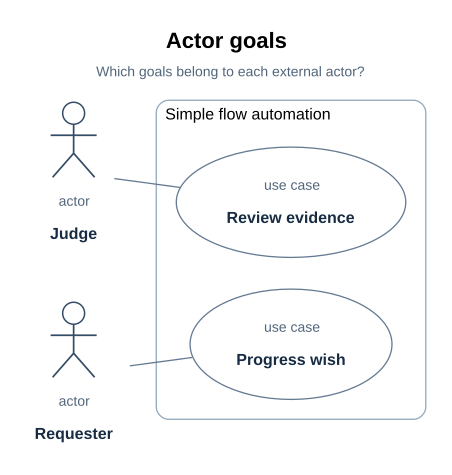
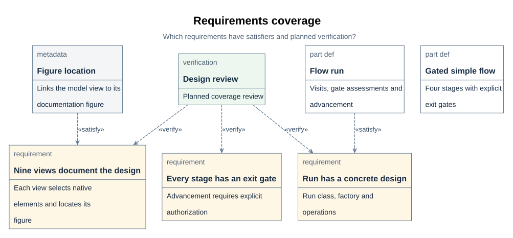

# Requirements specification

> Project: xdesign | Status: working requirements, functional baseline not frozen |
> Audience: wish owners, architects, implementers, integrators, and reviewers.

The requirements the tool must meet, why each exists, and what currently establishes it.
The modelled requirements live in `mbse/model/requirements.sysml`; their satisfaction
links live in `mbse/model/traceability.sysml`. This document follows the requirements-stage
topics in the design-document template while stating gaps in the present baseline.

| Revision | Date | Change | Review state |
| --- | --- | --- | --- |
| Working update | 2026-10-19 | Organized the requirements-stage topics around the existing model inventory and trace | Not an SRR or frozen functional baseline |

## R04 Introduction

### Purpose and readers

This specification gives the wish owner and reviewer an inspectable statement of what
xdesign promises. Architects and module owners use it to allocate behavior and constraints;
integrators and verifiers use its trace and evidence references to plan checks. A
requirements review would assess the completeness and quality of this specification before
claiming a functional baseline. No such SRR outcome is recorded here.

### Project scope and boundary

xdesign accepts a wish, assigns an engineering flow, records the work and assessments at
each stage, and authorizes advancement or rework under that flow's checkpoints. The project
model describes the system; one independent wish model records why a particular outcome was
produced and judged. The repository currently contains the SysML model, documentation,
renderer, and some standalone checks. The complete workflow application and several planned
gate commands are outside the implemented scope at this revision ([R03](#r03)).

### Terms and references

| Term | Meaning here |
| --- | --- |
| Wish | A requested outcome assigned a flow and an independent trace. |
| Flow | An ordered set of stages and applicable exit checkpoints. |
| Assessment | A judgment of one checkpoint at a stated artifact revision, with evidence. |
| RTM | Requirements traceability matrix; the human view of the model's satisfaction and planned verification links. |
| Functional baseline | Requirements accepted at requirements review; no freeze is claimed for this working document. |

Primary project references are [the documentation entry](../00_index.md),
`mbse/model/requirements.sysml`, `mbse/model/traceability.sysml`, and
[the architecture overview](../arch/00_overview.md#a01). The template under
`cache/templates/docs/requirements/00_baseline.md` guides the document topics; it is not
evidence that the current requirements have passed review.

## R05 Product position and goals

The tool's purpose is to keep system composition and per-wish rationale inspectable as a
wish advances. Its intended success condition is an authorized delivery backed by current
stage assessments and retained model products ([A03](../arch/00_overview.md#a03),
[B03](../arch/01_system_composition.md#b03)). The model specifies the relevant completion
invariants; the project has not set service-level targets such as throughput, availability,
or response time. Such targets must be stated and verified before they can become a
performance baseline.

## R06 User roles and scenarios

| Role | Goal | Current model or document |
| --- | --- | --- |
| Wish owner | Submit and progress a wish while retaining its trace and outcome. | `ProgressWish`; [F04](../details/01_flows_and_checkpoints.md#f04) |
| Reviewer or permitted judge | Inspect current evidence and decide whether a semantic checkpoint passes. | `ReviewEvidence`; [F02](../details/01_flows_and_checkpoints.md#f02) |
| Model author and implementer | Produce model and application artifacts that satisfy the declared requirements. | [A06](../arch/00_overview.md#a06), [D01](../details/simple_flow/01_run_design.md#d01) |
| Integrator and verifier | Check the relevant requirements, interfaces, stage records, and evidence. | [R02](#r02), [V01](../review/01_wish_status.md#v01) |

The first two roles are actors in the declared SimpleFlow use-case view. The other roles
describe readers and work responsibilities; they are not additional declared use-case
actors. A wish can legitimately enter rework when evidence is insufficient; the user goal
does not imply that every checkpoint must pass.

### D17 Use cases: user goals at the system boundary

> **Figure D17-1 — Use cases.**  
> **Question:** Who interacts with the simple-flow automation, and for which goals?  
> **Model view:** `XDesignDetailedDesign::useCaseDiagram`, a projection of `ProgressWish` and `ReviewEvidence`.  
> **Companions:** [D18](../details/simple_flow/05_module_design.md#d18) for internal actions and [B02](../arch/01_system_composition.md#b02) for the system interfaces.  
> **Status:** renderable-now; design reviewed.  
> **Reading:** Actors sit outside the subject boundary and their goals sit inside it. Their associations identify the value sought by the wish owner and reviewer.  
> **Limits:** A goal does not prescribe the internal action order or guarantee a passing judgment.

`useCaseDiagram` selects `ProgressWish` and `ReviewEvidence`. The wish owner's goal is to
progress a wish toward delivery with a trace that retains the produced artifacts and
decisions. The reviewer or permitted judge's goal is to inspect the evidence and decide
whether the declared criteria hold. The subject is the simple-flow automation; the actors
and their goals establish its boundary. The diagram places the two goals inside that
subject boundary and the actors outside, with short actor-to-goal connections.

The use cases describe value to participants. Reading rules, invoking a command, and
appending an assessment are internal actions shown in [D18](../details/simple_flow/05_module_design.md#d18). A user goal can end with
a blocked run or a request for rework when the evidence is insufficient; successful use of
the tool does not require a passing engineering judgment.

These goals support requirements and acceptance-scenario review. Their implementation is
still a design commitment, with concrete gate behavior defined by [D05](../details/simple_flow/02_gates_and_rules.md#d05).

## R07 Operating environment, assumptions, and dependencies

The current delivered artifacts run from this repository: the pinned local SysML compiler,
Python documentation and rendering tools, generated SVGs, and the static documentation
site ([T01](../details/03_toolchain.md#t01)). The model defines typed wish and flow
interfaces; it does not choose an application deployment platform, network transport,
external service, or device environment. Those choices and the resulting environmental
requirements remain open for implementation design.

The design assumes that a wish has an assigned flow, one trace, and revisioned assessment
evidence; a completed stage requires a current passing assessment. The model's current
constraint bodies are not executed by the compiler, so these assumptions still need
runtime and verification evidence ([B03](../arch/01_system_composition.md#b03),
[T04](../details/03_toolchain.md#t04)).

## R01 Functional and supporting requirements inventory

The current inventory has twenty-six requirements. It combines workflow behavior,
model/document consistency, presentation, and checker obligations; the last three are
supporting quality constraints rather than user actions. Every requirement specializes
`XDesignRequirement`, which carries a `rationale`. No requirement names the wish that
asked for it. The table is an inventory of existing model statements, not a claim that
each already has the full per-requirement acceptance and verification fields in the
template. [R11](#r11) identifies that gap.

| Requirement | What it demands | Why it exists | Satisfied by | Status |
| --- | --- | --- | --- | --- |
| `checkpointKindIsDeclared` | Every checkpoint declares whether its criteria are established syntactically or semantically | A flow can route a check to the right executor only if the checkpoint says which kind it is | `Checkpoint::kind` | met in the model |
| `syntacticCheckIsFixed` | A syntactic checkpoint names at least one checker whose command fixes the check | Repeating criteria by hand invites drift; one fixed command is reproducible and comparable across revisions | `Checkpoint::checkers` | met by `designFlow`'s compiler checker; the designed flow's gates declare no checker yet |
| `syntacticAssessmentIsScripted` | An assessment of a syntactic checkpoint is judged by a script, and its output for the assessed revision is the evidence | A script cannot rationalize a result, and its output can be re-examined | `CheckpointAssessment::judgedBy` | met in the model |
| `semanticCheckNamesItsJudges` | A semantic checkpoint names no checker and states whether an agent or a human may judge it | Criteria that no command can establish need a stated competent judge | `Checkpoint::agentMayJudge`, `Checkpoint::humanMayJudge` | met in the model |
| `checkerStatesItsConformance` | A checker states which kinds of conformance it establishes: artifact presence, identifier conformance, definition coverage, trace conformance | Knowing what a check covers is knowing what it leaves uncovered | `Checker::establishes` | met in the model |
| `wishProductsAreRetained` | The requirements a wish produces, and the model changes it causes, are retained in the model; a wish record never holds the only copy | A wish record is a working record; design kept only there would be lost to the project | — | unmet, maintained by hand |
| `modelStandsWithoutWishes` | The project model resolves and checks on its own; no model element names a wish or carries its identity | A model that needed wish records to check would make those records load-bearing | — | unmet, maintained by hand |
| `flowRunIsRealizedByDesign` | A flow's run is realized by design elements: a class for the run, a factory that creates it, and the functions that evaluate its gates and advance it | The architecture says what a flow is made of; only a design says what it is made into | `SimpleFlowRun` | met for the designed flow ([D02](../details/simple_flow/01_run_design.md#d02)) |
| `designedFlowGatesEveryStage` | Every stage of a designed flow declares the exit checkpoint that must pass before the flow leaves it | A stage left without a gate completes on the mere passage of work | `designedSimpleFlow` | met for the designed flow ([D01](../details/simple_flow/01_run_design.md#d01)) |
| `gateSyntaxIsRunnable` | Every syntactic gate's checker names a command that exists in the repository; its output for the assessed revision is the evidence | A gate whose command does not exist can never pass by its own rule, and the work would stall or fall back to unrecorded judgment | `designFlow` | met by `designFlow`'s syntactic checkpoint, whose checker is the pinned compiler command ([F03](../details/01_flows_and_checkpoints.md#f03)); the designed flow's gates declare no checker yet and are supplied at implementation ([D06](../details/simple_flow/02_gates_and_rules.md#d06), [R03](#r03)); unmet for `VModel` |
| `runRecordIsScriptChecked` | The conformance of a run's record — one visit per stage, assessments cited at the visited revision, evidence that exists — is established by a checker, not by reading | These invariants were kept by reading; reading does not re-run per revision and does not fail a record | — (checker not declared yet) | unmet: the record checker is designed but no checker is declared or implemented ([D06](../details/simple_flow/02_gates_and_rules.md#d06), [R03](#r03)) |
| `designCarriesItsDocSections` | Every element of the detailed design carries the documentation section that covers it, and the design's checker establishes the sections are present and well formed | A design read from declarations alone forces the reader to reconstruct the reasoning; a checker keeps the map from rotting | `DocSection` | the stand-alone documentation audit checks targets; the planned `simpleDesignCheck` gate is not implemented ([D31](../details/05_documentation_contract.md#d31)) |
| `checkerRulesAreDeclared` | Every checker of a designed flow declares the rules by which its outcome is determined — each rule's exact condition and what it reads — and its command reports each rule's verdict; a check establishes the declared rules and the command's rule list agree | A checker that only names a command hides its logic in code, and the model cannot say why a gate passed or what would make it fail | `CheckerRule` | rules documented for the designed flow ([D06](../details/simple_flow/02_gates_and_rules.md#d06)); checkers not declared yet; `VModel`'s checkers declare none |
| `structureGraphsAreDocumented` | Nine views of one model cover block definitions, internal blocks, requirements, parameters, use cases, activities, sequences, states, and packages; each locates a rendered figure and its documentation section | Three overview graphs leave goals, traceability, constraints, lifecycle conditions, and model dependencies unexplained | `DocFigure` | nine views and figures have prior design and presentation review; the new audit checks locators, while the planned flow checker remains unimplemented ([D12](../details/simple_flow/04_sysml_diagrams.md#d12), [D31](../details/05_documentation_contract.md#d31)) |
| `runRealizesItsDesign` | A run of a designed flow is recorded with the design's class, so the design is realized by the run rather than declared beside it | A class nothing is typed by is a picture of a run, not a run's design | `SimpleFlowRun` | met for the designed flow by reading at the design stage; its check is a research prototype, not implemented |
| `diagramViewsAreReadable` | The nine primary views remain legible at a 900-pixel article width with text at least 11 pixels; boundaries, ports, labels, and relationship endpoints remain clear | A correct model inventory can still produce unusable diagrams | `DiagramDocumentationRenderer` | implemented; final figures and built-article evidence are reviewed separately ([D24](../details/04_diagram_presentation.md#d24), [V06](../review/01_wish_status.md#v06)) |
| `diagramPresentationRetainsSourceIdentity` | Short model-owned labels preserve native identities and full source details; final SVGs and previews have matching provenance | Presentation needs concise text without creating a disconnected second model or accepting stale previews | `DiagramDocumentationRenderer` | implemented by metadata, native SVG references, and hash-bound final-figure evidence ([D23](../details/04_diagram_presentation.md#d23), [D26](../details/04_diagram_presentation.md#d26)) |
| `documentationEntryMapsDesign` | One entry gives each reader a path through the current documents and maps model modules and current design concerns to detailed sections | A reader should not have to reconstruct the document set or its relationship to the model | documentation set (no SysML satisfier) | [A09–A11](../00_index.md#a09); stage paths were reviewed at wish-0008 revision 2, and revision 3 adds directory overviews ([V07](../review/01_wish_status.md#v07)) |
| `documentationSupportsMultipleFlows` | Each defined flow has an addressable overview; each developed flow design has its own detailed location, and a new flow can be added without renumbering another flow's sections | Multiple selectable flows should not be forced into SimpleFlow's design pages | documentation set (no SysML satisfier) | per-flow map and extension rule in [D30](../details/05_documentation_contract.md#d30); revision 3 also gives the nested SimpleFlow directory its own overview ([V07](../review/01_wish_status.md#v07)) |
| `figuresStayWithDesignExplanation` | Each model-derived design figure appears beside its question, source view, companions, status, reading, and limits | An image catalog separated from its design claim is hard to interpret or audit | `DocFigure` | local figure blocks are covered by the [D28](../details/05_documentation_contract.md#d28) audit; nine primary figures moved to stage-owned sections at revision 2, revision 3 renamed them with their documents, and revision 4 colocates them in each directory's `assets/` ([V07](../review/01_wish_status.md#v07)) |
| `modelDocumentationLinksResolve` | Every `DocSection` anchor and `DocFigure` asset and embed resolves; the module-level reverse index agrees with the annotated modules and sections it lists | A locator to a missing section or figure gives a false explanation path | `DocSection` | [D31](../details/05_documentation_contract.md#d31) checks the current revision-4 paths; prior relocation reviews remain historical ([V07](../review/01_wish_status.md#v07)) |
| `viewAndViewpointRolesAreSpecified` | The viewpoint question and stakeholder, native view selection, rendered figure, and carrying section have distinct roles; nine reference concerns have flow-specific applicability | A figure needs an explicit concern and coverage decision to make omissions understandable | `DocumentationViewpoint` | nine SimpleFlow viewpoint usages and [D12](../details/simple_flow/04_sysml_diagrams.md#d12) applicability reasons were reviewed at revision 2 with [D29](../details/05_documentation_contract.md#d29); their current stage locations are indexed at revision 3 |
| `checkerRulesAreImplementationReady` | Each documented design-stage checker rule states inputs, exact pass condition, failure diagnostic, evidence output, and implementation status | A later implementer should reproduce the intended check without inventing its verdict | `CheckerRule` | planned SimpleFlow contracts in [D06](../details/simple_flow/02_gates_and_rules.md#d06) and implemented documentation audit in [D31](../details/05_documentation_contract.md#d31) were reviewed at revision 2; planned flow commands remain unimplemented |
| `rustUmlDesignMapsEveryDesignElement` | A Rust software design of a designed flow names one Rust element per design element — run, factory, checkpoint class and adaptations, gate and advance functions, records, statuses, ports — and records what each realizes | An unmapped design lets an implementation re-decide fixed structure and hides coverage gaps | `SimpflowCrate` | mapped in `SimpleFlowRustUml` with realization dependencies ([D46](../details/simple_flow/06_rust_uml_design.md#d46)); designed-only |
| `umlViewsAreSelectedWithReasons` | Every UML view of the guide is required, recommended, or not applicable with a reason; adopted views embed with figure block and honest status | A view set without stated applicability hides whether omissions were considered | documentation set (no SysML satisfier) | guide in [U09](../uml/01_c4_and_uml_guide.md#u09); first applicability table in [D52](../details/simple_flow/06_rust_uml_design.md#d52) |
| `softwareDesignClaimsNoImplementation` | A software design distinguishes designed elements from implemented code and claims no implementation, test or build the repository lacks | A design read as a finished product hides remaining work | documentation set (no SysML satisfier) | stated in [D44](../details/simple_flow/06_rust_uml_design.md#d44) and reviewed per [U12](../uml/01_c4_and_uml_guide.md#u12) |

## R08 Non-functional requirements

### Performance

The explicit presentation target is `diagramViewsAreReadable`: the nine primary
SimpleFlow figures must remain legible at a 900-pixel article width, with displayed text
at least 11 pixels and identifiable boundaries, ports, labels, and relationship endpoints
([V06](../review/01_wish_status.md#v06)). No runtime latency, throughput, capacity, or
memory target is in the requirements model. A benchmark cannot pass a target that has not
been set.

### Reliability and availability

Current requirements address correctness of stage advancement, evidence freshness, and
record completeness, especially `runRecordIsScriptChecked`. No service availability,
recovery-time, redundancy, or failure-budget requirement has been set. The planned record
checker remains unimplemented ([R03](#r03)).

### Safety, security, and compliance

The model distinguishes agent, human, and script judgment authority and requires evidence
for each assessment. It has no explicit authentication, authorization, privacy,
data-protection, safety, or regulatory target. These must be specified before a deployed
service or sensitive data is assumed.

### Maintainability and extensibility

`modelStandsWithoutWishes`, `documentationSupportsMultipleFlows`, and
`modelDocumentationLinksResolve` constrain separation of the project model, extension to
new flows, and location integrity. The independent model check and documentation audit
provide partial, repeatable evidence; they do not establish future deployment or migration
behavior ([R10](#r10)).

### Compliance and accessibility

No regulatory, industry, or deployed-service accessibility obligation has been selected
for this tool. The documentation has a specific readability requirement for nine primary
figures, but that result does not establish product-wide accessibility compliance. An
applicable standard, objective criterion, method, and review phase must be added before a
compliance claim can be assessed.

## R09 Interface requirements

The model specifies conceptual exchanges at the system boundary and within SimpleFlow
([B02](../arch/01_system_composition.md#b02),
[D10](../details/simple_flow/03_structure_graphs.md#d10)). The draft
[interface control document](../icd/01_interfaces.md#i01) already assigns IF-001 through
IF-004 and records their modeled fields and directions. Protocols, complete payload
schemas, timeouts, retries, criticality classes, contract owners, and review authorities
remain open; the ICD baseline has not been frozen for implementation or integration review.

| Model interface | Parties | Exchanged content | Contract state |
| --- | --- | --- | --- |
| `WishInterface` (IF-001) | requester and controller | submission description in; registered `Wish` and `Trace` references out | Typed ports and item flows modeled; transport and error contract unspecified ([I02](../icd/01_interfaces.md#i02)) |
| `FlowInterface` (IF-002) | selected flow and controller | `Flow` definition supplied to controller | Typed ports and item flow modeled; selection timing and version contract unspecified ([I03](../icd/01_interfaces.md#i03)) |
| `CheckCommandInterface` (IF-003) | SimpleFlow run and checker command | wish model and stage out; per-rule report and verdict in | Typed design exchange; command endpoint and report schema pending ([I04](../icd/01_interfaces.md#i04)) |
| `JudgmentInterface` (IF-004) | SimpleFlow run and permitted judge | criteria and artifact URIs out; outcome and rationale in | Typed design exchange; identity enforcement and response contract pending ([I05](../icd/01_interfaces.md#i05)) |

IF-001 and IF-002 are architecture-level exchanges; IF-003 and IF-004 refine the
designed SimpleFlow module. The draft ICD records their modeled provider/consumer and
field information. Compatibility and failure semantics remain open in
[I09](../icd/01_interfaces.md#i09).

## R10 Data requirements

| Data or record | Required relation or lifecycle | Source |
| --- | --- | --- |
| `Wish` and `Trace` | Each wish has exactly one trace; a trace belongs to its wish. | [B01](../arch/01_system_composition.md#b01) |
| `FlowExecution` and `StageRecord` | Record each assigned flow stage, including visits and the current artifact revision. | [E02–E03](../details/02_records_and_evidence.md#e02) |
| `CheckpointAssessment` | Identify checkpoint, evaluated revision, judge, outcome, and evidence URIs. | [E04](../details/02_records_and_evidence.md#e04) |
| Project and wish model files | Keep project requirements and design in `mbse/model/`; keep each wish's rationale and run in its own `mbse/wishes/` model. | [A02](../arch/00_overview.md#a02) |

The model defines record identity and trace relationships, but it does not yet define a
persistent database, storage format for a running application, retention term, deletion
policy, privacy classification, or data migration protocol. Generated compiler reports and
local verification evidence stay under `cache/` and are not the product data store.

## R11 Verification and acceptance plan

The available verification methods are analysis, demonstration, inspection, and test.
Method, phase, acceptance criterion, and case must be assigned per requirement before a
requirements baseline can be frozen. The table names current coverage without treating a
declared case or a clean compiler result as an executed acceptance test.

| Scope | Method and phase | Evidence or case | Acceptance state |
| --- | --- | --- | --- |
| SysML syntax and supported references | Automated analysis at design delivery | pinned compiler `parse` and `check`, including model-only check ([T02](../details/03_toolchain.md#t02)) | Executed for design-stage wishes; unevaluated rules remain |
| Documentation locators, embeds, and figure blocks | Automated inspection at documentation design delivery | `tools/check_documentation.py`; [D31](../details/05_documentation_contract.md#d31) | Executed as a standalone audit, not a workflow gate |
| Nine primary figure presentation | Measured inspection and visual review at design delivery | `DiagramPresentationReview`; [V06](../review/01_wish_status.md#v06) | Historical presentation review recorded |
| SimpleFlow structure and behavior | Planned design review | `SimpleFlowViewReview` | Case declared in the model; no standalone passed case result |
| Six documentation-contract requirements | Planned design review | `DocumentationContractReview`; [V07](../review/01_wish_status.md#v07) | Case declared; wish assessment is separate from case execution |
| Three Rust UML design requirements | Planned design review | `RustUmlDesignReview`; [D52](../details/simple_flow/06_rust_uml_design.md#d52) | Case declared; no standalone passed case result |
| SimpleFlow gate, recovery, and file-plan behavior | Planned executable verification at implementation | `SimpleFlowGateBehaviorVerification`, `SimpleFlowRecoveryVerification`, `SimpleFlowFilePlanVerification`; [D54](../details/simple_flow/07_file_plan_and_verification.md#d54) | Cases declared; execution must produce separate test reports |
| Runtime gate and record conformance | Scripted test or inspection at implementation and integration | planned checks in [D06–D07](../details/simple_flow/02_gates_and_rules.md#d06) | Commands and execution evidence pending |

Acceptance of a wish is recorded by that wish's applicable stage assessment at a stated
artifact revision. It does not freeze the project's entire requirements baseline.

## R12 Requirement quality review

The template calls for one objectively decidable behavior per requirement, an explicit
condition, subject, action, object, measurable target where relevant, and a verification
method and phase. The set also needs consistent terminology, no duplicate or conflicting
targets, and coverage from each upper-level requirement into design and verification.
These are review criteria for this working document; the model's requirement statements
do not yet provide every template field. In particular, per-requirement acceptance
criteria and method/phase are incomplete, and several operational targets are unset.

Before SRR, review each [R01](#r01) row against those criteria, record its parent or
derived relation where applicable, and complete its planned case and pass condition in
[R02](#r02). The current satisfaction links and case declarations are useful trace, but
they do not by themselves certify requirements quality or test coverage.

## R02 Requirements traceability matrix

`mbse/model/traceability.sysml` — twenty `satisfy` links from a requirement to the model
feature that answers it:

| Requirement | Satisfier |
| --- | --- |
| `checkpointKindIsDeclared` | `Checkpoint::kind` |
| `syntacticCheckIsFixed` | `Checkpoint::checkers` |
| `syntacticAssessmentIsScripted` | `CheckpointAssessment::judgedBy` |
| `semanticCheckNamesItsJudges` | `Checkpoint::agentMayJudge` |
| `semanticCheckNamesItsJudges` | `Checkpoint::humanMayJudge` |
| `checkerStatesItsConformance` | `Checker::establishes` |
| `flowRunIsRealizedByDesign` | `SimpleFlowRun` |
| `designedFlowGatesEveryStage` | `designedSimpleFlow` |
| `gateSyntaxIsRunnable` | `designFlow` |
| `designCarriesItsDocSections` | `DocSection` |
| `checkerRulesAreDeclared` | `CheckerRule` |
| `structureGraphsAreDocumented` | `DocFigure` |
| `runRealizesItsDesign` | `SimpleFlowRun` |
| `diagramViewsAreReadable` | `DiagramDocumentationRenderer` |
| `diagramPresentationRetainsSourceIdentity` | `DiagramDocumentationRenderer` |
| `figuresStayWithDesignExplanation` | `DocFigure` |
| `modelDocumentationLinksResolve` | `DocSection` |
| `viewAndViewpointRolesAreSpecified` | `DocumentationViewpoint` |
| `checkerRulesAreImplementationReady` | `CheckerRule` |
| `rustUmlDesignMapsEveryDesignElement` | `SimpflowCrate` |

`semanticCheckNamesItsJudges` is the one requirement with two links; every requirement
with a model satisfier added since has one link. The compiler export cannot attribute
two `satisfy` usages of one requirement to their requirement — the question wish-0004
keeps open ([V04](../review/01_wish_status.md#v04)). Four later requirements have no
model satisfier, as described below; they are not counterexamples to that attribution rule.

`wishProductsAreRetained` and `modelStandsWithoutWishes` have no satisfier: nothing in the
model holds a wish's products to the model, and nothing keeps wish identity out of it.
They are the two requirements this project keeps by hand — the first is what moved
requirements out of wish-0002's file ([V02](../review/01_wish_status.md#v02)), the
second is what lets the model check without the wish directory.
`runRecordIsScriptChecked` has no satisfier either: the designed flow's record gate is
designed, but no checker is declared or implemented yet ([R03](#r03)).

`documentationEntryMapsDesign`, `documentationSupportsMultipleFlows`,
`umlViewsAreSelectedWithReasons`, and `softwareDesignClaimsNoImplementation` have no SysML
satisfier because their products are the [documentation entry](../00_index.md), the
per-flow document structure, [UML view applicability](../details/simple_flow/06_rust_uml_design.md#d52),
and an honest software design status. Their absence from the `satisfy` table is explicit
rather than an omitted obligation. `XDesignVerification::DocumentationContractReview` declares
planned coverage for all six wish-0008 requirements; its declaration records no pass.
The revision-1, corrective revision-2, directory-layout revision-3, and asset-layout
revision-4 assessments are
recorded in [V07](../review/01_wish_status.md#v07) and the wish trace. The declared review case
remains planned coverage rather than a separate passed model-level result.

`XDesignVerification::SimpleFlowViewReview` specifies planned verification coverage for
`flowRunIsRealizedByDesign`, `designedFlowGatesEveryStage`, and
`structureGraphsAreDocumented`. Its `verify` relationships appear alongside the satisfaction
links in the [requirements view](#d15). Declaring
coverage records no passed result; the design review and compiler reports for the current
revision are recorded in the independent wish trace.

`DiagramPresentationReview` specifies verification coverage for the two presentation
requirements. It requires final-asset typography and source-identity checks plus visual
review in the built documentation; the actual outcome is recorded in
[V06](../review/01_wish_status.md#v06).

### D15 Requirements: satisfaction and planned verification

> **Figure D15-1 — Requirements trace.**  
> **Question:** Which selected requirements are satisfied by design elements and planned for review?  
> **Model view:** `XDesignDetailedDesign::requirementsDiagram`, a focused requirement and relationship projection.  
> **Companions:** [R01](#r01) for the full baseline and [R02](#r02) for satisfaction links.  
> **Status:** renderable-now; design reviewed.  
> **Reading:** Three requirements connect to their satisfiers and to `SimpleFlowViewReview`. Distinct edge labels separate a design answer from a planned verification case.  
> **Limits:** The selected subset and planned review do not imply passed verification or coverage of every requirement.

`requirementsDiagram` selects three detailed-design requirements, their satisfaction links,
and `XDesignVerification::SimpleFlowViewReview`. The requirements remain declared in
`XDesignRequirements`; their satisfiers remain project-level relationships in
`XDesignTraceability`. The independent wish trace records why wish-0006 produced this
design ([R02](#r02)).

| Requirement | Selected satisfier | Planned verification case |
| --- | --- | --- |
| `flowRunIsRealizedByDesign` | `SimpleFlowRun` | `SimpleFlowViewReview` |
| `designedFlowGatesEveryStage` | `designedSimpleFlow` | `SimpleFlowViewReview` |
| `structureGraphsAreDocumented` | `DocFigure` | `SimpleFlowViewReview` |

Short captions identify the three requirements without displaying their complete
rationales inside boxes. Satisfaction and verification labels distinguish the two kinds
of relationship; the planned review remains distinct from a recorded assessment.

The planned design review checks these three obligations through the nine coordinated
views, their source elements, and their documentation. The other detailed-design
requirements remain in the requirements baseline; this focused view does not add
verification coverage for them. A satisfaction relationship identifies the design that
answers a requirement. A verification relationship identifies the case intended to
establish it; neither relationship alone records a passed result.

Compiler parse/check reports establish the supported syntactic checks. Semantic review
must assess whether the design answers the wish, including blocked and rework behavior.
Application execution, checker conformance, and engineering validation need their own
evidence when implemented ([V05](../review/01_wish_status.md#v05)).

## R13 Baseline, margin, and change control

The functional baseline is **working**, not frozen: no SRR decision or approval record is
present. The allocated and product baselines also need their own design and release reviews
([D30](../details/05_documentation_contract.md#d30)). There is no quantified engineering
margin or post-baseline volatility series to report. Neither should be inferred from a
compiler result or a delivered design wish.

For a requirement change, the intended record is its revised statement and rationale,
affected `satisfy` and `verify` links, design and interface impact, evidence revision,
reviewer decision, and new baseline revision. Independent wish traces record why a change
was requested and judged; the project requirements remain in `mbse/model/`. The current
repository does not implement formal change approval or a frozen RTM workflow.

## R14 Model mapping and open issues

| Document concern | Model source | Current limit |
| --- | --- | --- |
| Requirement and rationale | `XDesignRequirements::XDesignRequirement` usages; `DocSection` to [R01](#r01) | Requirement fields are not yet a full SRS acceptance record. |
| Design allocation | `XDesignTraceability` `satisfy` links; [R02](#r02) | Three model obligations and four documentation obligations have no SysML satisfier. |
| Software design documentation | UML guide and SimpleFlow design; [D52](../details/simple_flow/06_rust_uml_design.md#d52) | UML applicability and status have a planned review, not a model satisfier. |
| Planned verification | `XDesignVerification` cases and `verify` links | Case declaration does not record a passed result. |
| User goals | `XDesignDetailedDesign::ProgressWish`, `ReviewEvidence`, and `useCaseDiagram`; [R06](#r06) | The view concerns SimpleFlow and is not a complete deployed-product scenario set. |
| Per-wish outcome | `mbse/wishes/wish-<id>.sysml`; [V02](../review/01_wish_status.md#v02) | A wish outcome does not freeze the project baseline. |

Open requirements-stage work is to classify and complete every requirement's method,
phase, and acceptance criterion; decide runtime performance, security, deployment, data
retention, and interface contracts as needed; and hold an explicit requirements review.

## R03 Enforcement status

Three checkers are declared in `VModel`, none of which declares rules. The designed
`designedSimpleFlow` declares no checkers at the design stage: its syntactic gates' rules
are documented in [D06](../details/simple_flow/02_gates_and_rules.md#d06) and
[D07](../details/simple_flow/02_gates_and_rules.md#d07), and the checker, the command and its
rule list are supplied at implementation. The early Python checkers are research conclusions
kept under `cache/research/checks/`; their logs are not project evidence.

The stand-alone `tools/check_documentation.py --json` command audits documentation
targets, embeds, and figure-block fields ([D31](../details/05_documentation_contract.md#d31)).
It is project code, but is not a `Checker` on `VModel` or `designedSimpleFlow`, and it
does not implement the planned gate commands below. A clean result cannot decide whether
the explanatory text and selected model content agree.

| Checker | Command | Establishes | Rules | Implemented |
| --- | --- | --- | --- | --- |
| `requirementTraceCheck` | intended `tools/checks/requirement_trace.py` (not project code) | trace conformance, identifier conformance | none | no |
| `implementationArtifactCheck` | intended `tools/checks/implementation_artifacts.py` (not project code) | artifact presence, definition coverage | none | no |
| `deliveryRecordCheck` | intended `tools/checks/delivery_record.py` (not project code) | artifact presence, trace conformance | none | no |

Consequences, stated rather than papered over:

- `VModel`'s three syntactic checkpoints that name checkers (`requirementsAccepted`,
  `implementationReady`, `deliveryAccepted`, see
  [F03](../details/01_flows_and_checkpoints.md#f03)) cannot pass until the commands exist;
  `gateSyntaxIsRunnable` ([R01](#r01)) stands unmet for `VModel`.
- The designed flow's four planned syntactic checks have documented rules but no declared
  checkers; their gates cannot run until implementation supplies the commands.
- The only fixed syntactic check available now is the pinned SysML compiler; the design-stage
  syntactic checkpoint uses it, and the design's meaning is read by the agent for the
  semantic judgment.
- The two project/model boundary requirements without satisfiers in [R01](#r01) remain
  maintained by hand; `runRecordIsScriptChecked` awaits the record checker's implementation.
