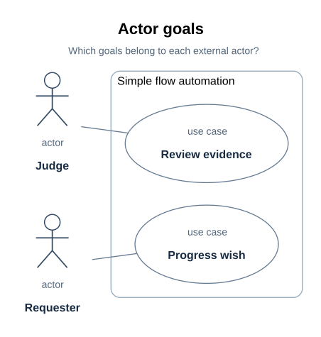

# Requirements specification

> Project: xdesign | Status: working requirements, functional baseline not frozen |
> Audience: wish owners, architects, implementers, integrators, and reviewers.

The requirements the tool must meet, why each exists, and what currently establishes it.
The modelled requirements live in `mbse/model/requirements.sysml`; their satisfaction
links live in `mbse/model/traceability.sysml`. This document states the requirements,
their rationale, and the current gaps in the baseline; the model remains the normative
source.

| Revision | Date | Change | Review state |
| --- | --- | --- | --- |
| Working update | 2026-10-19 | Organized the requirements-stage topics around the existing model inventory and trace | Not an SRR or frozen functional baseline |

## 1. Introduction

### 1.1 Purpose and readers

This specification gives the wish owner and reviewer an inspectable statement of what
xdesign promises. Architects and module owners use it to allocate behavior and constraints;
integrators and verifiers use its trace and evidence references to plan checks. A
requirements review would assess the completeness and quality of this specification before
claiming a functional baseline. No such SRR outcome is recorded here.

### 1.2 Project scope and boundary

xdesign accepts a wish, assigns an engineering flow, records the work and assessments at
each stage, and authorizes advancement or rework under that flow's checkpoints. The project
model describes the system and retains engineering products. A trace records why a particular
outcome was produced and judged: existing wishes use independent Git SysML traces, while the
storage requirements below define a durable operational store for new wish and run records.
The repository currently contains the SysML model, documentation, renderer, four SimpleFlow
checker commands, and local flat-flow Rust runs. The complete workflow application and three
VModel gate commands are outside the implemented scope
([R03](../records/status.md#r03), [P08](../records/executions/simple-flow.md#p08)).

### 1.3 Terms and references

| Term | Meaning here |
| --- | --- |
| Wish | A requested outcome assigned a flow and a trace. |
| Trace | The operational account of a wish's execution, retained in a legacy SysML model or the new store according to the run's registration boundary. |
| Flow | An ordered set of stages and applicable exit checkpoints. |
| Assessment | A judgment of one checkpoint at a stated artifact revision, with evidence. |
| RTM | Requirements traceability matrix; the human view of the model's satisfaction and planned verification links. |
| Functional baseline | Requirements accepted at requirements review; no freeze is claimed for this working document. |

Primary project references are [the documentation entry](../index.md),
`mbse/model/requirements.sysml`, `mbse/model/traceability.sysml`, and
[the architecture overview](../architecture/index.md#a01). The model files are the primary
source; this page records the readable requirement statements and their rationale.

## 2. Product position and goals

The tool's purpose is to keep system composition and per-wish rationale inspectable as a
wish advances. Its intended success condition is an authorized delivery backed by current
stage assessments and retained model products ([A03](../architecture/wish-lifecycle.md#a03),
[B03](../architecture/system-composition.md#b03)). The model specifies the relevant completion
invariants; the project has not set service-level targets such as throughput, availability,
or response time. Such targets must be stated and verified before they can become a
performance baseline.

## 3. User roles and scenarios

| Role | Goal | Current model or document |
| --- | --- | --- |
| Wish owner | Submit and progress a wish while retaining its trace and outcome. | `ProgressWish`; [F04](../design/lifecycle.md#f04) |
| Reviewer or permitted judge | Inspect current evidence and decide whether a semantic checkpoint passes. | `ReviewEvidence`; [F02](../design/adapters.md#f02) |
| Model author and implementer | Produce model and application artifacts that satisfy the declared requirements. | [A06](../architecture/index.md#a06), [D01](../design/flows/simple-flow/definition.md#d01) |
| Integrator and verifier | Check the relevant requirements, interfaces, stage records, and evidence. | [R02](#r02), [V01](../records/wishes/wish-history.md#v01) |

The first two roles are actors in the declared SimpleFlow use-case view. The other roles
describe readers and work responsibilities; they are not additional declared use-case
actors. A wish can legitimately enter rework when evidence is insufficient; the user goal
does not imply that every checkpoint must pass.

### 3.1 Use cases: user goals at the system boundary

> **Figure D17-1 — Use cases.**  
> **Question:** Who interacts with the simple-flow automation, and for which goals?  
> **Model view:** `XDesignDetailedDesign::useCaseDiagram`, a projection of `ProgressWish` and `ReviewEvidence`.  
> **Companions:** [D18](../design/flows/simple-flow/views.md#d18) for internal actions and [B02](../architecture/system-composition.md#b02) for the system interfaces.  
> **Status:** renderable-now; design reviewed.  
> **Reading:** Actors sit outside the subject boundary and their goals sit inside it. Their associations identify the value sought by the wish owner and reviewer.  
> **Limits:** A goal does not prescribe the internal action order or guarantee a passing judgment.

`useCaseDiagram` selects `ProgressWish` and `ReviewEvidence`. The wish owner's goal is to
progress a wish toward delivery with a trace that retains the produced artifacts and
decisions. The reviewer or permitted judge's goal is to inspect the evidence and decide
whether the declared criteria hold. The subject is the simple-flow automation; the actors
and their goals establish its boundary. The diagram places the two goals inside that
subject boundary and the actors outside, with short actor-to-goal connections.

The use cases describe value to participants. Reading rules, invoking a command, and
appending an assessment are internal actions shown in [D18](../design/flows/simple-flow/views.md#d18). A user goal can end with
a blocked run or a request for rework when the evidence is insufficient; successful use of
the tool does not require a passing engineering judgment.

These goals support requirements and acceptance-scenario review. Their implementation is
still a design commitment, with concrete gate behavior defined by [D05](../design/flows/simple-flow/definition.md#d05).

## 4. Operating environment, assumptions, and dependencies

The current delivered artifacts run from this repository: the pinned local SysML compiler,
Python documentation and rendering tools, generated SVGs, and the static documentation
site ([T01](../architecture/constraints.md#t01)). The model defines typed wish and flow
interfaces; it does not choose an application deployment platform, network transport,
external service, or device environment. Those choices and the resulting environmental
requirements remain open for implementation design.

The design assumes that a wish has an assigned flow, one trace, and revisioned assessment
evidence; a completed stage requires a current passing assessment. The model's current
constraint bodies are not executed by the compiler, so these assumptions still need
runtime and verification evidence ([B03](../architecture/system-composition.md#b03),
[T04](../architecture/constraints.md#t04)).

## 5. Functional and supporting requirements inventory

The inventory combines workflow behavior,
model/document consistency, presentation, and checker obligations; the last three are
supporting quality constraints rather than user actions. Every requirement specializes
`XDesignRequirement`, which carries a `rationale`. No requirement names the wish that
asked for it. The table is an inventory of existing model statements, not a claim that
each already has full per-requirement acceptance and verification fields. [R11](../verification/requirements.md#r11) identifies that gap.

| Requirement | What it demands | Why it exists | Satisfied by | Status |
| --- | --- | --- | --- | --- |
| `checkpointKindIsDeclared` | Every checkpoint declares whether its criteria are established syntactically or semantically | A flow can route a check to the right executor only if the checkpoint says which kind it is | `Checkpoint::kind` | met in the model |
| `syntacticCheckIsFixed` | A syntactic checkpoint names at least one checker whose command fixes the check | Repeating criteria by hand invites drift; one fixed command is reproducible and comparable across revisions | `Checkpoint::checkers` | met by `designFlow` and the four declared SimpleFlow syntactic gates; `VModel` commands remain absent |
| `syntacticAssessmentIsScripted` | An assessment of a syntactic checkpoint is judged by a script, and its output for the assessed revision is the evidence | A script cannot rationalize a result, and its output can be re-examined | `CheckpointAssessment::judgedBy` | met in the model |
| `semanticCheckNamesItsJudges` | A semantic checkpoint names no checker and states whether an agent or a human may judge it | Criteria that no command can establish need a stated competent judge | `Checkpoint::agentMayJudge`, `Checkpoint::humanMayJudge` | met in the model |
| `checkerStatesItsConformance` | A checker states which kinds of conformance it establishes: artifact presence, identifier conformance, definition coverage, trace conformance | Knowing what a check covers is knowing what it leaves uncovered | `Checker::establishes` | met in the model |
| `wishProductsAreRetained` | The requirements a wish produces, and the model changes it causes, are retained in the model; a wish record never holds the only copy | A wish record is a working record; design kept only there would be lost to the project | — | unmet, maintained by hand |
| `modelStandsWithoutWishes` | The project model resolves and checks on its own; no model element names a wish or carries its identity | A model that needed wish records to check would make those records load-bearing | — | unmet, maintained by hand |
| `flowRunIsRealizedByDesign` | A flow's run is realized by design elements: a class for the run, a factory that creates it, and the functions that evaluate its gates and advance it | The architecture says what a flow is made of; only a design says what it is made into | `SimpleFlowRun` | met for the designed flow ([D02](../design/flows/simple-flow/implementation.md#d02)) |
| `designedFlowGatesEveryStage` | Every stage of a designed flow declares the exit checkpoint that must pass before the flow leaves it | A stage left without a gate completes on the mere passage of work | `designedSimpleFlow` | met for the designed flow ([D01](../design/flows/simple-flow/definition.md#d01)) |
| `gateSyntaxIsRunnable` | Every syntactic gate's checker names a command that exists in the repository; its output for the assessed revision is the evidence | A gate whose command does not exist can never pass by its own rule, and the work would stall or fall back to unrecorded judgment | `designFlow` | pinned compiler and all four SimpleFlow commands exist and have executed with retained reports ([D06](../design/flows/simple-flow/definition.md#d06), [R03](../records/status.md#r03)); unmet for `VModel` |
| `runRecordIsScriptChecked` | The conformance of a run's record — one visit per stage, assessments cited at the visited revision, evidence that exists — is established by a checker, not by reading | These invariants were kept by reading; reading does not re-run per revision and does not fail a record | — (no project-wide satisfier) | `simpleRecordCheck` is declared and executed for the new SimpleFlow JSON run; default V-model and historical SysML wish records remain outside it ([D06](../design/flows/simple-flow/definition.md#d06), [R03](../records/status.md#r03)) |
| `designCarriesItsDocSections` | Every element of the detailed design carries the documentation section that covers it, and the design's checker establishes the sections are present and well formed | A design read from declarations alone forces the reader to reconstruct the reasoning; a checker keeps the map from rotting | `DocSection` | documentation audit and `simpleDesignCheck` execute locator checks; semantic adequacy still needs reading ([D31](../interfaces/documentation-contract.md#d31)) |
| `checkerRulesAreDeclared` | Every checker of a designed flow declares the rules by which its outcome is determined — each rule's exact condition and what it reads — and its command reports each rule's verdict; a check establishes the declared rules and the command's rule list agree | A checker that only names a command hides its logic in code, and the model cannot say why a gate passed or what would make it fail | `CheckerRule` | 18 rules declared and reported by the four SimpleFlow commands ([D06](../design/flows/simple-flow/definition.md#d06)); `VModel`'s checkers declare none |
| `structureGraphsAreDocumented` | Nine views of one model cover block definitions, internal blocks, requirements, parameters, use cases, activities, sequences, states, and packages; each locates a rendered figure and its documentation section | Three overview graphs leave goals, traceability, constraints, lifecycle conditions, and model dependencies unexplained | `DocFigure` | nine views and figures have design and presentation review; the audit and SimpleFlow design checker now check locators and embeds ([D12](../design/flows/simple-flow/views.md#d12), [D31](../interfaces/documentation-contract.md#d31)) |
| `runRealizesItsDesign` | A run of a designed flow is recorded with the design's class, so the design is realized by the run rather than declared beside it | A class nothing is typed by is a picture of a run, not a run's design | `SimpleFlowRun` | the SimpleFlow JSON run records `execution_type = FlowRun` with `plan_id = designedSimpleFlow`; the record checker tests it for new runs, while historical SysML records are not migrated |
| `diagramViewsAreReadable` | The nine primary views remain legible at a 900-pixel article width with text at least 11 pixels; boundaries, ports, labels, and relationship endpoints remain clear | A correct model inventory can still produce unusable diagrams | `DiagramDocumentationRenderer` | implemented; final figures and built-article evidence are reviewed separately ([D24](../interfaces/documentation-contract.md#d24), [V06](../records/wishes/wish-history.md#v06)) |
| `diagramPresentationRetainsSourceIdentity` | Short model-owned labels preserve native identities and full source details; final SVGs and previews have matching provenance | Presentation needs concise text without creating a disconnected second model or accepting stale previews | `DiagramDocumentationRenderer` | implemented by metadata, native SVG references, and hash-bound final-figure evidence ([D23](../interfaces/documentation-contract.md#d23), [D26](../interfaces/documentation-contract.md#d26)) |
| `documentationEntryMapsDesign` | One entry gives each reader a path through the current documents and maps model modules and current design concerns to detailed sections | A reader should not have to reconstruct the document set or its relationship to the model | documentation set (no SysML satisfier) | [A09–A11](../index.md#a09); stage paths were reviewed at wish-0008 revision 2, and revision 3 adds directory overviews ([V07](../records/wishes/wish-history.md#v07)) |
| `documentationSupportsMultipleFlows` | Each defined flow has an addressable overview; each developed flow design has its own detailed location, and a new flow can be added without renumbering another flow's sections | Multiple selectable flows should not be forced into SimpleFlow's design pages | documentation set (no SysML satisfier) | per-flow map and extension rule in [D30](../interfaces/documentation-contract.md#d30); revision 3 also gives the nested SimpleFlow directory its own overview ([V07](../records/wishes/wish-history.md#v07)) |
| `figuresStayWithDesignExplanation` | Each model-derived design figure appears beside its question, source view, companions, status, reading, and limits | An image catalog separated from its design claim is hard to interpret or audit | `DocFigure` | local figure blocks are covered by the [D28](../interfaces/documentation-contract.md#d28) audit; nine primary figures moved to stage-owned sections at revision 2, revision 3 renamed them with their documents, and revision 4 colocates them in each directory's `assets/` ([V07](../records/wishes/wish-history.md#v07)) |
| `modelDocumentationLinksResolve` | Every `DocSection` anchor and `DocFigure` asset and embed resolves; the module-level reverse index agrees with the annotated modules and sections it lists | A locator to a missing section or figure gives a false explanation path | `DocSection` | [D31](../interfaces/documentation-contract.md#d31) checks the current revision-4 paths; prior relocation reviews remain historical ([V07](../records/wishes/wish-history.md#v07)) |
| `viewAndViewpointRolesAreSpecified` | The viewpoint question and stakeholder, native view selection, rendered figure, and carrying section have distinct roles; nine reference concerns have flow-specific applicability | A figure needs an explicit concern and coverage decision to make omissions understandable | `DocumentationViewpoint` | nine SimpleFlow viewpoint usages and [D12](../design/flows/simple-flow/views.md#d12) applicability reasons were reviewed at revision 2 with [D29](../interfaces/documentation-contract.md#d29); their current stage locations are indexed at revision 3 |
| `checkerRulesAreImplementationReady` | Each documented design-stage checker rule states inputs, exact pass condition, failure diagnostic, evidence output, and implementation status | A later implementer should reproduce the intended check without inventing its verdict | `CheckerRule` | SimpleFlow contracts in [D06](../design/flows/simple-flow/definition.md#d06) now have command implementations and targeted rule tests; the broader V-model remains open |
| `rustUmlDesignMapsEveryDesignElement` | A Rust software design of a designed flow names one Rust element per design element — run, factory, checkpoint class and adaptations, gate and advance functions, records, statuses, ports — and records what each realizes | An unmapped design lets an implementation re-decide fixed structure and hides coverage gaps | `XDesignCrate` | mapped in `XDesignRustUml` with realization dependencies ([D46](../design/flows/simple-flow/implementation.md#d46)); the first executable module implements the SimpleFlow slice |
| `umlViewsAreSelectedWithReasons` | Every view of a module's software design is required, recommended, or not applicable with a reason; adopted views embed with figure block and honest status | A view set without stated applicability hides whether omissions were considered | documentation set (no SysML satisfier) | contract in [U09](../interfaces/documentation-contract.md#u09); first applicability table in [D52](../design/flows/simple-flow/views.md#d52) |
| `softwareDesignClaimsNoImplementation` | A software design distinguishes designed elements from implemented code and claims no implementation, test or build the repository lacks | A design read as a finished product hides remaining work | documentation set (no SysML satisfier) | stated in [D44](../design/flows/simple-flow/implementation.md#d44) and reviewed per [U12](../verification/review-criteria.md#u12) |
| `stageCliUsesUniformInteraction` | Every supported stage uses read-only `next` and a single `check` that records, assesses and advances, returning corrections or successor work | Agents follow flow content instead of coordinating internal commands | `StageCli` | [Local CLI contract](../design/stage-cli.md#d85); execution recorded by the new wish |
| `stageCliPreservesRunIntegrity` | Restore the same run across processes; reject corrupt state, plan drift, stale submissions and concurrent writers; bind judgments to artifact bytes | A short interface must preserve authority and evidence across restarts | `LocalStageCliRuntime` | [Runtime verification](../design/stage-cli.md#d85) and [storage evidence](../records/plans/storage.md#p38); local store, no authentication or remote-service claim |
| `operationalRecordsHaveDurableAuthority` | Persist new wish/run facts, revision manifests, material bytes and receipts outside regenerable cache; retain engineering products in Git | A run must not lose the facts and judged bytes when cache is discarded | `XDesignStorage` allocation in [R02](#r02) | Implemented; [STORE evidence](../records/plans/storage.md#p38) executed within disclosed limits |
| `wishHistoryIsRevisioned` | Append immutable numbered revisions with stable item identity/kind, typed metadata and complete manifests; support list/get/history/read/checkout | Earlier checked states must remain inspectable instead of being replaced by one mutable snapshot | `XDesignStorage` allocation in [R02](#r02) | Implemented; [STORE evidence](../records/plans/storage.md#p38) executed within disclosed limits |
| `materialsAreContentAddressed` | Bind logical URIs to exact SHA-256-identified bytes; atomically publish, deduplicate and verify reads through EOF | A path alone cannot establish which evidence bytes were judged | `XDesignStorage` allocation in [R02](#r02) | Implemented; [STORE evidence](../records/plans/storage.md#p38) executed within disclosed limits |
| `storageSaveIsAtomicAndIdempotent` | Reserve exact operations, guard expected heads, commit each complete revision and receipt together, and reconcile outcome without duplicate effects | Crash/retry and competing writers must not silently duplicate or overwrite run facts | `XDesignStorage` allocation in [R02](#r02) | Implemented; [STORE evidence](../records/plans/storage.md#p38) executed within disclosed limits |
| `workingCacheIsRecoverable` | Regenerate runtime cache and checkout every manifest byte; replay the SimpleFlow record checker on restored evidence | Cache is disposable only if durable copies reconstruct a usable record | `XDesignStorage` allocation in [R02](#r02) | Implemented; [STORE evidence](../records/plans/storage.md#p38) executed within disclosed limits |
| `wishStatusProjectsFlowExecution` | Derive wish status/current stage from the selected flow's run record and support kind/status queries | An independent status flag could contradict the flow's actual position | `XDesignStorage` allocation in [R02](#r02) | Implemented; [STORE evidence](../records/plans/storage.md#p38) executed within disclosed limits |
| `storageInputAndIntegrityAreChecked` | Refuse incompatible, malformed, excessive, unsafe or replaced state; verify digests and report missing/altered/orphan/pending data | Durable but corrupt or unsafe bytes must not enter engineering decisions | `XDesignStorage` allocation in [R02](#r02) | Implemented; [STORE evidence](../records/plans/storage.md#p38) executed within disclosed limits |
| `checkpointSourceIsProjectOwned` | Keep reusable source in the selected project and resolved run fields in its store | Tool installation and source edits must not redefine a registered run | `CheckpointLibrarySource` | As-built allocation; executor bytes are not pinned at init; [R16](#r16) |
| `configuredChecksRetainAuthority` | Retain actual executor authority, identity, revision and evidence | An agent answer cannot be represented as deterministic script evidence | `RsCustomChecker` | As-built allocation; generic scripted-only policy conflict remains; [R16](#r16) |
| `operatorDelegatesRunState` | Project stored facts and delegate lifecycle to the stage runtime | UI state must not become a second run authority | `OperatorWebProgram` | As-built allocation; [R16](#r16) |
| `sharedChecksHavePinnedOrigins` | Pin shared definition origin, executor bundle and input mapping | Equal local names do not identify equal content across projects | No implemented satisfier | Proposed extension; [R16](#r16) |
| `crossProjectHistoryKeepsItsOwner` | Identify source project/store/revision and retain restorable evidence | A derived central index is not the source authority | No implemented satisfier | Proposed extension; [R16](#r16) |

## 6. Non-functional requirements

### 6.1 Performance

The explicit presentation target is `diagramViewsAreReadable`: the nine primary
SimpleFlow figures must remain legible at a 900-pixel article width, with displayed text
at least 11 pixels and identifiable boundaries, ports, labels, and relationship endpoints
([V06](../records/wishes/wish-history.md#v06)). No runtime latency, throughput, capacity, or
memory target is in the requirements model. A benchmark cannot pass a target that has not
been set.

### 6.2 Reliability and availability

Current requirements address correctness of stage advancement, evidence freshness, and
record completeness, especially `runRecordIsScriptChecked`. No service availability,
recovery-time, redundancy, or failure-budget requirement has been set. The SimpleFlow
record checker covers only its new JSON run format ([R03](../records/status.md#r03)).

### 6.3 Safety, security, and compliance

The model distinguishes agent, human, and script judgment authority and requires evidence
for each assessment. It has no explicit authentication, authorization, privacy,
data-protection, safety, or regulatory target. These must be specified before a deployed
service or sensitive data is assumed.

### 6.4 Maintainability and extensibility

`modelStandsWithoutWishes`, `documentationSupportsMultipleFlows`, and
`modelDocumentationLinksResolve` constrain separation of the project model, extension to
new flows, and location integrity. The independent model check and documentation audit
provide partial, repeatable evidence; they do not establish future deployment or migration
behavior ([R10](#r10)).

### 6.5 Compliance and accessibility

No regulatory, industry, or deployed-service accessibility obligation has been selected
for this tool. The documentation has a specific readability requirement for nine primary
figures, but that result does not establish product-wide accessibility compliance. An
applicable standard, objective criterion, method, and review phase must be added before a
compliance claim can be assessed.

## 7. Interface requirements

The model specifies conceptual exchanges at the system boundary and within SimpleFlow
([B02](../architecture/system-composition.md#b02),
[D10](../design/flows/simple-flow/views.md#d10)). The draft
[interface control document](../interfaces/contracts.md#i01) already assigns IF-001 through
IF-004 and records their modeled fields and directions. Protocols, complete payload
schemas, timeouts, retries, criticality classes, contract owners, and review authorities
remain open; the ICD baseline has not been frozen for implementation or integration review.

| Model interface | Parties | Exchanged content | Contract state |
| --- | --- | --- | --- |
| `WishInterface` (IF-001) | requester and controller | submission description in; registered `Wish` and `Trace` references out | Typed ports and item flows modeled; transport and error contract unspecified ([I02](../interfaces/contracts.md#i02)) |
| `FlowInterface` (IF-002) | selected flow and controller | `Flow` definition supplied to controller | Typed ports and item flow modeled; selection timing and version contract unspecified ([I03](../interfaces/contracts.md#i03)) |
| `CheckCommandInterface` (IF-003) | SimpleFlow run and checker command | wish model and stage out; per-rule report and verdict in | Local command endpoint and JSON report schema implemented for SimpleFlow ([I04](../interfaces/contracts.md#i04)); transport and compatibility policy open |
| `JudgmentInterface` (IF-004) | SimpleFlow run and permitted judge | criteria and artifact URIs out; outcome and rationale in | Local judge response contract implemented for SimpleFlow ([I05](../interfaces/contracts.md#i05)); external identity enforcement and transport policy open |

IF-001 and IF-002 are architecture-level exchanges; IF-003 and IF-004 refine the
designed SimpleFlow module. The draft ICD records their modeled provider/consumer and
field information. Compatibility and failure semantics remain open in
[I09](../interfaces/contracts.md#i09).

## 8. Data requirements

| Data or record | Required relation or lifecycle | Source |
| --- | --- | --- |
| `Wish` and `Trace` | Each wish has exactly one trace; a trace belongs to its wish. | [B01](../architecture/system-composition.md#b01) |
| `FlowExecution` and `StageRecord` | Record each assigned flow stage, including visits and the current artifact revision. | [E02–E03](../design/evidence-and-revisions.md#e02) |
| `CheckpointAssessment` | Identify checkpoint, evaluated revision, judge, outcome, and evidence URIs. | [E04](../design/evidence-and-revisions.md#e04) |
| Project engineering files | Keep project requirements, designs, implementations and verification definitions in Git, including `mbse/model/`; a store revision never holds their only authoritative copy. | [A02](../architecture/index.md#a02), `wishProductsAreRetained` |
| New wish and run records | Persist registration, flow identity, visits, assessments, revision manifests, judged material bytes and receipts in the operational store; derive status from the run. | `operationalRecordsHaveDurableAuthority`, `wishHistoryIsRevisioned`, `wishStatusProjectsFlowExecution` |
| Legacy wish models | Preserve existing `mbse/wishes/` traces as Git history without automatic import or retroactively changing their authority. | [A02](../architecture/index.md#a02), `operationalRecordsHaveDurableAuthority` |
| Working cache | Treat materialized sources, runtime copies and generated reports as regenerable after their durable revision is committed. | `workingCacheIsRecoverable` |

The existing model defines record identity and trace relationships; the new storage design
must define format/schema versions, request and manifest contracts, expected-head guards,
receipts and integrity inspection. Retention deletion, privacy classification, whole-store
backup and migration from other store formats remain outside this slice. Generated compiler
reports and local verification logs stay under `cache/`; once cited by a stored revision,
their required bytes must also have a durable material copy.

## 9. Requirement quality review

A requirement quality review checks one objectively decidable behavior per requirement, an
explicit condition, subject, action, object, measurable target where relevant, and a
verification method and phase. It also checks consistent terminology, no duplicate or
conflicting targets, and coverage from each upper-level requirement into design and
verification. These are review criteria for this working document; the model's requirement
statements do not yet provide every field. In particular, per-requirement acceptance
criteria and method/phase are incomplete, and several operational targets are unset.

Before SRR, review each [R01](#r01) row against those criteria, record its parent or
derived relation where applicable, and complete its planned case and pass condition in
[R02](#r02). The current satisfaction links and case declarations are useful trace, but
they do not by themselves certify requirements quality or test coverage.

## 10. Requirements traceability matrix

`mbse/model/traceability.sysml` carries the `satisfy` links from requirements to the
model features allocated to answer them:

| Requirement | Satisfier |
| --- | --- |
| `checkpointKindIsDeclared` | `Checkpoint::kind` |
| `syntacticCheckIsFixed` | `Checkpoint::checkers` |
| `syntacticAssessmentIsScripted` | `CheckpointAssessment::judgedBy` |
| `semanticCheckNamesItsJudges` | `Checkpoint::agentMayJudge` |
| `semanticCheckNamesItsJudges` | `Checkpoint::humanMayJudge` |
| `checkerStatesItsConformance` | `Checker::establishes` |
| `flowRunIsRealizedByDesign` | `SimpleFlowRun` |
| `designedFlowGatesEveryStage` | `designedSimpleFlow` |
| `gateSyntaxIsRunnable` | `designFlow` |
| `designCarriesItsDocSections` | `DocSection` |
| `checkerRulesAreDeclared` | `CheckerRule` |
| `structureGraphsAreDocumented` | `DocFigure` |
| `runRealizesItsDesign` | `SimpleFlowRun` |
| `diagramViewsAreReadable` | `DiagramDocumentationRenderer` |
| `diagramPresentationRetainsSourceIdentity` | `DiagramDocumentationRenderer` |
| `figuresStayWithDesignExplanation` | `DocFigure` |
| `modelDocumentationLinksResolve` | `DocSection` |
| `viewAndViewpointRolesAreSpecified` | `DocumentationViewpoint` |
| `checkerRulesAreImplementationReady` | `CheckerRule` |
| `rustUmlDesignMapsEveryDesignElement` | `XDesignCrate` |
| `stageCliUsesUniformInteraction` | `StageCli` |
| `stageCliPreservesRunIntegrity` | `LocalStageCliRuntime` |
| `operationalRecordsHaveDurableAuthority` | `ProjectStore` |
| `wishHistoryIsRevisioned` | `ItemRevision` |
| `materialsAreContentAddressed` | `Material` |
| `storageSaveIsAtomicAndIdempotent` | `SaveOperation` |
| `workingCacheIsRecoverable` | `CheckoutOperation` |
| `wishStatusProjectsFlowExecution` | `WishProjection` |
| `storageInputAndIntegrityAreChecked` | `DoctorOperation` |
| `checkpointSourceIsProjectOwned` | `CheckpointLibrarySource` |
| `configuredChecksRetainAuthority` | `RsCustomChecker` |
| `operatorDelegatesRunState` | `OperatorWebProgram` |

`semanticCheckNamesItsJudges` is the one requirement with two links; every requirement
with a model satisfier added since has one link. The compiler export cannot attribute
two `satisfy` usages of one requirement to their requirement — the question wish-0004
keeps open ([V04](../records/wishes/wish-history.md#v04)). Four later requirements have no
model satisfier, as described below; they are not counterexamples to that attribution rule.

`wishProductsAreRetained` and `modelStandsWithoutWishes` have no satisfier: nothing in the
model holds a wish's products to the model, and nothing keeps wish identity out of it.
They are the two requirements this project keeps by hand — the first is what moved
requirements out of wish-0002's file ([V02](../records/wishes/wish-history.md#v02)), the
second is what lets the model check without the wish directory.
`runRecordIsScriptChecked` has no project-wide SysML satisfier either. The new
`simpleRecordCheck` is a declared and executable checker for a SimpleFlow JSON run,
but it does not cover the default V-model or historical wish SysML records
([R03](../records/status.md#r03)).

`documentationEntryMapsDesign`, `documentationSupportsMultipleFlows`,
`umlViewsAreSelectedWithReasons`, and `softwareDesignClaimsNoImplementation` have no SysML
satisfier because their products are the [documentation entry](../index.md), the
per-flow document structure, [UML view applicability](../design/flows/simple-flow/views.md#d52),
and an honest software design status. Their absence from the `satisfy` table is explicit
rather than an omitted obligation. The proposed `sharedChecksHavePinnedOrigins` and
`crossProjectHistoryKeepsItsOwner` also have no implemented satisfier; their proposed
design and planned verification are in [R16](#r16).
`XDesignVerification::DocumentationContractReview` declares
planned coverage for all six wish-0008 requirements; its declaration records no pass.
The revision-1, corrective revision-2, directory-layout revision-3, and asset-layout
revision-4 assessments are
recorded in [V07](../records/wishes/wish-history.md#v07) and the wish trace. The declared review case
remains planned coverage rather than a separate passed model-level result.

`XDesignVerification::SimpleFlowViewReview` specifies planned verification coverage for
`flowRunIsRealizedByDesign`, `designedFlowGatesEveryStage`, and
`structureGraphsAreDocumented`. Its `verify` relationships appear alongside the satisfaction
links in the [requirements view](../verification/requirements.md#d15). Declaring
coverage records no passed result; the design review and compiler reports for the current
revision are recorded in the independent wish trace.

`DiagramPresentationReview` specifies verification coverage for the two presentation
requirements. It requires final-asset typography and source-identity checks plus visual
review in the built documentation; the actual outcome is recorded in
[V06](../records/wishes/wish-history.md#v06).

## 11. Baseline, margin, and change control

The functional baseline is **working**, not frozen: no SRR decision or approval record is
present. The allocated and product baselines also need their own design and release reviews
([D30](../interfaces/documentation-contract.md#d30)). There is no quantified engineering
margin or post-baseline volatility series to report. Neither should be inferred from a
compiler result or a delivered design wish.

For a requirement change, the intended record is its revised statement and rationale,
affected `satisfy` and `verify` links, design and interface impact, evidence revision,
reviewer decision, and new baseline revision. Independent wish traces record why a change
was requested and judged; the project requirements remain in `mbse/model/`. The current
repository does not implement formal change approval or a frozen RTM workflow.

## 12. Model mapping and open issues

| Document concern | Model source | Current limit |
| --- | --- | --- |
| Requirement and rationale | `XDesignRequirements::XDesignRequirement` usages; `DocSection` to [R01](#r01) | Requirement fields are not yet a full SRS acceptance record. |
| Design allocation | `XDesignTraceability` `satisfy` links; [R02](#r02) | Three model obligations, four documentation obligations and two proposed cross-project requirements have no implemented satisfier. |
| Software design documentation | UML guide and SimpleFlow design; [D52](../design/flows/simple-flow/views.md#d52) | UML applicability and status have a planned review, not a model satisfier. |
| Planned verification | `XDesignVerification` cases and `verify` links | Case declaration does not record a passed result. |
| User goals | `XDesignDetailedDesign::ProgressWish`, `ReviewEvidence`, and `useCaseDiagram`; [R06](#r06) | The view concerns SimpleFlow and is not a complete deployed-product scenario set. |
| Per-wish outcome | Legacy/bootstrap `mbse/wishes/wish-<id>.sysml`; new store revisions and [V18](../records/wishes/wish-history.md#v18) | A wish outcome does not freeze the project baseline; STORE-01 through STORE-10 evidence applies to its recorded runs and limits. |
| Operational persistence | `XDesignStorage` and [D86](../design/storage.md#d86) | Local store implemented and exercised; whole-store backup, migration, deletion, privacy and remote operation remain outside this slice. |

Open requirements-stage work is to classify and complete every requirement's method,
phase, and acceptance criterion; decide runtime performance, security, deployment, data
retention, and interface contracts as needed; and hold an explicit requirements review.

## 13. Checkpoint and operator reconciliation requirements

These requirements distinguish allocation of the existing implementation from proposed
real-project extensions. Their rationale is normative in `XDesignRequirements`; their
design is in the [checkpoint project boundary](../design/checkpoint-library.md#d107).
They do not supply a missing historical requirements review.

| Requirement | Acceptance condition | Verification allocation |
| --- | --- | --- |
| `checkpointSourceIsProjectOwned` | Selecting project B reads/writes B's checkpoint source; initializing a run retains resolved rules/criteria independently of subsequent library edits | `CheckpointOperatorDesignReview`; existing LIB-01, LIB-04, LIB-05, LIB-08 and WEB2-01 cases |
| `configuredChecksRetainAuthority` | Configured syntactic evaluations identify script authority, checker identity, reviewed snapshot and retained report/log bytes; semantic judgments remain separately supplied | `CheckpointOperatorDesignReview`; CUSTOM-02, CUSTOM-03, CUSTOM-06 and LIB-07 |
| `operatorDelegatesRunState` | Operator status/history derive from the selected store; lifecycle actions use the stage CLI; source saves do not assess gates or launch stage work | `CheckpointOperatorDesignReview`; WEB-02..05 and WEB2-01..05 |
| `sharedChecksHavePinnedOrigins` (proposed) | Two projects import an identified immutable definition/bundle with explicit input mapping; updating or removing upstream cannot change an existing binding; ambiguity and digest drift fail explicitly | `CrossProjectCheckpointReview`; future PROJECT-02 and PROJECT-03 |
| `crossProjectHistoryKeepsItsOwner` (proposed) | Colliding wish IDs remain distinct; history links identify a pinned source revision/assessment; unavailable stores remain visible; a supported archival/restore exercise retains original evidence and provenance | `CrossProjectCheckpointReview`; future PROJECT-04..06 |

Launching and managing a working agent, including its selection, monitoring, cancellation,
and session recovery, is outside this requirement baseline. The operator hands off the
current work order and records submitted stage results. Agent CLI execution is also outside
the syntactic checkpoint executor contract: a new binding selects a built-in script, a
project script, or a script-backed library entry. A permitted agent may still supply a
semantic judgment through the stage result; xdesign does not launch that agent. Earlier
agent-authority syntactic assessments remain historical records and do not authorize a new
Agent CLI binding.

The proposed requirements have planned verification links and no implemented satisfiers.
No shared registry, project identity format, cross-project history API, executable
dependency lock or store-transfer contract is delivered by their declaration.

## 14. Released checker resources and project execution

| Requirement | Required behavior and acceptance |
| --- | --- |
| `releasedCheckersAreSelfContained` | Built-in scripts, helper and parser come from the executable. A copied release runs without a source checkout or consumer `tools/`; defaults cannot be shadowed by a project file. ISO-01, ISO-02. |
| `checkerExecutorsAreRetained` | New registrations retain the entry and every declared helper/data file by digest. Edits, source deletion, upgrade and cache loss preserve the selected bundle; retained-byte changes refuse execution. ISO-03–05. |
| `checkerExecutionUsesProjectContext` | Execute against the selected project, project-owned environment and unique attempt paths, with retained interpreter identity. Independent projects retain independent results even for equal local IDs. ISO-06–08. |

The model rationales remain normative. [Checker execution](../design/checker-execution.md#d111)
states the ownership and trust boundary; [ISO-01–09](../verification/design.md#d112) defines
observable acceptance. These requirements add no generic input mapper, shared-package
registry, cross-project history federation or operating-system sandbox.

## 15. Portable documentation contract

The document kit is a separate, versioned component under `document-kit/`. Its
[rules and templates](../design/document-kit.md#d113) make the document path and
required content visible before a writer creates a page. The selected project
profile is an input to the kit, so a consumer project can use the same operations
with its own root. The original authoring rules in `docs/AGENTS.md` and the
[SysML documentation contract](../interfaces/documentation-contract.md#d27)
remain the basis for this repository.

| Requirement | Acceptance condition |
| --- | --- |
| `documentContractIsPortable` | A versioned profile, human-readable rules, and real Markdown templates reside together outside `docs/`; a temporary second project resolves paths from its own root. |
| `documentAuthoringFollowsContract` | Given a document class and slug, planning resolves one permitted destination and required sections; creation and section updates enforce that contract, require caller-provided content, refuse traversal and unexpected overwrites, and leave an existing page intact on failure. |
| `documentChecksReportContractGaps` | Validation reports missing or reordered headings, empty required content, unresolved template slots, invalid paths, broken model locators, and incomplete figure blocks as structured findings. Checks state their scope; model meaning and visual readability require review. |
| `documentToolsShareOneContract` | The CLI and stdio MCP adapter call one engine and return equivalent contract decisions; the skill names when an agent plans, writes, checks, and reviews documents before implementation claims. |

[DocumentKitVerification](../verification/design.md#d114) defines the
cross-project and failure cases. The current SimpleFlow wish records actual
commands and evidence separately; these acceptance conditions alone are not
an executed result.

The versioned profile, rules, templates, and skill are design source.
Implementation status and executed DOC-01..07 results are tracked in the
wish and review records, not inferred from these requirement statements.
