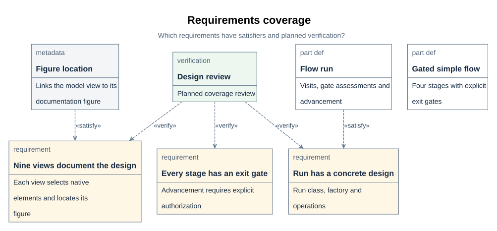

# Verification of requirements

## 1. Verification and acceptance plan

The available verification methods are analysis, demonstration, inspection, and test.
Method, phase, acceptance criterion, and case must be assigned per requirement before a
requirements baseline can be frozen. The table names current coverage without treating a
declared case or a clean compiler result as an executed acceptance test.

| Scope | Method and phase | Evidence or case | Acceptance state |
| --- | --- | --- | --- |
| SysML syntax and supported references | Automated analysis at design delivery | pinned compiler `parse` and `check`, including model-only check ([T02](../architecture/constraints.md#t02)) | Executed for design-stage wishes; unevaluated rules remain |
| Documentation locators, embeds, and figure blocks | Automated inspection at documentation design delivery | `tools/check_documentation.py`; [D31](../interfaces/documentation-contract.md#d31) | Executed as a standalone audit, not a workflow gate |
| Nine primary figure presentation | Measured inspection and visual review at design delivery | `DiagramPresentationReview`; [V06](../records/wishes/wish-history.md#v06) | Historical presentation review recorded |
| SimpleFlow structure and behavior | Planned design review | `SimpleFlowViewReview` | Case declared in the model; no standalone passed case result |
| Six documentation-contract requirements | Planned design review | `DocumentationContractReview`; [V07](../records/wishes/wish-history.md#v07) | Case declared; wish assessment is separate from case execution |
| Three Rust UML design requirements | Planned design review | `RustUmlDesignReview`; [D52](../design/flows/simple-flow/views.md#d52) | Case declared; no standalone passed case result |
| SimpleFlow gate, recovery, and file-plan behavior | Executable verification for the first implementation slice | `SimpleFlowGateBehaviorVerification`, `SimpleFlowRecoveryVerification`, `SimpleFlowFilePlanVerification`; [D54](design.md#d54) | Gate and recovery behavior tested in [P08](../records/executions/simple-flow.md#p08) and [P12](../records/reviews/simple-flow-fixes.md#p12); named model cases are declarations, not separately executed case records |
| Runtime gate and record conformance | Scripted test and inspection of local SimpleFlow run | four checks in [D06–D07](../design/flows/simple-flow/definition.md#d06) | Commands, Rust adapter tests, and a four-stage demo executed for this slice ([P08](../records/executions/simple-flow.md#p08), [P12](../records/reviews/simple-flow-fixes.md#p12)); VModel integration and project acceptance remain open |

Acceptance of a wish is recorded by that wish's applicable stage assessment at a stated
artifact revision. It does not freeze the project's entire requirements baseline.

### 1.1 Requirements: satisfaction and planned verification

> **Figure D15-1 — Requirements trace.**  
> **Question:** Which selected requirements are satisfied by design elements and planned for review?  
> **Model view:** `XDesignDetailedDesign::requirementsDiagram`, a focused requirement and relationship projection.  
> **Companions:** [R01](../requirements/requirements.md#r01) for the full baseline and [R02](../requirements/requirements.md#r02) for satisfaction links.  
> **Status:** renderable-now; design reviewed.  
> **Reading:** Three requirements connect to their satisfiers and to `SimpleFlowViewReview`. Distinct edge labels separate a design answer from a planned verification case.  
> **Limits:** The selected subset and planned review do not imply passed verification or coverage of every requirement.

`requirementsDiagram` selects three detailed-design requirements, their satisfaction links,
and `XDesignVerification::SimpleFlowViewReview`. The requirements remain declared in
`XDesignRequirements`; their satisfiers remain project-level relationships in
`XDesignTraceability`. The independent wish trace records why wish-0006 produced this
design ([R02](../requirements/requirements.md#r02)).

| Requirement | Selected satisfier | Planned verification case |
| --- | --- | --- |
| `flowRunIsRealizedByDesign` | `SimpleFlowRun` | `SimpleFlowViewReview` |
| `designedFlowGatesEveryStage` | `designedSimpleFlow` | `SimpleFlowViewReview` |
| `structureGraphsAreDocumented` | `DocFigure` | `SimpleFlowViewReview` |

Short captions identify the three requirements without displaying their complete
rationales inside boxes. Satisfaction and verification labels distinguish the two kinds
of relationship; the planned review remains distinct from a recorded assessment.

The planned design review checks these three obligations through the nine coordinated
views, their source elements, and their documentation. The other detailed-design
requirements remain in the requirements baseline; this focused view does not add
verification coverage for them. A satisfaction relationship identifies the design that
answers a requirement. A verification relationship identifies the case intended to
establish it; neither relationship alone records a passed result.

Compiler parse/check reports establish the supported syntactic checks. Semantic review
must assess whether the design answers the wish, including blocked and rework behavior.
Application execution, checker conformance, and engineering validation need their own
evidence when implemented ([V05](../records/wishes/wish-history.md#v05)).
